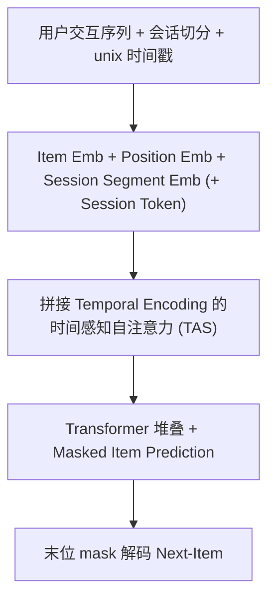
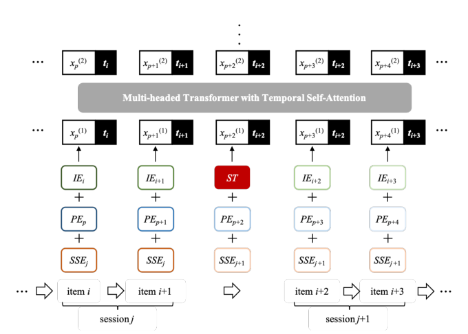

# Exploiting Session Information in BERT-based Session-aware Sequential Recommendation (在基于 BERT 的会话感知序列推荐中显式利用会话信息)

- **会议/期刊**: SIGIR 2022 (Short Paper)
- **作者与机构**: Jinseok Seol, Youngrok Ko, Sang-goo Lee (首尔大学)
- **推荐链路定位**: 精排 / 端到端序列打分（Next-Item Prediction）
- **研究方向**: 序列与会话推荐 / 自监督与掩码建模
- **论文原文**: [https://arxiv.org/abs/2204.10851v3](https://arxiv.org/abs/2204.10851v3)
- **开源代码**: [https://github.com/theeluwin/session-aware-bert4rec](https://github.com/theeluwin/session-aware-bert4rec)

## TL;DR (1分钟核心速览)

会话感知推荐此前依赖层次 RNN、会话图或双通道长短期解耦网络，结构复杂且参数膨胀。本文不改 BERT4Rec 主干，只在**输入层**插入三个轻量插件：会话分隔 Token (ST)、会话段嵌入 (SSE) 与时间感知自注意力 (TSA)，用约 0.1% 的额外参数把「会话边界 + 绝对时间」注入掩码语言模型。在 Steam/ML-1M/ML-20M 上采用 Leave-One-Out + 全库排序协议，ML-1M 的 NDCG@10 相对 BERT4Rec 提升 **55.5%**（0.0508→0.0790），Steam 提升 8.7%。

## Background & Motivation (背景与核心矛盾)

- **主流范式**: 序列推荐直接照搬 NLP 的 Transformer/BERT 范式和用户全部历史拍平成一条长序列，位置嵌入只编码「第几个物品」。
- **前人局限**: ①真实业务中的交互按会话（session）分段，同一会话内偏好同质、跨会话偏好漂移，纯长序列建模无法区分"上一次会话的兴趣"与"这一次会话的兴趣"；②现有 session-aware 方案（层次结构 HPM、会话图、多会话关系建模）虽显式刻画会话，但网络层次堆叠、参数量与训练成本大幅上升。
- **核心洞察 (Key Insight)**: 会话信息本质是一种**结构先验（structural prior）**，NLP 中区分句子用的是 segment embedding，而 BERT4Rec 的位置嵌入与掩码机制恰好留出了「额外嵌入位」与「待预测位置的上下文槽位」，因此无需新网络层即可承载会话层级。
- **本文切入点**: 把会话边界当作"句子边界"、把时间戳当作"额外的注意力偏置"，全部塞进输入表示与注意力打分，主干 Transformer 一层不改。

## Method (核心方法设计)

### 1. 整体框架 (Overall Architecture)

输入为用户最近 $L$个交互（ML-1M/ML-20M/Steam 分别取$L=200/100/15$，仅保留最近 200 物品、≥2 会话、每会话 ≥2 物品）。每个物品的表示由三部分相加：物品嵌入$IE_i$、BERT 位置嵌入$PE_p$、会话段嵌入$SSE_j$；会话之间插入可学习 Session Token，并把时间戳编码为$TE(t)$ 后与隐表示拼接送入每一层 Multi-Head Attention。训练沿用 BERT4Rec 的掩码物品预测（随机 mask 一个位置），推理时把末位 token 置为 mask 预测下一物品。相较 SASRec 的自回归解码，本文的 ST/SSE/TE 在**推理阶段同样对目标位置可用**，这是其结构性优势。

<figure class="paper-figure" markdown="span">
  <figcaption>图1：模型架构的输入层，展示所提出的方法：会话标记（ST）、会话段嵌入（SSE）和时间自注意力（TAS）。</figcaption>
</figure>

### 2. 关键设计拆解 (Key Designs)

1. **Session Token (ST)**：痛点是最朴素的会话切分只能靠 padding 或截断，padding 又被注意力屏蔽、无法传递"新会话开始"的信号。做法是在会话间插入一个与物品嵌入同维的可学习 token，**不参与 mask 排除**，并顺带让其后所有物品的位置嵌入整体后移一位。效果上等价于一个可学习的硬分隔符，且推理时可显式标注"当前输入属于新会话"，只需 $+1$ 个物品向量的参数。
2. **Session Segment Embedding (SSE)**：位置嵌入 $PE_p$只描述会话内序号，无法表达"这是历史上第几个会话"。借鉴 BERT 句子段嵌入，为第$j$个会话（按最近顺序取$j\le m$，$m$为最大会话段数）加一个可学习向量，形成层级位置编码：$x = IE_i + PE_p + SSE_j$。它把"会话序号"与"会话内序号"解耦为正交的两维坐标，使模型可隐式学到「近期会话权重更高」的长短期偏好，代价仅$m$ 个向量。
3. **Temporal Self-Attention (TSA/TAS) + 训练目标**：unix 时间戳量纲巨大，手工特征工程（分桶、三角函数）易失真。本文采用可学习的时间编码 $TE(t)=[\cos(\omega_1 t+\theta_1),\dots,\cos(\omega_{d_T}t+\theta_{d_T})]^\top$（$\omega_i,\theta_i$ 可学习），并与输入拼接后统一进注意力：

$$\mathrm{TAS}(X,T)=\mathrm{softmax}\!\left(\frac{[X\,T][X\,T]^\top}{\sqrt{d_X+d_T}}\right)X,\quad a_{ij}=x_i^\top x_j+TE(t_i)^\top TE(t_j)$$

即注意力权重 = 内容相关性 + 时间相关性之和，且 $TE$逐层逐头拼接（实验发现逐层独立训练无显著收益，故共享）。训练目标为标准 masked item softmax 交叉熵$\mathcal{L}=-\sum\log p(i_{\text{mask}}\mid \mathcal{S})$，**无需显式负采样**（softmax 全库归一化），在线推理仅一次前向。三者全开时参数增量约 0.1%（如 ML-20M：9,464,272 → 9,482,576）。

## Experimental Setup & Evaluation Protocol (实验设置与评估协议)

- **数据集与预处理**: 按 SASRec 惯例，交互频次 $\le 5$的物品与历史长度$\le 5$ 的用户被过滤（`5-core`）；**会话切分规则为 1 天无活动即断会话**，并强制每用户 ≥2 会话、每会话 ≥2 物品。

| 数据集 | #Users | #Items | #Interactions | 密度 | 场景说明 |
| :--- | :---: | :---: | :---: | :---: | :--- |
| Steam | 6,330 | 4,331 | 49,163 | 0.18% | 游戏购买，极稀疏、会话极短（item/session $Q_2$=3） |
| ML-1M | 1,196 | 3,327 | 158,498 | 3.98% | 电影评分，稠密、长会话（item/session $Q_2$=26） |
| ML-20M | 23,404 | 12,239 | 1,981,866 | 0.69% | 大规模电影评分，中等会话长度 |

- **数据划分与防穿越 (Splitting Strategy)**: `Leave-One-Out`（每用户最后 1 个物品作测试、倒数第 2 个作验证、其余训练），**验证集物品在测试时被放回候选池**，避免候选集被人为缩小。
- **排名评测协议 (Ranking Protocol)**: 三种并列报告 —— ①`Sampled Ranking`（Ran.，每用户随机采 100 个未交互负样本，正负比 1:100）；②`Popular Ranking`（Pop.，按热度排序取负样本，构成 hard negative）；③`Full-Ranking`（All，全库未交互物品排序）。作者明确承认随机负样本是有偏采样，故以 All 协议为主证据。
- **对比基线与超参**: 基线为 SASRec 与 BERT4Rec（均为原文重实现，非引用数值）；grid search 搜索 $d\in\{8,\dots,256\}$、mask 概率$\{0.05,\dots,0.3\}$、头数$\{1,2,4,8\}$、最大会话段$\{2,\dots,5\}$、时间维$d_T\in\{8,\dots,64\}$；AdamW + Titan Xp。

## Key Experimental Results (实验关键数据)

### 1. 主实验对比 (Main Results)

全库排序（All）下的 R@10 / N@10（其余两种协议原文表格更完整，此处取最具判别力的列）：

| Model | Steam R@10 | Steam N@10 | ML-1M R@10 | ML-1M N@10 | ML-20M R@10 | ML-20M N@10 |
| :--- | :---: | :---: | :---: | :---: | :---: | :---: |
| SASRec | 0.5164 | 0.4610 | 0.1480 | 0.0742 | 0.1489 | 0.0807 |
| BERT4Rec | 0.5313 | 0.4782 | 0.1129 | 0.0508 | 0.1381 | 0.0724 |
| + ST | 0.5578 | **0.5199** | 0.1338 | 0.0618 | 0.1436 | 0.0750 |
| + SSE | 0.5528 | 0.5138 | 0.1455 | 0.0678 | 0.1450 | 0.0740 |
| + TSA | 0.5577 | 0.5179 | **0.1522** | **0.0790** | 0.1439 | 0.0754 |
| + ST + TSA | **0.5616** | 0.5187 | 0.1564 | 0.0728 | **0.1499** | **0.0790** |
| Improv. (best vs BERT4Rec) | **+5.7%** | **+8.7%** | **+38.5%** | **+55.5%** | **+8.5%** | **+9.1%** |

### 2. 消融实验 (Ablation Study)

| 组合 | Steam R@10 All | Steam N@10 All | ML-1M R@10 All | ML-1M N@10 All |
| :--- | :---: | :---: | :---: | :---: |
| BERT4Rec (w/o all) | 0.5313 | 0.4782 | 0.1129 | 0.0508 |
| + ST + SSE | 0.5558 | 0.5147 | 0.1497 | 0.0739 |
| + SSE + TSA | 0.5566 | 0.5181 | 0.1513 | 0.0704 |
| + ST + SSE + TSA | 0.5581 | 0.5118 | 0.1505 | 0.0701 |

### 3. 关键实验发现 (Key Findings)

1. **单插件优于全叠加**：三件套同时开启反而在 Steam（0.5616→0.5581）与 ML-1M N@10（0.0790→0.0701）出现回落，说明 ST/SSE 与 TSA 各自承载的"会话位置信号"存在冗余，冗余信号在稀疏的小数据（Steam 仅 4.9 万条）上会互相干扰；最佳组合应逐数据集选取。
2. **全库排序放大了会话先验的价值**：随机 100 负样本下增益温和（ML-1M R@10 0.7341→0.7533），但切到 All 协议后 BERT4Rec 基线本身崩到 0.1129，本文方法拉回 0.1564（+38.5%），说明会话边界主要在"抗热门偏置、抑制跨会话兴趣污染"上起作用——即 hard-negative 场景才是其真实战场。
3. **SSE 在长会话稠密数据更有效、ST 在超短会话更有效**：ML-1M 的 item/session 中位数 26，SSE 的层级序号收益明显（Pop. R@10 0.5025→0.5109）；Steam 中位会话仅 3 个物品，ST 的硬分隔符更鲁棒（Pop. R@10 0.5670→0.6033，+6.4%，为全部单插件最高）。此外会话段数 $m$ 需超过数据实际会话数阈值才能在全库指标上获得显著收益。

## Highlights & Limitations (亮点、对比与审稿批判)

- **与代表作对比 (vs. Prior Work)**: 相较 HPM 等层次 RNN 与会话图模型（显式构建会话节点/边、多跳聚合），本文完全放弃结构建模，只在输入层加三个嵌入；相较 BERT4Rec 与 SASRec，本文的关键差异在于掩码式（双向）解码让 ST/SSE/TE 在推理时对目标位置可见，自回归模型则无法享受此性质；相较 TiSASRec 类时间建模，本文用可学习 $\cos(\omega t+\theta)$ 替代分桶/三角核，免去时间特征工程。
- **可迁移亮点**: ①"段嵌入 + 层级位置"这套零成本结构先验可平移到任何 Transformer 序列推荐（跨域场景、跨设备序列、多行为类型序列）；②将三者并列评测于随机/热门/全库三种负样本协议，是低成本自检评估偏置的范式，可直接复用到其他精排论文。
- **审稿级局限批判**: ①基线仅 SASRec 与 BERT4Rec 两个，缺少与 session-aware 专模（如 HPM、CSRM、DHAN）的直接数值对比，"轻量但有效"的论断说服力受限；②作者自承在 Amazon、LastFM、RetailRocket、Diginetica 上无法复现增益，说明方法对每用户会话数/每会话物品数的分布高度敏感，泛化边界未刻画清楚；③时间维 $d_T$需逐数据集调参（ML-1M 与 Steam 最优值不同），且$TE$ 全层共享与逐层独立的对比只给了定性结论，缺少延迟/吞吐的工程测量。

## Rating (四维评分)

- **方法创新性 (Novelty)**: ⭐⭐⭐ （把 NLP 的 segment embedding 与时间核注意力"搬运"到会话推荐，思路朴素但契合掩码式解码的推理结构，缺少理论或谱分析支撑）
- **评估协议与实验扎实度 (Protocol & Experiments)**: ⭐⭐⭐⭐ （Leave-One-Out + 随机/热门/全库三协议并列，主动暴露随机负样本偏差，消融覆盖全组合；但基线数量偏少且无显著性检验）
- **写作与数学规范度 (Clarity & Rigor)**: ⭐⭐⭐⭐ （6 页短文公式极简清晰，$a_{ij}$ 分解为内容项 + 时间项的推导一目了然；ST/SSE 的交互作用仅有经验结论，缺机制解释）
- **工业落地与复现价值 (Industrial & Practical Value)**: ⭐⭐⭐⭐⭐ （0.1% 参数增量、代码与预处理全开源、无需负采样、单次前向推理，是极少见的"近乎零成本可上线"改进）

