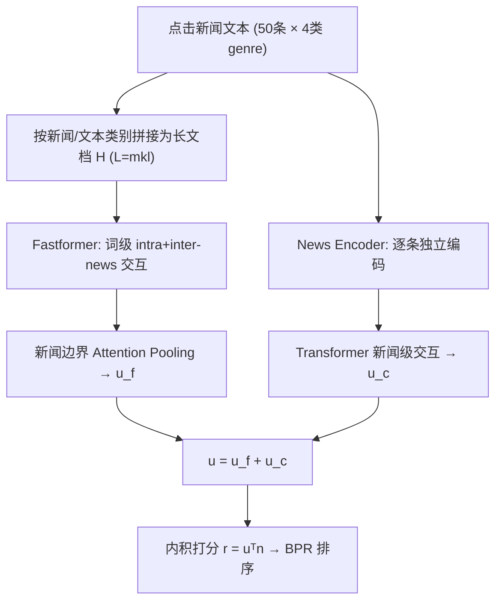
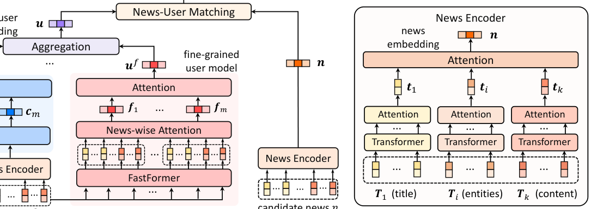

# FUM: Fine-grained and Fast User Modeling for News Recommendation (细粒度快速用户建模的新闻推荐)

- **会议/期刊**: SIGIR 2022 (Short Paper)
- **作者与机构**: Tao Qi、Chuhan Wu、Yongfeng Huang (清华大学电子工程系)；Fangzhao Wu (微软亚洲研究院，通讯作者)
- **推荐链路定位**: 召回 (User–News Matching，用户/新闻表征可离线缓存)
- **研究方向**: 序列与会话推荐 / 新闻推荐中的用户兴趣建模
- **论文原文**: [https://arxiv.org/abs/2204.04727v1](https://arxiv.org/abs/2204.04727v1)
- **开源代码**: [https://github.com/taoqi98/FUM](https://github.com/taoqi98/FUM)

## TL;DR (1分钟核心速览)

新闻推荐的常规范式是“先独立编码每条点击新闻 → 再聚合为兴趣向量”，其致命缺陷是把不同新闻之间的**词级关联**彻底切断。FUM 反其道而行：把用户近 50 条点击新闻的全部文本（标题/摘要/实体描述/主题标签）**首尾拼接为一条超长文档**，将用户建模直接改写为文档建模，用线性复杂度的 Fastformer 同时捕获 intra-news 与 inter-news 词级交互，再与一条新闻级 Transformer 粗粒度通路相加融合。在 MIND / Feeds 上 AUC 相对 LSTUR 提升 **2.16% / 2.48%**，nDCG@5 提升 **3.12% / 3.61%**，而 1k 样本推理仅 2.75s（FIM 需 350.38s），且用户表征可离线缓存。

## Background & Motivation (背景与核心矛盾)

- **主流范式**: NRMS/LSTUR/NAML 等先对每条点击新闻独立 self-attention 编码得到 $\mathbf{n}_i$，再用 attention/GRU 聚合为$\mathbf{u}$，本质是**两级分离**的“先编码后聚合”。
- **前人局限一（信息瓶颈）**: 新闻被压成单一向量后再聚合，跨新闻的细粒度语义关联在第一步编码时即被丢弃——例如“Iron Man”与“movies”、“Adele”与“songs”这类跨新闻词对，是推断兴趣的关键线索，但两级范式无从建模。
- **前人局限二（效率悖论）**: 若天真地把拼接文档喂给 vanilla Transformer，$L=mkl$可达数千 token（50 条 × 4 类文本 × 数十词），$O(L^2)$ 自注意力在训练与在线推理上都不可承受。
- **核心洞察 (Key Insight)**: 用户历史本质是一篇“关于该用户的长文档”，文档内部的词级共现即兴趣证据；只要解决长序列建模的效率问题，细粒度交互可以廉价获得。
- **本文切入点**: 拼接 + 高效 Transformer (Fastformer) 做细粒度通路，并保留一条新闻级粗粒度通路做互补融合，形成“粗细双路”用户表征。

## Method (核心方法设计)

### 1. 整体框架 (Overall Architecture)

输入为用户 $u$最近$m=50$条点击新闻，每条新闻含$k$类文本 genre（标题、摘要、实体描述、主题标签）。**细粒度通路**：各类文本先经 genre-specific embedding 层得到$\mathbf{T}_i^j$，按$[\mathbf{T}_1^1;\dots;\mathbf{T}_1^k;\dots;\mathbf{T}_m^k]$拼接为长序列，叠加 genre embedding 与 position embedding 得行为序列$\mathbf{H}\in\mathbb{R}^{L\times g}$，送入 Fastformer 得到上下文词表征，再按新闻边界做 attention pooling 得$\mathbf{f}_i$，最后聚合为$\mathbf{u}_f$。**粗粒度通路**：同一 News Encoder（Transformer + Attention）独立编码每条新闻为$\mathbf{n}_i$，经 Transformer 建模新闻级交互得$\mathbf{c}_i$，聚合为$\mathbf{u}_c$。最终$\mathbf{u}=\mathbf{u}_f+\mathbf{u}_c$，与候选新闻做内积打分，BPR 训练，按分数排序。两条通路的新闻/用户向量均可离线预计算缓存。

<figure class="paper-figure" markdown="span">
  <figcaption>图 2：用于新闻推荐的 FUM 框架。</figcaption>
</figure>

### 2. 关键设计拆解 (Key Designs)

1. **长文档化用户建模 (User-as-Document)**：痛点是跨新闻词级线索被两级范式切断；做法是把 $m$条新闻的$k$类文本直接拼接为$\mathbf{T}=[\mathbf{T}_1^1;\dots;\mathbf{T}_1^k;\dots;\mathbf{T}_m^1;\dots;\mathbf{T}_m^k]\in\mathbb{R}^{mkl\times d}$，使同一条自注意力序列里任意两个词（无论是否同属一条新闻）都能直接交互。直觉：把“新闻→向量→用户”的两次有损压缩合并为一次无损序列建模，词级共现不再被新闻边界阻断。
2. **Fastformer 线性复杂度交互**：痛点 $O(L^2)$ 使长文档不可行；Fastformer 先用 attention pooling 把全局上下文压成查询向量，再以逐元素乘积调制每个 token：
$\mathbf{q}=\mathrm{Att}(q_1,\dots,q_L),\ q_i=\mathbf{W}_q\mathbf{h}_i$，$\mathbf{k}=\mathrm{Att}(\mathbf{q}\ast k_1,\dots,\mathbf{q}\ast k_L)$，$\hat{\mathbf{h}}_i=\mathbf{W}_o(\mathbf{k}\ast v_i)$。
直觉：全局上下文只需一个 $d$维摘要$\mathbf{q}$即可调制所有 token，把 token 间两两打分降级为“token ↔ 全局摘要”，复杂度从$O(L^2)$降至$O(L)$，使$L\approx$ 数千的文档真正可训。
3. **粗细双路融合与训练目标**：细粒度序列把新闻边界“抹平”，会削弱单条新闻内部的结构信息；粗粒度通路（新闻级 Transformer + attention 聚合）恰好补回 intra-news 语义。两路等权相加 $\mathbf{u}=\mathbf{u}_f+\mathbf{u}_c$，无需门控，零额外超参。训练用 BPR：$\mathcal{L}=-\frac{1}{|\mathcal{D}|}\sum_{i=1}^{|\mathcal{D}|}\log\sigma(r_{c_i}-r_{n_i})$，负样本取自同一 impression 内的未点击新闻（in-impression 采样，无额外 hard negative 挖掘），打分$r=\mathbf{u}^{\top}\mathbf{n}$；无交叉特征、无 ID embedding，在线仅需一次内积 + ANN 检索。

## Experimental Setup & Evaluation Protocol (实验设置与评估协议)

- **数据集与预处理**: 论文仅报告 impression 规模，未披露用户/新闻精确统计（下表以公开版 MIND 量级标注，Feeds 为微软新闻流 13 周采样）：

| 数据集 | #Users | #Items | #Interactions | 稀疏度/密度 | 特征/场景说明 |
| :--- | :---: | :---: | :---: | :---: | :--- |
| MIND | ≈1M（公开版） | ≈16万（公开版） | 论文未报告总量 | — | 微软新闻用户采样；英文新闻，含标题/摘要/实体/主题 |
| Feeds | 论文未报告 | 论文未报告 | 20万(前10周训练+验证) + 10万(后3周测试) | — | 微软新闻流平台 2020-01-23 至 04-01，共 13 周 |

- **数据划分与防穿越 (Splitting Strategy)**: **全局时间戳切分**——Feeds 取前 10 周做训练/验证、后 3 周做测试，严格按时间防穿越；MIND 沿用官方划分。用户历史取最近 50 条点击，超长截断、不足补齐。
- **排名评测协议 (Ranking Protocol)**: **Impression-level 候选集排序**（每条曝光仅 1 条正样本 + 该 impression 内若干未点击新闻），属**采样排序而非 Full-Ranking 全库排序**，指标 AUC / MRR / nDCG@5 / nDCG@10；训练负采样同为 impression 内未点击新闻。
- **对比基线与超参设置**: 基线覆盖 4 类——RNN 类 (GRU、LSTUR)、注意力类 (NPA、NAML、NRMS)、知识图谱类 (DKN、KRED、GNewsRec)、细粒度匹配类 (FIM)。词向量 300 维 GloVe 并微调；Transformer/Fastformer 均为 20 头 × 20 维；Adam，lr=1e-4，训练 2 epoch；结果取 5 次重复的均值±标准差，t-test 显著性 $p<0.001$。

## Key Experimental Results (实验关键数据)

### 1. 主实验对比 (Main Results)

| 模型 | MIND AUC | MIND MRR | MIND nDCG@5 | MIND nDCG@10 | Feeds AUC | Feeds MRR | Feeds nDCG@5 | Feeds nDCG@10 |
| :--- | :---: | :---: | :---: | :---: | :---: | :---: | :---: | :---: |
| GRU | 65.47 | 31.15 | 33.64 | 39.34 | 62.95 | 27.57 | 31.55 | 37.18 |
| DKN | 67.19 | 32.97 | 35.87 | 41.53 | 64.02 | 28.65 | 32.97 | 38.54 |
| NPA | 67.42 | 32.97 | 35.90 | 41.54 | 64.83 | 29.21 | 33.64 | 39.18 |
| KRED | 67.77 | 33.39 | 36.34 | 42.04 | 64.92 | 29.27 | 33.71 | 39.25 |
| NAML | 68.16 | 33.31 | 36.26 | 41.94 | 65.31 | 29.47 | 33.99 | 39.57 |
| NRMS | 68.33 | 33.55 | 36.53 | 42.18 | 65.21 | 29.39 | 33.87 | 39.46 |
| LSTUR | 68.53 | 33.58 | 36.54 | 42.23 | 65.31 | 29.54 | 34.08 | 39.63 |
| FIM | 68.15 | 33.36 | 36.38 | 42.02 | 65.47 | 29.62 | 34.19 | 39.72 |
| **FUM** | **70.01** | **34.51** | **37.68** | **43.38** | **66.93** | **30.49** | **35.31** | **40.87** |
| **Improv.%** | **+2.16%** | **+2.77%** | **+3.12%** | **+2.72%** | **+2.23%** | **+2.94%** | **+3.28%** | **+2.89%** |

（Improv.% 为相对各数据集最强基线：MIND 取 LSTUR，Feeds 取 FIM；全部 $p<0.001$。）

### 2. 消融实验 (Ablation Study)

原文 Fig. 3 仅以柱状图给出（AUC 轴范围 67.0–70.2），未列具体数值，此处按趋势整理：

| 配置 | AUC 趋势 | 说明 |
| :--- | :---: | :--- |
| FUM (完整) | 最高 | 双路融合，MIND AUC 70.01 |
| w/o fine-grained (仅粗粒度) | 显著下降 | 失去跨新闻词级线索，跌幅最大 |
| w/o coarse-grained (仅细粒度) | 下降（跌幅小于上行） | 失去 intra-news 结构信息 |

**效率对比（MIND，1k 样本）**：

| 指标 | NAML | NRMS | FIM | FUM |
| :--- | :---: | :---: | :---: | :---: |
| 训练时间 (s) | 7.98 | 11.39 | 15.85 | 13.21 |
| 推理时间 (s) | 1.23 | 2.16 | 350.38 | 2.75 |
| 可缓存 (Cacheable) | ✓ | ✓ | ✗ | ✓ |

### 3. 关键实验发现 (Key Findings)

1. **细粒度是主要增益源，但非唯一源**：去掉细粒度通路后 AUC 从 70.01 大幅回落，验证跨新闻词级交互确为信息增量；然而“仅细粒度”反而弱于“仅粗粒度”，说明长文档拼接抹平新闻边界后，intra-news 结构仍需粗粒度通路补偿，双路相加是必要而非锦上添花。
2. **细粒度建模不必以延迟为代价**：FIM 同样引入细粒度匹配，但推理 350.38s/1k 且不可缓存（需在线跑 CNN 匹配），比 FUM 慢 **127 倍**；FUM 借 Fastformer 的 $O(L)$ 复杂度把推理压到 2.75s，与 NRMS (2.16s) 同量级，且用户向量可离线缓存，符合真实系统的严格在线时延约束。
3. **高效 Transformer 的选型直接决定可用性**：替换为 Longformer / PoolingFormer 后 FUM 仍稳定优于所有基线（说明细粒度建模本身有效，与具体骨干无关），但训练/推理开销明显更高；Fastformer 在精度与效率的帕累托前沿上最优，是本文选择它的实证依据。

## Highlights & Limitations (亮点、对比与审稿批判)

- **与代表作对比 (vs. Prior Work)**: ① vs **NRMS/LSTUR**：它们止步于新闻级聚合，FUM 把交互粒度下沉到词级；② vs **FIM**：FIM 虽也做细粒度，但走“新闻文本 ↔ 阅读历史”的 pairwise CNN 匹配，代价是 350s 级推理且不可缓存，FUM 改为一次性长文档自注意力，效率高两个数量级；③ vs **DKN/KRED/GNewsRec**：后者靠知识图谱/图网络引入外部语义，FUM 不引入任何外部结构，仅靠历史文本内部交互即超越，工程成本更低。
- **可迁移亮点**: ① “把用户行为序列拼成一条长文档 + 高效 Transformer” 是通用套路，可直接迁移到短视频标题/商品标题序列、搜索 query 序列的细粒度兴趣建模；② genre + position 双 embedding 叠加，解决了多字段拼接后“字段来源与顺序”混淆的问题，可复用于多字段 CTR 特征拼接。
- **审稿级局限批判**: ① **评测协议偏弱**：仅做 impression 内采样排序，未报告 Full-Ranking 全库结果，且 MIND/Feeds 均来自微软同一平台，跨域泛化性未知；② **效率结论有保留**：$L=mkl$随历史长度线性膨胀，若$m$从 50 增至数百，Fastformer 的$O(L)$ 常数项与显存仍会成瓶颈，论文只测了 1k/10k 样本，未给出线上 QPS 与尾延迟；③ 消融仅以柱状图呈现、无具体数值与方差，且“细粒度单路弱于粗粒度单路”这一反常现象作者仅一句“可能因为 intra-news 交互无法被充分利用”带过，缺乏深入分析；④ 融合方式为无参相加，未验证门控/自适应加权是否更优。

## Rating (四维评分)

- **方法创新性 (Novelty)**: ⭐⭐⭐⭐ （“用户建模 = 文档建模”的视角转换简洁有力，但本质是拼接 + 现成 Fastformer 的组合式创新，缺乏理论刻画）
- **评估协议与实验扎实度 (Protocol & Experiments)**: ⭐⭐⭐ （9 个基线、5 次重复 + $p<0.001$ 显著性、含效率与骨干替换实验，但仅采样排序、无 Full-Ranking、消融无具体数值）
- **写作与数学规范度 (Clarity & Rigor)**: ⭐⭐⭐⭐ （5 页短文结构清晰、公式精炼，但 Fastformer 公式中 $\mathbf{q}\ast k_i$ 的维度对齐与 attention pooling 细节交代略简）
- **工业落地与复现价值 (Industrial & Practical Value)**: ⭐⭐⭐⭐⭐ （代码开源、无外部知识依赖、用户向量可离线缓存、推理与 NRMS 同量级，是可直接上线的轻量改造方案）

