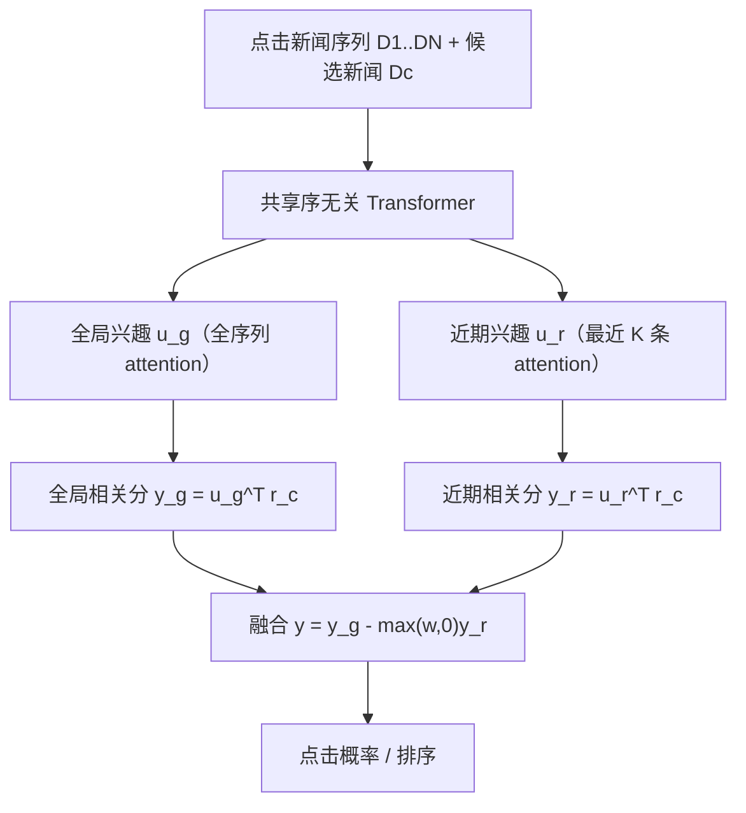
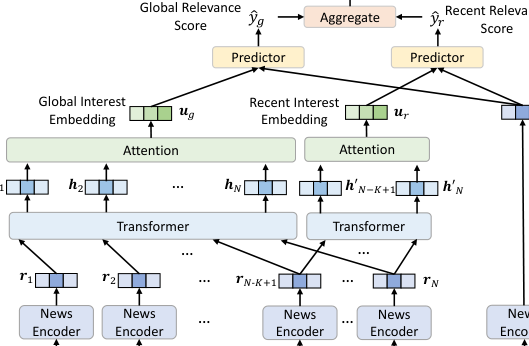

# Is News Recommendation a Sequential Recommendation Task? (新闻推荐是一个序列推荐任务吗？)

- **会议/期刊**: SIGIR 2022
- **作者与机构**: Chuhan Wu, Fangzhao Wu, Tao Qi, Yongfeng Huang；清华大学电子工程系 & 微软亚洲研究院
- **推荐链路定位**: 精排
- **研究方向**: 序列与会话推荐
- **论文原文**: [论文原文链接](https://arxiv.org/abs/2108.08984v2)
- **开源代码**: 暂未开源

## TL;DR (1分钟核心速览)

针对新闻推荐被默认建模为序列任务、但用户对新闻有时间多样性偏好的矛盾，本文用逆序/随机打乱与位置编码实验证伪短时依赖假设，提出双序无关 Transformer 分别建模全局与近期兴趣，并以可学习负近期相关项惩罚与刚点击新闻相似的候选；在 MIND/News 曝光排序上 AUC 最高提升 0.68，nDCG@10 提升 0.67。

## Background & Motivation (背景与核心矛盾)

- **主流范式**: 现有新闻推荐多用 GRU/LSTM/Transformer 编码点击新闻序列，学习用户兴趣后与候选新闻做相关性匹配。
- **前人局限**: 这些方法继承序列推荐的核心假设——历史行为存在丰富短时依赖，近期点击更能预测下一次点击；但新闻消费具有强时间多样性，用户未必连续点击相似新闻。
- **核心洞察 (Key Insight)**: MIND 中仅 7.2% 相邻点击新闻同主题（随机点击为 7.9%），仅 0.04% 相邻点击共享实体（随机为 0.11%）；相邻新闻反而更多样，直接违背“近期相似性”假设。
- **本文切入点**: 不再强化顺序建模，而是用顺序无关 Transformer 学习全局兴趣，并显式惩罚候选与近期点击的相似度，以贴合新闻的时间多样性。

## Method (核心方法设计)

### 1. 整体框架 (Overall Architecture)

TempRec 保留“新闻编码器 + 用户兴趣建模 + 候选打分”框架，但将序列模型替换为两个共享参数的顺序无关 Transformer：一个处理全部点击新闻，经注意力池化得到全局兴趣 \(u_g\)；另一个只处理最近 \(K\) 条点击，得到近期兴趣 \(u_r\)。候选新闻编码为 \(r_c\) 后，分别计算全局相关分与近期相关分，再用可学习权重 \(w\) 做“全局正相关 − 近期相似惩罚”的融合，最终经 Sigmoid 输出点击概率并排序。训练沿用曝光日志负采样与交叉熵，推理时用户侧兴趣可离线预计算，在线仅需候选编码与内积。

图2 给出 TempRec 的双分支架构与打分融合方式。

<figure class="paper-figure" markdown="span">
  <figcaption>图2：TempRec 的架构。</figcaption>
</figure>

### 2. 关键设计拆解 (Key Designs)

1. **共享序无关 Transformer 双兴趣建模**：痛点在于位置编码与因果掩码会强迫模型依赖局部顺序，但新闻点击顺序信息弱。TempRec 去掉位置嵌入、使用双向注意力，并以共享参数分别编码全序列与最近 \(K\) 条，注意力池化为 \(u_g=\sum_i \alpha_i h_i\)、\(u_r=\sum_{j=N-K+1}^{N} \alpha_j h_j\)。这样全局分支捕捉稳定长期兴趣，近分支只提供“最近看过什么”的弱信号，避免把近期相似性误当兴趣延续。
2. **时间多样性感知打分**：若候选与近期点击过相似，用户可能因“刚看过”而不点击。模型将近期相关分作为惩罚项：\(\hat{y}=\hat{y}_g-\max(w,0)\hat{y}_r\)，其中 \(\hat{y}_g=u_g^\top r_c\)，\(\hat{y}_r=u_r^\top r_c\)。\(w\) 可学习且被约束非负，实验学到 0.075/0.083，说明近期点击对未来点击略有负相关，惩罚比奖励更合理。
3. **训练目标、负采样与推理效率**：以曝光未点击为负样本，损失为 \(\mathcal{L}=-\sum [y\log\sigma(\hat{y})+(1-y)\log(1-\sigma(\hat{y}))]\)。负采样来自曝光日志而非全库均匀采样；共享 Transformer 控制参数量，全序列编码可离线缓存，在线开销主要是候选编码与两次内积，适合精排。

## Experimental Setup & Evaluation Protocol (实验设置与评估协议)

- **数据集与预处理**: 使用 MIND 与自建 News 曝光日志，按新闻标题文本建模；统计如下：

| 数据集 | #Users | #News | #Impressions | #Clicks | 平均标题长度 | 平均点击序列长 |
| :--- | :---: | :---: | :---: | :---: | :---: | :---: |
| MIND | 1,000,000 | 161,013 | 15,777,377 | 24,155,470 | 11.52 | 36.72 |
| News | 874,891 | 1,322,973 | 1,000,000 | 41,976,699 | 12.62 | 40.18 |

- **数据划分与防穿越 (Splitting Strategy)**: 全局时间戳切分：最后一周测试、其前一日验证、其余训练；按曝光日志组织候选集，负样本为同次曝光未点击新闻。
- **排名评测协议 (Ranking Protocol)**: 曝光级候选排序（impression-level），非全库 Full-Ranking；报告 AUC、MRR、nDCG@5、nDCG@10，5 次独立实验均值。
- **对比基线与超参设置**: 基线含 LSTUR、DAN、NRMS 及 NRMS+PE/CM 变体；GloVe 初始化，隐藏维度 400，Adam lr=1e-4；显著性用 t-test，\(p<0.05\)。

## Key Experimental Results (实验关键数据)

### 1. 主实验对比 (Main Results)

| 方法 | MIND AUC | MIND nDCG@10 | News AUC | News nDCG@10 |
| :--- | :---: | :---: | :---: | :---: |
| LSTUR | 68.43 | 42.27 | 64.45 | 45.85 |
| LSTUR(random) | 68.76 | 42.55 | 64.67 | 46.03 |
| DAN | 67.96 | 41.95 | 63.92 | 45.46 |
| NRMS | 68.22 | 42.15 | 64.22 | 45.64 |
| NRMS+PE | 68.13 | 42.07 | 64.27 | 45.69 |
| NRMS+CM | 67.67 | 41.74 | 63.87 | 45.36 |
| **TempRec(LSTUR)** | **68.99** | **42.78** | **65.13** | **46.44** |
| TempRec(NRMS) | 68.77 | 42.58 | 64.96 | 46.31 |

相对 LSTUR，TempRec 在 MIND 上 AUC +0.56（0.82%）、nDCG@10 +0.51（1.21%）；News 上 AUC +0.68（1.06%）、nDCG@10 +0.59（1.29%）。相对 NRMS，News 上 nDCG@10 从 45.64 升至 46.31（+1.47%）。

### 2. 消融实验 (Ablation Study)

| 变体（MIND，NRMS 骨干） | AUC | nDCG@10 | 结论 |
| :--- | :---: | :---: | :--- |
| NRMS | 68.22 | 42.15 | 序无关基线 |
| +PE | 68.13 | 42.07 | 位置编码无增益 |
| +Causal Mask | 67.67 | 41.74 | 因果掩码显著变差 |
| +Causal Mask + Random Shuffle | 68.06 | 41.92 | 打乱反升，顺序非必需 |
| TempRec(NRMS) | 68.77 | 42.58 | 双分支+多样性惩罚最优 |

### 3. 关键实验发现 (Key Findings)

1. **顺序信息在新闻推荐中近乎无效**：NRMS 加位置编码降至 68.13，因果掩码降至 67.67；而随机打乱点击序列后，LSTUR 从 68.43 升至 68.76、DAN 从 67.96 升至 68.30，说明短时依赖假设不成立。
2. **时间多样性惩罚稳定增益**：TempRec 在三种骨干上均提升且 \(p<0.05\)；LSTUR 在 News 上 AUC 64.45→65.13、nDCG@10 45.85→46.44，NRMS 在 MIND 上 AUC 68.22→68.77、nDCG@10 42.15→42.58。
3. **近期窗口 \(K\) 与权重 \(w\) 可解释**：\(K=3\) 最优，过大引入无关近期点击、过小无法建模多样性；学到的 \(w=0.075/0.083\) 为正，证明近期相似候选应被轻微降权而非奖励。

## Highlights & Limitations (亮点、对比与审稿批判)

- **与代表作对比 (vs. Prior Work)**: LSTUR/DAN/NRMS 默认序列顺序与短时依赖有效；本文先用逆序、随机打乱、位置编码与因果掩码系统性证伪，再以“全局兴趣 + 近期相似惩罚”替代顺序建模，问题切入比单纯换编码器更本质。
- **可迁移亮点**: 双兴趣分支与“负近期相关”惩罚可直接迁移到短视频、资讯流等强时效、强 novelty 场景；随机打乱序列作为 sanity check 也值得用于检验序列模型是否真正利用顺序。
- **审稿级局限批判**: 评测仅为两家数据集上的曝光级排序，未做全库 Full-Ranking 或在线 A/B；News 数据未开源，\(w\) 与 \(K\) 的跨域稳定性、近期惩罚在冷启动用户上的作用仍需验证。

## Rating (四维评分)

- **方法创新性 (Novelty)**: ⭐⭐⭐⭐ （用实证证伪“新闻=序列推荐”并给出轻量多样性惩罚，机制简单但问题视角新颖）
- **评估协议与实验扎实度 (Protocol & Experiments)**: ⭐⭐⭐ （两数据集、5 次实验与 t-test 充分，但仅曝光级排序、基线类别较少）
- **写作与数学规范度 (Clarity & Rigor)**: ⭐⭐⭐⭐ （假设—证伪—方法—验证链条清晰，公式简洁，符号定义明确）
- **工业落地与复现价值 (Industrial & Practical Value)**: ⭐⭐⭐ （结构轻、易接现有新闻编码器，但无开源代码与线上延迟/收益验证）

