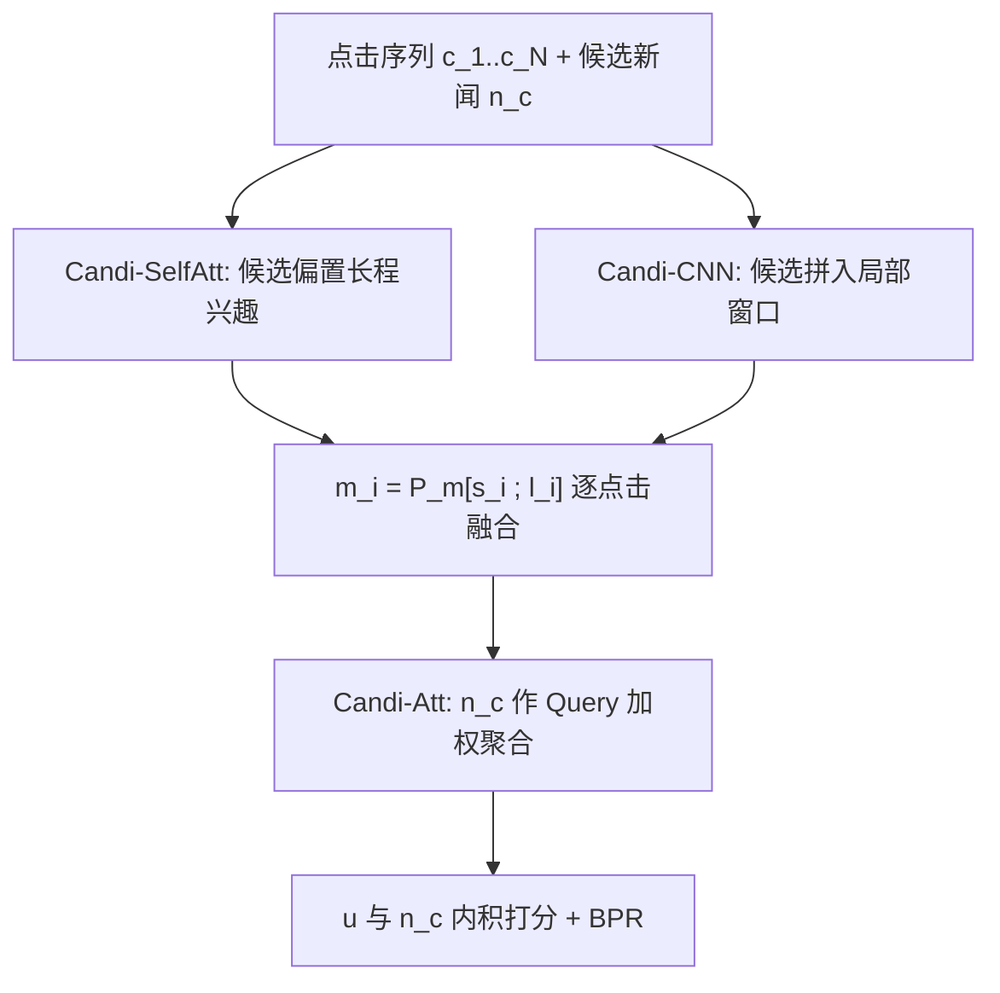

# News Recommendation with Candidate-aware User Modeling (候选感知用户建模的新闻推荐)

- **会议/期刊**: SIGIR 2022 (Short Paper)
- **作者与机构**: Tao Qi, Chuhan Wu, Yongfeng Huang (清华大学电子工程系)；Fangzhao Wu (微软亚洲研究院，通讯作者)
- **推荐链路定位**: 精排（候选集内用户-新闻匹配打分）
- **研究方向**: 序列与会话推荐 / 单塔候选感知用户表征
- **论文原文**: [https://arxiv.org/abs/2204.04726v1](https://arxiv.org/abs/2204.04726v1)
- **开源代码**: [https://github.com/taoqi98/CAUM](https://github.com/taoqi98/CAUM)

## TL;DR (1分钟核心速览)

现有新闻推荐将用户建模与候选新闻解耦（candidate-agnostic）：先由历史点击算出一个固定用户向量 $u$，再用$n_c^\top u$打分。但用户兴趣是多峰的、单条候选只命中其中一峰，固定$u$会把无关兴趣平均进来稀释匹配信号。CAUM 把候选新闻$n_c$作为"探针"注入用户建模三处：用它偏置自注意力打分以筛长期兴趣、拼进 CNN 窗口以筛短期兴趣、用它做注意力 Query 聚合点击序列。MIND/NewsApp 曝光级排序下 AUC 70.04 / 66.44，nDCG@5 相对最强基线提升 4.21% / 1.61%（$p\leq0.001$）。

## Background & Motivation (背景与核心矛盾)

- **主流范式**: NRMS/LSTUR/NAML 等先独立编码新闻（标题 + 实体 + 主题），再由点击序列经自注意力或 GRU 聚合出唯一用户向量 $u$，最后内积匹配候选新闻。
- **前人局限**: ①**兴趣稀释**——用户兴趣跨政治/音乐/体育/旅游多峰，候选新闻只对应其中一峰，与候选无关的历史点击仍被等权（或仅内容自洽）地聚合进 $u$；②**上下文失配**——即使如 DKN/HiFi-Ark 引入候选感知注意力，也只是在"已聚合好的行为表示"上加权，行为间的局部/长程上下文仍是 candidate-agnostic 建模的。
- **核心洞察 (Key Insight)**: 用户兴趣本身是"相对于候选"才可定义的；长程相关（第 1 与第 5 次点击共同刻画政治兴趣）与局部相关（第 12、13 次点击连续刻画威斯康星旅游兴趣）都需由候选新闻来决定"该看哪一段关联"。
- **本文切入点**: 把候选新闻嵌入到用户建模的**三个层次的算子内部**（注意力打分、卷积窗口、聚合 Query），而非仅在末端加权。

## Method (核心方法设计)

### 1. 整体框架 (Overall Architecture)

新闻编码侧沿用 NRMS 式方案：标题自注意力得 $n_t$、实体自注意力得$n_e$、主题嵌入得$n_v$，新闻表示为三者之和$n=n_t+n_e+n_v$（$d=400$）。用户侧输入最近$N$条点击表示$\{c_i\}_{i=1}^N$与候选表示$n_c$，并行送入 Candi-SelfAtt（长程全局兴趣）与 Candi-CNN（局部短期兴趣），两路拼接投影得每条点击的融合上下文$m_i$；再由 Candi-Att 以$n_c$为 Query 对$\{m_i\}$加权得候选相关用户向量$u$，打分$\hat{y}=n_c^\top u$，BPR 成对训练。推理时同一用户对不同候选需重算$u$，但点击间自注意力分数与 CNN 编码可跨候选复用，故开销未随候选数线性爆炸。

### 2. 关键设计拆解 (Key Designs)

1. **Candi-SelfAtt（候选偏置的全局兴趣选择）**：痛点是无差别的自注意力把所有兴趣峰混在一起。做法是在标准自注意力分数上叠加一条"候选—点击"打分项：
$r^k_{i,j}=\underbrace{q_i^\top W^k_r c_j}_{q_i=Q_u c_i}+\underbrace{q_c^\top W^k_r c_j}_{q_c=Q_c n_c}$即同一套头参数$W^k_r$同时度量"点击-点击"与"候选-点击"关联，使$\gamma^k_j=\mathrm{softmax}_j(r^k_{i,j})$在候选引导下偏向与候选同峰的历史点击，输出$l^k_i=W^k_o\sum_j\gamma^k_j c_j$并拼接$K=20$ 头。直觉：候选充当软性的兴趣选择器，把长程相关性的"取景框"缩到候选所在子空间。
2. **Candi-CNN（候选拼入局部窗口的短期兴趣）**：把窗口内相邻点击与候选拼成一个感受野：$s_i=W_c[c_{i-h};\dots;c_i;\dots;c_{i+h};\,n_c]$（窗口 3，$h=1$，400 个滤波器）。候选参与卷积使其充当"局部模式匹配模板"，能捕捉"点击 12→13 连续旅游新闻 + 候选旅游新闻"这类共现短期意图；随后$m_i=P_m[s_i;l_i]$ 将长程与局部证据逐点击对齐融合。
3. **Candi-Att 与训练目标**：$\alpha_i=\mathrm{softmax}_i\,\Phi(m_i,n_c)$，$u=\sum_i\alpha_i m_i$，$\hat{y}=n_c^\top u$；损失为 BPR：$\mathcal{L}=-\frac{1}{H}\sum_{i=1}^{H}\log\sigma(\hat{y}^p_i-\hat{y}^n_i)$，负样本从**同一 impression 内随机采样 1 条**（非全局均匀、非 hard negative，也非 in-batch 免采样）。复杂度$O((3N+M)d^2+(N^2+MN)d)$，对$M$ 个候选打分时仅 Candi-Att 与打分部分需重算，实测速度与 NAML/NRMS 同量级。

## Experimental Setup & Evaluation Protocol (实验设置与评估协议)

- **数据集与预处理**: 原文未给完整统计表（下表标"未披露"者为论文未列），MIND 处理流程沿用 Wu et al. (NRMS)。

| 数据集 | #Users | #Items | #Interactions | 稀疏度/密度 | 特征/场景说明 |
| :--- | :---: | :---: | :---: | :---: | :--- |
| MIND (公开) | 未披露 | 未披露 | 未披露 | 未披露 | 微软新闻公开基准；标题+实体+主题 |
| NewsApp (工业) | 未披露（训练取 110,000） | 未披露 | 未披露 | 未披露 | 微软新闻 App 2020-01-23~04-01 共 13 周日志 |

- **数据划分与防穿越 (Splitting Strategy)**: NewsApp 采用**时间切分**——前 10 周随机选 110,000 条用于训练，后 3 周随机选 100,000 条 impression 构造测试集；MIND 沿用官方划分（按时间切分，验证集调参）。
- **排名评测协议 (Ranking Protocol)**: **Impression 级列表排序**（非全库 Full-Ranking）——候选集为该次曝光的展示新闻（1 条正例 + 若干未点击），指标 AUC / MRR / nDCG@5 / nDCG@10；训练侧每正例采样 1 个同 impression 负例。
- **对比基线与超参设置**: 10 个基线覆盖 RNN（GRU、LSTUR）、注意力（NAML、NPA、NRMS）、候选感知注意力（DKN、HiFi-Ark）、知识图谱（KRED、GNewsRec）与词级交互（FIM）；$d=400$，20 头 × 20 维，400 滤波器、窗口 3，Adam，lr$5\times10^{-5}$，3 epoch；5 次重复取均值 ± 标准差，显著性$p\le0.001$。

## Key Experimental Results (实验关键数据)

### 1. 主实验对比 (Main Results)

| 方法 | MIND AUC | MIND MRR | MIND nDCG@5 | MIND nDCG@10 | NewsApp AUC | NewsApp MRR | NewsApp nDCG@5 | NewsApp nDCG@10 |
| :--- | :---: | :---: | :---: | :---: | :---: | :---: | :---: | :---: |
| NAML | 66.49 | 32.38 | 35.17 | 40.84 | 64.52 | 29.02 | 33.35 | 38.90 |
| NPA | 66.56 | 32.42 | 35.20 | 40.87 | 64.39 | 28.93 | 33.31 | 38.83 |
| DKN | 66.32 | 32.13 | 34.86 | 40.47 | 62.86 | 28.00 | 32.12 | 37.68 |
| NRMS | 68.04 | 33.31 | 36.23 | 41.92 | 65.36 | 29.47 | 33.96 | 39.49 |
| LSTUR | 68.36 | 33.30 | 36.30 | 42.00 | 65.18 | 29.28 | 33.71 | 39.28 |
| HiFi-Ark | 67.93 | 32.87 | 35.77 | 41.47 | 64.91 | 29.10 | 33.52 | 38.98 |
| FIM | 67.84 | 33.26 | 36.18 | 41.86 | 65.39 | 29.63 | 34.14 | 39.60 |
| GNewsRec | 68.36 | 33.41 | 36.36 | 42.01 | 65.31 | 29.40 | 33.92 | 39.48 |
| **CAUM** | **70.04** | **34.71** | **37.89** | **43.57** | **66.44** | **30.07** | **34.69** | **40.23** |
| **Improv.%** (vs 最强基线) | +2.46% | +3.89% | +4.21% | +3.71% | +1.51% | +1.48% | +1.61% | +1.46% |

### 2. 消融实验 (Ablation Study)

原文消融仅以柱状图（Fig. 3）呈现，未给具体数值，下表为趋势与相对排序（Base = 把三个 Candi 模块替换为普通 SelfAtt/CNN/Attention）：

| 变体 | MIND AUC | MIND nDCG@10 | 结论 |
| :--- | :--- | :--- | :--- |
| Base | 最低 | 最低 | 解耦式用户建模下界 |
| Base + Candi-SelfAtt | 显著高于 Base | 显著高于 Base | 长程兴趣选择有效 |
| Base + Candi-CNN | 显著高于 Base | 显著高于 Base | 局部短期兴趣有效 |
| **CAUM (三者全开)** | **最高** | **最高** | 全局+局部双路互补 |

### 3. 关键实验发现 (Key Findings)

1. **候选感知是主要增益来源，且"深度"比"末端"更值钱**：CAUM 相对 NRMS（同为 Transformer 式兴趣建模但完全解耦）AUC +2.00、nDCG@5 +1.66，而同样带候选感知注意力却只作用于聚合末端的 HiFi-Ark 仅 67.93 / 35.77，说明把候选注入注意力打分与卷积窗口比末端加权更有效。
2. **增益在 NewsApp 上明显小于 MIND**（AUC +1.51% vs +2.46%，nDCG@5 +1.61% vs +4.21%），暗示工业数据中用户兴趣漂移更快、候选与历史共现信号更弱，候选引导能带来的可分性收益被压缩。
3. **效率可接受**：CAUM 对 $M$个候选打分时复用了点击间自注意力分数（$O(N^2d)$部分与候选无关），实测 GPU 上速度与 NAML/NRMS 同量级，甚至快于 RNN 类 LSTUR；说明"每候选一个用户向量"并未带来$M$ 倍延迟，工程可行。

## Highlights & Limitations (亮点、对比与审稿批判)

- **与代表作对比 (vs. Prior Work)**: 相比 NRMS/LSTUR 的 candidate-agnostic 单向量匹配，本文让 $u$ 随候选变化；相比 DKN/HiFi-Ark 的"候选感知只在聚合层"，本文将候选下沉到 self-attention 打分与 CNN 感受野；相比 FIM 的词级 3D-CNN 交互（代价高、易过拟合词形），本文在新闻表示层做候选注入，粒度更粗但更稳、更快。
- **可迁移亮点**: ①"候选-历史"与"历史-历史"共享同一套注意力头参数 $W^k_r$ 的双向打分技巧，可直接搬到 CTR 序列建模的用户兴趣抽取；②长程（SelfAtt）+ 局部（CNN）+ 聚合（Att）三路都做候选条件化，可作为候选感知建模的通用模板（重排阶段同样适用）。
- **审稿级局限批判**: ①**评估协议偏弱**——仅 impression 内小候选集排序，未做全库 Full-Ranking 或采样负例（如 1:100），AUC 类指标在曝光偏差下易高估，也缺少对位置/流行度去偏的讨论；②**训练信号与推理需求不匹配**——每正例仅采 1 个同 impression 负例、无 hard negative，而模型核心优势恰在"区分同 impression 内的相似候选"，负例构造过弱可能低估其潜力；③数据集统计与消融数值披露不完整（消融仅柱状图），复现结论需依赖开源代码；④候选数 $M$增大时复杂度含$MN$ 项，超长候选列表（如千级重排）下需重新评估延迟。

## Rating (四维评分)

- **方法创新性 (Novelty)**: ⭐⭐⭐⭐ （把候选新闻下沉到注意力打分、卷积窗口、聚合 Query 三处，思路简洁且物理直觉清晰，但本质是条件化建模的工程化组合，无理论分析）
- **评估协议与实验扎实度 (Protocol & Experiments)**: ⭐⭐⭐ （两个真实数据集 + 10 个基线 + 5 次重复 + $p\le0.001$ 检验较规范，但仅曝光级排序、负采样过弱、消融缺具体数值）
- **写作与数学规范度 (Clarity & Rigor)**: ⭐⭐⭐⭐ （三模块公式与符号定义紧凑清晰、复杂度分析到位，少量符号如 $\{c_i\}_{i=1}^N$与$n_c$ 的维度约定需从上下文推断）
- **工业落地与复现价值 (Industrial & Practical Value)**: ⭐⭐⭐⭐ （代码开源、400 维轻量、推理速度与 NRMS 同量级、可直接嵌入现有新闻/内容精排链路，但每候选重算用户向量的显存开销需工程优化）

