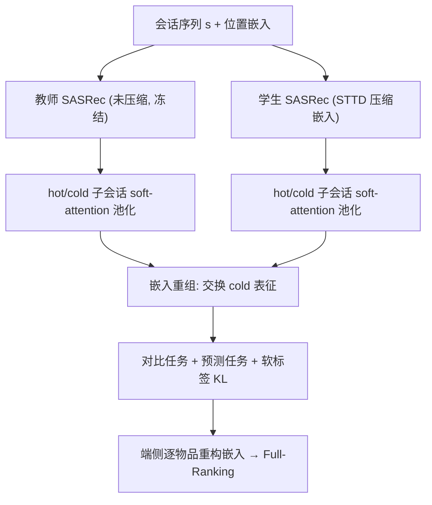
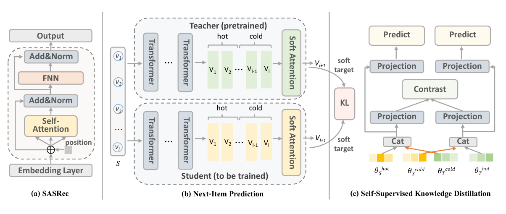

# On-Device Next-Item Recommendation with Self-Supervised Knowledge Distillation (基于自监督知识蒸馏的端侧下一物品推荐)

- **会议/期刊**: SIGIR 2022
- **作者与机构**: Xin Xia, Hongzhi Yin, Junliang Yu（昆士兰大学）、Qinyong Wang（百度）、Guandong Xu（悉尼科技大学）、Nguyen Quoc Viet Hung（格里菲斯大学）
- **推荐链路定位**: 端侧推理（召回级会话排序）
- **研究方向**: 序列与会话推荐 / 冷启动与长尾推荐
- **论文原文**: [https://arxiv.org/abs/2204.11091v1](https://arxiv.org/abs/2204.11091v1)
- **开源代码**: [https://github.com/xiaxin1998/OD-Rec](https://github.com/xiaxin1998/OD-Rec)

## TL;DR (1分钟核心速览)

端侧推荐的核心矛盾是：Embedding 表占据 99% 参数，既要压到手机能跑，又不能掉点。本文不再沿用"小 TT-rank 硬压"的保守 TTD 路线，而是把**半张量积 (STP) 引入张量链分解 (STTD)**，允许核张量维度不一致，把压缩率从 4~8× 推到 **30×**；再用**师生嵌入重组 (冷/热会话表征互换)** 构造对比 + 预测 + 软标签三条自监督蒸馏任务补容量。在 Tmall/RetailRocket 的 `Leave-Last-One + Full-Ranking` 协议下，压缩学生模型几乎无损，甚至多数指标反超未压缩教师（Tmall P@5：22.47% → 23.46%）。

## Background & Motivation (背景与核心矛盾)

- **主流范式**: 云侧 SASRec/GRU4Rec 类序列模型靠巨大 Embedding 表 + 自注意力堆叠获得表达能力，端侧工作（TT-Rec、LLRec、DeepRec）则用 TTD/剪枝/量化把模型塞进设备。
- **前人局限一（压不下去）**: 推荐模型中间层只占小部分参数，剪枝与降维收益微乎其微；TTD 为规避维度一致性约束下的精度崩塌，只敢用 4~8× 压缩率——小 TT-rank 表征不足，大 TT-rank 又失去效率，形成两难。
- **前人局限二（补不回来）**: 常规 KD 在推荐上受数据稀疏掣肘；且张量分解相当于在学生 Embedding 层前插入一层线性先验，**师生结构差异被拉大**，知识迁移效果打折；现有 KD 也无法处理长尾物品冷启动。
- **核心洞察 (Key Insight)**: TTD 的瓶颈其实是"因子矩阵维度必须相乘一致"这条死约束；若允许任意维度相乘（STP），核张量可在 $R/n$与$I_kJ_k/n$上自由缩放，压缩率提升约$n^2$ 倍而不损表达。而生物"基因重组"式地交换师生同会话的冷/热表征，恰好给长尾物品一条**直达教师知识的旁路**。
- **本文切入点**: STTD 负责"极致压缩"，嵌入重组驱动的自监督蒸馏负责"恢复容量"，二者组成端侧下一物品推荐的完整闭环。

## Method (核心方法设计)

### 1. 整体框架 (Overall Architecture)

教师为云侧预训练 SASRec（含位置嵌入 + 自注意力块 + FFN，但将原始"取末位物品"改为 soft-attention 池化得到会话表征）；学生共享同一骨架，唯一差异是 Embedding 表由 STTD 因子化存储。训练分两步：先冻结教师，再让学生的每个会话裂成 hot/cold 两个子会话分别池化，与教师互换 cold 表征拼成重组表征，同时优化主推荐损失、对比自监督损失、预测自监督损失与软标签蒸馏损失；推理时只需载入 STTD 核张量，逐物品即时重构嵌入并按内积打分。

<figure class="paper-figure" markdown="span">
  <figcaption>图1：所提出框架的概述。</figcaption>
</figure>

### 2. 关键设计拆解 (Key Designs)

1. **STTD：松弛维度一致性的半张量积张量链**：常规 TTD 要求相邻核张量首尾维度严格相等，核张量为 $R_{k-1}\times I_kJ_k\times R_k$。本文改用左半张量积$\mathbf{A}\ltimes\mathbf{B}$，将核张量重塑为$\hat{\mathbf{G}}_1\in\mathbb{R}^{I_1J_1\times R}$、$\hat{\mathbf{G}}_k\in\mathbb{R}^{\frac{R}{n}\times\frac{I_kJ_k}{n}\times R}$、$\hat{\mathbf{G}}_d\in\mathbb{R}^{\frac{R}{n}\times\frac{I_dJ_d}{n}}$，于是$\mathbf{X}=\hat{\mathbf{G}}_1\ltimes\hat{\mathbf{G}}_2\ltimes\cdots\ltimes\hat{\mathbf{G}}_d$，压缩率变为
$\text{rate}=\frac{\prod_k I_kJ_k}{I_1J_1R+\sum_{k=2}^{d-1}I_kJ_kR^2/n^2+I_dJ_dR/n^2}$，
当链长 $d$足够大时约等于原 TTD 的$n^2$倍，例如 2,560,000 参数的表在 TT-rank=8 下由 TTD 的 9,408 压到 2,592（近千倍）。直觉上，STP 把"整块相乘"拆成$n$ 段分块加权求和，等效于在核张量间插入低秩旁路，容量损失被分摊到多个小核上。
2. **嵌入重组 (Embedding Recombination)**：按流行度把前 20% 记为 hot、其余 cold，会话拆为两个子会话并各自 attention 池化得 $\theta_s^{hot},\theta_s^{cold}$；对同一会话交换冷段：$z_s^{tea}=[\theta_{hot}^{tea},\theta_{cold}^{stu}]$、$z_s^{stu}=[\theta_{hot}^{stu},\theta_{cold}^{tea}]$。这样长尾物品表征始终携带教师侧的冷段信息，绕开了师生结构不对称带来的迁移障碍，同时天然构成表征级数据增广。
3. **三条蒸馏任务与总目标**：对比任务用 InfoNCE 拉近重组表征 $\mathcal{L}_{cl}=-\sum_{s\in\mathcal{B}}\log\frac{\psi(\mathbf{W}_tz_s^{tea},\mathbf{W}_sz_s^{stu})}{\psi(\cdot)+\sum_{j\neq s}\psi(\mathbf{W}_tz_s^{tea},\mathbf{W}_sz_j^{stu})}$（余弦相似度、$\tau=0.2$、batch 内负采样）；预测任务让双方用重组表征各自拟合真标签；软标签任务用 KL 对齐$\text{prob}^{tea}$与$\text{prob}^{stu}$。最终$\mathcal{L}=(1-\beta_3)\mathcal{L}_{rec}+\beta_1\mathcal{L}_{cl}+\beta_2\mathcal{L}_{pred}+\beta_3\mathcal{L}_{soft}$。推理端免负采样，仅需核张量查表重构 + 内积，100 个会话耗时 0.169s（Tmall）/ 0.081s（RetailRocket），为全部基线中最快。

## Experimental Setup & Evaluation Protocol (实验设置与评估协议)

- **数据集与预处理**: 过滤会话长度 =1 与出现次数 <5 的物品（等价 `5-core`），训练/测试按"会话最后一条交互为测试"构造，并从训练集随机抽 10% 作验证；再用序列切分扩增样本 $([v_{s,1}],v_{s,2}),\ldots$。

| 数据集 | #Train Sessions | #Test Sessions | #Items | 平均长度 | 场景 |
| :--- | :---: | :---: | :---: | :---: | :--- |
| Tmall | 351,268 | 25,898 | 40,728 | 6.69 | 电商购物日志 |
| RetailRocket | 433,643 | 15,132 | 36,968 | 5.43 | 电商浏览行为 |

- **数据划分与防穿越**: `Leave-Last-One`（会话级，最后一条交互作测试）+ 训练集内 10% 随机验证，无时间戳泄漏。
- **排名评测协议**: `Full-Ranking`——对全部 $|\mathcal{V}|$ 个物品做 softmax 全库排序，非采样排序；指标 P@5/MRR@5/P@10/MRR@10。
- **对比基线与超参**: GRU4Rec、NARM、STAMP、SR-GNN 四类会话推荐 SOTA + 未压缩教师；嵌入维度 $d=128$（Tmall）/$256$（RetailRocket），batch=100，$L_2=10^{-5}$，Adam lr=0.001，dropout 0.5/0.2；学生取 Stu-1 分解形状，$R=60,n=2$（Tmall）、$R=100,n=2$（RetailRocket），压缩率 27×/30×。

## Key Experimental Results (实验关键数据)

### 1. 主实验对比 (Main Results)

| Method | Tmall P@5 | M@5 | P@10 | M@10 | RR P@5 | M@5 | P@10 | M@10 |
| :--- | :---: | :---: | :---: | :---: | :---: | :---: | :---: | :---: |
| GRU4Rec | 16.48 | 11.92 | 19.58 | 12.33 | 32.37 | 23.86 | 39.35 | 24.67 |
| NARM | 16.84 | 12.34 | 19.68 | 12.72 | 32.94 | 23.36 | 39.18 | 24.19 |
| STAMP | 17.45 | 12.68 | 22.61 | 13.12 | 33.57 | 23.30 | 39.75 | 24.51 |
| SR-GNN | 19.39 | 12.88 | 23.79 | 13.46 | 35.68 | 24.72 | 43.31 | 25.75 |
| Teacher (未压) | 22.47 | 15.75 | 27.86 | 16.32 | **36.51** | 24.87 | **43.59** | 25.79 |
| **Stu (27×/30×)** | **23.46** | **17.79** | **25.22** | **18.03** | 35.17 | **26.40** | 36.81 | **26.63** |
| Improv. vs SR-GNN | +21.0% | +38.1% | +6.0% | +34.0% | −1.4% | +6.8% | −15.0% | +3.4% |

### 2. 消融实验 (Ablation Study)

| 变体 | 说明 | 结果（相对完整学生模型） |
| :--- | :--- | :--- |
| Stu-base | 关闭全部自监督蒸馏，仅 STTD | Tmall P@5 下降 16.86%、M@5 降 12.31%、P@10 降 16.35%、M@10 降 12.34%；RetailRocket 分别降 9.53%/3.21%/11.24%/3.58% |
| Stu-TTD | 用常规 TTD 替代 STTD | 同等精度下参数量约为 STTD 的 3~4 倍（CR 由 27× 退回 ~8×） |
| Stu-c（去对比任务） | 移除 InfoNCE | 小幅下降，长尾表征判别力减弱 |
| Stu-p（去预测任务） | 移除重组预测 | 小幅下降，重组表征与主任务解耦 |
| Stu-s（去软标签） | 移除 KL 蒸馏 | 下降最显著，$\beta_3$最优值（0.8）远大于$\beta_1,\beta_2$ |

| 长尾分桶 | Tmall Popular | Tmall Long-tail | RR Popular | RR Long-tail |
| :--- | :---: | :---: | :---: | :---: |
| Stu-base | 5.30 | 14.93 | 7.50 | 24.61 |
| 完整 Student | **6.03** | **17.43** | **7.72** | **27.45** |

### 3. 关键实验发现 (Key Findings)

1. **压缩不只是无损，而是正则化**：Tmall 上 27× 压缩学生在 P@5（23.46 vs 22.47）、MRR@5（17.79 vs 15.75）、MRR@10（18.03 vs 16.32）全面反超未压缩教师，说明 Transformer 序列推荐模型存在大量参数冗余，STTD 的低秩先验起到了隐式正则作用。
2. **蒸馏收益集中在长尾而非头部**：加入自监督 KD 后，Tmall 长尾桶 P@5 从 14.93 涨到 17.43（+16.7%），头部仅从 5.30 到 6.03（+13.8%），且长尾在整体 P@5 中的占比显著上升——直接验证"冷段师生互换"是给稀疏物品开的知识旁路。
3. **超参敏感度呈倒挂关系**：分解形状与 TT-rank 的影响小于 STP 的 $n$；$n$从 2 增到 4 时 CR 仅从 27× 提到 31×，但 Tmall P@5 从 23.46 掉到 22.20，RetailRocket 更从 33.54 崩到 30.28，说明$n$提升的压缩收益远不抵容量损失，实践中应把$n$锁在 2、改调$R$ 与张量形状。

## Highlights & Limitations (亮点、对比与审稿批判)

- **与代表作对比 (vs. Prior Work)**: 相比 TT-Rec/LLRec 只用 TTD 保守压缩（4~8×）且无蒸馏补偿，本文用 STP 放宽维度一致性把压缩率推到 30×；相比 Ranking Distillation / CD / DE-RRD 只迁移 top-K 或采样物品的排序知识，本文迁移的是**表征级**的冷/热分解信息，首次把自监督 KD 引入端侧推荐。
- **可迁移亮点**: (1) "按流行度切分子表征 + 跨模型互换"是一种通用的长尾蒸馏增广算子，可套用到双塔召回或 GNN 推荐；(2) STTD 的"松弛维度一致性换压缩率"思路可复用到任何 Embedding 主导的稠密检索索引压缩。
- **审稿级局限批判**: (1) 教师与学生共享同一骨架，蒸馏收益是否在异构师生（如 GNN 教师 + MLP 学生）下成立未验证，而端侧真实部署往往更偏异构；(2) 实验仅两个电商会话数据集、指标止于 P@K/MRR，缺少 NDCG 与显著性检验，30× 压缩下 RetailRocket 的 P@10 仍比教师低 15%，"几乎无损"的结论对指标选择较敏感；(3) 训练阶段需同时驻留教师与学生，端侧部署虽轻但云端蒸馏开销未量化。

## Rating (四维评分)

- **方法创新性 (Novelty)**: ⭐⭐⭐⭐ （STP 松弛 TTD 维度约束 + 冷热嵌入重组的自监督蒸馏，两个机制都有清晰物理直觉且此前未被用于端侧推荐）
- **评估协议与实验扎实度 (Protocol & Experiments)**: ⭐⭐⭐⭐ （Full-Ranking 全库排序、两数据集、四类基线、逐任务消融与长尾分桶齐全，但缺少显著性检验与 NDCG 等补充指标）
- **写作与数学规范度 (Clarity & Rigor)**: ⭐⭐⭐⭐ （TTD/STP 公式与压缩率推导完整、图表直观；部分符号如 $\beta$ 系数在 Eq.12 与 Eq.21 间表述略有不一致）
- **工业落地与复现价值 (Industrial & Practical Value)**: ⭐⭐⭐⭐⭐ （代码开源、PyTorch Mobile + Android 模拟器实测推理时延、30× 压缩直接对应端侧内存预算，工程参考价值高）

