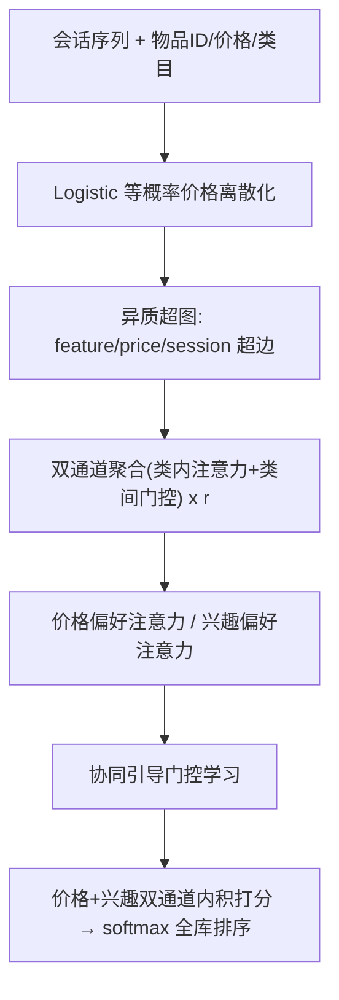
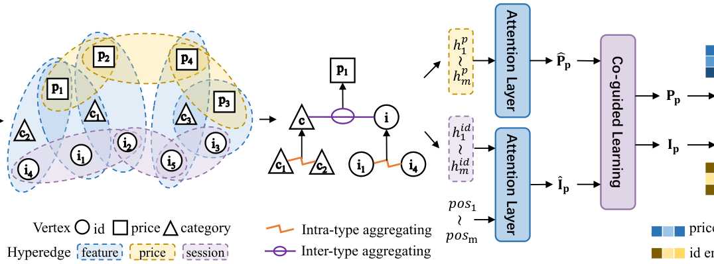

# Price DOES Matter! Modeling Price and Interest Preferences in Session-based Recommendation (价格真的很重要！会话推荐中价格与兴趣偏好的联合建模)

- **会议/期刊**: SIGIR 2022
- **作者与机构**: Xiaokun Zhang、Bo Xu、Liang Yang、Haifeng Liu、Hongfei Lin（大连理工大学），Chenliang Li（武汉大学），Fenglong Ma（宾州州立大学）
- **推荐链路定位**: 召回（会话级 Next-Item 预测）
- **研究方向**: 序列与会话推荐 / 图神经网络与知识图谱推荐
- **论文原文**: [https://arxiv.org/abs/2205.04181v1](https://arxiv.org/abs/2205.04181v1)
- **开源代码**: [https://github.com/Zhang-xiaokun/CoHHN](https://github.com/Zhang-xiaokun/CoHHN)

## TL;DR (1分钟核心速览)

匿名会话推荐（SBR）长期只建模"用户有多喜欢某物品"的兴趣偏好，完全忽略"用户愿意为它付多少钱"的价格偏好。本文提出 CoHHN：先把类目内的绝对价格按 Logistic 累积分布做等概率分位离散化为价格等级，再构建含 `<物品ID, 价格, 类目>` 三类节点的异质超图，用双通道（类内注意力 + 类间门控）聚合高阶依赖，最后用协同引导门控让价格偏好与兴趣偏好互相指导学习。在 Cosmetics / Diginetica-buy / Amazon 三个数据集、全库排序协议下，Prec@20 相对最强基线 COTREC 提升 6.86% / 3.56% / 1.88%，MRR@20 提升 4.40% / 8.46% / 17.43%。

## Background & Motivation (背景与核心矛盾)

- **主流范式**: SBR 用 RNN（GRU4Rec/NARM）、自注意力（BERT4Rec）或会话图（SR-GNN/LESSR）与超图（S²-DHCN）建模会话内物品转移，目标只是拟合兴趣偏好。
- **前人局限 1（异质信息缺失）**: 价格偏好随类目剧烈漂移（$200 的笔记本是便宜货，$200 的台灯则昂贵），必须同时纳入物品、价格、类目三类异质信息；而 RNN/GNN 只能吃单一类型信息，异质图又因过平滑只能建模$k\le3$ 跳的**成对**关系，无法刻画 `<item, price, category>` 三元**高阶**关联。
- **前人局限 2（价格-兴趣耦合）**: 经济学中的价格弹性现象表明二者相互作用——高兴趣会抬高可接受价位，低价也能让人买下非最爱物品；简单相加打分无法表达这种权衡。
- **核心洞察 (Key Insight)**: 价格不是辅助特征而是决策性因素；同类别内价格分布近似 Logistic 而非均匀，故应在分布密集处细分等级，使各级样本量均衡。
- **本文切入点**: 用"异质超图 + 双通道聚合"解决高阶异质建模，用"协同引导门控"解决双偏好耦合。

## Method (核心方法设计)

### 1. 整体框架 (Overall Architecture)

输入为会话 $\mathcal{S}=[x_1,\dots,x_m]$及每个物品的 ID/价格/类目三元特征。首先将绝对价格离散为价格等级节点，与 ID 节点、类目节点共同构成异质超图；图中定义三类超边——feature 超边（连接同一物品的三类特征）、price 超边（连接一个会话内所有价格节点）、session 超边（连接会话内所有 ID 节点）。feature 超边承载$r$轮双通道聚合以传播异质信息；price/session 超边分别经注意力层抽取原始价格偏好$\hat{P}_p$与兴趣偏好$\hat{I}_p$；随后协同引导学习模块让二者互相门控增强；最终用增强后的$P_p,I_p$ 与物品价格/ID 嵌入内积打分，softmax 全库归一，交叉熵训练。

<figure class="paper-figure" markdown="span">
  <figcaption>图2：所提出的 CoHHN 的工作流程。我们首先基于所有会话构建异构超图。设计双通道聚合机制以聚合异质节点间的各种信息。随后，分别基于价格超边和会话超边，利用注意力层提取用户价格偏好和兴趣偏好。然后提出协同引导学习模式来建模这两种偏好之间的复杂关系。最后，基于物品特征以及用户的价格偏好和兴趣偏好预测用户未来行为。（最佳效果请见彩色版）</figcaption>
</figure>

### 2. 关键设计拆解 (Key Designs)

1. **Logistic 等概率价格离散化**：绝对价格跨类目不可比，均匀分桶会让训练样本极度失衡。本文把类目内累积分布 $\Phi(\cdot)$（Logistic CDF）按等概率切成$\rho$段：$p_i=\left\lfloor\frac{\Phi(x_p)-\Phi(min)}{\Phi(max)-\Phi(min)}\times\rho\right\rfloor$。由于 Logistic 呈"中间高、两侧低"，分布密集的中价区被细分、稀疏的长尾区被粗分，既解决跨类目可比性又平衡了各等级样本量——消融显示这优于均匀量化。
2. **双通道聚合的异质超图编码**：同一目标节点在超图中同时邻接多类型节点，同类型节点重要性不同、不同类型语义不同。类内通道对不同类型分别做注意力求和 $e_t^{\tau}=\sum_i\alpha_i v_i^{\tau}$，$\alpha_i=\mathrm{softmax}(u_\tau^{\top}v_i^{\tau})$得到类型专属嵌入；类间通道用门控在特征层融合：$h_t=v_t+g_t\odot e_t^{\tau_1}+(1-g_t)\odot e_t^{\tau_2}$，其中$g_t=\sigma(\mathbf{W}_t[v_t;e_t^{\tau_1};e_t^{\tau_2}]+\sum\mathbf{W}_t^{\tau}e_t^{\tau})$。相比成对 GNN，一次超边聚合即可覆盖三元高阶依赖，$r$轮迭代（$r{=}2\sim3$）后 ID 嵌入即富含价格与类目语义。
3. **协同引导学习与训练目标**：价格与兴趣并非可加独立。先构造两种交互语义 $m_c=\tanh(\mathbf{W}_{pi1}(\hat{P}_p\odot\hat{I}_p)+b_c)$、$m_j=\tanh(\mathbf{W}_{pi2}(\hat{P}_p+\hat{I}_p)+b_j)$，再由"遗忘门"生成$r_P,r_I=\sigma(\mathbf{W}_{r}m_c+\mathbf{U}_{r}m_j)$，最终$P_p=m_P\odot(\hat{P}_p+m_I)$、$I_p=m_I\odot(\hat{I}_p+m_P)$——价格用$1-r_P$的互补门吸收兴趣信息反向增强自身。打分$y_i=P_p^{\top}v_i^{p}+I_p^{\top}v_i^{id}$经 softmax 后以交叉熵$\mathcal{L}=-\sum_j[p_j\log\hat{y}_j+(1-p_j)\log(1-\hat{y}_j)]$训练；全库打分、无负采样采样器，Adam 学习率 0.001、批大小 100、BPTT 截断 19 步、$d=128$。

## Experimental Setup & Evaluation Protocol (实验设置与评估协议)

- **数据集与预处理**: 过滤会话长度 1 与出现次数 <10 的物品（近似 10-core）：

| 数据集 | #Items | #Interactions | #Sessions | 平均长度 | 特征/场景说明 |
| :--- | :---: | :---: | :---: | :---: | :--- |
| Cosmetics | 23,194 | 1,058,263 | 156,922 | 6.74 | 美妆网店，仅保留 add_to_cart/purchase |
| Diginetica-buy | 24,889 | 855,070 | 187,540 | 4.56 | 电商购买行为 |
| Amazon (Grocery) | 9,114 | 487,701 | 204,036 | 2.39 | 同日序列切为一个会话 |

- **数据划分与防穿越 (Splitting Strategy)**: 按会话时间戳排序的 **70%/20%/10% 比例切分**（训练/验证/测试），属全局时间序切分；会话内以最后一个物品为标签、其余为输入。
- **排名评测协议 (Ranking Protocol)**: **Full-Ranking 全库排序**（对全部 $|\mathcal{I}|$个候选打分并 softmax，非采样排序）；指标 Prec@10/20 与 MRR@10/20，$k=10,20$。
- **对比基线与超参设置**: 基线含 S-POP、SKNN、GRU4Rec、NARM、BERT4Rec、SR-GNN、LESSR、S²-DHCN、COTREC；所有模型 $d=128$，网格搜索调参；显著性用配对 t 检验$p<0.01$；CoHHN 中$\rho=10/100/50$（Cosmetics/Diginetica/Amazon），$r=3/3/2$，注意力头数$h=4$。

## Key Experimental Results (实验关键数据)

### 1. 主实验对比 (Main Results)

| 方法 | Cosmetics Prec@20 | Cosmetics MRR@20 | Diginetica Prec@20 | Diginetica MRR@20 | Amazon Prec@20 | Amazon MRR@20 |
| :--- | :---: | :---: | :---: | :---: | :---: | :---: |
| S-POP | 38.43 | 27.32 | 25.91 | 19.84 | 38.03 | 32.19 |
| SKNN | 47.63 | 30.80 | 55.76 | 21.10 | 64.23 | 46.30 |
| NARM | 46.29 | 34.52 | 57.34 | 23.27 | 65.38 | 57.23 |
| BERT4Rec | 46.30 | 23.92 | 60.89 | 21.51 | 64.52 | 56.74 |
| SR-GNN | 48.01 | 34.96 | 56.80 | 22.87 | 65.83 | 57.89 |
| LESSR | 46.32 | 24.97 | 61.35 | 22.64 | 64.18 | 56.69 |
| S²-DHCN | 47.95 | 33.13 | 54.91 | 22.03 | 60.47 | 50.03 |
| COTREC | 50.12 | 35.24 | 61.82 | 23.75 | 66.44 | 50.25 |
| **CoHHN** | **53.56**\* | **36.79**\* | **64.02**\* | **25.76**\* | **67.69**\* | **59.01**\* |
| **Improv.%** | +6.86% | +4.40% | +3.56% | +8.46% | +1.88% | +17.43% |

### 2. 消融实验 (Ablation Study)

| 变体 | Cosmetics Prec@20 / MRR@20 | Diginetica Prec@20 / MRR@20 | Amazon Prec@20 / MRR@20 |
| :--- | :---: | :---: | :---: |
| w/o 类目 (CoHHN-c) | 53.05 / 36.28 | 63.21 / 24.97 | 67.06 / 58.51 |
| w/o 价格偏好 (CoHHN-p) | 52.81 / 35.92 | 61.83 / 22.99 | 66.93 / 58.12 |
| 价格仅更新嵌入 (CoHHN-pp) | 52.59 / 36.08 | 62.30 / 23.23 | 67.14 / 58.38 |
| 简单相加替代协同引导 (CoHHN-co) | 52.79 / 36.33 | 62.49 / 23.54 | 67.28 / 58.63 |
| **CoHHN 完整模型** | **53.56 / 36.79** | **64.02 / 25.76** | **67.69 / 59.01** |

### 3. 关键实验发现 (Key Findings)

1. **价格是决策性因素而非辅助特征**：去掉价格偏好的 CoHHN-p 在 Diginetica 上 MRR@20 从 25.76 掉到 22.99（−10.8%），而"只用价格更新嵌入、不显式抽偏好"的 CoHHN-pp 回升到 23.23，仍显著低于完整模型——说明必须显式建模价格偏好；同时 CoHHN-p 与 COTREC 在 Diginetica 的 Prec@20 几乎持平（61.83 vs 61.82），意味着若无价格偏好抽取，异质超图本身贡献有限。
2. **协同引导优于简单相加**：CoHHN-co 在每个数据集上都劣于完整模型（如 Diginetica MRR@20 23.54 vs 25.76），验证价格-兴趣权衡不能用可加打分近似，互补门控确实带来额外增益（约 +2.2 MRR@20）。
3. **跨价格等级一致增益，兼顾高价位**：Cosmetics 在全部 10 个价格等级上 CoHHN 均优于 COTREC，且双方均在等级 3–6（中低价）命中率最高，符合人群低价偏好；但 CoHHN 在高价段同样保持提升，说明它不只是"偏向便宜货"的捷径，可兼顾商家高毛利商品曝光。

## Highlights & Limitations (亮点、对比与审稿批判)

- **与代表作对比 (vs. Prior Work)**: 相比 SR-GNN/LESSR（成对会话图，仅单类型信息），CoHHN 用超边一次覆盖 `<item,price,category>` 高阶关联；相比 S²-DHCN（超图+自监督，仍只建模物品 ID），本文把价格与类目显式升格为独立节点与独立偏好通道；相比 PUP（价格异质图，面向长周期购买行为），本文将价格偏好迁移到匿名会话场景并首次建模其与兴趣的耦合。
- **可迁移亮点**: (1) 按类目做 Logistic 等概率分位离散化，可无缝迁移到任何"跨类目不可比的连续属性"（如时长、客单价、地理距离）的等级化编码；(2) 互补遗忘门 $P_p=m_P\odot(\hat{P}_p+m_I)$ 的互引导结构，可直接用于任意双信号（内容/协同、短期/长期）融合。
- **审稿级局限批判**: (1) **推理成本**：异质超图需离线按全量会话构建，$r$轮双通道聚合与两路注意力使单会话前向开销高于 SR-GNN，论文未给出时延/显存实测，线上 RT 场景存疑；(2) **协议与超参**：仅用 Prec/MRR，缺少 NDCG 与采样排序（如 100 负例）对照，且$\rho$ 敏感（Cosmetics 上 200 即退化）且三数据集最优值各异（10/100/50），跨业务冷启动调参成本高；此外 Amazon 上 COTREC 的 MRR@20（50.25）异常低于其 Prec@20，基线复现细节存疑，会放大本文 MRR 提升幅度。

## Rating (四维评分)

- **方法创新性 (Novelty)**: ⭐⭐⭐⭐ （首次把价格偏好引入 SBR，异质超图+协同引导门控的组合设计有新意，但单模块均为已有技术的定制化拼装）
- **评估协议与实验扎实度 (Protocol & Experiments)**: ⭐⭐⭐⭐ （三数据集全库排序、t 检验、价格等级/超参分析完整，欠缺采样排序与 NDCG 对照）
- **写作与数学规范度 (Clarity & Rigor)**: ⭐⭐⭐⭐ （三类超边与双通道公式交代清晰、图 2 对齐良好，但 Eq.(30) 交叉熵与 softmax 输出的形式混用，门控符号略显冗余）
- **工业落地与复现价值 (Industrial & Practical Value)**: ⭐⭐⭐⭐ （代码与数据全开源，价格离散化+双偏好打分极易在电商召回上线，代价是超图离线构建与迭代聚合的工程开销）

