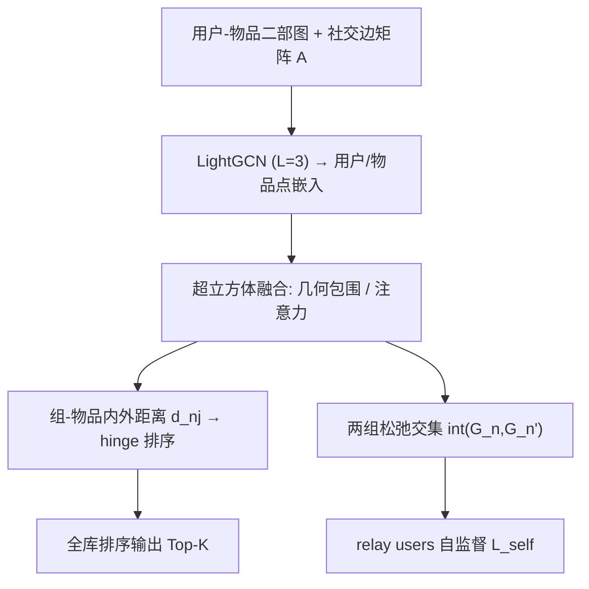

# Thinking inside The Box: Learning Hypercube Representations for Group Recommendation (跳出点嵌入：用超立方体表示群组偏好)

- **会议/期刊**: SIGIR 2022
- **作者与机构**: Tong Chen, Hongzhi Yin, Jing Long, Quoc Viet Hung Nguyen, Yang Wang, Meng Wang（昆士兰大学、格里菲斯大学、合肥工业大学）
- **推荐链路定位**: 召回（群组-物品全库候选排序）
- **研究方向**: 社交与群组推荐 / 自监督对比学习与交互去噪
- **论文原文**: [https://arxiv.org/abs/2204.02592v3](https://arxiv.org/abs/2204.02592v3)
- **开源代码**: [https://github.com/jinglong0407/CubeRec](https://github.com/jinglong0407/CubeRec)

## TL;DR (1分钟核心速览)

群组推荐长期把多名成员的点嵌入压缩成**单个群组点向量**，既丢失多面性个人偏好，也不符合"成员在可协商区间内妥协"的真实决策过程。本文改用**超立方体**（中心 $\mathbf{c}$+ 非负偏移$\mathbf{o}$）表示群组，给出几何包围与注意力两种融合算子、点到超立方体的内外双重距离，并利用两组交集共享的 relay users 构造自监督。在 4 个真实数据集、8:1:1 划分、全库未交互物品排序协议下，CubeRec-G 相对最强基线 GroupIM 平均提升 Recall@10 **14.4%**、NDCG@10 **23.6%**。

## Background & Motivation (背景与核心矛盾)

- **主流范式**: 偶发群组（occasional group）group-item 交互极稀，标准做法是先由稠密 user-item 交互学点嵌入，再用平均池化、注意力聚合或社会影响加权得到群组点嵌入，最后以欧氏/余弦距离排序。
- **前人局限一**: 点嵌入在每个维度只能取定值，无论均值还是影响力加权，都强迫所有成员"同意某个精确数值"，无法承载价格、口味等维度上的分歧区间，多面偏好被压平。
- **前人局限二**: 群组-物品交互平均仅 1.1–2.7 条/组，纯靠这些稀疏标签学群组表示信息量极低，新群组几乎无法泛化；GroupIM 的互信息最大化仍受限于点嵌入的表征形状。
- **核心洞察 (Key Insight)**: 超立方体是向量空间中的子空间，每维为闭区间 $[c_z-o_z, c_z+o_z]$，可容纳无穷多个点——恰好对应"群体在某一维度上达成的可接受区间"，且几何上可用于构造新的自监督关系。
- **本文切入点**: 保留用户/物品点嵌入，仅把**群组**升级为超立方体，并为其配套新距离度量与交集式自监督。

## Method (核心方法设计)

### 1. 整体框架 (Overall Architecture)

两阶段训练：阶段一用带社交图的 LightGCN 学用户/物品点嵌入（hinge 排序损失 $\mathcal{L}_{user}$）；阶段二冻结式微调这些点嵌入，并用几何包围或注意力融合把成员点压成群组超立方体$G_n=(\mathbf{c}_n,\mathbf{o}_n)$，以"点到超立方体"距离做 group-item 排序，同时随机采样一个与该组有共同成员的组$G_{n'}$，取其（松弛）交集，把 relay users 拉入交集、非共享用户推出，从而在稀疏标签外注入额外监督。推理时仅需一次距离计算，无额外检索结构。

### 2. 关键设计拆解 (Key Designs)

1. **群组超立方体构建（几何包围 vs. 注意力融合）**：点聚合的病根是信息压缩不可逆。**几何版**取成员嵌入逐元素 max/min 得包络 $\tilde{\mathbf{c}}_n=(\mathbf{u}_{max}+\mathbf{u}_{min})/2$、$\tilde{\mathbf{o}}_n=|\mathbf{u}_{max}-\mathbf{u}_{min}|/2$，再用投影$\mathbf{c}_n=\mathbf{W}_c\tilde{\mathbf{c}}_n$、$\mathbf{o}_n=\mathbf{W}_o\tilde{\mathbf{o}}_n$（$\mathbf{W}_o\ge 0$）缩放——因为分歧越大盒越大，会罩住过多假正例，必须学一个收缩尺度。**注意力版**用可学习 query 做 self-attention 得$\tilde{\mathbf{c}}_n$，中心取线性投影，偏移取$\mathbf{o}_n=\mathrm{ReLU}(\mathbf{W}_o\tilde{\mathbf{c}}_n+\mathbf{b}_o)$，把被聚合抹掉的多样性用非线性"补回来"。直觉：前者保留物理语义、对分歧更宽容；后者更关注语义重要性、更轻量。
2. **点到超立方体距离（内外双通道）**：点-点距离对超立方体失效。作者定义两个角 $\mathbf{g}^{lo}_n=\mathbf{c}_n-\mathbf{o}_n$、$\mathbf{g}^{hi}_n=\mathbf{c}_n+\mathbf{o}_n$，先求盒面上离物品最近的锚点，再分别度量外部与内部距离：$d_{nj}=f_{out}(G_n,\mathbf{v}_j)+\gamma f_{in}(G_n,\mathbf{v}_j)$，其中$f_{out}=\|\max(\mathbf{v}_j-\mathbf{g}^{lo}_n,0)+\max(\mathbf{g}^{hi}_n-\mathbf{v}_j,0)\|_2^2$，$f_{in}=\|\mathbf{c}_n-\min(\mathbf{g}^{hi}_n,\max(\mathbf{g}^{lo}_n,\mathbf{v}_j))\|_2^2$。当物品落盒内$f_{out}=0$、$f_{in}$ 退化为到中心距离，因此模型既有"盒内优先"的容错，又能对盒内物品按中心远近再分辨，避免大盒稀释排序。
3. **交集自监督与训练目标**：针对 group-item 稀疏，取共享成员组 $G_{n'}$，用注意力加权中心$\mathbf{c}_{nn'}=a_n\odot\mathbf{c}_n+a_{n'}\odot\mathbf{c}_{n'}$、收缩偏移$\mathbf{o}_{nn'}=\min(\mathbf{o}_n,\mathbf{o}_{n'})\odot\sigma(\psi(\mathbf{o}_n+\mathbf{o}_{n'}))$得到松弛交集（几何交在无重叠维上不可导/不可用，故用 MLP 松弛）。损失$\mathcal{L}_{self}=\sum\sum\max(0,\lambda''+d_{nn'i^+}-d_{nn'i^-})$，正样本为 relay user，负样本从$\mathcal{U}\setminus(G_n\cap G_{n'})$均匀采。总目标为两阶段：先$\mathcal{L}_{user}$，再$\mathcal{L}_{group}+\mu\mathcal{L}_{self}$；每组正样本采 5 个均匀负样本（无难负采样、无跨 batch 负样本），$\lambda=\lambda'=\lambda''=0.5$。

<figure class="paper-figure" markdown="span">
  ![图2：在 Meetup 上，针对同一用户组和推荐正物品，CubeRec-G（左）与 CubeRec-A（右）的可视化。注意，为便于可视化，仅使用 R𝑑 的前两个维度。由于所有表示均从两个独立向量空间中学习得到，可视化的负物品数量不同；为确保清晰，超出 \[−3, 3\] 范围的嵌入被裁剪掉。](../../../../assets/papers/2204.02592v3/figure_2.png)<figcaption>图2：在 Meetup 上，针对同一用户组和推荐正物品，CubeRec-G（左）与 CubeRec-A（右）的可视化。注意，为便于可视化，仅使用 R𝑑 的前两个维度。由于所有表示均从两个独立向量空间中学习得到，可视化的负物品数量不同；为确保清晰，超出 [−3, 3] 范围的嵌入被裁剪掉。</figcaption>
</figure>

## Experimental Setup & Evaluation Protocol (实验设置与评估协议)

- **数据集与预处理**: 四个事件/签到社交网络；Yelp、Gowalla 原本无群组，按"社交相连 + 同时同地签到"重构群组（与 SIGR/CAGR 一致）。

| 数据集 | #Users | #Groups | #Items | #User-Item | #Group-Item | 组均物品数 | 平均组规模 | 组-物品密度 |
| :--- | :---: | :---: | :---: | :---: | :---: | :---: | :---: | :---: |
| Meetup | 24,631 | 13,552 | 19,031 | 126,813 | 19,031 | 1.40 | 8.79 | ~7.4e-5 |
| Yelp | 34,504 | 24,103 | 22,611 | 482,273 | 26,883 | 1.12 | 4.45 | ~4.9e-5 |
| Gowalla | 60,805 | 78,453 | 8,984 | 1,625,817 | 208,336 | 2.66 | 2.31 | ~3.0e-4 |
| Douban | 70,743 | 109,538 | 60,028 | 3,422,266 | 164,153 | 1.50 | 4.86 | ~2.5e-5 |

- **数据划分与防穿越**: 按 **8:1:1 比例划分**训练/验证/测试，无时间戳切分，也无冷启动划分。
- **排名评测协议**: **全库排序（Full-Ranking）**——每个群组所有未交互物品均作候选，Recall@10/20、NDCG@10/20，5 次运行取均值；非采样排序，指标偏严格。
- **对比基线与超参**: 基线含 MF-AVG、NCF-AVG、AGREE、SIGR、CAGR、GroupIM 六类；$d=64$、$L=3$、$\gamma=0.3$、$\mu=0.7$、学习率 1e-3、batch 256、dropout 0.2，Adam 优化；未报告显著性检验。

## Key Experimental Results (实验关键数据)

### 1. 主实验对比 (Main Results)

| 方法 | Yelp R@10 | Yelp N@10 | Douban R@10 | Douban N@10 | Gowalla R@10 | Gowalla N@10 | Meetup R@10 | Meetup N@10 |
| :--- | :---: | :---: | :---: | :---: | :---: | :---: | :---: | :---: |
| NCF-AVG | 0.0042 | 0.0018 | 0.0023 | 0.0010 | 0.0146 | 0.0088 | 0.0087 | 0.0074 |
| FM-AVG | 0.0161 | 0.0075 | 0.0032 | 0.0014 | 0.0127 | 0.0061 | 0.0128 | 0.0063 |
| AGREE | 0.0168 | 0.0073 | 0.0031 | 0.0013 | 0.0125 | 0.0063 | 0.0081 | 0.0033 |
| SIGR | 0.0194 | 0.0082 | 0.0035 | 0.0016 | 0.0143 | 0.0070 | 0.0090 | 0.0038 |
| CAGR | 0.0215 | 0.0106 | 0.0026 | 0.0010 | 0.0169 | 0.0090 | 0.0028 | 0.0012 |
| GroupIM | 0.0424 | 0.0207 | 0.0212 | 0.0098 | 0.0281 | 0.0113 | 0.0407 | 0.0237 |
| **CubeRec-G** | **0.0455** | **0.0241** | **0.0243** | **0.0114** | **0.0361** | **0.0171** | **0.0437** | **0.0261** |
| CubeRec-A | 0.0417 | 0.0206 | 0.0211 | 0.0098 | 0.0343 | 0.0135 | 0.0418 | 0.0202 |
| Improv.% (G vs GroupIM) | +7.3% | +16.4% | +14.6% | +16.3% | +28.5% | +51.3% | +7.4% | +10.1% |

### 2. 消融实验 (Ablation Study)

| 变体 | Yelp | Douban | Gowalla | Meetup |
| :--- | :---: | :---: | :---: | :---: |
| CubeRec-G Default | **0.0455** | **0.0243** | **0.0361** | **0.0437** |
| - Remove SR（去社交边） | 0.0440 | 0.0222↓ | 0.0353 | 0.0414↓ |
| - Point Distance（退化为中心点距离） | 0.0204↓ | 0.0098↓ | 0.0156↓ | 0.0181↓ |
| - Remove SSL（去交集自监督） | 0.0442 | 0.0232 | 0.0342↓ | 0.0407↓ |
| CubeRec-A Default | **0.0417** | **0.0211** | **0.0343** | **0.0418** |
| - Remove SR | 0.0391↓ | 0.0209 | 0.0326 | 0.0371↓ |
| - Point Distance | 0.0202↓ | 0.0099↓ | 0.0159↓ | 0.0163↓ |
| - Remove SSL | 0.0382↓ | 0.0195↓ | 0.0342 | 0.0399 |

### 3. 关键实验发现 (Key Findings)

1. **距离度量是最大贡献源，而非融合方式**：把内外距离换成"物品到中心"的点距离后，CubeRec-G 从 0.0455/0.0437 掉到 0.0204/0.0181（Meetup 掉 58%），甚至低于 GroupIM，说明收益主要来自"盒内可容忍 + 盒内再分辨"的几何排序，而非超立方体这个符号本身。
2. **自监督在稀疏场景收益最大**：去掉 $\mathcal{L}_{self}$在 Gowalla/Meetup 上给 CubeRec-G 造成 >5% 下降（0.0361→0.0342、0.0437→0.0407），在 Yelp 这个平均组规模最小（4.45）的数据集上对 CubeRec-A 同样触发 >5% 下降，验证 relay users 是稀疏标签的有效替代监督；Yelp 上$\mu=0.3$ 优于 0.7，正因组小、共享成员自监督信号更弱。
3. **几何包围优于注意力融合，且小群体优势更明显**：CubeRec-G 全场景领先（平均 +14.4% R@10），在组规模 2–5 的长尾区间相对 GroupIM 的增益更大；组规模 >9 时 Yelp/Gowalla 性能回落，说明大组的盒被噪声撑大，假正例稀释效应真实存在。$\gamma$ 呈倒 U 形（0.3 最佳），即略偏重外距离才有足够分辨力。

## Highlights & Limitations (亮点、对比与审稿批判)

- **与代表作对比 (vs. Prior Work)**: AGREE/SIGR 仍在点空间做注意力或社会影响加权聚合，CAGR 侧重 centrality-aware 两阶段训练，GroupIM 用互信息最大化补稀疏——三者都受点嵌入形状限制；本文的差异是**改变表征的几何形状**（点→子空间）并把该形状本身当作自监督的构造工具，因而与 GroupIM 正交、可叠加。
- **可迁移亮点**: ①"内外双通道距离 + 盒内锚点"可直接迁移到用户兴趣集合、多意图召回的区间式表征；②用"两个样本集合的交集"构造弱监督，适用于任何带重叠成员/属性的实体（如会话-用户、包裹-群体）。
- **审稿级局限批判**: ①几何包围版需逐元素 max/min 与 $d\times d$投影，组规模大时盒面积随分歧膨胀，缺少显式的体积正则，超参$\gamma$ 敏感（0.3 vs 0.5 已明显下降）；②自监督依赖组间共享成员，孤立组需用 PS/PI 伪造"假组"，其正负样本语义可信度未做消融核查；③Yelp/Gowalla 的群组由"同时同地 + 社交边"启发式重构，标签噪声会影响结论外推；④未报告显著性检验与在线 A/B。

## Rating (四维评分)

- **方法创新性 (Novelty)**: ⭐⭐⭐⭐ （把群组表征从点升级为超立方体，并用交集几何直接生成自监督信号，思路少见且自洽，但仍是几何启发式而非理论刻画）
- **评估协议与实验扎实度 (Protocol & Experiments)**: ⭐⭐⭐⭐ （四数据集全库排序、5 次均值、六类基线 + 消融 + 组规模/超参分析齐全；缺显著性检验与冷启动划分）
- **写作与数学规范度 (Clarity & Rigor)**: ⭐⭐⭐⭐ （中心-偏移、内外距离、松弛交集的公式链条清晰，图示到位；角点符号 $\rhd/\lhd$ 与几何直觉稍显反直觉）
- **工业落地与复现价值 (Industrial & Practical Value)**: ⭐⭐⭐⭐ （代码开源，推理仅增一次距离计算，易插到现有双塔召回；但 $\mathcal{O}(d^2)$ 投影与组交集采样带来额外训练开销）

