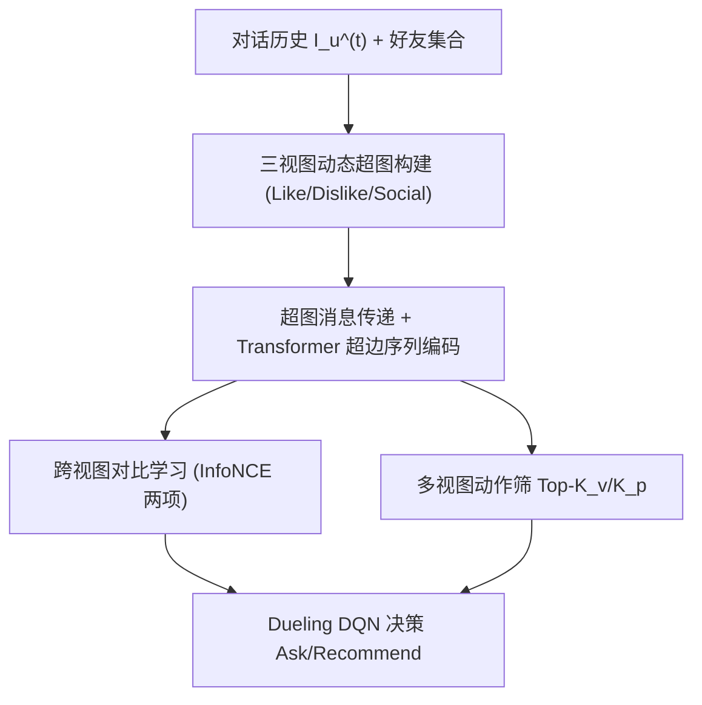
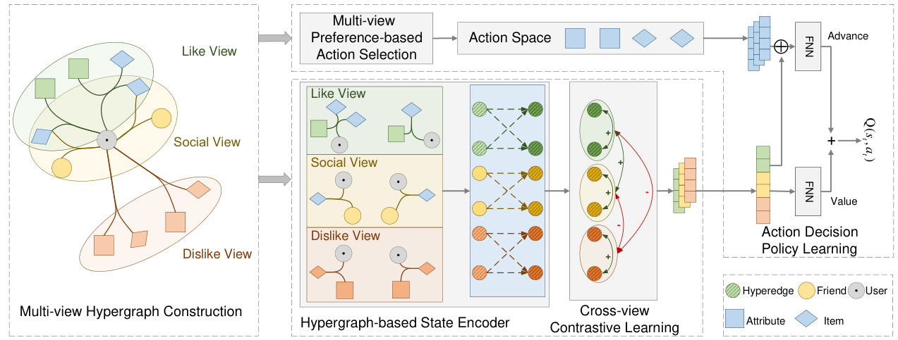

# Multi-view Hypergraph Contrastive Policy Learning for Conversational Recommendation (多视图超图对比策略学习用于对话推荐)

- **会议/期刊**: SIGIR 2023
- **作者与机构**: Sen Zhao, Wei Wei (华中科技大学 CCIIP 实验室 & HUST-平安产险联合实验室), Xian-Ling Mao (北理工), Shuai Zhu, Minghui Yang, Zujie Wen (蚂蚁集团), Dangyang Chen (平安产险), Feida Zhu (新加坡管理大学)
- **推荐链路定位**: 多轮对话式策略决策 (Ask/Recommend) + 端到端强化学习
- **研究方向**: 对话推荐与智能体仿真 / 图神经网络与知识图谱推荐
- **论文原文**: [arxiv 2307.14024](https://arxiv.org/abs/2307.14024v1)
- **开源代码**: [Snnzhao/MHCPL](https://github.com/Snnzhao/MHCPL)

## TL;DR (1分钟核心速览)

MHCPL 针对多兴趣多轮对话推荐 (MMCR) 中偏好建模只能刻画成对关系的痛点，指出对话中的用户-物品-属性-社交关系本质是**多元 (multiplex) 的**：用户因属性喜/厌物品 (Like/Dislike 视图)、又与好友共享物品偏好 (Social 视图)。作者用三视图动态超图、分层超图编码与跨视图 InfoNCE 对比学习，把对话交互、物品知识与社交影响统一编码，再交给 Dueling DQN 决策 Ask/Recommend。在 Yelp 与 LastFM 模拟器基准上，Yelp 的 SR@15 相对最优基线 S*-MCMIPL 提升 **18.28%**，AT 缩短 **5.23%**，hDCG@(15,10) 提升 **13.48%**。

## Background & Motivation (背景与核心矛盾)

- **主流范式**: 对话推荐主流走 RL/图方法（CRM、EAR、SCPR），近期 UNICORN、MCMIPL 用加权图 + MDP 建模动态偏好，把用户、属性、物品节点串联成图。
- **前人局限 (1)**: 现有方法把对话与物品知识压缩为成对关系 (user-item / user-attribute / item-attribute)，无法表达"用户因某属性 dislike"这种"一个超边连接多个节点"的多元交互；也几乎没有利用社交关系这一强信号。
- **前人局限 (2)**: 社交信息整体静态引入，噪声巨大——用户好友的历史交互绝大多数与当前对话主题无关，直接聚合会污染当前偏好；同时多视图偏好简单拼接会模糊各自分布差异。
- **核心洞察 (Key Insight)**: 用户偏好天然可从三个正交视图刻画：Like 视图（因属性喜好的物品集合）、Dislike 视图（因属性厌恶的物品集合）、Social 视图（好友中满足当前对话的物品集合）；三者**同一视图内更相似、不同视图间应保持区分**，而 Like 与 Social 应相关、与 Dislike 应互斥。
- **本文切入点**: 用动态多视图超图刻画三视图多元关系，按对话生成序把同视图超边依次串接，再用层级对比学习让三视图表征"分得开、连得上"。

## Method (核心方法设计)

### 1. 整体框架 (Overall Architecture)

MHCPL 把 MMCR 建模为 MDP: $s_t = [I_u^{(t)}, F_u^{(t)}]$同时编码对话历史$I_u^{(t)}$与"当前对话筛选后的好友"$F_u^{(t)} = \{f \mid V_f^{(t)} \neq \emptyset\}$（$V_f^{(t)}$为好友可接受且满足当前对话的物品）。每个回合根据三视图构建动态超图$\mathcal{G}_u^{(t)}=(\mathcal{N}^{(t)},\mathcal{H}^{(t)},\mathbf{A}^{(t)})$，其中超边分 Like/Dislike/Social 三类，由分层超图编码器得到状态表征$q_t$与好友偏好$\tilde{e}_f$，Action 决策时用多视图动作选择评分筛出 Top-$K_v$物品与 Top-$K_a$ 属性进入动作空间，再送 Dueling DQN 打分；训练在对比损失与 DQN 损失之间交替优化。

<figure class="paper-figure" markdown="span">
  <figcaption>图2：多视图超图对比策略学习（Multi-view Hypergraph Contrastive Policy Learning）的概览。主要包含四个模块：(a) 多视图超图构建，从三个视图动态捕捉多重关系；(b) 基于超图的状态编码器，捕捉动态超图中的图结构与序列建模；(c) 跨视图对比学习，保持不同视图下用户偏好的固有特征与相关性；(d) 动作决策策略学习，根据学习到的动态用户偏好决定下一动作。</figcaption>
</figure>

### 2. 关键设计拆解 (Key Designs)

1. **三视图动态超图 + 分层超图编码 (Multi-view Hypergraph + Hierarchical Encoder)**：解决成对关系无法表达多元偏好。核心算子是超图消息传递 $\Gamma = \text{ReLU}(\mathbf{A}\cdot\mathbf{A}^{\top}\cdot\mathbf{E})$，先由节点聚合到超边$\mathbf{H}=\mathbf{A}^{\top}\mathbf{E}$，再经$\ell$层 Transformer 让同视图超边按对话生成时序交互$\psi(\mathbf{H}_o^{l}) = \text{MHSA}_o(\mathbf{H}_o^{l-1},\ldots)$，最后回写节点$\Gamma^{l}=\text{ReLU}(\mathbf{H}\cdot\psi^{l}(\mathbf{A}^{\top}\mathbf{E}))$并逐层求和得$q_t=\sum_l \Gamma^{l}(u)$。直觉：超图建模"一原因驱动多物品"的多元关系，Transformer 补上对话**时序**依赖，层数增加可引入多跳协同信号（最优$L=2\sim 3$）。

2. **跨视图对比学习 (Cross-view Contrastive Learning)**：解决多视图简单融合会抹平各视图特性与相关性的问题。用两段 InfoNCE：第一项以"同视图超边为正、异视图超边为负"保留各视图的**内在判别性**；第二项显式把 Like 与 Social 超边互设为正、与 Dislike 超边设为负，编码"社交同质 + 正负偏好互斥"的领域先验：

$$\mathcal{L}_{SSL} = -\sum_{o}\sum_{i\in\mathcal{H}_o}\log\frac{\sum_{i^+\in\mathcal{H}_o}\exp(s(H_i,H_{i^+})/\tau)}{\sum_{i^+}\exp(s(H_i,H_{i^+})/\tau)+\sum_{i^-\in\mathcal{H}-\mathcal{H}_o}\exp(s(H_i,H_{i^-})/\tau)} + (\text{Like}\leftrightarrow\text{Social, Dislike 为负})$$

3. **多视图动作选择 + 训练目标**：为缓解动作空间爆炸，先按视图打分筛 Top-$K_v$/$K_p$，$w_v^{(t)}=\sigma(e_u^{\top}e_v+\sum_{p\in P_{acc}^{(t)}}e_v^{\top}e_p+\sum_{f\in F_u^{(t)}}e_v^{\top}\tilde{e}_f-\sum_{p\in P'^{(t)}_{rej}}e_v^{\top}e_p)$（属性打分同理），其中$\tilde{e}_f=\sum_{v'\in V_f^{(t)}}e_{v'}$为已筛选好友偏好。再以 Dueling 结构$Q(s_t,a_t)=f^V_\theta(q_t)+f^A_\theta(q_t,a_t)$+ Double DQN 与 Bellman 目标$y_t=r_t+\gamma\max_{a_{t+1}}Q(s_{t+1},a_{t+1})$做$\mathcal{L}_{DQN}=\mathbb{E}[(y_t-Q)^2]$。**负采样**依赖 DQN 回放缓冲区采样的回合经验；**训练方式**为对比损失与 DQN 损失交替优化，无显式 pairwise 负采样。**推理开销**主要在每回合重建超图$|\mathcal{N}^{(t)}|\times|\mathcal{H}^{(t)}|$ 邻接，$$L\le 3$ 时可控；动作空间 Top-10 筛选显著降低每步打分成本。

## Experimental Setup & Evaluation Protocol (实验设置与评估协议)

- **数据集与预处理**（采用 Zhang et al. 的 MMCR 基准，从 Yelp/LastFM 原始数据适配）：

| 数据集 | #Users | #Items | #Attributes / (Types) | #User-Item | #User-User | #Item-Attribute |
| :--- | :---: | :---: | :---: | :---: | :---: | :---: |
| Yelp | 27,675 | 70,311 | 590 / 29 | 1,368,606 | 688,209 | 477,012 |
| LastFM | 1,801 | 7,432 | 8,438 / 34 | 76,693 | 23,958 | 94,446 |

- **数据划分与防穿越 (Splitting Strategy)**: 严格遵循 MMCR 设定——每个 $(u, V_u)$ 会话抽 **2 个属性部分重叠的可接受物品**作为目标集，模拟器据此回答 Ask/Recommend；训练/测试按会话分隔，无对话级信息穿越。
- **排名评测协议 (Ranking Protocol)**: 模拟器交互式评估（无偏且非采样）；指标为 **SR@5/10/15**（截至第 $t$ 回合成功推荐率）、**AT**（平均结束回合数）、**hDCG@(15,10)**（推荐列表排序质量）。
- **对比基线与超参**: 规则基线 (Abs Greedy, Max Entropy)、因子分解 (CRM, EAR)、图/路径 (SCPR, UNICORN, MCMIPL) 以及作者复现的**社交增强版本 S*-UNICORN 与 S*-MCMIPL**。Embedding $d=64$(TransE 预训练)，学习率$10^{-4}$，折扣因子$\gamma=0.999$，每回合 Recommend$K_v=10$/ Ask$K_a=2$属性，$L\in\{1,2,3,4\}$；显著性$p<0.01$。

## Key Experimental Results (实验关键数据)

### 1. 主实验对比 (Main Results)

| 模型 | Yelp SR@15 | Yelp AT | Yelp hDCG | LastFM SR@15 | LastFM AT | LastFM hDCG |
| :--- | :---: | :---: | :---: | :---: | :---: | :---: |
| Abs Greedy | 0.150 | 13.65 | 0.065 | 0.512 | 10.10 | 0.237 |
| Max Entropy | 0.390 | 12.97 | 0.117 | 0.680 | 9.34 | 0.263 |
| CRM | 0.188 | 13.99 | 0.059 | 0.372 | 12.56 | 0.130 |
| EAR | 0.240 | 12.91 | 0.094 | 0.508 | 10.08 | 0.237 |
| SCPR | 0.436 | 12.29 | 0.169 | 0.764 | 8.47 | 0.322 |
| UNICORN | 0.430 | 11.33 | 0.175 | 0.846 | 7.10 | 0.348 |
| MCMIPL | 0.522 | 11.25 | 0.184 | 0.884 | 6.87 | 0.353 |
| S*-UNICORN | 0.696 | 10.59 | 0.223 | 0.912 | 6.69 | 0.363 |
| S*-MCMIPL | 0.722 | 10.51 | 0.230 | 0.940 | 6.43 | 0.368 |
| **MHCPL** | **0.854** | **9.96** | **0.261** | **0.982** | **5.87** | **0.427** |
| **Improv.%** (vs S*-MCMIPL) | **+18.28%** | **−5.23%** | **+13.48%** | **+4.47%** | **−8.71%** | **+16.03%** |

### 2. 消融实验 (Ablation Study)

| 设置 | Yelp SR@15 | Yelp AT | Yelp hDCG | LastFM SR@15 | LastFM AT | LastFM hDCG |
| :--- | :---: | :---: | :---: | :---: | :---: | :---: |
| **MHCPL 完整** | **0.854** | **9.96** | **0.261** | **0.982** | **5.87** | **0.427** |
| w/o social | 0.592 | 10.80 | 0.208 | 0.908 | 6.63 | 0.365 |
| w/o hypergraph (超图→GCN) | 0.726 | 10.68 | 0.346 | 0.938 | 6.58 | 0.382 |
| w/o contrastive | 0.762 | 10.37 | 0.237 | 0.962 | 6.17 | 0.403 |

### 3. 关键实验发现 (Key Findings)

1. **社交视图是增益最大来源**：去掉社交后 Yelp SR@15 由 0.854 掉到 0.592（−30.7%），LastFM 掉到 0.908（−7.5%），且 w/o social 仍高于原始 MCMIPL（0.522/0.884），说明对话动态筛选社交信息本身即有效——不筛直接喂社交反而在早期回合更差，佐证篇首"逐回合筛选"设计的必要性。
2. **超图 vs GCN 的本质差异**：把超图换成 GCN 后 Yelp SR@15 降 15.0%，说明"一属性驱动多物品"的多元关系确实无法被成对图等价表达；有意思的是 hDCG 反而从 0.261 **升到 0.346**——超图强化了 Ask 阶段的判别，但压缩了 Recommend 阶段的排序多样性，提示两阶段目标仍有对齐空间。
3. **对比学习主要稳住 AT 而非 SR**：w/o contrastive 时 SR@15 仅下降 9.2%（Yelp），但 AT 从 9.96 拉到 10.37、hDCG 从 0.261 掉到 0.237，说明对比项并非直接提升召回，而是让策略在**更少回合内**就产生区分性偏好——对工业场景"用户耐心有限"至关重要。层数 $L$上$L=2$显著优于$L=1$，$L=4$ 在 LastFM 上因高阶噪声退化，验证"多跳有用但需控噪"。

## Highlights & Limitations (亮点、对比与审稿批判)

- **与代表作对比**: 相较 UNICORN（加权二部图 + 图 MDP）和 MCMIPL（在其上叠多兴趣 attention），MHCPL 的本质区别是把"成对边"升级为"超边 + 三视图"，并引入两条领域先验的对比项；相较社交推荐代表 MHCN（静态三角超图），MHCPL 的关键跃迁在**对话驱动动态筛选好友**——社交不是静态先验，而是随 Ask/Recommend 反馈不断重算 $F_u^{(t)}$。
- **可迁移亮点**: (1) "属性 → 正/负物品超边"的三视图构造模板，可直接迁移到电商/新闻的属性驱动兴趣建模；(2) "同视图为正、Like-Social 为正、Dislike 为负"的双项 InfoNCE 先验，可作为多源偏好对齐的通用损失套件。
- **审稿级局限批判**: (1) 模拟器生成的对话脚本、Ask 选项与奖励权重固定，缺少真人/LLM 模拟器的健壮性检验，SR 提升里有多少来自策略、多少来自仿真偏置难界定；(2) 每回合重建超图 + Transformer 超边编码，在 $|\mathcal{H}^{(t)}|$大时在线推理成本未做复杂度量化，工业部署代价不明确；(3) 社交视图依赖 User-User 关系网，对新用户/弱社交场景外包性弱，对比项$\tau$与层数$L$ 的敏感性仅做定性曲线，未给超参搜索区间。

## Rating (四维评分)

- **方法创新性 (Novelty)**: ⭐⭐⭐⭐ （三视图超图 + 跨视图对比双先验是对话推荐中少见的多元关系建模范式，但组件多为已有算子组合）
- **评估协议与实验扎实度 (Protocol & Experiments)**: ⭐⭐⭐⭐ （Yelp/LastFM 双数据集 + 自建 S*-UNICORN/S*-MCMIPL 社交增强对照公平，消融完整，缺真人/LLM 模拟器验证）
- **写作与数学规范度 (Clarity & Rigor)**: ⭐⭐⭐⭐ （超图邻接矩阵定义清晰、MDP 五要素完整，但 InfoNCE 两项与动作打分公式排版较拥挤，复杂度分析缺位）
- **工业落地与复现价值 (Industrial & Practical Value)**: ⭐⭐⭐⭐ （代码开源、Top-K 动作空间筛选显著降本，但超图动态重建与社交网依赖是线上化的主要工程阻力）

