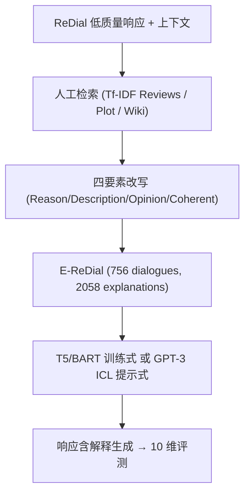

# Towards Explainable Conversational Recommender Systems (面向可解释对话推荐系统)

- **会议/期刊**: SIGIR 2023
- **作者与机构**: Shuyu Guo, Weiwei Sun, Pengjie Ren, Zhumin Chen, Zhaochun Ren (Shandong University); Shuo Zhang (Bloomberg)
- **推荐链路定位**: 端到端生成式（对话推荐响应生成）
- **研究方向**: 对话推荐与智能体仿真 / 大语言模型推荐
- **论文原文**: [https://arxiv.org/abs/2305.18363v1](https://arxiv.org/abs/2305.18363v1)
- **开源代码**: [https://github.com/Superbooming/E-ReDial](https://github.com/Superbooming/E-ReDial)

## TL;DR (1分钟核心速览)

本文针对对话推荐系统（CRS）中缺乏解释质量统一评估标准、缺少高质量解释数据的两大痛点，提出覆盖 10 个维度的解释评估视角，并基于 ReDial 以"人工改写 + 知识接地"方式构建 **E-ReDial** 数据集（756 段对话、2,058 条解释、平均 79.2 token）。在 8:2 划分的 Test-Full/Test-Rec 协议下，T5-Base + E-ReDial + 知识接地 (KG) 相比 T5+ReDial 将 F1 从 20.35 提升至 26.01（**+21.8%**）、METEOR 从 11.34 提升至 16.29，人工总体评分从 1.14 跃升至 3.67（**+222%**）。

## Background & Motivation (背景与核心矛盾)

- **主流范式**: 现有 CRS 通过多轮自然语言交互动态获取用户偏好，但响应往往仅"流畅自然"，如 ReDial/TG-ReDial 等数据集绝大多数系统回复只提及电影名，不解释推荐理由。
- **前人局限**: (1) 传统推荐可解释性指标（如透明性、说服力）不足以覆盖 CRS 多轮上下文特征；(2) 现有 CRS 数据集的解释质量低下——权威标注显示 ReDial 可解释率仅 0.32、INSPIRED/OpenDialKG 仅约 0.22；(3) Wen et al. 虽首次尝试 CRS 解释生成，但缺少评估框架与高质量监督信号。
- **核心洞察 (Key Insight)**: 通过 20+ 参与者问卷标注发现，CRS 解释质量与其整体效用强相关——"可解释率"与 CRS effectiveness/efficiency 的 Spearman 相关性显著为正（图 2），且改善任意解释维度都能提升对话质量与用户满意度。
- **本文切入点**: 系统定义 CRS 解释的 10 维评估视角 → 量化验证现有基准的不足 → 人工构建 E-ReDial → 以"知识接地 + 文本生成"两范式建立可比基线。

## Method (核心方法设计)

### 1. 整体框架 (Overall Architecture)

论文以"评估-数据-生成"三层闭环组织：先定义 10 维 CRS 解释评估视角，再对 5 个现有 CRS 数据集（ReDial/TG-ReDial/DuRecDial/INSPIRED/OpenDialKG）按 exchange 与 dialogue 两级进行问卷标注排查；随后设计人工标注流水线（检索信息→改写→质量检查）从 ReDial 中筛选低质量响应并重写，构成 E-ReDial；最后在 E-ReDial 上比较训练式（T5/BART/GPT-2/DialoGPT）与提示式（Flan-T5-XXL/Davinci-002 ICL）两类解释生成基线，并引入知识接地 (+KG) 增强。

### 2. 关键设计拆解 (Key Designs)

1. **CRS 解释 10 维评估体系**：传统可解释推荐仅覆盖单轮交互，无法捕捉 CRS 多轮上下文。本文继承 Tintarev & Masthoff 的 8 个目标（effectiveness/efficiency/persuasiveness/transparency/scrutability/trust/satisfaction/representativeness）并新增 **reasonability** 与 **coherence** 两维，分别衡量解释与对话逻辑/语言的连贯度。评估形式化为每个 exchange 的 13 题问卷打分后取均值 $\bar{s}_m = \frac{1}{|\mathcal{E}|}\sum_{e\in\mathcal{E}} s_{m,e}$。

2. **人工标注四要素流水线**：针对 ReDial 响应缺少理由与描述的病灶，设计"检索—改写—质量复核"三段式流程。改写的目标拆为 4 个可检查单元：推荐理由 (clear reason)、代表性描述 (representative description)、鼓励/个人观点 (encouragement)、合理连贯 (contextual coherence)。检索端以 Tf-IDF 相似度从 IMDb/Wikipedia 召回 Top-3 相关评论补充事实依据。超过 30 名标注者与 10 名复核者协作，最终剔除不合格样本，共保留 756 段对话与 2,058 条重写解释（平均 79.2 token）。作者还用 Davinci-002 做纯自动改写，但 >30% 响应未能满足需求（漏改推荐电影、丢失偏好、描述空洞），由此确认 E-ReDial 必须走人工路径。

3. **知识接地 (KG) 解释增强**：在输入中拼入推荐电影的 plot + wiki + reviews 三路知识，并仅保留与上下文最相关的评论以控制长度。公式上即 $p_\theta(y \mid x)=\prod_{t} p_\theta(y_t \mid y_{<t}, x, \mathcal{K}(y))$，其中$x$是对话上下文，$\mathcal{K}(y)$是与目标响应$y$ 中提及电影关联的知识块。知识接地的直觉是——解释质量的核心瓶颈在于"事实性 (representativeness)"维度，单纯拟合 E-ReDial 文本学不会具体剧情，必须显式提供事实原料。

4. **训练配置与推理**：微调模型使用 AdamW（$lr=5e-5$，batch=16，≤20 epoch），测试端贪心解码；提示式模型（Flan-T5-XXL/Davinci-002）采用 8-shot 上下文示例 +$p=0.9$ 的 nucleus decoding + temperature 0.8。总损失为标准序列交叉熵，无对比/负采样设计。

## Experimental Setup & Evaluation Protocol (实验设置与评估协议)

- **数据集与预处理**: E-ReDial 直接从 ReDial 扩展而来（后者为 CC BY 4.0），过滤逻辑是"保留含解释的系统响应 + 重写不足部分"，不改动对话结构：

| 数据集 | #Dialogues | #Utterances | #Explanations | Avg Turn | Avg Exp. Tokens |
| :--- | :---: | :---: | :---: | :---: | :---: |
| ReDial (原始) | 10,006 | — | 少量/低质 | — | — |
| **E-ReDial** | 756 | 12,003 | 2,058 | 15.9 | 79.2 |

- **数据划分与防穿越 (Splitting Strategy)**: 按 **8:2 比例划分** 70/30 train-test（未使用时间戳或 Leave-One-Out）。测试集 150 段对话 / 1,121 条系统响应；其中 **Test-Rec** 仅保留含推荐+解释的 418 条，用于评测"解释质量"，**Test-Full** 覆盖全部 1,121 条响应，用于衡量整体生成质量。
- **排名评测协议 (Ranking Protocol)**: **不适用**（非 Top-N 检索任务）；本文是生成任务，采用 **生成式文本评测**——自动指标 F1/BLEU-2/BLEU-4/METEOR/Distinct-2/Distinct-3 + 人工评估 10 维打分（3 位资深标注者，随机 30 段对话）。人工评分显著性以 $p<0.05$ t-test 检验。
- **对比基线与超参设置**: 训练式 T5-Base(220M)/BART-Base(140M)/GPT-2(117M)/DialoGPT-Small；提示式 Flan-T5-XXL(11B)/Davinci-002(~170B, 8-shot ICL)。知识接地 (+KG) 作为可选组件。模型输入 = 对话上下文 + 金标推荐电影名，输出 = 含解释的响应；推荐结果统一取 ground truth 以隔离推荐准确率与解释质量的耦合。

## Key Experimental Results (实验关键数据)

### 1. 主实验对比 (Main Results)

Test-Full（训练式模型，越高越好，加粗为各指标最优）：

| Model | F1 | B2 | B4 | MT | D2 | D3 |
| :--- | :---: | :---: | :---: | :---: | :---: | :---: |
| T5-Base + ReDial | 20.35 | 3.65 | 1.70 | 11.34 | 34.04 | 39.23 |
| T5-Base + ReDial + KG | 19.34 | 3.56 | 1.44 | 11.01 | 32.39 | 36.62 |
| T5-Base + E-ReDial | 24.31 | 6.75 | 2.38 | 15.14 | 26.69 | 39.18 |
| **T5-Base + E-ReDial + KG** | **26.01** | **7.89** | 4.10 | **16.29** | **47.60** | **59.44** |
| BART-Base + E-ReDial + KG | 24.46 | 7.87 | **4.61** | 16.48 | 47.38 | 59.11 |
| GPT-2 + E-ReDial + KG | 25.38 | **8.75** | 4.55 | **17.83** | 40.33 | 52.63 |
| DialoGPT-Small + E-ReDial + KG | 25.70 | 8.12 | 4.22 | 16.61 | 30.87 | 40.34 |

Test-Rec（训练式 vs 提示式，解释质量关键指标）：

| Model | F1 | B2 | B4 | MT | D2 | D3 |
| :--- | :---: | :---: | :---: | :---: | :---: | :---: |
| T5-Base + ReDial | 14.76 | 0.47 | 0.21 | 8.37 | 41.70 | 48.74 |
| T5-Base + E-ReDial | 29.53 | 12.69 | 5.22 | 19.83 | 27.17 | 40.95 |
| **T5-Base + E-ReDial + KG** | **34.62** | **18.10** | **11.22** | **26.65** | 48.66 | 62.24 |
| Flan-T5-XXL (8-shot ICL) | 24.52 | 7.53 | 2.45 | 15.34 | 51.08 | 70.33 |
| Davinci-002 (8-shot ICL) | 33.81 | 14.86 | 6.07 | 25.55 | **53.07** | **74.60** |

### 2. 消融实验 (Ablation Study)

以 T5-Base + KG 为骨干，E-ReDial 数据量消融（Test-Full，% 指 E-ReDial 训练样本占比，0% 即仅 ReDial 预训练）：

| Setting | F1 | B2 | B4 | MT | D2 |
| :--- | :---: | :---: | :---: | :---: | :---: |
| Vanilla T5 (0% E-ReDial) | 9.74 | 1.70 | 0.40 | 6.17 | 27.80 |
| T5 + E-ReDial(10%) | 21.46 | 6.92 | 3.69 | 15.46 | 41.29 |
| T5 + E-ReDial(50%) | 24.92 | 8.45 | 4.76 | 16.73 | 46.53 |
| T5 + E-ReDial(100%) | 26.01 | 7.89 | 4.10 | 16.29 | 47.60 |
| **T5 + ReDial → E-ReDial(0%)** | 22.61 | 4.38 | 2.16 | 12.46 | 32.83 |
| **T5 (ReDial) + E-ReDial(10%)** | **27.04** | **8.69** | **4.66** | **17.37** | 44.47 |
| T5 (ReDial) + E-ReDial(100%) | 27.98 | 9.71 | 4.84 | 18.88 | 47.07 |

### 3. 关键实验发现 (Key Findings)

- **数据源比模型规模更重要**：在 Test-Rec 上，T5-Base 切换 ReDial→E-ReDial 带来 F1 从 14.76→29.53（**+100%**）、METEOR 8.37→19.83（**+137%**），超过单纯模型调大或切换到 170B 模型的收益；Davinci-002 在 D2/D3 上领先（74.60 vs 62.24）但 F1/METEOR 低于 T5+KG，说明**大模型擅长多样性、训练式模型擅长事实精准性**。
- **知识接地增益依赖于解释性训练数据**：在 ReDial 上 +KG 反而降低 F1（T5-Base 20.35→19.34），因为 ReDial 响应本身不鼓励引用背景知识；在 E-ReDial 上 +KG 显著提升（F1 24.31→26.01、D3 39.18→59.44，$p<0.05$），说明**数据的解释性先验与知识接地相互成就**。
- **少量高质量数据即可媲美全量训练**：仅用 10% E-ReDial（约 75 段对话）在 ReDial 预训练的 T5 上即可达到 F1 27.04，超过原始 T5 全量训练的 26.01（+4.0%），数据效率极高；超过 50% 后指标进入平台或被部分指标反转，提示 E-ReDial 的标注规模对该任务已趋于饱和。

## Highlights & Limitations (亮点、对比与审稿批判)

- **与代表作对比 (vs. Prior Work)**: Wen et al. (2020) 首次在真实 CRS 数据上做解释生成，但缺少评估框架与高质量监督；Chen et al. 使用模板生成单轮反馈，脱离多轮 CRS 场景。本文本质区别在于**"评测-数据-基线"三者协同**：10 维评估视角可量化约束模型行为，E-ReDial 提供了该约束的可学习样本，知识接地则提供了事实性保障。
- **可迁移亮点**: (1) 4 要素响应拆解（理由/描述/观点/连贯）可作为对话式生成任务的通用目标分解模板；(2) "基于 Tf-IDF 检索事实再做监督改写"的数据构造范式，可直接迁移至电商/客服场景的可解释回复标注；(3) 用 ICL 大模型产出多样化描述 + 训练式小模型保证事实精准性，可作为生产环境的双模型互补架构。
- **审稿级局限批判**: (1) 解释全部**基于 ReDial 重写而非重新采集**，真实对话中的"人-系统"解释协商过程缺失，可能无法反映线上解释性交互的自然分布；(2) 数据规模较小（仅 756 段），作者也承认超过 50% 数据利用率后指标饱和甚至波动，下游难以稳定评估模型架构差异；(3) 10 维评估依赖人工问卷且样本仅 30 段对话，方差较大，缺乏自动化替代指标（作者将自动评估列为 future work）；(4) 生成式评测仅以 BLEU/METEOR 等词级重叠指标，无法衡量"解释是否真正说服用户"。

## Rating (四维评分)

- **方法创新性 (Novelty)**: ⭐⭐⭐⭐ （不是新网络架构，但 10 维 CRS 解释评估体系 + 四要素拆解具有方法论首创性，且以相关性分析佐证了解释与效用的正相关）
- **评估协议与实验扎实度 (Protocol & Experiments)**: ⭐⭐⭐⭐ （自动 + 人工双轨评测、Test-Full/Test-Rec 分层合理、数据量消融揭示饱和点，但 30 段人工评估样本偏小、未做显著性统计在表格中体现）
- **写作与数学规范度 (Clarity & Rigor)**: ⭐⭐⭐⭐ （定义清晰、4 要素拆解直观、标注流程透明，但公式偏少，生成建模形式化简略）
- **工业落地与复现价值 (Industrial & Practical Value)**: ⭐⭐⭐⭐ （E-ReDial 已开源、schema 简洁可直接用，数据 ~12k utterances 规模适合快速监督微调；但解释生成仍需人工质检环节，纯线上部署成本高）

