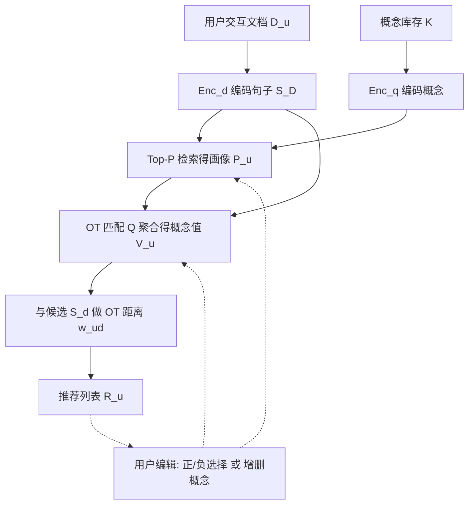
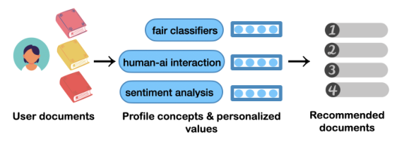
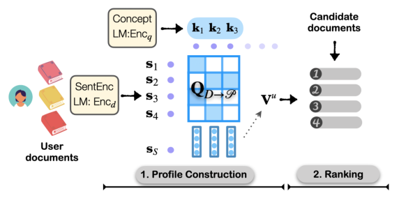

# Editable User Profiles for Controllable Text Recommendation (可编辑用户画像的可控文本推荐)

- **会议/期刊**: SIGIR 2023（预印本 v3 含扩展结果）
- **作者与机构**: Sheshera Mysore, Mahmood Jasim, Andrew McCallum, Hamed Zamani（UMass Amherst）
- **推荐链路定位**: 重排（可作为可重排的端到端内容推荐器）
- **研究方向**: 冷启动与长尾推荐 / 大语言模型推荐
- **论文原文**: [arXiv:2304.04250v3](https://arxiv.org/abs/2304.04250v3)
- **开源代码**: [iesl/editable_user_profiles-lace](https://github.com/iesl/editable_user_profiles-lace)

## TL;DR (1分钟核心速览)

隐表征推荐在冷启动与零样本场景性能崩坏，且用户无法查看/修正“系统眼中的自己”。LACE 把概念瓶颈模型迁移到文本推荐：从用户交互文档中以 BERT 级编码器检索一组人类可读概念构成画像 $P_u$，再用熵正则化最优传输把句子稀疏分配到概念上，得到个性化概念值$V_u$ 用于排序。在 6 个数据集、3 种设定（warm-start / cold-start / zero-shot）的 **Full-Ranking** NDCG@20/R@20 评估中，零样本下较 NeuKNN 提升 21–29%，冷启动下提升 5–15%；20 人用户研究中经画像编辑后 MRR 由 70.76 升至 90.00。

## Background & Motivation (背景与核心矛盾)

- **主流范式**: 隐表征（矩阵分解 / 神经内容编码）在交互数据充足时性能强，但用户画像不可读、不可改；概念瓶颈类透明模型则缺少个性化能力。
- **前人局限**: ① Balog 等的加权标签画像依赖预标注物品标签，且完全无法用于零交互冷启动；② Radlinski 等倡导的 LLM 自然语言画像可解释性尚未验证；③ 传统 CBM 需要成对 $(D_u, P_u)$ 标注，且不支持测试期新增概念。
- **核心洞察 (Key Insight)**: 若用户画像本身就是“检索出来的概念集合”，那么概念既是**可读的语义单元**（满足透明性），又是**可编辑的输入端**（新增概念会被同一编码器即时编码），还能在无交互数据时仅凭文档内容构建（满足零样本）。
- **本文切入点**: 用“检索增强的概念瓶颈 + 个性化概念值”把透明性与性能统一到一个可微框架里，编辑即改变 $V_u$ 的聚合方式，无需重训。

## Method (核心方法设计)

### 1. 整体框架 (Overall Architecture)

LACE 是两段式概念值瓶颈：$g: D_u \to P_u$（画像构建）与$f: P_u \to R_u$（排序）。句子级编码器$\text{Enc}_d$把用户文档编码为$S_D$，概念编码器$\text{Enc}_q$编码概念库$K$；按最小 L2 距离检索 Top-$P$概念成画像；再用最优传输求句子到概念的稀疏匹配$Q$，加权平均得个性化概念值$V_u$；排序时对$V_u$与候选文档多向量$S_d$再做一次 OT 求 Wasserstein 距离。训练阶段仅用三元组损失微调$\text{Enc}_d$，$\text{Enc}_q$ 持续以 ICT 目标更新以保持与用户编辑语义对齐。

<figure class="paper-figure" markdown="span">
  <figcaption>图 1：我们提出的方法 LACE 使用人类可读的概念画像表示用户，并将其用于可控推荐。LACE 有两项关键创新：允许用户编辑画像的检索增强概念画像，以及从用户文档计算得到的个性化概念值，以实现高性能推荐。</figcaption>
</figure>

### 2. 关键设计拆解 (Key Designs)

1. **检索增强的概念瓶颈（画像构建）**：痛点在于 CBM 需概念监督且无法测试期扩展。LACE 把 $g$实现为检索算子：$P=\text{top-}P(S_D,K)$，其中$\text{dist}(S_D,k_i)=\min_j\|k_i-s_j\|$。新增/重命名概念只需经同一$\text{Enc}_q$编码，即可回流至$Q$与$V_u$，无需重训，这是其“可编辑性”的形式化根基。

2. **个性化概念值（OT 稀疏聚合）**：同一概念在不同用户文档下语义应不同。以熵正则 OT（$\lambda=20$，geomloss 实现）求传输计划$Q$，再作指派加权平均：
$$V_i=\frac{1}{\sum_j Q_{ji}}\sum_{j=1}^{S}Q_{ji}\cdot S_j$$
OT 解的稀疏性使每个概念只吸收一小簇句子，等价于把文档软聚类为“主题簇”，故对概念的正/负选择恰好是“保留/剔除某主题簇”，推荐结果变化具可解释因果链。

<figure class="paper-figure" markdown="span">
  <figcaption>图 2：LACE 中通过检索获得的画像概念作为键，用于从用户文档计算个性化概念值；这些值用于排序。</figcaption>
</figure>

3. **训练目标、负采样与推理效率**：损失为三元组排序
$$\mathcal{L}_{rec}=\sum_{u}\sum_{i=1}^{|D_u|}\max\big[w_{u}^{d^+}-w_{u}^{d^-}+\delta,\,0\big]$$
负样本从**其他用户**交互文档中随机采样（非 in-batch），$\delta=1$；$\text{Enc}_q$额外接 ICT 对比损失联合训练。推理端全库计算$w_{ud}$ 开销较大，实践中采用 NeuKNN 召回 Top-500 + LACE 重排，OT 可微且支持 ANN 近似，作者留作未来工作。

## Experimental Setup & Evaluation Protocol (实验设置与评估协议)

- **数据集与预处理**（原文仅报告稀疏度，未列绝对规模）：

| 数据集 | #Users | #Items | #Interactions | 稀疏度 | 特征/场景说明 |
| :--- | :---: | :---: | :---: | :---: | :--- |
| CiteULike-A | — | — | — | 99.78% | 科学论文；物品至少被 5 用户收藏 |
| CiteULike-T | — | — | — | 99.93% | 科学论文；同上 5-core |
| TEDREC | — | — | — | 99.70% | TED 演讲；用户至少 12 次交互 |
| ICLR-2020 / ICLR-2019 / UAI-2019 | — | — | — | — | 审稿人-论文匹配（OpenReview 私有数据，无过滤） |

- **数据划分与防穿越 (Splitting Strategy)**: ① Warm-start：每用户随机 20% 物品作测试；② Cold-start：随机 20% **全体物品**完全不曝光，模型仅在剩余 80% 上训练；③ Zero-shot：不允许使用任何交互训练。开发集为 10% 用户。
- **排名评测协议 (Ranking Protocol)**: 无偏 **Full-Ranking**（候选集为全部未交互物品），指标 NDCG@20 与 Recall@20（原文验证 rank 5 趋势一致）。
- **对比基线与超参设置**: Popular / BPR / ALS（仅 warm）/ Hybrid（Bansal 等，LM 冻结）/ NeuKNN（单塔文档最近邻，可视为 LACE 的可控性对照组）。科学文本用 SPECTER 与 Aspire，网页文本用 Sentence-BERT（110M BERT 基座）；OT 熵正则 $\lambda=20$；显著性用双侧 t 检验$p<0.05$ 并 Bonferroni 校正。

## Key Experimental Results (实验关键数据)

### 1. 主实验对比 (Main Results)

**Warm-start**（LACE 原生输出弱于 ALS，但作为重排器显著反超）：

| 模型 | CiteULike-A NDCG@20 | R@20 | CiteULike-T NDCG@20 | R@20 | TEDREC NDCG@20 | R@20 |
| :--- | :---: | :---: | :---: | :---: | :---: | :---: |
| ALS | 16.82 | 25.55 | 16.58 | 28.58 | 6.49 | 11.07 |
| BPR | 12.90 | 20.34 | 13.49 | 24.14 | 4.80 | 8.57 |
| Hybrid | 10.37 | 17.46 | 6.22 | 12.05 | 1.58 | 2.55 |
| NeuKNN | 5.79 | 17.45 | 5.95 | 15.19 | 1.57 | 5.22 |
| LACE | 8.86 | 20.20 | 8.36 | 19.27 | 3.69 | 7.78 |
| **LACE rrALS** | **24.86** | **44.92** | **19.74** | **35.63** | **12.50** | **27.27** |
| *Improv. vs best* | +47.8% | +75.8% | +19.1% | +24.7% | +92.6% | +125.4% |

**Cold-start / Zero-shot**（LACE 原生即为 SOTA）：

| 模型 | CiteULike-A NDCG@20 | R@20 | CiteULike-T NDCG@20 | R@20 | TEDREC NDCG@20 | R@20 |
| :--- | :---: | :---: | :---: | :---: | :---: | :---: |
| *Cold-start* Hybrid | 22.93 | 31.64 | 13.61 | 23.45 | 7.32 | 11.51 |
| *Cold-start* NeuKNN | 26.31 | 37.36 | 18.38 | 28.75 | 17.49 | 25.69 |
| *Cold-start* **LACE** | **29.39** | **39.72** | **21.20** | **32.11** | **17.93** | **27.06** |
| *Zero-shot* NeuKNN | 21.25 | 30.46 | 15.21 | 24.07 | 16.30 | 22.77 |
| *Zero-shot* **LACE** | **27.47** | **38.86** | **18.76** | **29.15** | **17.41** | **24.86** |

**OpenReview 零样本（Bids 相关性）**: LACE 在 ICLR-2020 / ICLR-2019 / UAI-2019 上 NDCG@20 分别达 18.02 / 18.33 / 28.05，较 NeuKNN（15.52 / 15.21 / 22.98）提升 16.1% / 20.5% / 22.1%；在 Assignments 相关性上 UAI-2019 提升 16.7%。在 RAPRatings 外部数据集上 Loss 降至 0.22，优于 TPMS、ELMo、SPECTER+MFR。

### 2. 消融实验 (Ablation Study)

| 配置 | CiteULike-A Cold NDCG | CiteULike-A Zero NDCG | TEDREC Cold NDCG | TEDREC Zero NDCG |
| :--- | :---: | :---: | :---: | :---: |
| LACE (full) | **29.39** | **27.47** | **17.93** | **17.41** |
| w/o CV bottleneck | 28.10 | 24.30 | 17.78 | **17.85** |
| w/o 概念值（退化为标签画像） | 12.66 | 3.90 | 9.85 | 8.80 |
| NeuKNN + 更多预训练 | 26.28 | 24.89 | 17.45 | 16.09 |

### 3. 关键实验发现 (Key Findings)

1. **概念值是承载个性化信息的主体**：移除以 OT 计算的概念值、退化为标签画像后，CiteULike-A 零样本 NDCG@20 从 27.47 骤降至 3.90（−85.8%），远大于移除整个 CV 瓶颈的降幅（24.30，−11.5%），说明“概念可读”与“概念个性化”解耦，后者才是性能瓶颈。
2. **收益与数据稀疏度强相关**：在稀疏的 CiteULike-A/T（99.78%/99.93%）零样本提升 27–29% 与 21–23%，而在更稠密的 TEDREC（99.70% 但交互更密）仅提升 7–9%；这与“NeuKNN 在稠密数据上已很强”的既有结论一致，LACE 的核心增量场景是科学文本等稀疏域。
3. **可控性在真实交互中确实生效但显著性有限**：20 人研究里 LACE 调优后 MRR 从 70.76→90.00（+19.24）、NDCG@20 从 71.68→86.16（+14.48），增益略大于 NeuKNN 的 +18.42/+12.88，但两者差异未达 $p<0.05$ 显著；用户平均执行 7.2 次正/负选择 vs 仅 0.68 次概念编辑，说明**选择优于编辑**是更自然的交互范式。

## Highlights & Limitations (亮点、对比与审稿批判)

- **与代表作对比 (vs. Prior Work)**: 相较 Balog 标签画像，LACE 不依赖预标注物品且支持零样本；相较 NeuKNN 单塔最近邻，LACE 通过多概念值聚合与 OT 稀疏对齐获得 5–29% 提升并附带可编辑性；相较经典 CBM（Koh 等），LACE 用检索式 $g$ 绕开成对标注瓶颈并支持测试期概念扩展。
- **可迁移亮点**: ① “检索即画像构建”可迁移到任意内容域（音乐、视频）的冷启动画像生成；② OT 稀疏匹配作为可微的“软聚类 + 聚合器”，天然支持用户对簇级语义的增删干预，可作为可解释推荐/搜索的通用交互原语。
- **审稿级局限批判**: ① Warm-start 原生性能仍落后 ALS 约 50%，其定位实际是**重排器**而非端到端方案，需依赖现有粗排系统；② 概念库（TED 200 类 / OpenReview 8k / CiteULike 116k）按数据集人工定制，新领域部署仍存在概念库存获取门槛，且论文未讨论概念覆盖度敏感性；③ 全库 OT 距离计算复杂度高，虽提及 ANN 近似但未给出可行性验证，20 人用户研究的统计功效也不足以支撑“显著优于 NeuKNN”的结论。

## Rating (四维评分)

- **方法创新性 (Novelty)**: ⭐⭐⭐⭐ （把概念瓶颈从视觉分类迁移到文本推荐，并以检索+OT 形式化实现“可编辑—可微—零样本”三位一体，机制清晰；但“概念画像”并非全新概念）
- **评估协议与实验扎实度 (Protocol & Experiments)**: ⭐⭐⭐⭐ （6 数据集×3 设定×Full-Ranking，配 Bonferroni 校正与 20 人用户研究，完整性高；扣分于数据集绝对统计量披露不全、用户研究样本偏小）
- **写作与数学规范度 (Clarity & Rigor)**: ⭐⭐⭐⭐ （三条 desiderata 的形式化清晰，OT 推导完整且引用规范；但 $T$、$K_f$ 等符号在正文中定义分散，实现依赖 geomloss/POT 两个库略有割裂）
- **工业落地与复现价值 (Industrial & Practical Value)**: ⭐⭐⭐ （代码开源、整型依赖简单、可作为现有 MF 系统的重排插件带来 19–125% 提升；但全库 OT 在线开销高、概念库需领域定制，直接全量部署门槛较高）

