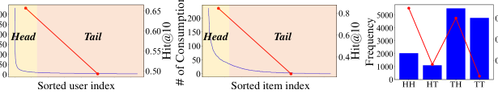
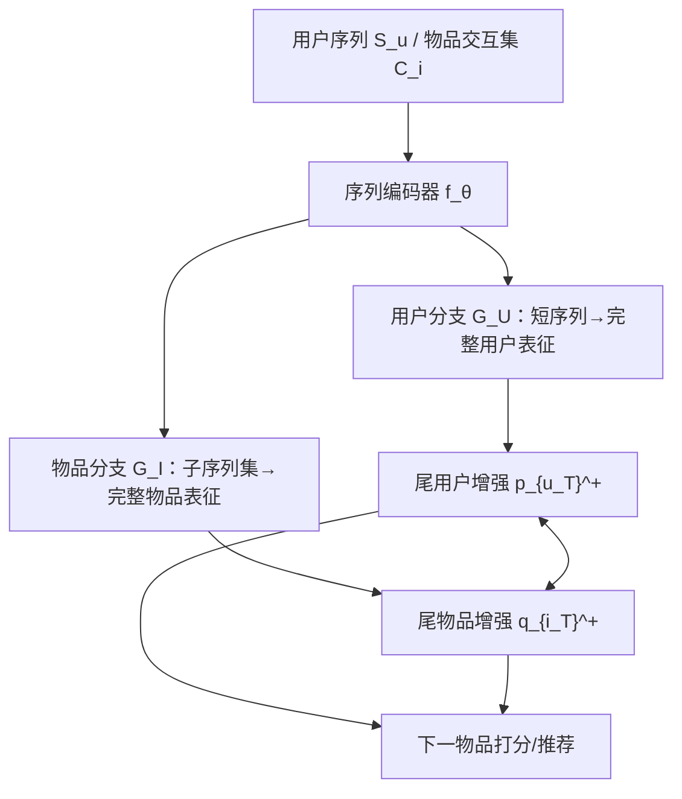
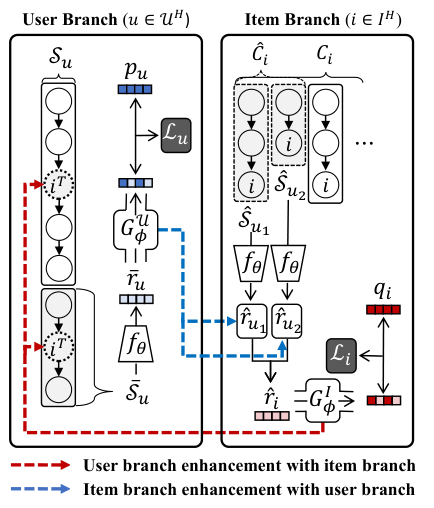

# MELT: Mutual Enhancement of Long-Tailed User and Item for Sequential Recommendation (长尾用户与物品互增强的序列推荐)

- **会议/期刊**: SIGIR 2023
- **作者与机构**: Kibum Kim, Dongmin Hyun, Sukwon Yun, Chanyoung Park；KAIST、POSTECH
- **推荐链路定位**: 召回/排序（序列下一物品预测）
- **研究方向**: 冷启动与长尾推荐 / 序列推荐
- **论文原文**: [https://arxiv.org/abs/2304.08382v1](https://arxiv.org/abs/2304.08382v1)
- **开源代码**: [https://github.com/rlqja1107/MELT](https://github.com/rlqja1107/MELT)

## TL;DR (1分钟核心速览)

针对序列推荐中长尾用户与长尾物品同时存在、单侧方法会互相拖累的痛点，MELT 用用户/物品双边分支分别做“头到尾”表征生成，并以互增强和课程学习端到端联合训练。在 8 个数据集、Leave-One-Out + 100 负采样协议下，Music 总体 HR@10 较最佳基线提升 8.3%，尾用户/尾物品分别提升 10.2%/9.5%。

## Background & Motivation (背景与核心矛盾)

- **主流范式**: SASRec/BERT4Rec 等序列编码器做下一物品预测；长尾方法分两类，ASReP/INSERT 补尾用户，CITIES/Tail-Net 补尾物品。
- **前人局限**: 只解一侧；ASReP 增广多为头物品且增广器固定，CITIES 冻结尾物品参数；简单拼接 ASReP+CITIES 在 Music TT 组仅 0.273，反低于 CITIES 的 0.279。
- **核心洞察 (Key Insight)**: Music 中 TT 组占 38% 且 Hit@10 最低，尾用户与尾物品问题共现，单侧优化会把偏差传给另一侧。
- **本文切入点**: 双边分支分别以头用户/头物品为教师，生成尾表征并迭代互增强。

<figure class="paper-figure" markdown="span">
  <figcaption>图1：在 Amazon Music 数据上，Hit@10 性能（红色）随 (a) 用户消费序列长度、(b) 已消费物品数量以及 (c) 头部/尾部用户与头部/尾部物品的组合变化。</figcaption>
</figure>

## Method (核心方法设计)

### 1. 整体框架 (Overall Architecture)

MELT 以任意序列编码器 $f_\theta$为骨干：用户分支把头部用户完整序列截断为短序列，训练生成器$G_U$由短序列表征回归完整用户表征；物品分支把“以目标物品结尾”的用户子序列集采样后编码，训练$G_I$ 由不完整交互集回归完整物品表征。两分支在训练中互相替换对方输入里的尾用户/尾物品表征，形成头→尾知识迁移闭环；推理时只对尾用户、尾物品做增强后点积排序。

<figure class="paper-figure" markdown="span">
  <figcaption>图2：用户分支与物品分支的整体框架。</figcaption>
</figure>

### 2. 关键设计拆解 (Key Designs)

1. **用户分支：短序列模拟尾用户**：头部用户完整序列 $S_u$截断为最近$R$项$\bar S_u$，编码得$\bar r_u=f_\theta(\bar S_u)$；生成器$G_U$以$\bar r_u$回归完整表征$p_u$：$L_u=\|p_u-G_U(\bar r_u)\|_2^2$。尾用户增强为$p_{u_T}^+=G_U(r_{u_T})+\beta p_{u_T}$，用头部知识补短序列。
2. **物品分支与互增强**：对物品 $i$，构造以其结尾的用户子序列集$C_i$，采样$\hat C_i$得$\hat r_i=\frac{1}{K}\sum_{\hat S_u\in\hat C_i}f_\theta(\hat S_u)$，训练$L_i=\|q_i-G_I(\hat r_i)\|_2^2$，尾物品$q_{i_T}^+=G_I(r_{i_T})+\gamma q_{i_T}$。互增强时，用户序列中的尾物品替换为$G_I(r_i)+\gamma q_i$，物品分支中用户子序列表征替换为$G_U(\hat r_u)+\beta p_u$，交替更新。
3. **训练目标、课程学习与推理**：总损失 $\mathcal{L}=\lambda_U\sum_{u\in U_H}L_u+\lambda_I\sum_{i\in I_H}L_i+\mathcal{L}_{rec}$；课程权重$w_u=\sin(\frac{\pi e}{2e_{max}}+\frac{\pi(|S_u|-L_{min})}{2(L_{max}-L_{min})})$，从长序列/多交互到短序列/少交互。负采样沿用 SRS 原训练；推理用点积，空间$O(2d^2+|\theta|)$，比 ASReP+CITIES 快 1.62×。

## Experimental Setup & Evaluation Protocol (实验设置与评估协议)

- **数据集与预处理**: 8 个 Amazon/Foursquare/Behance 数据集，过滤少于 5 次交互的用户/物品（5-core）。

| 数据集 | #Users | #Items | #Interactions | 密度 | 场景 |
| :--- | :---: | :---: | :---: | :---: | :--- |
| Clothing | 184,050 | 174,484 | 1,068,972 | 0.0033% | Amazon 服饰 |
| Sports | 83,970 | 83,728 | 589,029 | 0.0084% | Amazon 运动 |
| Beauty | 52,204 | 57,289 | 394,908 | 0.0132% | Amazon 美妆 |
| Grocery | 32,126 | 39,264 | 275,256 | 0.0218% | Amazon 杂货 |
| Automotive | 34,315 | 40,287 | 183,567 | 0.0133% | Amazon 汽车 |
| Music | 20,165 | 20,356 | 132,595 | 0.0323% | Amazon 音乐 |
| Foursquare | 43,110 | 13,335 | 306,553 | 0.0533% | 签到 POI |
| Behance | 28,915 | 32,491 | 712,271 | 0.0758% | 艺术兴趣 |

- **数据划分与防穿越**: `Leave-One-Out`；最后 1 次交互测试、倒数第 2 次验证、其余训练；复现 ASReP/INSERT 时排除验证/测试交互防泄漏。
- **排名评测协议**: `Sampled Ranking`，每个用户真值配 100 个未交互随机负样本；报告 HR@10、ND@10。
- **对比基线与超参**: SASRec、BERT4Rec、Tail-Net、INSERT、ASReP、CITIES；$d=50$、最大序列长 50、batch 128/256、5 个随机种子取均值；原文未报告显著性检验。

## Key Experimental Results (实验关键数据)

### 1. 主实验对比 (Main Results)

SASRec 骨干，Music/Beauty 为代表；TU/TI 为尾用户/尾物品。MELT 行加粗最优，Improv. 相对最佳基线。

| 模型 | Music Overall HR@10 / ND@10 | Music TU HR@10 | Music TI HR@10 | Beauty Overall HR@10 / ND@10 | Beauty TU HR@10 | Beauty TI HR@10 |
| :--- | :---: | :---: | :---: | :---: | :---: | :---: |
| SASRec | 0.5344 / 0.3717 | 0.4970 | 0.2481 | 0.4576 / 0.2995 | 0.4399 | 0.1680 |
| BERT4Rec | 0.5203 / 0.3628 | 0.4835 | 0.2270 | 0.4476 / 0.3005 | 0.4337 | 0.1087 |
| Tail-Net | 0.4791 / 0.3072 | 0.4487 | 0.1231 | 0.4233 / 0.2643 | 0.4118 | 0.0375 |
| INSERT | 0.4400 / 0.2724 | 0.4198 | 0.0832 | 0.4069 / 0.2447 | 0.3997 | 0.0278 |
| ASReP | 0.5443 / 0.3830 | 0.5076 | 0.2637 | 0.4680 / 0.3112 | 0.4515 | 0.1755 |
| CITIES | 0.5537 / 0.3879 | 0.5147 | 0.3030 | 0.4599 / 0.3039 | 0.4406 | 0.2071 |
| **MELT** | **0.5997 / 0.4058** | **0.5672** | **0.3318** | **0.5012 / 0.3300** | **0.4861** | **0.2144** |
| Improv.% | +8.3 / +4.6 | +10.2 | +9.5 | +7.1 / +6.0 | +7.7 | +3.5 |

### 2. 消融实验 (Ablation Study)

Music 数据集 HR@10；U=用户分支，I=物品分支，Mutual=互增强，CL=课程学习。

| 变体 | Overall | HU | TU | HI | TI |
| :--- | :---: | :---: | :---: | :---: | :---: |
| SASRec | 0.534 | 0.660 | 0.497 | 0.851 | 0.248 |
| +U | 0.541 | 0.659 | 0.506 | 0.891 | 0.225 |
| +I | 0.578 | 0.698 | 0.543 | 0.848 | 0.331 |
| +U+I | 0.582 | 0.699 | 0.548 | 0.877 | 0.316 |
| +Mutual | 0.597 | 0.711 | 0.563 | 0.891 | 0.330 |
| +CL (Full) | **0.600** | **0.709** | **0.567** | **0.896** | **0.332** |

### 3. 关键实验发现 (Key Findings)

1. **联合建模显著优于单侧**：Music 上 MELT 总体 HR@10 0.5997 vs CITIES 0.5537（+8.3%），尾用户 0.5672 vs 0.5147（+10.2%），尾物品 0.3318 vs 0.3030（+9.5%），且头用户/头物品未降。
2. **简单拼接会失效**：Music TT 组 ASReP+CITIES 仅 0.273，低于 CITIES 的 0.279；MELT 达 0.312，相对 CITIES +11.8%，说明固定增广+单侧优化会加剧头物品偏置。
3. **互增强修复尾物品、CL 稳定迁移**：Music 去互增强（+U+I）TI 为 0.316，加互增强升至 0.330，再加 CL 达 0.332；Overall 从 0.597 到 0.600，课程学习主要稳定头→尾知识迁移。

## Highlights & Limitations (亮点、对比与审稿批判)

- **与代表作对比 (vs. Prior Work)**: ASReP 只做尾用户反转增广且增广器固定；CITIES 只增强尾物品且冻结参数；MELT 用双生成器端到端互增强，首次把长尾用户/物品联合处理，参数仅增 $O(2d^2)$。
- **可迁移亮点**: 单层 FFN 作为 head→tail 表征生成器，低参高效；按序列长度/交互数调权的课程学习可直接用于其他冷启动/长尾迁移任务。
- **审稿级局限批判**: 评测仅 100 负样本采样排序，未做全库 Full-Ranking，可能高估；头尾阈值固定 20%/50%，$C_i$构造与尾物品增强推理有额外工程开销，$\beta,\gamma$ 搜索时固定为 1/0，泛化性待验证。

## Rating (四维评分)

- **方法创新性 (Novelty)**: ⭐⭐⭐⭐ （首次联合长尾用户/物品，双边互增强+课程学习机制清晰，但理论分析偏经验）
- **评估协议与实验扎实度 (Protocol & Experiments)**: ⭐⭐⭐⭐ （8 数据集、5 种子、细粒度头尾分析完整；但采样 100 负样本、未报告显著性检验）
- **写作与数学规范度 (Clarity & Rigor)**: ⭐⭐⭐⭐ （框架与公式简洁，复杂度分析完整；部分实现细节依赖附录）
- **工业落地与复现价值 (Industrial & Practical Value)**: ⭐⭐⭐⭐ （模型无关、单层生成器、训练快 1.62×，易插现有 SRS；需优化 $C_i$ 字典与尾物品推理）

