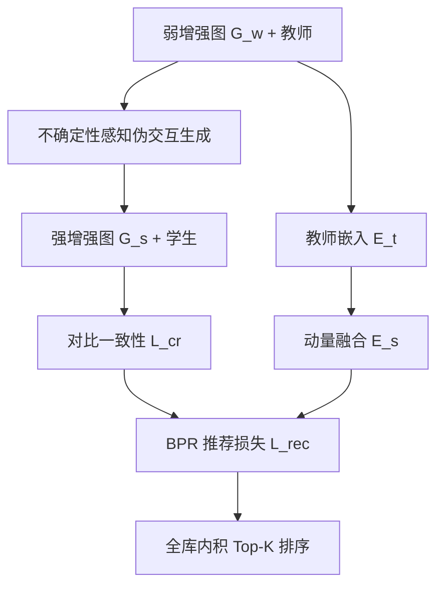
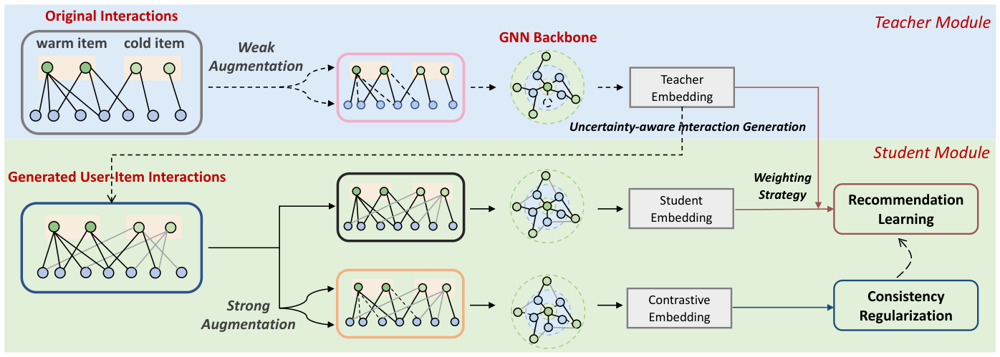
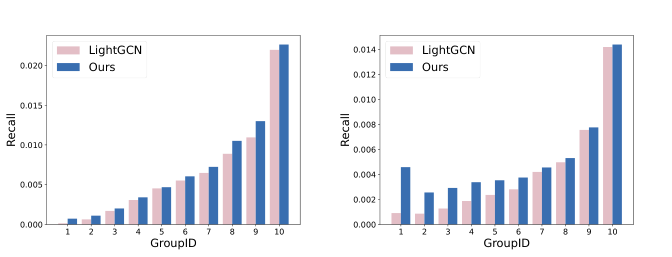

# Uncertainty-aware Consistency Learning for Cold-Start Item Recommendation（面向冷启动物品推荐的不确定性感知一致性学习）

- **会议/期刊**: SIGIR 2023
- **作者与机构**: Taichi Liu, Chen Gao, Zhenyu Wang, Dong Li, Jianye Hao, Depeng Jin, Yong Li；清华大学、华为诺亚方舟实验室
- **推荐链路定位**: 召回/排序（Top-K 物品推荐）
- **研究方向**: 冷启动与长尾推荐 / 自监督对比学习与交互去噪
- **论文原文**: [论文原文链接](https://arxiv.org/abs/2308.03470v1)
- **开源代码**: 暂未开源

## TL;DR (1分钟核心速览)

针对 GNN 冷启动推荐中冷/热物品交互分布差异导致的“此消彼长”问题，UCC 仅在用户—物品交互上，用教师模型生成低不确定性伪交互，再以教师—学生图对比与动量嵌入保持一致性。Yelp/Amazon-Book 的 10-core、7:1:2 划分、K=20 排序下，Recall 相对 LightGCN 提升 11.6%/27.6%，且冷、热分组同时受益。

## Background & Motivation (背景与核心矛盾)

- **主流范式**：GNN 推荐以 LightGCN 等图卷积聚合高阶邻域；冷物品邻居极少，表征天然欠拟合。
- **前人局限**：现有冷启动方法多引入社交、属性等辅助特征，对交互本身利用不足；同时冷物品低曝光交互与热物品高曝光交互的嵌入分布显著不同。
- **核心洞察 (Key Insight)**：仅提升冷物品或热物品会触发 seesaw 现象；关键是给冷物品补足“低不确定性交互”，使其分布靠近热物品，再用一致性学习抑制伪交互噪声。
- **本文切入点**：以不确定性感知的伪交互生成 + 教师—学生一致性学习，在纯交互设定下同时提升冷、热物品。

## Method (核心方法设计)

### 1. 整体框架 (Overall Architecture)

UCC 将推荐器拆为教师与学生两阶段。教师先在弱增强图 $G_w$上按 BPR 预训练，得到相对稳定的嵌入与全库打分；随后按物品平均打分与用户—物品余弦相似度筛选低不确定性未交互边，生成伪交互$\hat{\mathcal{O}}$；学生模型在原图加伪边的强增强图$G_s$ 上训练，通过物品/用户级对比损失对齐弱/强视图，并以动量把教师嵌入累积进学生嵌入，最后用 BPR 微调。推理仅保留学生 GNN，全库内积排序 Top-K，生成器不进入在线链路。

<figure class="paper-figure" markdown="span">
  <figcaption>图 1：UCC 整体框架。教师模型（上方蓝色框）先在弱增强正则化下训练；随后通过不确定性感知选择过程生成交互；最后生成的交互用于学生模型训练（下方绿色框）。基于强增强的一致性正则化与集成教师表示提升了学生模型的鲁棒性。</figcaption>
</figure>

### 2. 关键设计拆解 (Key Designs)

1. **不确定性感知交互生成**：冷物品分布偏移源于曝光不足，直接补边会放大流行度偏差。UCC 先算用户—物品余弦相似度 $d_{mn}=\frac{|e_{u_m}e_{i_n}^{\top}|}{\|e_{u_m}\|\|e_{i_n}\|}$，再用物品平均打分$\bar{s}_n=\frac{1}{M}\sum_{m=1}^M s_{mn}$作为整体不确定性尺度，按$\hat{\mathcal{O}}_n=\{(u_m,i_n)\mid \mathbb{I}(d_{mn}>\alpha\bar{s}_n)=1\}$ 保留高确信伪边。冷物品阈值相对低、补边更多，从物理上拉近冷/热物品交互分布。

2. **教师—学生一致性学习**：伪交互仍含噪，UCC 用弱增强图 $G_w=(\mathcal{V},\mathbf{M}\odot\mathcal{O}^+)$与强增强图$G_s=(\mathcal{V},\mathcal{O}^++\hat{\mathcal{O}})$构造两视图，并以对比损失约束同一物品两视图一致：$\mathcal{L}_{cr,item}=\sum_{i\in\mathcal{I}}-\log\frac{\exp(\mathrm{sim}(z'_i,z''_i)/\tau)}{\sum_{j\in\mathcal{I}}\exp(\mathrm{sim}(z'_i,z''_j)/\tau)}$，用户侧同理。模型级再用$\mathbf{E}_s\leftarrow\gamma\mathbf{E}_s+(1-\gamma)\mathbf{E}_t$ 累积教师知识，降低伪边噪声对稀疏冷物品的冲击。

3. **训练目标、负采样与推理效率**：推荐主损失为 BPR：$\mathcal{L}_{rec}=\sum_{(u,i^+,i^-)\in\mathcal{O}}-\ln\sigma(\hat{y}_{ui^+}-\hat{y}_{ui^-})+\lambda\|\Theta\|_2^2$，总体$\mathcal{L}_{total}=\mathcal{L}_{rec}+\mu\mathcal{L}_{cr}$。负采样沿用 BPR 的未交互随机负例，原文未报告负例比例；推理无生成器，但训练需教师/学生及弱/强图两套前向，训练开销高于 LightGCN。

## Experimental Setup & Evaluation Protocol (实验设置与评估协议)

- **数据集与预处理**：Yelp 与 Amazon-Book 均采用 `10-core` 过滤，正文未报告用户/物品/交互统计量：

| 数据集 | #Users | #Items | #Interactions | 稀疏度/密度 | 特征/场景说明 |
| :--- | :---: | :---: | :---: | :---: | :--- |
| Yelp | 未报告 | 未报告 | 未报告 | 未报告 | 10-core；用户—物品二部图 |
| Amazon-Book | 未报告 | 未报告 | 未报告 | 未报告 | 10-core；交互更稀疏、冷物品偏置更强 |

- **数据划分与防穿越 (Splitting Strategy)**：按 $7:1:2$ 划分为训练/验证/测试，沿用 LightGCN 系列设置；未采用 Leave-One-Out。
- **排名评测协议 (Ranking Protocol)**：Top-$K$，$K=20$，报告 Recall@20 与 NDCG@20。原文未明确写出 Full-Ranking 或采样排序及正负比；从沿用 LightGCN/SGL 流程看倾向全库排序，但缺少显式说明。
- **对比基线与超参设置**：以 LightGCN 为 GNN backbone，对比 LightGCN、IRBPR、NB、ADT、SGL；Embedding 维度 $d$、$\alpha,\mu,\gamma$ 具体取值及显著性检验均未在正文报告。

## Key Experimental Results (实验关键数据)

### 1. 主实验对比 (Main Results)

| Dataset | Metric | LightGCN | IRBPR | NB | ADT | SGL | UCC (Ours) | Improv. vs LightGCN |
| :--- | :--- | :---: | :---: | :---: | :---: | :---: | :---: | :---: |
| Yelp | Recall@20 | 0.0639 | 0.0538 | 0.0640 | 0.0691 | 0.0673 | **0.0713** | +11.6% |
| Yelp | NDCG@20 | 0.0515 | 0.0438 | 0.0526 | 0.0388 | 0.0554 | **0.0587** | +14.0% |
| Amazon-Book | Recall@20 | 0.0410 | 0.0325 | 0.0425 | 0.0335 | 0.0477 | **0.0523** | +27.6% |
| Amazon-Book | NDCG@20 | 0.0318 | 0.0246 | 0.0328 | 0.0176 | 0.0378 | **0.0410** | +28.9% |

### 2. 消融实验 (Ablation Study)

原文未给出完整消融数值表，以下按正文数值与图 3 趋势整理：

| 配置/分析 | 报告结果或趋势 | 结论 |
| :--- | :--- | :--- |
| Full UCC | Yelp Recall 0.0713；Amazon 0.0523 | 主结果最优 |
| Item-side 伪交互生成 | 冷物品平均生成约 3.5 条，热物品约 1.0 条 | 自适应补边缓解冷/热分布差 |
| 改用 User-side 生成 | Yelp Recall 由 0.0673 降至 0.0671 | 用户侧伪交互偏置更强，反而伤害性能 |
| Finetune learning | 图 3 中低于 UCC | 无教师动量累积，更易受伪边噪声影响 |
| Continuous learning | 图 3 中低于 UCC | 无额外冷物品交互，冷启动增益不足 |

### 3. 关键实验发现 (Key Findings)

- UCC 在 Yelp 上 Recall 0.0713 对 LightGCN 0.0639（+11.6%），Amazon-Book 上 0.0523 对 0.0410（+27.6%）；相对强基线 SGL 也分别高约 6.0% 与 9.6%，说明伪边生成与一致性学习带来稳定增益。
- 冷启动分组中，Amazon-Book 最冷组 Recall 由 0.0009 升至 0.0045，相对提升 400%；Yelp 冷组接近 7 倍，且原文称所有热度组均优于 LightGCN，直接缓解“提升冷物品伤热物品”的 seesaw 问题。
- 伪交互数量呈自适应：冷物品约 3.5 条、热物品约 1.0 条；用户侧生成使 Yelp Recall 0.0673→0.0671，而教师—学生训练在图 3 中优于 finetune/continuous，表明“物品侧低不确定性筛选 + 教师知识保持”是收益关键。

<figure class="paper-figure" markdown="span">
  <figcaption>图 2：各物品组的性能比较。</figcaption>
</figure>

## Highlights & Limitations (亮点、对比与审稿批判)

- **与代表作对比 (vs. Prior Work)**：LightGCN 缺少冷物品补边机制；SGL 用随机图增强做对比学习，但不显式生成低不确定性交互；NB/IRBPR/ADT 侧重生成或去噪，未用教师—学生动量把冷/热分布对齐。UCC 的差异在于仅用交互、训练期生成伪边且推理不加开销。
- **可迁移亮点**：按物品自适应阈值筛选伪交互，可迁移到长尾/稀疏物品补边；教师嵌入动量累积可推广到其他稀疏节点表征学习，降低伪标签噪声。
- **审稿级局限批判**：仅两个数据集，未报告 $d,\alpha,\mu,\gamma$ 与显著性检验，统计量与负采样协议也缺失；训练需教师/学生双模型与两套图前向，开销增加，且余弦阈值仍可能放大曝光偏差，冷启动分组仅按最后两组划分，粒度较粗。

## Rating (四维评分)

- **方法创新性 (Novelty)**: ⭐⭐⭐⭐ （从冷/热分布差与 seesaw 切入，伪交互生成结合教师—学生一致性，机制针对性强）
- **评估协议与实验扎实度 (Protocol & Experiments)**: ⭐⭐⭐ （10-core、7:1:2、K=20 主表清晰，但缺统计量、超参敏感性、显著性检验与完整消融数值）
- **写作与数学规范度 (Clarity & Rigor)**: ⭐⭐⭐ （核心公式简洁，但 Eq.(2)(4) 的 $d_{mn}$与$\bar{s}_n$ 尺度关系交代不足，复杂度分析缺失）
- **工业落地与复现价值 (Industrial & Practical Value)**: ⭐⭐⭐ （推理仅保留学生 GNN、易插拔 LightGCN，但训练双模型开销与无开源代码限制复现落地）

