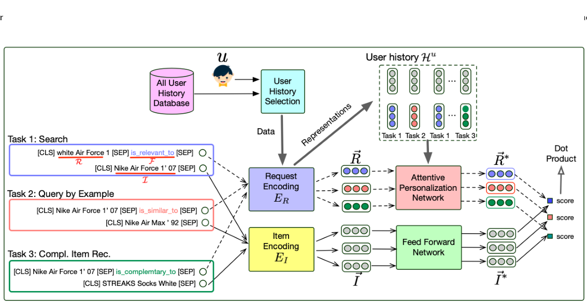
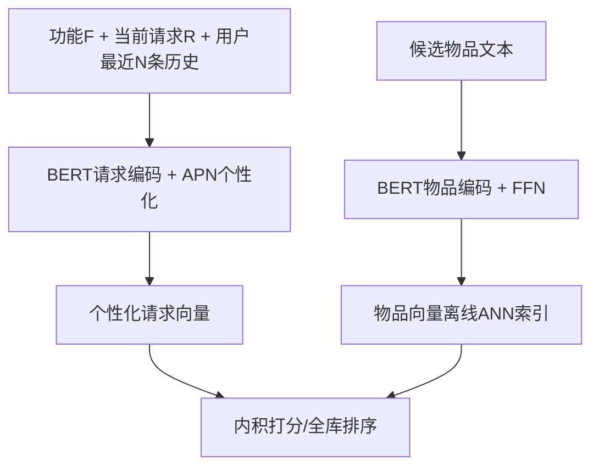

# A Personalized Dense Retrieval Framework for Unified Information Access (面向统一信息访问的个性化稠密检索框架)

- **会议/期刊**: SIGIR 2023
- **作者与机构**: Hansi Zeng, Hamed Zamani (UMass Amherst); Surya Kallumadi, Zaid Alibadi (Lowe’s); Rodrigo Nogueira (UNICAMP)
- **推荐链路定位**: 召回（稠密双塔检索 + ANN）
- **研究方向**: 协同过滤与双塔召回 / —
- **论文原文**: [论文原文链接](https://arxiv.org/abs/2304.13654v1)
- **开源代码**: [开源代码仓库链接](https://github.com/HansiZeng/UIA)

## TL;DR (1分钟核心速览)

针对搜索、示例检索与互补推荐各自建模型、跨任务知识难迁移的痛点，UIA把功能描述编码进双塔稠密检索，并用APN跨功能注意力做个性化。在Lowe’s leave-last-out全库排序上，NDCG@10较SRJGraph分别提升1.8%/3.6%/2.9%，联合训练较单任务最高+45%。

## Background & Motivation (背景与核心矛盾)

- **主流范式**: 搜索用DPR/ANCE/RocketQA等稠密检索，推荐用NCF/序列模型，联合搜索推荐用JSR/SRJGraph加任务层或图网络。
- **前人局限**: ①搜索与推荐模型割裂，多系统维护成本高；②QBE与互补推荐数据远少于搜索，任务专用模型难充分学习，且用户历史无法跨功能共享。
- **核心洞察 (Key Insight)**: 若把“信息访问功能”$F$作为文本条件输入，同一双塔稠密检索即可统一多任务；用户跨功能历史可迁移，尤其利于小数据任务。
- **本文切入点**: 用功能条件化请求编码 + APN个性化 + 两阶段训练，将稠密检索扩展为统一信息访问框架。

## Method (核心方法设计)

### 1. 整体框架 (Overall Architecture)

UIA采用双塔：请求塔输入当前请求$R_{u,t}$与功能描述$F_{u,t}$，经BERT得到$\mathbf{r}_{u,t}$；APN取用户最近$N=5$条交互的请求/物品向量做注意力，拼接用户与功能嵌入后得到个性化$\mathbf{r}^*_{u,t}$。物品塔用BERT编码候选物品，并经FFN适配个性化空间；两塔内积打分，物品向量离线建Faiss ANN索引，在线只编码请求并检索。训练先非个性化预训练，再个性化微调。

图1：UIA 双塔框架整体概览。
<figure class="paper-figure" markdown="span">
  <figcaption>图 1：UIA 框架的高层概览。</figcaption>
</figure>

### 2. 关键设计拆解 (Key Designs)

1. **功能条件化请求编码**：QBE与互补推荐输入同为锚物品，若不加功能条件，模型无法区分“找相似”还是“找互补”。UIA将功能文本拼入请求：$\mathbf{r}_{u,t}=E_R([\mathrm{CLS}]\,R_{u,t}\,[\mathrm{SEP}]\,F_{u,t}\,[\mathrm{SEP}])$，用同一编码器显式学习任务语义，避免额外任务参数。
2. **APN内容+协同个性化**：传统context-aware DPR把历史直接拼接，噪声大且不区分请求/点击物品。APN以当前请求为query、历史请求为key、历史点击物品为value：$\mathrm{Attn}(Q_j,K_j,V_j)=\mathrm{softmax}(Q_jK_j^\top/\sqrt{l})V_j$，再拼接用户嵌入$\mathbf{u}$与功能嵌入$\mathbf{f}$：$\mathbf{r}^*_{u,t}=\mathrm{FFN}([\mathrm{AddNorm}(\mathrm{concat}_j\mathrm{Attn}_j);\mathbf{u};\mathbf{f}])$。内容注意力捕捉行为相关性，ID嵌入补充协同信号。
3. **训练目标、负采样与推理效率**：先非个性化预训练，再个性化微调。负采样两阶段：Phase 1从BM25 top200随机采样，Phase 2用ANN自采样top200，并均加in-batch负例，正负比1:1；损失为$\mathcal{L}=-\log\frac{\exp(\mathbf{r}^{*\top}\mathbf{i}^{*})}{\exp(\mathbf{r}^{*\top}\mathbf{i}^{*})+\sum_{i^-\in\mathcal{N}}\exp(\mathbf{r}^{*\top}\mathbf{i}^{-*})}$。物品向量离线可预计算，在线仅需请求塔+ANN检索。

## Experimental Setup & Evaluation Protocol (实验设置与评估协议)

- **数据集与预处理**: Lowe’s个性化微调仅保留搜索/QBE≥10、CIR≥5条交互用户；未见k-core过滤。

| 数据集 | #Users | #Items | #Interactions | 稀疏度/密度 | 特征/场景说明 |
| :--- | :---: | :---: | :---: | :---: | :--- |
| Lowe’s | 893,619 | 2,260,878 | 5,374,766 | ≈0.00027% | 真实电商，含用户ID/时间戳，三功能交互 |
| Amazon ESCI | — | 1,216,070 | 3,432,347 | — | KDD Cup 2022构造，无用户ID，不做个性化 |

- **数据划分与防穿越**: Lowe’s采用`Leave-Last-Out`：每功能最近1条测试、次近1条验证、其余训练，测试/验证各>890K；ESCI按请求随机80%/10%/10%。
- **排名评测协议**: 全库排序（全量候选，ANN仅加速；原文未采用采样负例评测）。
- **对比基线与超参设置**: 基线含BM25、NCF、DPR/ANCE/RocketQA及Context-Aware变体、SASRec++/BERT4Rec++、JSR/JSR+BERT4Rec++/SRJGraph；BERT-base $d=768$，$N=5$，batch=384，预训练/微调lr=$7e^{-6}$/$7e^{-5}$；显著性用双侧配对t检验+Bonferroni，$p<0.01$。

## Key Experimental Results (实验关键数据)

### 1. 主实验对比 (Main Results)

表1：Lowe’s 主实验（NDCG@10 / Recall@50，粗体最优；Improv. 相对SRJGraph）。

| 模型 | Search NDCG | Search R@50 | QBE NDCG | QBE R@50 | CIR NDCG | CIR R@50 |
| :--- | :---: | :---: | :---: | :---: | :---: | :---: |
| BM25 | 0.095 | 0.367 | 0.167 | 0.584 | 0.014 | 0.111 |
| RocketQA | 0.207 | 0.595 | 0.204 | 0.613 | 0.176 | 0.507 |
| Context-Aware RocketQA | 0.389 | 0.861 | 0.369 | 0.874 | 0.304 | 0.723 |
| BERT4Rec++ | — | — | 0.354 | 0.851 | 0.279 | 0.703 |
| JSR | 0.379 | 0.853 | 0.380 | 0.878 | 0.317 | 0.760 |
| SRJGraph | 0.392 | 0.874 | 0.478 | 0.921 | 0.420 | 0.822 |
| **UIA** | **0.399** | **0.880** | **0.495** | **0.945** | **0.432** | **0.836** |
| Improv. vs SRJGraph | +1.8% | +0.7% | +3.6% | +2.6% | +2.9% | +1.7% |

UIA的MRR@10为0.340/0.433/0.438；ESCI上亦全指标最优，Search/QBE/CIR NDCG@10为0.360/0.199/0.493，较SRJGraph约+2.6%/+6.4%/+1.0%，但无用户ID导致个性化缺失，增益小于Lowe’s。

### 2. 消融实验 (Ablation Study)

表2：Lowe’s NDCG@10消融。

| 变体 | Search | QBE | CIR |
| :--- | :---: | :---: | :---: |
| UIA | **0.399** | **0.495** | **0.432** |
| w/o encoding F | 0.371 | 0.347 | 0.284 |
| w/o joint optimization | 0.391 | 0.369 | 0.298 |
| w/o APN | 0.207 | 0.214 | 0.176 |
| w/o combined content-based personalization | 0.397 | 0.482 | 0.411 |
| w/o collaborative personalization | 0.378 | 0.507 | 0.419 |

### 3. 关键实验发现 (Key Findings)

1. **APN是最大增益源**：去掉APN后NDCG@10降至0.207/0.214/0.176，相对下降48%/57%/59%，说明跨功能历史注意力比单纯拼接历史更有效。
2. **联合训练主要救小数据任务**：去掉联合优化，QBE从0.495降至0.369、CIR从0.432降至0.298，相对损失34%/45%；Search仅损失2%，因其数据量约为其他任务3倍以上。
3. **功能编码与协同个性化各有边界**：去掉$F$使QBE/CIR跌至0.347/0.284，证明同输入异任务必须显式条件化；协同个性化利于Search/CIR（0.399→0.378、0.432→0.419），但对QBE略负（0.495→0.507），内容相似匹配更依赖内容注意力。

## Highlights & Limitations (亮点、对比与审稿批判)

- **与代表作对比 (vs. Prior Work)**: 相比JSR/SRJGraph需任务特定层或图卷积，UIA仅用功能文本+APN即可联合训练且无额外任务参数；相比Context-Aware DPR/RocketQA直接拼接历史，APN用注意力选择历史并融合用户/功能嵌入。
- **可迁移亮点**: ①把任务/场景描述作为文本条件注入双塔，可低成本扩展新功能；②跨功能历史注意力可作为多场景推荐的统一用户建模插件。
- **审稿级局限批判**: ①Lowe’s为私有数据、ESCI无用户ID，个性化复现与公平比较受限；②APN仅取最近5条交互，且个性化对冷启动/意图漂移用户可能负收益，文中未建模“是否需要个性化”；③未报告在线延迟与ANN召回损失。

## Rating (四维评分)

- **方法创新性 (Novelty)**: ⭐⭐⭐⭐ （功能条件化+APN统一稠密检索，机制简洁但理论/谱分析支撑较弱）
- **评估协议与实验扎实度 (Protocol & Experiments)**: ⭐⭐⭐⭐ （Lowe’s leave-last-out全库排序扎实，但关键数据私有、ESCI无法验证个性化）
- **写作与数学规范度 (Clarity & Rigor)**: ⭐⭐⭐⭐ （框架与公式清晰，APN细节充分，缺少复杂度与延迟分析）
- **工业落地与复现价值 (Industrial & Practical Value)**: ⭐⭐⭐⭐ （代码开源、物品侧可离线ANN，但请求塔需用户历史，冷启动与在线成本需工程优化）

