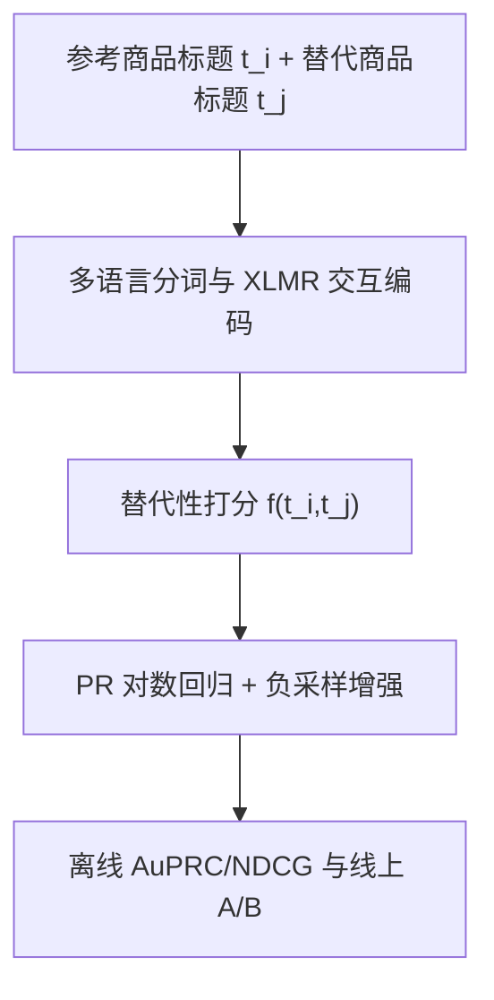

# A Transformer-Based Substitute Recommendation Model Incorporating Weakly Supervised Customer Behavior Data (融合弱监督客户行为数据的 Transformer 替代商品推荐模型)

- **会议/期刊**: SIGIR 2023 Industry Track (SIRIP)
- **作者与机构**: Wenting Ye, Hongfei Yang, Shuai Zhao, Haoyang Fang, Xingjian Shi, Naveen Neppalli；Amazon Retails / AWS
- **推荐链路定位**: 召回（替代商品映射生成与排序）
- **研究方向**: 协同过滤与双塔召回 / 去偏、可信与工业系统
- **论文原文**: [https://arxiv.org/abs/2211.02533v2](https://arxiv.org/abs/2211.02533v2)
- **开源代码**: 暂未开源

## TL;DR (1分钟核心速览)

针对替代推荐仅靠共浏览/浏览后购买、导致功能不匹配的问题，本文把商品标题对视为 query-document，用 XLMR 交互匹配建模功能与可购性；以购买率对数回归、随机负采样去噪弱监督标签，并在 11 个市场单模型上线。离线 AuPRC 相对 GBDT 最高 +5.62%，线上 A/B 收入 +19%。

## Background & Motivation (背景与核心矛盾)

- **主流范式**: 替代推荐常用 co-view、view-but-purchase-another 等行为信号构造 `<参考商品, 替代商品>` 对，再学习排序或匹配。
- **前人局限**: 行为共现会被互补品与用户偏好混淆，如维生素 D 与 C 常被共浏览但功能不可替代；同时购买率长尾、极端值噪声大，直接回归易过拟合。
- **核心洞察 (Key Insight)**: 商品标题已覆盖品类、规格与功能词，若把替代关系转成语言匹配，可在弱监督下补足“功能相似性”，并用 PR 对数回归同时保留“可购性”。
- **本文切入点**: 用 XLMR 对标题对做跨编码交互打分，配合 PR 标签变换与负样本增强，单模型覆盖多语言市场。

<figure class="paper-figure" markdown="span">
  <figcaption>图 1：基于共同浏览替代定义的热门替代商品对，但替代商品与参考商品功能不同。</figcaption>
</figure>

## Method (核心方法设计)

### 1. 整体框架 (Overall Architecture)

输入为参考商品与候选替代商品的标题对 $(t_i,t_j)$；先做多语言子词切分，再由 XLMR 对两段标题做交互编码并输出替代分数。训练端以购买率 PR 为弱监督标签，经$\log(1+y)$ 压缩长尾，并注入随机负样本，使模型同时学习功能相似与可购性排序。推理时对候选映射逐对打分排序，单模型覆盖 11 个市场、6 种语言。

### 2. 关键设计拆解 (Key Designs)

1. **功能感知的标题交互匹配**：共浏览会把非替代品配成对，根因是行为信号忽略功能。本文将 $t_i$视作 query、$t_j$视作 document，用 XLMR 的 [CLS] 交互表示打分$s_{ij}=g_{\text{XLMR}}([\text{CLS}]\oplus t_i\oplus[\text{SEP}]\oplus t_j)$；跨编码器可捕捉品类、规格与功能词组合，比仅用共现统计更贴近“可替代”。

2. **PR 标签工程与特征去偏**：CTR 与 CVR 相关性低于 0.20，单用任一都次优；购买率 $y=\mathrm{PR}=\#\text{purchase}/\#\text{impression}$更接近功能替代。对长尾极端 PR 做$\tilde{y}=\log(1+y)$，避免模型过拟合高方差噪声；同时丢弃价格、上游置信度与来源，防止高价款被系统性过滤及上游模型冷启动依赖。

3. **训练目标、负采样与多语推理**：总损失为 $\mathcal{L}=\frac{1}{n}\sum_{(i,j)}(f(t_i,t_j)-\tilde{y}_{ij})^2+\lambda\sum_{(i,j)\in\mathcal{N}}(f(t_i,t_j)-y_{\text{neg}})^2$，随机负样本赋$y_{\text{neg}}<0$，并保留约 60% 零购买率硬负样本以缓解选择偏差。多市场共享 XLMR 参数$\theta=\arg\min_\theta\sum_{m=1}^{11}\mathcal{L}_m(\theta)$，减少逐语言维护；推理为候选对逐对打分，开销随候选数线性增长。

## Experimental Setup & Evaluation Protocol (实验设置与评估协议)

- **数据集与预处理**:

| 数据集 | #Users | #Items | #Interactions/映射 | 稀疏度/密度 | 特征/场景说明 |
| :--- | :---: | :---: | :---: | :---: | :--- |
| 训练映射 | N/A | N/A | 460k | 非用户-物品矩阵 | 11 国、6 语，>250 impressions |
| 功能分类评估 | N/A | N/A | 215k | 正:负≈6:4 | 人工审核+随机负+流量好坏映射 |
| 可购性排序评估 | N/A | N/A | 222k | >500 impressions | 每 query 商品计算 NDCG@PR |

- **数据划分与防穿越 (Splitting Strategy)**: 原文未披露具体划分比例；训练集排除在验证集中出现过的 query 商品以防泄漏，并按 US/JP/DE/All 市场验证，单次运行。
- **排名评测协议 (Ranking Protocol)**: 功能侧为二分类 AuPRC；可购性侧为 query-level NDCG@PR，在 222k 流量映射候选上排序，**不是全库 Full-Ranking**。训练负采样为随机商品对+约 60% 零购买率硬负样本。
- **对比基线与超参设置**: GBDT+FastText、RoBERTa、XLMR 单语/多语及不同标签/损失；XLMR 使用 base、batch 512、AdamW，学习率网格 1e-5~8e-5 中最优 4e-5；未报告显著性检验。

## Key Experimental Results (实验关键数据)

### 1. 主实验对比 (Main Results)

表 1：目标函数与标签对比（相对 GBDT 基线，US 验证集）

| 目标/模型 | ΔAuPRC | ΔNDCG@CTR | ΔNDCG@CVR | ΔNDCG@PR |
| :--- | ---: | ---: | ---: | ---: |
| CTR+MSE (Base) | — | — | — | — |
| CVR+MSE | -23.3% | -4.60% | -3.42% | -5.88% |
| PR+MSE | +1.76% | -1.60% | +2.74% | +1.58% |
| GMV+MSE | -23.59% | -4.60% | -3.42% | -6.00% |
| **PR+Log+MSE** | **+5.62%** | -1.26% | **+3.19%** | **+2.15%** |
| purchase>0 + logistic | **+5.62%** | -1.78% | +2.17% | +0.79% |
| purchase>0 + hinge | -3.42% | -3.35% | -0.68% | -2.83% |

### 2. 消融实验 (Ablation Study)

表 2：单语/多语与训练市场消融（相对 XLMR(US)）

| 训练数据/模型 | US ΔAuPRC | US ΔNDCG | JP ΔAuPRC | JP ΔNDCG | DE ΔAuPRC | DE ΔNDCG | All ΔAuPRC | All ΔNDCG |
| :--- | ---: | ---: | ---: | ---: | ---: | ---: | ---: | ---: |
| GBDT (US) | **+3.8%** | -1.1% | NA | NA | NA | NA | NA | NA |
| RoBERTa (US) | +0.3% | -0.1% | NA | NA | NA | NA | NA | NA |
| XLMR (US) | — | — | — | — | — | — | — | — |
| XLMR (EN) | +0.2% | **+0.2%** | -0.5% | +0.3% | +0.8% | +0.7% | +1.1% | +0.7% |
| **XLMR (All)** | +0.6% | **+0.2%** | **+5.1%** | **+4.7%** | **+3.4%** | **+4.7%** | **+2.0%** | **+1.3%** |

### 3. 关键实验发现 (Key Findings)

- PR+Log+MSE 相比 CTR+MSE 将 AuPRC 提升 **+5.62%**、NDCG@PR 提升 **+2.15%**；仅加 log 变换就把 PR+MSE 的 NDCG@PR 从 +1.58% 提到 +2.15%，说明长尾压缩有效抑制了极端 PR 噪声过拟合。
- XLMR(All) 在 JP 上提升 **+5.1% AuPRC / +4.7% NDCG**、DE 上 **+3.4% / +4.7%**，整体 **+2.0% / +1.3%**；而 GBDT 仅支持英语、无法覆盖 JP/DE，验证单多语模型可把小语种监督迁移到低资源市场。
- 线上 A/B 中，Robust GBDT 相对 Naive GBDT 收入 **+19%**、PR **+24.1%**；Robust XLMR 相对前代再增收入 **+19%**（PR -2.5%），非美市场 PR **+22.3%**、OPS **+0.6%**，显示多语部署收益主要来自新增市场覆盖。

## Highlights & Limitations (亮点、对比与审稿批判)

- **与代表作对比 (vs. Prior Work)**: 相较 co-view/view-buy 仅拟合行为，本文把商品标题引入功能匹配；相较 GBDT+FastText，XLMR 端到端保留词序并领域微调；相较单语 RoBERTa，XLMR 单模型跨语种且不牺牲 US 表现。
- **可迁移亮点**: 对长尾购买率做 $\log(1+y)$ 压缩；随机负样本预生成+零购买率硬负样本组合；丢弃上游置信度/来源/价格，降低模型对上游更新与价格偏置的依赖。
- **审稿级局限批判**: 仅单次运行、只报相对提升，未做显著性检验；NDCG 在流量候选映射上计算，非全库排序，可能高估线上全量召回难度。跨编码器逐对打分推理成本随候选数线性增长，且功能性与可购性仍未解耦，人工功能标签仅用于评估。

## Rating (四维评分)

- **方法创新性 (Novelty)**: ⭐⭐⭐ （将替代推荐转为标题语言匹配并引入弱监督 PR 回归，工业适配新颖但算法突破有限）
- **评估协议与实验扎实度 (Protocol & Experiments)**: ⭐⭐⭐ （20 万级验证集与线上 A/B 有说服力，但单次运行、无显著性检验且非全库排序）
- **写作与数学规范度 (Clarity & Rigor)**: ⭐⭐⭐⭐ （问题定义、标签工程与损失公式清晰，工程细节完整；理论分析较薄）
- **工业落地与复现价值 (Industrial & Practical Value)**: ⭐⭐⭐⭐⭐ （11 市场 6 语言单模型部署，收入 +19%，负采样与标签变换可直接迁移）

