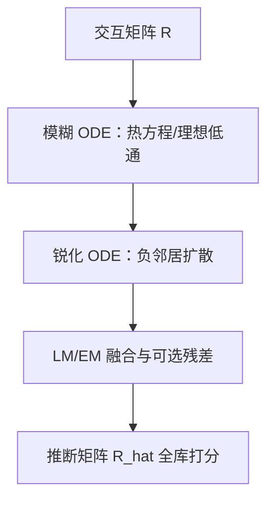
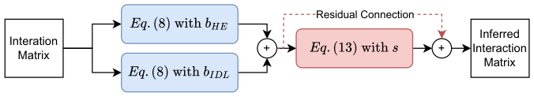

# Blurring-Sharpening Process Models for Collaborative Filtering (面向协同过滤的模糊-锐化过程模型)

- **会议/期刊**: SIGIR 2023
- **作者与机构**: Jeongwhan Choi, Seoyoung Hong, Noseong Park, Sung-Bae Cho；Yonsei University
- **推荐链路定位**: 召回/全库排序（直接矩阵补全打分）
- **研究方向**: 协同过滤与双塔召回 / 图神经网络与知识图谱推荐
- **论文原文**: [论文原文链接](https://arxiv.org/abs/2211.09324v2)
- **开源代码**: 暂未开源（未检测到官方仓库）

## TL;DR (1分钟核心速览)

本文针对图滤波类 CF 只做低通模糊、缺少恢复且依赖离散层叠的痛点，提出 BSPM：先把用户-物品交互矩阵经连续 ODE 模糊，再经负扩散锐化，以确定性扰动-恢复直接推断未知交互，全程免训练。在 Gowalla/Yelp2018/Amazon-book 的 Full-Ranking Recall@20/NDCG@20 上，BSPM 相对次优基线最高提升 3.74%，且预处理耗时远低于 LightGCN 训练。

## Background & Motivation (背景与核心矛盾)

- **主流范式**: LightGCN、GF-CF、LT-OCF 等把交互矩阵视为二部图，用线性低通滤波、热方程或理想低通滤波直接平滑交互信号。
- **前人局限**: 仅做“模糊”会把信号扩散到邻居，热门偏置与过平滑明显；同时多数方法仍是离散时间/固定层数，GF-CF 只是 Euler 一步特例，缺少反向“锐化”恢复用户特异信息。
- **核心洞察 (Key Insight)**: 推荐与生成模型共享“先扰动、再恢复并发现新信息”的哲学，但 CF 只有单个交互矩阵，不应照搬 SGM 的随机 SDE 与 score 网络，而应使用确定性 ODE。
- **本文切入点**: 将连续模糊与连续锐化组合成 BSPM，并给出 LM/EM 两种融合方式，直接由交互矩阵得到推断打分。

## Method (核心方法设计)

### 1. 整体框架 (Overall Architecture)

输入原始交互矩阵 $\mathbf{R}$及归一化矩阵$\tilde{\mathbf{R}}$、$\tilde{\mathbf{P}}=\tilde{\mathbf{R}}^T\tilde{\mathbf{R}}$。先分别用热方程、理想低通或 GF-CF 组合求解模糊 ODE，得到$\mathbf{B}_{HE}(T_b)$与$\mathbf{B}_{IDL}(T_b)$；再以$s(\mathbf{S})=-\mathbf{S}\tilde{\mathbf{P}}$求解锐化 ODE，恢复用户特异信号。BSPM-LM 在末端融合锐化结果与低通结果，BSPM-EM 在锐化前先融合两种模糊结果；残差连接可选。最终$\hat{\mathbf{R}}$ 直接作为用户-物品打分，无需训练嵌入，推理仅需 ODE 步进与矩阵乘法。

<figure class="paper-figure" markdown="span">
  <figcaption>图3：蓝色框表示模糊过程，红色框表示锐化过程。红色虚线路径表示残差连接，其在我们方法中是可选的。在我们的实验中，残差连接在一个数据集上提升了推荐准确率。</figcaption>
</figure>
*图3：BSPM-LM 与 BSPM-EM 的模糊-锐化融合结构。*

### 2. 关键设计拆解 (Key Designs)

1. **连续模糊 ODE（把离散图滤波推广到连续时间）**：前人卡在固定层数/离散低通，本文写 $\mathbf{B}(T_b)=\mathbf{B}(0)+\int_0^{T_b}b(\mathbf{B}(t))dt$，其中$b_{HE}(\mathbf{B})=k\mathbf{B}(\tilde{\mathbf{P}}-\mathbf{I})$、$b_{IDL}(\mathbf{B})=\mathbf{B}(\mathbf{V}^{-1/2}\bar{\mathbf{U}}\bar{\mathbf{U}}^T\mathbf{V}^{1/2}-\mathbf{I})$。Euler 取$T_b=1$ 即退化为 GF-CF/LightGCN 类滤波，连续时间让热扩散与理想低通统一。

2. **锐化 ODE（反向强调用户特异差异）**：只模糊会把交互扩散到邻居，导致过平滑与热门偏置；本文加反向过程 $s(\mathbf{S})=-\mathbf{S}\tilde{\mathbf{P}}$，即$\mathbf{S}(T_s)=\mathbf{S}(0)+\int_0^{T_s}s(\mathbf{S}(t))dt$。负邻居扩散相当于图高频增强，使推荐从“大众协同”回到“用户特异”，同时提升长尾覆盖。

3. **LM/EM 融合与免训练推理**：LM 末端融合 $\hat{\mathbf{R}}=\mathbf{S}(T_s)+\mathbf{B}_{IDL}(T_b)$（可选再加$\mathbf{B}_{HE}(T_b)$）；EM 先令$\mathbf{S}(0)=\mathbf{B}_{HE}(T_b)+\mathbf{B}_{IDL}(T_b)$ 再锐化。模型无训练损失、无负采样，直接解 ODE；Euler/RK4 少步即可，开销主要来自矩阵乘法与 ODE 步数。

## Experimental Setup & Evaluation Protocol (实验设置与评估协议)

- **数据集与预处理**: 三个常用基准，均呈长尾分布；沿用前人同款训练/测试切分。

| 数据集 | #Users | #Items | #Interactions | 密度 | 特征/场景说明 |
| :--- | :---: | :---: | :---: | :---: | :--- |
| Gowalla | 29,858 | 40,981 | 1,027,370 | 0.084% | 位置签到二部图，长尾显著 |
| Yelp2018 | 31,668 | 38,048 | 1,561,406 | 0.130% | 本地商户隐式反馈 |
| Amazon-book | 52,643 | 91,599 | 2,984,108 | 0.062% | 图书隐式反馈，稀疏度高 |

- **数据划分与防穿越 (Splitting Strategy)**: 沿用 LightGCN/NGCF 同款每用户留一（Leave-One-Out）训练/测试切分，验证集用于调参，非全局时间戳切分。
- **排名评测协议 (Ranking Protocol)**: 无偏 `Full-Ranking`，所有未交互物品均为候选；报告 Recall@20 与 NDCG@20，训练无负采样。
- **对比基线与超参设置**: 对比 43 个基线，覆盖 MF、AE、网络嵌入、GCN/CF；BSPM 无嵌入维度，超参含 $T_b,T_s\in[1,5]$、步数$\{1,2,3,4\}$、$\beta\in[0,1]$、$k\in[0.1,1]$；模糊多用 Euler、锐化多用 RK4，论文未明确显著性检验。

## Key Experimental Results (实验关键数据)

### 1. 主实验对比 (Main Results)

| 模型 | Gowalla R@20 | Gowalla N@20 | Yelp R@20 | Yelp N@20 | Amazon R@20 | Amazon N@20 |
| :--- | ---: | ---: | ---: | ---: | ---: | ---: |
| LightGCN | 0.1830 | 0.1554 | 0.0649 | 0.0530 | 0.0411 | 0.0315 |
| UltraGCN | 0.1862 | 0.1580 | 0.0683 | 0.0561 | 0.0681 | 0.0556 |
| SimpleX | 0.1872 | 0.1557 | 0.0701 | 0.0575 | 0.0583 | 0.0468 |
| GF-CF | 0.1849 | 0.1518 | 0.0697 | 0.0571 | 0.0710 | 0.0584 |
| LinkProp-Multi | 0.1908 | 0.1573 | 0.0690 | 0.0571 | 0.0721 | 0.0588 |
| MGDCF | 0.1864 | 0.1589 | 0.0696 | 0.0572 | 0.0490 | 0.0378 |
| GTN | 0.1870 | 0.1588 | 0.0679 | 0.0554 | 0.0450 | 0.0346 |
| BSPM-LM | 0.1901 | 0.1570 | 0.0713 | 0.0584 | **0.0733** | **0.0610** |
| BSPM-EM | **0.1920** | **0.1597** | **0.0720** | **0.0593** | **0.0733** | 0.0609 |
| **Improv. vs 2nd** | **0.63%** | **0.50%** | **2.71%** | **3.13%** | **1.66%** | **3.74%** |

### 2. 消融实验 (Ablation Study)

| 模型 | Gowalla R/N | Yelp R/N | Amazon R/N |
| :--- | :---: | :---: | :---: |
| Only Blurring (HE) | 0.1682 / 0.1331 | 0.0684 / 0.0565 | 0.0710 / 0.0584 |
| Only Blurring (IDL) | 0.1776 / 0.1489 | 0.0668 / 0.0549 | 0.0395 / 0.0316 |
| Only Blurring (GF-CF) | 0.1854 / 0.1518 | 0.0701 / 0.0575 | 0.0710 / 0.0584 |
| BSPM-LM | 0.1901 / 0.1570 | 0.0713 / 0.0584 | **0.0733 / 0.0610** |
| BSPM-EM | **0.1920 / 0.1597** | **0.0720 / 0.0593** | **0.0733** / 0.0609 |

### 3. 关键实验发现 (Key Findings)

1. **锐化是主要增益来源**：GF-CF→BSPM-EM 在 Gowalla Recall 由 0.1854 升至 0.1920（+3.56%），Yelp 由 0.0701 升至 0.0720（+2.71%）；Amazon 上 BSPM-LM 由 0.0710 升至 0.0733（+3.24%），NDCG 由 0.0584 升至 0.0610（+4.45%）。
2. **锐化强度存在最优区间**：$T_s$在约 2.4 时 Gowalla/Amazon 最优，继续增大会明显掉点；$T_s/\tau=1$–2 已足够，说明过度强调用户特异会破坏协同信号。
3. **长尾与覆盖率同步改善**：Yelp2018 覆盖率提升 73.20%，Amazon-book 新颖度提升 7.01%；Amazon 正确推荐物品平均节点度由仅模糊的 48.20 降至 33.10，锐化确实把低热度、用户特异物品推上来。

## Highlights & Limitations (亮点、对比与审稿批判)

- **与代表作对比 (vs. Prior Work)**: GF-CF 是“仅模糊 + Euler 一步”的特例；LightGCN 在无限维下等价于一步热扩散，无锐化；LT-OCF 连续化热方程但仍无恢复过程。BSPM 首次把确定性模糊-锐化作为完整 CF 范式，且免训练。
- **可迁移亮点**: “低通模糊 + 高频锐化”的 ODE 组合可直接嵌入矩阵补全/图滤波基线；少步 Euler/RK4 即可推理，适合作为快速强基线。
- **审稿级局限批判**: 所有滤波器与超参手工设定，$T_s$、$\beta$、$k$ 对数据较敏感且无自适应学习；PyTorch ODE 求解暂不支持稀疏矩阵，RK4 推理在 Amazon 上约 127.2s，明显慢于 GF-CF 的 40.1s。仅三个基准、无显著性检验与线上 A/B，结论外推需谨慎。

## Rating (四维评分)

- **方法创新性 (Novelty)**: ⭐⭐⭐⭐ （把 SGM 的扰动-恢复迁移为 CF 的确定性 ODE 模糊-锐化，范式新颖；但滤波器仍为手工设计，缺少可学习 score。）
- **评估协议与实验扎实度 (Protocol & Experiments)**: ⭐⭐⭐⭐ （3 个基准、43 个基线、Full-Ranking、消融/敏感性/长尾/运行时齐全；不足是未报告显著性检验与线上验证。）
- **写作与数学规范度 (Clarity & Rigor)**: ⭐⭐⭐⭐ （ODE 定义、特例归约与 LM/EM 结构清晰，公式简洁；个别“new era”表述略强，理论分析以归约为主。）
- **工业落地与复现价值 (Industrial & Practical Value)**: ⭐⭐⭐⭐ （免训练、预处理快，适合冷启动式快速部署；但 ODE 稀疏支持不足与超参调优会限制大规模线上直接落地。）

