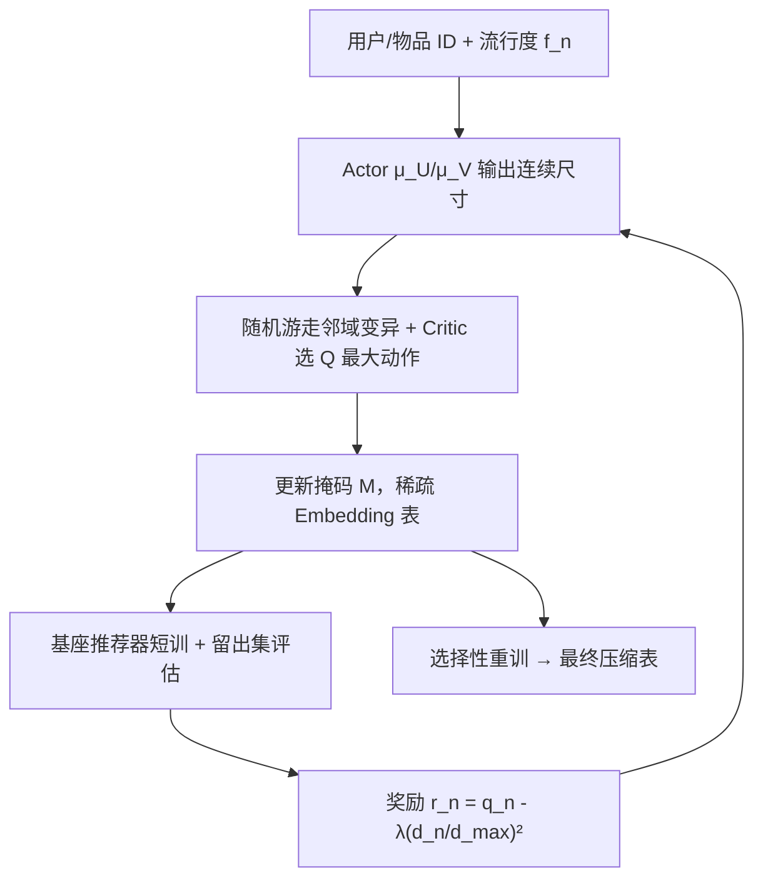
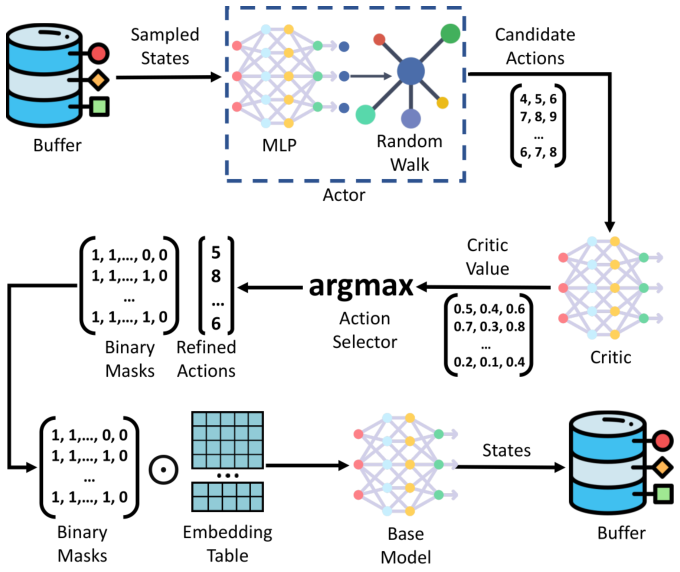
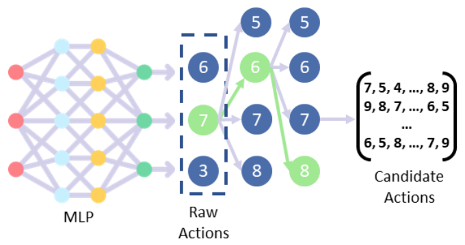

# Continuous Input Embedding Size Search For Recommender Systems (面向推荐系统的连续输入嵌入尺寸搜索)

- **会议/期刊**: SIGIR 2023
- **作者与机构**: Yunke Qu, Tong Chen, Hongzhi Yin (昆士兰大学)；Xiangyu Zhao (香港城市大学)；Lizhen Cui (山东大学)；Kai Zheng (电子科技大学)
- **推荐链路定位**: 召回/全链路表征层 —— 隐因子模型 Embedding 表的存储压缩
- **研究方向**: 协同过滤与双塔召回 / 强化学习与动态探索推荐
- **论文原文**: [arXiv:2304.03501](https://arxiv.org/abs/2304.03501v7)
- **开源代码**: [qykcq/CIESS](https://github.com/qykcq/Continuous-Input-Embedding-Size-Search-For-Recommender-Systems)

## TL;DR (1分钟核心速览)

隐因子模型的 Embedding 表被统一固定为 $d_{max}$维，在亿级用户/物品下存储爆炸；已有 RL 方案（ESAPN/OptEmbed）只能在 6 个预设尺寸的**离散小动作集**中选，粒度太粗必然次优。CIESS 首次把动作空间放宽到连续区间$[1,d_{max}]$，用 TD3 actor-critic 逐用户/逐物品输出尺寸，并设计**随机游走动作探索**在邻域内变异取 Q 值最大者以稳定收敛。在 50/25/25 比例划分、Recall@k/NDCG@k 协议下，MovieLens-1M 上 80% 稀疏率 R@20 达 0.2436（较最强受控基线 ES 提升 8.4%）。

## Background & Motivation (背景与核心矛盾)

- **主流范式**: 以 NCF/NGCF/LightGCN 为代表的隐因子模型用一张 $(|\mathcal{U}|+|\mathcal{V}|)\times d_{max}$ 的 Embedding 表做 ID 映射，检索即内积；压缩路线分两支——码本/张量分解类（需按预算重训）与 RL 尺寸搜索类（可按预算自适应）。
- **前人局限**: ① RL 方法继承了高度离散的动作集（ESAPN 仅 6 个候选尺寸），最优尺寸往往落在两个候选之间，导致重要实体表达不足、冷门实体浪费内存；② 若暴力把 $[1,256]$ 每个整数都当动作，策略网络面临巨大动作空间与"训练-评估"循环开销，Q 值估计方差爆炸。
- **核心洞察 (Key Insight)**: 尺寸搜索本质是"连续容量分配"问题，其瓶颈不在建模能力而在**探索效率**——只要能在 actor 输出的当前动作邻域内做小步变异，就能以极小评估代价逼近连续最优解。
- **本文切入点**: 用带掩码的稀疏 Embedding 承接任意整数尺寸 + TD3 连续策略 + 随机游走邻域探索，三者组合成模型无关的搜索框架。

## Method (核心方法设计)

### 1. 整体框架 (Overall Architecture)

CIESS 由交替优化的两部分构成：基座推荐器 $F_\Theta(\cdot)$与搜索策略$G_\Phi(\cdot)$。每轮迭代，$G_\Phi$为全部用户/物品输出尺寸$d_n$并写入二值掩码$\mathbf{M}$，$F_\Theta$仅在$\mathbf{E}\odot\mathbf{M}$上以 BPR 损失短训 5 个 epoch；随后在留出集上计算推荐质量，转化为状态$q_n$与奖励$r_n$回灌策略网络（存入 replay buffer，用 TD3 更新 actor/critic）。搜索阶段结束后，从满足目标稀疏率$c$的候选掩码集合中选取 top-$l$个做**选择性重训**，取$q$ 最高者为最终解，且一次搜索可复用于多个内存预算。

<figure class="paper-figure" markdown="span">
  <figcaption>图 1：CIESS 的总体概览。</figcaption>
</figure>

### 2. 关键设计拆解 (Key Designs)

1. **掩码式可变尺寸 Embedding**：痛点是把"每个实体尺寸不同"落到可微可存的张量上。做法是对全尺寸表按行施加二值掩码，$m_n(s)=\mathbb{I}(1\le s\le d_n)$，即$\mathbf{e}_n=\mathrm{Lookup}(\mathbf{E}\odot\mathbf{M},n)$，把第$d_n$ 位之后全部置零。目标被写成带约束的稀疏化问题：

$$\min_{\Theta,\Phi}\mathcal{L}_{BPR}\quad \text{s.t.}\ 1-\frac{\|\mathbf{M}\|_{1,1}}{(|\mathcal{U}|+|\mathcal{V}|)d_{max}}\ge c$$

零值可直接用稀疏矩阵存储，故"取前 $d_n$ 维"这一朴素截断即可获得真实内存收益，无需额外解码器。

2. **连续动作 + 随机游走探索（核心 Delta）**：直接对连续动作取贪心 $\arg\max$需遍历所有尺寸，不可行；而 TD3 双 critic 的 min 估计又偏低。作者构造动作图，把距离不超过阈值$t=5$的整数动作连边，并按距离加权做有放回随机游走，得到候选序列$\mathcal{Z}_{\hat{d}_n}$，再在其中贪心选优：

$$p(d\to d')=\frac{|d'-d|}{\sum_{d'\in\mathcal{A}_d}|d'-d|},\qquad d_n^i=\arg\max_{d'\in\mathcal{Z}_{\hat{d}_n^i}}Q\big(s_n^i,d'\big)$$

直觉是"对当前最优尺寸做受控变异"，只评估 5 个邻居即可跳出局部最优，兼顾采样效率与探索广度。

3. **状态/奖励设计与训练目标**：状态 $s_n=\big(\tfrac{f_n-f_{min}}{f_{max}-f_{min}},\tfrac{d_n-d_{min}}{d_{max}-d_{min}},q_n\big)$，其中质量指示$q_n=\min\big(\mathrm{eval}(\mathbf{e}_n|\mathbf{E}\odot\mathbf{M})/\mathrm{eval}(\mathbf{e}_n|\mathbf{E}),1\big)$用**比值**而非绝对值，避免长尾用户天然低分带来的误导；$\mathrm{eval}$取$k\in\{5,10,20\}$上 Recall 与 NDCG 的均值，物品侧则对其交互用户取平均。奖励$r_n=q_n-\lambda(d_n/d_{max})^2$，平方项使早期大幅剪枝收益更高、后期趋于细粒度微调。总损失为 BPR +$L_2$，负采样沿用基座默认（每正样本 1 负样本）；推理时仅需按掩码截断查表，无额外在线开销。

<figure class="paper-figure" markdown="span">
  <figcaption>图 2：基于随机游走的嵌入尺寸探索，其中原始动作是由 actor 预测的 ˆ𝑑𝑖𝑛。</figcaption>
</figure>

## Experimental Setup & Evaluation Protocol (实验设置与评估协议)

- **数据集与预处理**:

| 数据集 | #Users | #Items | #Interactions | 稀疏度 | 说明 |
| :--- | :---: | :---: | :---: | :---: | :--- |
| MovieLens-1M | 6,040 | 3,952 | 1,000,208 | 4.19% | 电影评分转隐式反馈 |
| Yelp2018 | 31,668 | 38,048 | 1,561,147 | 0.13% | 商户点评，长尾更重 |

- **数据划分与防穿越 (Splitting Strategy)**: 按 **50% / 25% / 25% 比例划分**训练/验证/测试（非 Leave-One-Out、非全局时间戳切分），因此存在弱时间穿越风险。
- **排名评测协议 (Ranking Protocol)**: 报告 Recall@$\{5,20\}$与 NDCG@$\{5,20\}$；原文未显式声明是否为 **Full-Ranking** 全库排序，从基座沿用 NCF/NGCF/LightGCN 的默认实现推断大概率为 **1:99 采样排序**，这是复现时需注意的协议模糊点。
- **对比基线与超参**: 基线含 PEP（软阈值剪枝）、ESAPN（离散 RL 搜索）、OptEmbed（超网+进化搜索）、ES（等长固定）、MR（随机混合固定）；基座为 NCF / NGCF / LightGCN，$d_{max}=128$，Adam 优化，$M=30$episode ×$T=10$iteration，高斯噪声$\sigma=6$，随机游走阈值与步长均为 5，目标稀疏率$c\in\{80\%,90\%,95\%\}$。ESAPN/OptEmbed 无稀疏率控制机制，仅报告其自然稀疏率。

## Key Experimental Results (实验关键数据)

### 1. 主实验对比 (Main Results)

MovieLens-1M + LightGCN（受控基线在同一 $c$ 下对比）:

| 方法 | 稀疏率 $c$ | R@5 | R@20 | N@20 |
| :--- | :---: | :---: | :---: | :---: |
| ESAPN | 72%(自定) | 0.0912 | 0.2422 | 0.4178 |
| OptEmbed | 83%(自定) | 0.0745 | 0.1994 | 0.3650 |
| PEP | 80% | 0.0771 | 0.2098 | 0.3778 |
| ES | 80% | 0.0825 | 0.2248 | 0.3969 |
| MR | 80% | 0.0737 | 0.2004 | 0.3648 |
| **CIESS** | 80% | **0.0920** | **0.2436** | **0.4257** |
| ES | 90% | 0.0778 | 0.2105 | 0.3787 |
| PEP | 90% | 0.0733 | 0.1988 | 0.3641 |
| **CIESS** | 90% | **0.0846** | **0.2248** | **0.4023** |
| ES | 95% | 0.0646 | 0.1752 | 0.3272 |
| PEP | 95% | 0.0659 | 0.1789 | 0.3315 |
| **CIESS** | 95% | **0.0744** | **0.2009** | **0.3664** |

相比同预算最强受控基线 ES：$c$=80% 时 R@20 **+8.4%**，$c$=90% **+6.8%**，$c$=95% **+14.7%**；N@20 分别 +7.3% / +6.2% / +12.0%。

Yelp2018 + LightGCN（R@20 / N@20）:

| 方法 | 80% | 90% | 95% |
| :--- | :---: | :---: | :---: |
| ESAPN (76%) | 0.0752 / 0.0699 | – | – |
| OptEmbed (80%) | 0.0534 / 0.0489 | – | – |
| PEP | 0.0723 / 0.0682 | 0.0657 / 0.0610 | 0.0600 / 0.0561 |
| ES | 0.0822 / 0.0758 | 0.0722 / 0.0648 | 0.0624 / 0.0571 |
| **CIESS** | **0.0839 / 0.0783** | **0.0730 / 0.0705** | **0.0657 / 0.0640** |

### 2. 消融实验 (Ablation Study)

LightGCN 基座，$c=80\%$（随机游走与噪声类型两组因子）:

| 变体 | ML-1M R@20 | ML-1M N@20 | Yelp R@20 | Yelp N@20 |
| :--- | :---: | :---: | :---: | :---: |
| CIESS (高斯噪声 + 随机游走) | **0.2437** | **0.4250** | **0.0839** | **0.0783** |
| 替换为 OU 过程噪声 + 随机游走 | 0.2432 | 0.4243 | 0.0765 | 0.0722 |
| 替换为均匀噪声 + 随机游走 | 0.2421 | 0.4241 | 0.0763 | 0.0710 |
| **去除随机游走**（仅高斯噪声） | 0.2130 | 0.3825 | 0.0766 | 0.0705 |

### 3. 关键实验发现 (Key Findings)

1. **随机游走是性能的决定性来源，噪声形式几乎无关**：去掉随机游走后 ML-1M 的 R@20 从 0.2437 跌至 0.2130（**-12.6%**），Yelp 从 0.0839 跌至 0.0766（**-8.7%**）；而把高斯噪声换成 OU / 均匀分布，性能波动在 0.7% 以内——说明提升来自"邻域变异选优"而非噪声扰动本身。
2. **更高压缩率 + 更细粒度可反超"低压缩率"对手**：Yelp 上 CIESS 在 $c$=90%（R@20 0.0730）显著优于 OptEmbed 在约 80% 稀疏率下的 0.0534，且逼近 ESAPN 在 76% 稀疏率下的 0.0752，即用更少参数取得相当甚至更好的精度，验证了连续搜索空间的实际价值。
3. **基座越强，稀疏化越"抗跌"**：图模型基座在同等稀疏率下退化更平滑；NCF 因直接用内积作用于高度稀疏向量而损失更大（Yelp 上 $c$=80% 时 CIESS+NCF R@20 仅 0.0533，远低于 LightGCN 的 0.0839），提示轻量化 Embedding 应与图式传播类基座搭配。超参上$\lambda$在 ML-1M 最优 0.4、Yelp 最优 0.2（0.1–0.4 区间不敏感），$M=30$对$c\ge90\%$ 已足够收敛。

## Highlights & Limitations (亮点、对比与审稿批判)

- **与代表作对比 (vs. Prior Work)**: 相比 ESAPN（6 个离散候选、依赖额外 value 函数）与 OptEmbed（超网 + 进化搜索、稀疏率不可控），CIESS 的核心区别是把动作空间由离散集合换成连续区间并配套邻域探索；相比 PEP 等软阈值剪枝类方法，它给出的是**逐实体**而非**逐字段/全局**的容量分配，且一次搜索可产出多预算解，无需按预算重训。
- **可迁移亮点**: ① "掩码 + 稀疏存储"的容量分配范式可直接迁移到双塔召回、序列模型、多模态融合层的任意 Embedding 表压缩；② 用**性能比值** $q_n$ 而非绝对指标做 RL 状态/奖励信号，能有效抑制长尾实体天然低分带来的噪声，可复用于任何以排序指标为奖励的搜索任务。
- **审稿级局限批判**: ① 搜索成本高——每个 episode 的每次迭代都要从头初始化并重训基座模型，$M\times T=300$次短训 + 选择性重训的总开销远超一次性剪枝，论文未给出实际 GPU 小时对比；② 评测协议交代不足：数据划分未按时间戳切分、未声明 Full-Ranking 或采样排序，且仅两个中等规模数据集，缺乏工业级千万级 Embedding 表与线上内存/延迟实测；③ 尺寸为整数且掩码取"前$d_n$ 维"，维度顺序被隐式固定，若通道重要性不均匀则截断本身即为次优，论文未讨论维度重排。

## Rating (四维评分)

- **方法创新性 (Novelty)**: ⭐⭐⭐⭐ （首次将 Embedding 尺寸搜索连续化，随机游走邻域探索是在巨大动作空间下的务实且有效的新解，但 TD3 与掩码剪枝均为成熟组件组合）
- **评估协议与实验扎实度 (Protocol & Experiments)**: ⭐⭐⭐ （三基座 × 两数据集 × 三预算的矩阵较完整，但划分方式未时间切分、排序协议未声明、缺少显著性检验与开销分析）
- **写作与数学规范度 (Clarity & Rigor)**: ⭐⭐⭐⭐ （状态、奖励、动作与随机游走公式定义清晰，算法伪代码完整；随机游走转移概率按距离加权取模的处理缺少理论论证）
- **工业落地与复现价值 (Industrial & Practical Value)**: ⭐⭐⭐⭐ （模型无关、掩码零值可直接走稀疏存储、一套流程覆盖多内存预算，代码已开源；但搜索期训练开销与多阶段流水线仍需工程改造）

