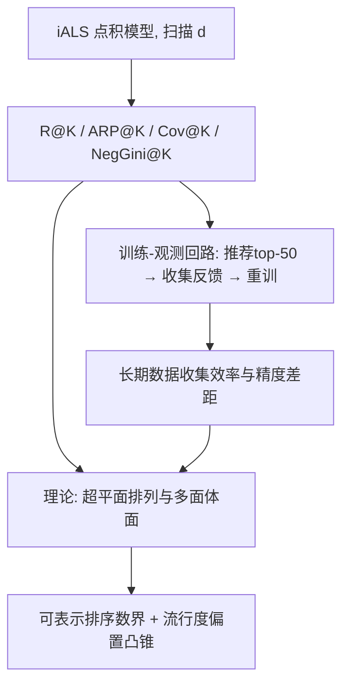
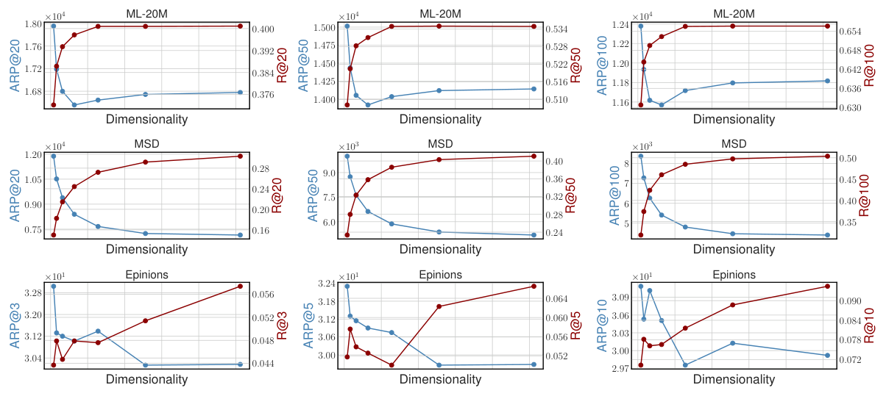

# Curse of "Low" Dimensionality in Recommender Systems (推荐系统中的"低维诅咒")

- **会议/期刊**: SIGIR 2023
- **作者与机构**: Naoto Ohsaka, Riku Togashi（CyberAgent, Inc.，共同一作）
- **推荐链路定位**: 召回（双塔点积召回的表征容量分析）
- **研究方向**: 协同过滤与双塔召回 / 去偏公平与工业架构
- **论文原文**: [https://arxiv.org/abs/2305.13597v1](https://arxiv.org/abs/2305.13597v1)
- **开源代码**: 暂未开源

## TL;DR (1分钟核心速览)

本文指出：点积模型（MF、iALS、乃至 VAE 式 AE 召回）中用户/物品嵌入维度 $d$长期被当作普通调参细节，但其真实作用是决定"可表示排序数"的容量瓶颈。作者在 ML-20M / MSD / Epinions 的**强泛化划分 + 全库 Full-Ranking** 协议下扫描$d\in\{8,\dots,4096\}$，发现低维模型在 R@K 几乎不变的情况下 ARP@K（平均推荐流行度）显著升高、Cov@K 与公平性 Pareto 前沿整体内缩；并从理论上证明可表示$K$-排序数被$n^{\min\{K,2d\}}$ 指数级约束，用凸锥刻画了近流行物品压制长尾物品的机制。

## Background & Motivation (背景与核心矛盾)

- **主流范式**: 大规模召回几乎都是双塔点积模型 $\hat{r}_{u,v}=\langle\phi(u),\psi(v)\rangle$，靠低维$d$ 换取 MIPS 检索效率；VAE/AE 类模型亦可归约为此形式（其最后一层权重行即物品嵌入）。
- **前人局限**: 已有工作（Rendle 等的高维+强正则实验、Mult-VAE 用 $d=600$）只报告维度对**精度**有利，却把$d$隐匿于"模型尺寸超参"之中；实践者在资源约束下按 R@K 单指标选型，倾向选小$d$。
- **核心洞察 (Key Insight)**: 低维并非"防过拟合的正则化"，而是**对已有流行度分布的过拟合**——它把可达排序空间压得极小，使模型只能靠"推热门"来维持精度。
- **本文切入点**: 从"可表示排序数 (representable rankings)"这一几何-组合视角，把 $d$ 的容量效应做成可证的紧界，并用"训练-观测回路"仿真揭示其长期反噬。

## Method (核心方法设计)

### 1. 整体框架 (Overall Architecture)

本文是分析型工作，主链路为「维度扫描实证 → 反馈回路仿真 → 几何理论解释」三段闭环：先以 iALS 为最简点积模型，固定其他超参仅扫描 $d$，在 R@K、ARP@K、Cov@K、Negative Gini@K 四个面上观测容量变化；再把模型放回"推荐→曝光→收集新反馈→重训"的在线回路，检验偏置的累积效应；最后用超平面排列、多面体的面与凸锥三种几何工具，给出可表示排序数的上下界与流行度偏置的结构性成因，从而证明观测现象对**任意**点积模型成立。

### 2. 关键设计拆解 (Key Designs)

1. **可表示排序数的双边界（容量即维度）**: 排序由 $\langle\boldsymbol{q},\boldsymbol{v}_i\rangle$的符号组合决定，等价于把每对物品的偏好编码为线性不等式组$\langle\boldsymbol{q},\boldsymbol{v}_i-\boldsymbol{v}_j\rangle\cdot\delta_{ij}>0$；可表示排序数即$d$维空间中$\binom{n}{2}$个过原点超平面划分出的区域数。由此得 上界$\mathrm{nperm}_K\le n^{\min\{K,2d\}}$（超平面排列区域计数），下界借助凸包$P=\mathrm{conv}(\boldsymbol{v}_i)$的每个面可被外法向量"整面推出"一个$d$-排序，配合 cyclic polytope 的面数上界定理得$\mathrm{nperm}_d\ge\binom{n}{\lceil d/2\rceil}=n^{\Theta(d)}$。故最大可表示排序数为$n^{\Theta(\min\{K,d\})}$——**$d$ 每增加 1，容量指数级放大**，这是低维"表达力饥饿"的硬约束。
2. **流行度偏置的凸锥刻画（为何逃不掉）**: 设 $P$、$L$为热门与长尾物品集，用户向量被约束在$\mathcal{Q}(P,L)$（要求$P$全压$L$）内。此时必有$\mathcal{S}(P,\{l\})=\mathrm{PC}(\{\boldsymbol{p}_i-l\};\,l)$，即从$l$出发、由全部$\boldsymbol{p}_i-l$张成的多面体锥内的任何"近热门"物品，都自动排在$l$之上，且该锥随$|P|$或$|L|$ 增大而膨胀。几何直觉：只要用户被迫把热门推上前排，锥内一片"相似热门"就被连带抬升，长尾被系统性挤出。
3. **训练目标、负采样与推理效率**: iALS 采用全隐式加权最小二乘 $\sum_{u,v}c_{uv}(r_{uv}-\langle\boldsymbol{x}_u,\boldsymbol{y}_v\rangle)^2+\lambda(\|\boldsymbol{x}_u\|^2+\|\boldsymbol{y}_v\|^2)$，**无显式负采样**（全部未观测对以低置信度作零目标），训练用近期提出的块坐标下降求解器以缓解高维下 ALS 的立方复杂度。推理为全库打分，正是 MIPS/ANN 依赖点积结构的场景。理论上还有一个关键补充：若$\mathcal{S}(P,L)$是半角$\theta$的$d$维圆锥，随机物品落入的概率为$\tfrac{1}{2}I_{\sin^2\theta}\!\left(\tfrac{d-1}{2},\tfrac12\right)=\Theta\!\left((\sin\theta)^{d-1}/\sqrt{d-1}\right)$，随$d$ **指数衰减**——即升维虽不能消除锥，但能让偏置在统计上急剧稀释。

> <figure class="paper-figure" markdown="span">
  <figcaption>图 1：iALS 的维度对推荐结果中流行度偏差的影响。</figcaption>
</figure>

## Experimental Setup & Evaluation Protocol (实验设置与评估协议)

- **数据集与预处理**:

| 数据集 | #Items（过滤后） | 二值化/过滤规则 | 原始规模（论文仅给 #Items） |
| :--- | :---: | :--- | :--- |
| ML-20M | 20,108 | 保留 rating $>4$ 为正 | 约 13.8 万用户 / 2,000 万评分 |
| MSD | 41,140 | 全部收听记录视为正反馈 | 约 57.1 万用户 / 4,800 万条 |
| Epinions | 3,423 | rating $>4$；用户与物品均需$>20$ 交互 | 约 2.2 万用户 / 92 万评分 |

- **数据划分与防穿越**: 严格沿用 Liang 等的**强泛化 (strong generalization)** 协议——按用户切分 train/val/test，测试用户再留 20% 交互作验证、其余作测试，杜绝用户侧信息穿越。
- **排名评测协议**: **Full-Ranking（全库未交互物品排序）**，非采样排序；维度范围 ML-20M/MSD 取 $d\in\{64,128,\dots,4096\}$、Epinions 取$d\in\{8,\dots,512\}$，以保证低秩条件。指标：R@K（$K$ 见各图）、ARP@K（平均推荐流行度，越低越去偏）、Cov@K（目录覆盖率）、Negative Gini@K（物品公平性）。
- **对比基线与超参设置**: 本文**不设 SOTA 对比**，而是以同一 iALS 在不同 $d$下的自比对（Pareto 前沿）为主实验，属"超参敏感性 + 理论"型研究；正则系数等其余超参在各$d$ 下均做调优，未报告显著性检验。

## Key Experimental Results (实验关键数据)

### 1. 主实验对比（维度扫描，数值读自原文图 1/图 3 坐标轴，仅示意量级与方向）

| 数据集·指标 | $d=64$（低维） |$d=1024$|$d=4096$ | 结论 |
| :--- | :---: | :---: | :---: | :--- |
| ML-20M R@20 | ≈0.376 | ≈**0.400** | 饱和 | 精度增益有限（相对≈6%） |
| ML-20M ARP@20 | ≈1.80×10⁴ | ≈**1.68×10⁴** | 低位徘徊 | 低维平均推更热门物品 |
| ML-20M Cov@20 | 低 | 中 | **最高** | 同等 R 下覆盖率单调右移 |
| ML-20M NegGini@20 | 差（更负） | 中 | **最优** | 物品曝光更均衡 |
| MSD R@20 / ARP@20 | ≈0.16 / ≈1.20×10⁴ | 提升中 | ≈**0.28** / ≈**0.75×10⁴** | 大目录下高维收益更明显 |
| Epinions R@3 / ARP@3 | ≈0.044 / ≈3.28×10¹ | ≈**0.056** / ≈**3.04×10¹** | — | 长尾场景同样受益 |

### 2. 消融/敏感性：自偏置反馈回路（对应图 4/图 5）

| 设置 | Epoch 1 | Epoch 3 | Epoch 5 | 说明 |
| :--- | :---: | :---: | :---: | :--- |
| ML-20M：$d{=}128/256$相对$d{=}64$ 的用户平均召回差 | ≈0（前 1 轮甚至更差） | ≈0.008 | ≈**0.0125** | 差距随轮次单调放大 |
| MSD：同上 | ≈0.020 | ≈0.030 | ≈**0.040** | 物品目录更大，差距翻倍 |
| 物品侧数据收集 | — | — | 差距>用户侧 | 低维几乎只从少数物品收数据 |

### 3. 关键实验发现 (Key Findings)

1. **"精度近似不变、偏置显著恶化"是选型陷阱**：ML-20M 上 $d$ 提升使 R@20 仅从 ≈0.376 升至 ≈0.400（相对≈6%），却把 ARP@20 从 ≈1.80×10⁴ 压到 ≈1.68×10⁴（低维平均推荐流行度高出约 7%）。说明单看 R@K 挑模型会系统性偏向低维、不公平的模型。
2. **维度收缩的是"多样性与公平性的可达域"，而非仅最优点**：图 3 的 Pareto 前沿显示，固定 $d$的模型族被限制在一条曲线上，$d$ 越小整条前沿越向左下内缩；因此即使开发者同时优化 R 与 Cov，低维下也**取不到**高覆盖+高精度的组合。
3. **伤害是长期累积且被学术评测低估**：回路仿真中 $d{=}128/256$与$d{=}64$ 的召回差在第 1 轮近乎为零（ML-20M 甚至为负），到第 5 轮扩大到 ≈0.0125（MSD ≈0.040），物品侧差距更大——常规"只跑一轮离线评测"恰好落在差距最小的位置。

## Highlights & Limitations (亮点、对比与审稿批判)

- **与代表作对比 (vs. Prior Work)**: 相较 Rendle 等"高维+强正则提升排序精度"的实证、以及 Mult-VAE 以 $d{=}600$隐式使用高维的做法，本文首次把$d$从"调参细节"抬升为**容量与公平性的第一性变量**，并给出双向紧界（$n^{2d}$上界、$n^{\Theta(d)}$ 下界），解释力强于纯实验报告；相比 DCN/双塔等容量扩充工作，本文指出瓶颈不在交叉结构而在**内积空间的几何维度**。
- **可迁移亮点**: ① 选型时把 Cov@K / NegGini@K 与 R@K 画成 Pareto 前沿再定 $d$，比单指标早停更稳；② 用"训练-观测回路"作为长期公平性压力测试协议，可迁移到任何自偏置推荐系统（含 LLM 生成式召回的曝光闭环）。
- **审稿级局限批判**: ① 实验仅覆盖 iALS 一个点积模型与三个隐式反馈数据集，神经双塔、多模态与生成式语义 ID 召回未验证，外推性存疑；② 理论界只在 $K=d$等特例紧，一般$K$的确切界与"给定排序集是否可表示"仍是 open problem，且$\mathcal{S}(P,L)$的包含关系是否严格未定；③ 高维代价（ALS 对$d$ 的立方依赖、MIPS 索引内存/延迟）只作展望未量化，工业可用性缺成本-收益曲线。

## Rating (四维评分)

- **方法创新性 (Novelty)**: ⭐⭐⭐⭐ （把"可表示排序数"作为点积模型容量的度量，并用超平面排列/多面体面/凸锥三件套给出可证紧界，视角新颖但现象本身已被零散观察）
- **评估协议与实验扎实度 (Protocol & Experiments)**: ⭐⭐⭐ （强泛化划分 + 全库排序协议扎实、回路仿真有巧思，但无 SOTA 基线对比、仅单模型、结果多为图形而无精确数值表与显著性检验）
- **写作与数学规范度 (Clarity & Rigor)**: ⭐⭐⭐⭐ （定理陈述与证明思路清晰、图示直观，仅一般 $K$ 的界与锥包含的严格性留有 open problem）
- **工业落地与复现价值 (Industrial & Practical Value)**: ⭐⭐⭐ （结论"召回维度要放大"对工业界有直接指导意义且易验证，但高维训练/检索成本未量化，且无开源代码）

