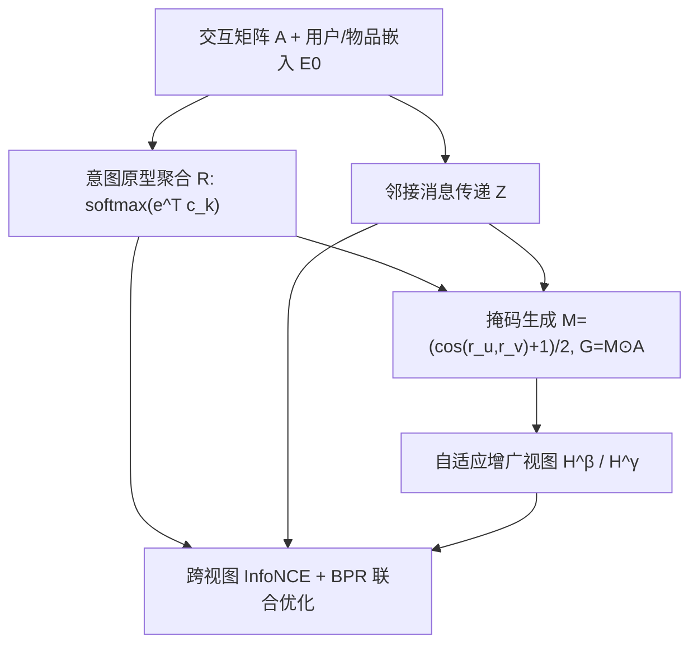
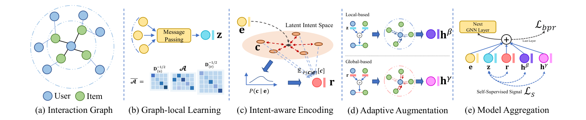

# Disentangled Contrastive Collaborative Filtering (解缠对比协同过滤)

- **会议/期刊**: SIGIR 2023 (Full Paper)
- **作者与机构**: Xubin Ren, Lianghao Xia, Chao Huang (香港大学 HKUDS)；Jiashu Zhao (Wilfrid Laurier University)；Dawei Yin (百度)
- **推荐链路定位**: 召回 (图协同过滤表征学习 + 自监督辅助任务)
- **研究方向**: 协同过滤与双塔召回 / 自监督对比学习与交互去噪
- **论文原文**: [https://arxiv.org/abs/2305.02759v4](https://arxiv.org/abs/2305.02759v4)
- **开源代码**: [https://github.com/HKUDS/DCCF](https://github.com/HKUDS/DCCF)

## TL;DR (1分钟核心速览)

现有图对比学习推荐 (SGL/HCCF) 存在两大痛点：一是用户-物品交互背后的多意图因子被"纠缠"编码，二是不区分重要性、随机丢边丢点的增广方式对噪声极敏感。DCCF 提出用 $K$个全局意图原型做意图感知信息聚合以解缠表征，再以解缠后嵌入的余弦相似度参数化生成图掩码$\mathbf{G}=\mathbf{M}\odot\mathbf{A}$，据此构造自适应增广视图做跨视图 InfoNCE 对比。在 Gowalla/Amazon-book/Tmall 上采用 **Full-Ranking 全库排序**评测，Recall@20 相比最强基线 LightGCL 分别提升 2.8%/6.3%/5.7%，NDCG@20 提升 4.3%/5.8%/5.6%，且训练时间仅为 DGCF 的约一半。

## Background & Motivation (背景与核心矛盾)

- **主流范式**: GNN 协同过滤 (NGCF / LightGCN) 通过邻接矩阵归一化消息传递捕捉高阶协同信号；为缓解监督标签稀疏，SGL 用随机 edge/node dropout 造增广视图、HCCF 用超图全局语义向量做跨视图对比，构成 GCL-based CF 主线。
- **前人局限一**: 交互行为由多重潜在意图驱动（家庭聚会采购、偏好某品牌/颜色），但现有 GCL 模型编码出的不变表征是纠缠的，对比信号只能停留在粗粒度用户偏好层面。
- **前人局限二**: 随机 dropout 属非自适应增广——删去 hub 节点会破坏跨社区结构，增广图与原图语义可能不相关；而对误点击、流行度偏置节点一视同仁地施加自监督，会引入误导性监督。
- **核心洞察 (Key Insight)**: 若表征本身可按意图原型解缠，则边的重要性可由意图级语义相似度自然度量，掩码即"自适应增广器"，自监督信号也随之去噪。
- **本文切入点**: 用全局意图原型 + 参数化可学习掩码，把「意图解缠」与「自适应对比增广」耦合进同一个 GNN 消息传递层。

## Method (核心方法设计)

### 1. 整体框架 (Overall Architecture)

DCCF 以 LightGCN 式残差消息传递为骨架。每个 GNN 层同时产出三路表征：局部协同消息 $\mathbf{Z}$（邻接归一化聚合）、全局意图感知消息$\mathbf{R}$（向$K$个意图原型的软分配聚合）、以及两路自适应增广消息$\mathbf{H}^{\beta},\mathbf{H}^{\gamma}$（由可学习掩码矩阵重新归一化后聚合）。三路信号与上一层嵌入相加得到第$l$ 层嵌入（式 13），最终层间池化后内积打分，训练目标为 BPR + 跨视图 InfoNCE + 两组正则。推理解码阶段不需要任何增广分支，仅保留主干嵌入内积，因此在线开销与 LightGCN 同阶。

<figure class="paper-figure" markdown="span">
  <figcaption>图1：我们提出的DCCF模型的整体框架，通过整合全局意图解缠和交互模式编码进行自适应增强，从而得到解缠的环境不变表示。</figcaption>
</figure>

### 2. 关键设计拆解 (Key Designs)

1. **意图原型软分配聚合 (Disentangled Multi-intent Encoding)**：针对表征纠缠问题，本文不切分维度（区别于 DGCF 的 embedding splitting），而是引入 $K$个可学习全局原型$\{\mathbf{c}_k^u\},\{\mathbf{c}_k^v\}$，以注意力权重加权求和得到意图感知表征：
$$\mathbf{r}_{i,l}^{(u)}=\sum_{k=1}^{K}\mathbf{c}_k^u\cdot\frac{\exp(\mathbf{e}_{i,l-1}^{(u)\top}\mathbf{c}_k^u)}{\sum_{k'}\exp(\mathbf{e}_{i,l-1}^{(u)\top}\mathbf{c}_{k'}^u)}$$
该式即 $\mathbb{E}_{P(c^u|u)}[c^u]$的蒙特卡洛近似，理论依据是用$\mathbb{E}[f(\cdot)]\approx f(\mathbb{E}[\cdot])$使 Jensen gap 有界（式 4）；全局原型使非局部（$>$3 跳）同好用户也能被拉到同一意图子空间，从而缓解稀疏与过平滑。

2. **参数化自适应图掩码 (Parameterized Adaptive Masking)**：针对随机增广的噪声脆弱性，用解缠嵌入间的余弦相似度定义边重要性并线性映射到 $[0,1]$：
$$M_{i,j}^{l}=\tfrac{1}{2}\big(s(\mathbf{r}_{i,l}^{(u)},\mathbf{r}_{j,l}^{(v)})+1\big),\quad \mathbf{G}^{l}=\mathbf{M}^{l}\odot\mathbf{A},\ \ \bar{G}_{i,j}=G_{i,j}/\textstyle\sum_{j'}G_{i,j'}$$
再以 $\bar{\mathbf{G}}$替代$\bar{\mathbf{A}}$执行一次消息传递得到$\mathbf{H}$。直觉是：与用户主导意图一致的历史交互被保留权重大，噪声/离群交互被压低，等价于一个可微的图去噪器；同时按行重新归一化避免了掩码导致的度失真。

3. **训练目标、负采样与推理效率**：三视图（局部增广 $\mathbf{h}^{\beta}$、全局意图视图$\mathbf{r}$、掩码增广$\mathbf{h}^{\gamma}$）分别与原始视图$\mathbf{z}$构成正对，batch 内其他节点为负对，$\mathcal{L}_{cl}^{(u)}=\mathcal{I}(\mathbf{z},\mathbf{r})+\mathcal{I}(\mathbf{z},\mathbf{h}^{\beta})+\mathcal{I}(\mathbf{z},\mathbf{h}^{\gamma})$（$\mathcal{I}$为 InfoNCE，温度$\tau$）。总损失：
$$\mathcal{L}=\mathcal{L}_{bpr}+\lambda_1(\mathcal{L}_{cl}^{(u)}+\mathcal{L}_{cl}^{(v)})+\lambda_2\|\Theta_1\|_F^2+\lambda_3\|\Theta_2\|_F^2$$
BPR 采用每用户 $S$正$S$负的均匀采样，跨视图对比负样本即 in-batch 节点（含难负样本，式 20 给出梯度范数随相似度增大而增大的证明）。训练开销$O(L|\mathbf{A}|d+2L|\mathbf{A}|d+L(I+J)Kd)$，Gowalla 单 epoch 12.4s（DGCF 25.1s、DisenHAN 16.8s）。

## Experimental Setup & Evaluation Protocol (实验设置与评估协议)

- **数据集与预处理**:

| 数据集 | #Users | #Items | #Interactions | 密度 | 场景说明 |
| :--- | :---: | :---: | :---: | :---: | :--- |
| Gowalla | 50,821 | 57,440 | 1,172,425 | 4.0e-4 | LBS 签到关系 |
| Amazon-book | 78,578 | 77,801 | 2,240,156 | 3.7e-4 | 图书评分/购买 |
| Tmall | 47,939 | 41,390 | 2,357,450 | 1.2e-3 | 电商购买行为 |

- **数据划分与防穿越**: 遵循 GCL-CF 惯例的固定训练/测试交互划分（非时间戳切分，测试集仅含训练中未出现的正交互），未额外引入冷启动划分；稀疏性分析以交互度为分桶替代。
- **排名评测协议**: 明确采用 **Full-Ranking (all-rank，对全部未交互物品排序)** 而非采样排序，以消除负样本采样偏差；指标 Recall@{20,40}、NDCG@{20,40}，并报告 $p$值（最大$1.3e\text{-}3$，多数$<1e\text{-}6$）。
- **对比基线与超参**: 5 组基线共 13 个——NCF/AutoR；NGCF/LightGCN；DisenGCN/DisenHAN/CDR/DGCF/DGCL；SLRec/SGL-ED/SGL-ND/HCCF/LightGCL。统一 $d=32$、batch=10240、层数$\{1,2,3\}$调优；$K=128$（搜索$\{32,64,128,256\}$），$\lambda_1\in\{0.001,0.025,0.1,0.2\}$，$\lambda_{2,3}\in\{2.5e\text{-}5,5e\text{-}4,5e\text{-}3\}$，Adam lr$1e\text{-}3$。

## Key Experimental Results (实验关键数据)

### 1. 主实验对比 (Main Results)

| 模型 | Gowalla R@20 | Gowalla N@20 | Amazon R@20 | Amazon N@20 | Tmall R@20 | Tmall N@20 |
| :--- | :---: | :---: | :---: | :---: | :---: | :---: |
| NCF | 0.1247 | 0.0659 | 0.0468 | 0.0336 | 0.0383 | 0.0252 |
| NGCF | 0.1413 | 0.0813 | 0.0532 | 0.0388 | 0.0420 | 0.0250 |
| LightGCN | 0.1799 | 0.1053 | 0.0732 | 0.0544 | 0.0555 | 0.0381 |
| DGCF | 0.1784 | 0.1069 | 0.0688 | 0.0513 | 0.0544 | 0.0372 |
| DGCL | 0.1793 | 0.1067 | 0.0677 | 0.0506 | 0.0526 | 0.0359 |
| SGL-ED | 0.1809 | 0.1067 | 0.0774 | 0.0578 | 0.0574 | 0.0393 |
| HCCF | 0.1818 | 0.1061 | 0.0824 | 0.0625 | 0.0623 | 0.0425 |
| LightGCL | 0.1825 | 0.1077 | 0.0836 | 0.0643 | 0.0632 | 0.0444 |
| **DCCF** | **0.1876** | **0.1123** | **0.0889** | **0.0680** | **0.0668** | **0.0469** |
| Improv. | +2.79% | +4.27% | +6.34% | +5.75% | +5.70% | +5.63% |

### 2. 消融实验 (Ablation Study)

| 变体 | Gowalla R@20 / N@20 | Amazon R@20 / N@20 | Tmall R@20 / N@20 |
| :--- | :---: | :---: | :---: |
| -Disen（去意图编码） | 0.1637 / 0.0975 | 0.0772 / 0.0580 | 0.0629 / 0.0437 |
| -LocalR（去局部掩码） | 0.1719 / 0.1015 | 0.0786 / 0.0593 | 0.0638 / 0.0446 |
| -DisenR（去意图级掩码） | 0.1718 / 0.1016 | 0.0793 / 0.0597 | 0.0640 / 0.0447 |
| -DisenG（去全局意图对比视图） | 0.1763 / 0.1053 | 0.0829 / 0.0635 | 0.0644 / 0.0449 |
| -AllAda（去全部掩码视图） | 0.1845 / 0.1096 | 0.0833 / 0.0632 | 0.0651 / 0.0452 |
| **DCCF 全模型** | **0.1876 / 0.1123** | **0.0889 / 0.0680** | **0.0668 / 0.0469** |

### 3. 关键实验发现 (Key Findings)

1. **意图解缠是最大贡献源，且与对比学习强耦合**：去掉 DME 后 Gowalla R@20 从 0.1876 掉到 0.1637（−12.7%），甚至低于未做解缠的 LightGCN (0.1799)；而去掉全部掩码增广视图 (-AllAda) 仅降 1.7%，说明"解缠"提供表征骨架、"对比"提供增益放大，单独保留其一的收益都远小。
2. **自监督信号对低频分桶收益更显著**：按交互度分组后，DCCF 在 0–10 度的长尾物品与冷用户桶上相对 LightGCN/DGCF/DGCL 的优势最大（图 2），原因是 DGCF 一类仅切分维度的方法易偏向高度数热门物品，而掩码增广把监督压力分散到了弱交互边。
3. **过平滑与效率双赢**：MAD 指标显示 DCCF 用户嵌入达 0.999（Tmall），关闭对比分支后跌至 0.800，而 LightGCN 仅 0.910，说明跨视图对比显著提升表征均匀性；同时单 epoch 训练 12.4s/18.9s/18.8s，约为 DGCF 的 50%–65%，代价可控。

## Highlights & Limitations (亮点、对比与审稿批判)

- **与代表作对比 (vs. Prior Work)**: 相比 SGL 的随机 dropout 增广，DCCF 的掩码由数据驱动、可微且逐层不同（自适应）；相比 DGCF 的维度切分 + 路由迭代，本文用全局原型做软分配，避免了递归路由的高开销且天然支持跨跳意图对比；相比 HCCF 的超图全局语义，本文的全局性体现在意图原型到非局部用户的语义桥接（图 5 中 $u_{1155}$与$u_{32856}$ 无局部连边但意图权重高度一致），并进一步把全局信息反向用于图结构增广，而非仅作对比锚点。
- **可迁移亮点**: (i) 用「已解缠表征的余弦相似度」生成边掩码这一思路，可直接移植到序列推荐中的物品转移图去噪或多行为图融合；(ii) 三视图（局部/全局/增广）与原始视图的交叉 InfoNCE 组合方式，是低成本增强 GCL 的通用模板。
- **审稿级局限批判**: (i) 每层需同时算 4 路消息传递与两组掩码，且 $K=128$时意图聚合开销$O(L(I+J)Kd)$已超过主消息传递，工业级千万物品规模下需靠原型共享/量化压缩；(ii) 评测仅在三个中小规模公开数据集、单一固定划分上完成，缺少时间切分与冷启动划分，也未验证$K$与$\lambda_1$的联合敏感性（图 3 已显示 Tmall 上$K$ 从 128 增至 256 反而退化，存在意图冗余风险），线上 A/B 缺失使增益的工程可信度仍待补强。

## Rating (四维评分)

- **方法创新性 (Novelty)**: ⭐⭐⭐⭐ （首次把意图原型解缠与参数化图掩码增广耦合，并用 Jensen gap 界与梯度范数推导给出理论支撑，思路清晰但组件本身均为已有技术的巧妙重组）
- **评估协议与实验扎实度 (Protocol & Experiments)**: ⭐⭐⭐⭐ （Full-Ranking 无偏评测 + 13 个基线 + $p$ 值检验 + 稀疏分桶/MAD/效率/案例五维分析齐备，扣分在缺少时间切分与冷启动协议）
- **写作与数学规范度 (Clarity & Rigor)**: ⭐⭐⭐⭐ （意图概率分解→近似→原型聚合的推导链条完整，复杂度逐项列出；但式 13 与式 9 符号重复、掩码归一化细节分散，阅读需反复对照）
- **工业落地与复现价值 (Industrial & Practical Value)**: ⭐⭐⭐⭐ （代码开源、推理期无额外分支、训练开销低于 DGCF，工程友好；短板是 $K$ 与多路视图在超大规模图上的显存与吞吐压力）

