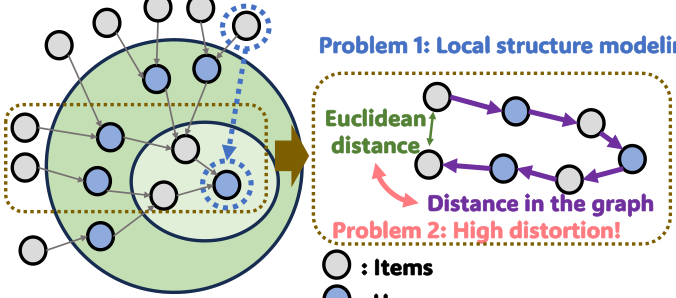
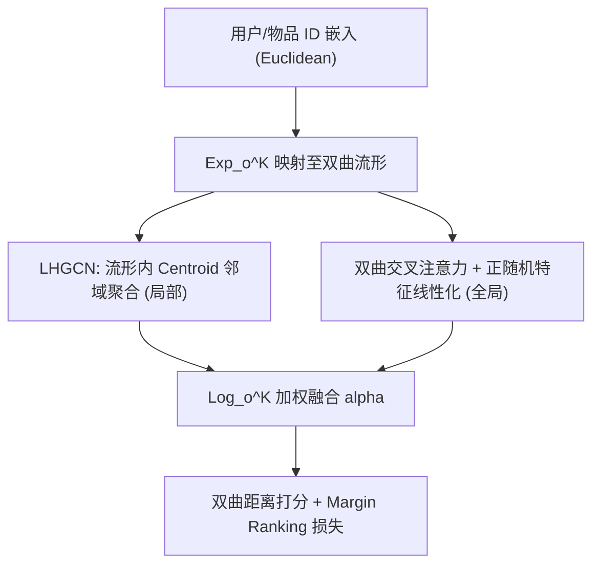
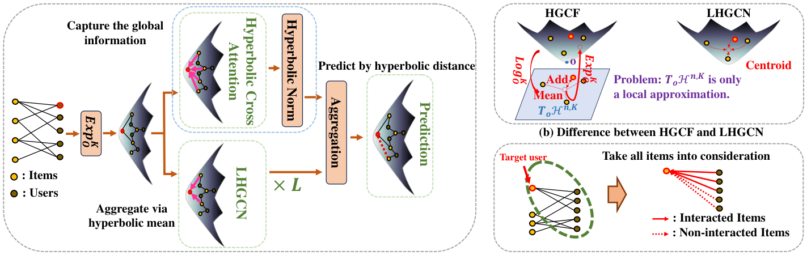

# Hgformer: Hyperbolic Graph Transformer for Recommendation (双曲图 Transformer 推荐模型)

- **会议/期刊**: SIGIR 2024（arXiv:2502.15693v1，2024-12-30）
- **作者与机构**: Xin Yang, Xingrun Li, Heng Chang, Erxue Min 等（筑波大学 / 京都大学 / 清华大学 / 东京大学 / 百度）
- **推荐链路定位**: 召回（用户-物品表示学习与 Top-K 排序）
- **研究方向**: 跨域与多场景推荐 / 图神经网络与知识图谱推荐
- **论文原文**: [论文原文链接](https://arxiv.org/abs/2502.15693v1)
- **开源代码**: 暂未开源

## TL;DR (1分钟核心速览)

长尾物品在协同过滤中既受限于 GNN 的局部邻域聚合（低度节点表征欠训），又在欧氏空间中因无法承载指数级层次结构而产生嵌入畸变。本文把两者统一到双曲流形上：以无参的 LHGCN 做全流形邻域聚合、以双曲交叉注意力建模全局用户-物品交互，并用正随机特征把注意力从 $O(MNd)$降到$O((M+N)md)$。在 6 个 Amazon/Douban 数据集的全库排序下，Amazon-Book R@10 相对次优 HICF 提升 17.6%，尾部物品 Recall@10 相对 HGCF 提升最高 55.7%。

## Background & Motivation (背景与核心矛盾)

- **主流范式**: LightGCN 式无参图卷积在二部交互图上做邻居消息传递；HGCF/HRCF/HICF 进一步把嵌入搬到负曲率双曲空间以适配幂律/层次分布。
- **前人局限**: ① 双曲 GNN 必须先 `Log` 到北极点切空间做聚合再 `Exp` 回流形，而切空间只是流形的局部近似，每层都引入信息畸变；② 纯 GNN 只能看到 $L$ 跳邻域，尾部物品因邻居稀少几乎无法把信号传给大多数用户。
- **核心洞察 (Key Insight)**: 图 Transformer 能看全局，但在推荐场景下对全部结点对做注意力会过度强调用户-用户、物品-物品关系而引入噪声；同时欧氏空间下的全局注意力无法与双曲层次容量兼得。
- **本文切入点**: 在双曲流形上同时保留局部结构（LHGCN）与全局信息（仅 user–item 的双曲交叉注意力），并给出线性化近似与误差上界。

<figure class="paper-figure" markdown="span">
  <figcaption>图1. 本图突出传统GNN在处理长尾物品时通常面临的两个关键挑战。第一个是局部邻域中的消息传递范式，它阻止模型将来自不太热门物品的信息传递给大多数用户，导致对这些物品的推荐效果较差。第二个是欧几里得空间中的嵌入可能无法捕捉图中的长距离关系，并会在图结构中导致严重的信息失真。</figcaption>
</figure>

## Method (核心方法设计)

### 1. 整体框架 (Overall Architecture)

用户/物品 ID 嵌入经指数映射 $\mathrm{Exp}_o^K$从北极点切空间推到双曲流形；随后两路并行：$L$层 LHGCN 在流形上直接聚合邻居得到局部表示$(u^{local}, i^{local})$，双曲交叉注意力（含线性近似）对所有用户-物品对做全局建模并经双曲归一化得到$(u^{global}, i^{global})$；两路表示用可学习权重$\alpha$ 在切空间加权后映射回流形，最终以双曲距离排序，用双曲 margin-ranking 损失端到端训练。

<figure class="paper-figure" markdown="span">
  <figcaption>图2. 图(a)展示了Hgformer的整体架构。我们首先将用户和物品嵌入映射到双曲流形中。然后，我们使用若干层LHGCN捕捉交互图的局部信息，并使用Hyperbolic Transformer捕捉交互图的整体信息。最后，我们结合这两类信息并在双曲流形上进行预测。图(b)展示了HGCF与LHGCN在图卷积中的差异。在HGCF中，嵌入从双曲流形映射到北极点的切空间以进行聚合</figcaption>
</figure>

### 2. 关键设计拆解 (Key Designs)

1. **LHGCN：全流形无参图卷积**：针对 HGCF 类方法"切空间聚合"的近似误差，直接把邻居集合的 Fréchet 均值写成闭式：
$u_i^{(l+1)}=\mathrm{Centroid}\big(\{u_i^{(l)}\}\cup\{i_k^{(l)}:k\in\mathcal{N}_i\}\big),\quad \mathrm{Centroid}(\mathcal{N})=\sqrt{K}\,\frac{\sum_i w_i x_i}{\big|\|\sum_i w_i x_i\|_M\big|}$
因双曲质心天然贴合幂律层次结构，低度节点也能被"拉到"其所属子树的公共祖先附近，且不引入任何可训练参数。

2. **双曲交叉注意力与线性化**：针对 CF 二部图特性，只对 user–item 对计算注意力，相似度取 $\mathrm{HSM}(x,y)=\exp(\langle x,y\rangle_M)$（Minkowski 内积单调等价于负测地距离）。为突破$O(MNd)$，用满足$\omega\sim\mathcal{N}(0,I_d)$的正随机特征$\phi(x)=\frac{\exp((K-x_0^2)/2\tau)}{\sqrt{m}}\big[\exp(\omega_1^\top\tilde{x}/\sqrt{\tau}),\dots\big]$ 做无偏估计并交换计算顺序：
$\hat{u}_i \approx \frac{\phi(q_i/\sqrt{\tau})^{\top}\sum_j \phi(k_j/\sqrt{\tau})\,v_j^{\top}}{\phi(q_i/\sqrt{\tau})^{\top}\sum_n \phi(k_n/\sqrt{\tau})}$复杂度降为$O((M+N)md)$，且误差以$O(\sqrt{\exp(3(\delta-K))/(m\epsilon)})$概率有界——只依赖嵌入范数$\delta$、曲率$K$、特征数$m$，可由增大$m$ 或做归一化控制。

3. **训练目标、负采样与推理开销**：融合 $u^{final}=\mathrm{Exp}_o^K\big(\alpha \mathrm{Log}_o^K(u^{global})+(1-\alpha)\mathrm{Log}_o^K(u^{local})\big)$；损失为双曲 margin-ranking：$\mathcal{L}=\max\big(d_M(u^{final},i^{pos})^2-d_M(u^{final},i^{neg})^2+\lambda,0\big)$，负样本为均匀随机未交互物品（无难负采样、无 in-batch）。推理时交叉注意力已是线性算子，可离线预计算$\sum_j\phi(k_j)v_j^\top$与$\sum_n\phi(k_n)$，线上仅需$O(md)$ 打分。

## Experimental Setup & Evaluation Protocol (实验设置与评估协议)

- **数据集与预处理**: 6 个公开数据集（Amazon 与 Douban 各 3 个），统计如下：

| 数据集 | #Users | #Items | #Interactions | 密度 |
| :--- | :---: | :---: | :---: | :---: |
| Amazon-Book | 211,170 | 163,789 | 5,069,747 | 0.015% |
| Amazon-CD | 66,317 | 58,869 | 952,547 | 0.024% |
| Amazon-Movie | 26,969 | 18,564 | 762,957 | 0.150% |
| Douban-Book | 18,086 | 33,068 | 809,248 | 0.140% |
| Douban-Movie | 22,041 | 25,802 | 2,553,305 | 0.459% |
| Douban-Music | 15,996 | 39,749 | 1,116,984 | 0.176% |

- **数据划分与防穿越 (Splitting Strategy)**: 正文未明确交代划分比例/是否 Leave-One-Out（仅给出 Recall/NDCG 的按用户平均定义），属复现性缺口，需参照 HGCF 系列惯例（通常为每用户留一）。
- **排名评测协议 (Ranking Protocol)**: 采用 `Full-Ranking`（Recall@K 分母为全体未交互候选），K ∈ {10, 20}；负采样仅用于训练。
- **对比基线与超参设置**: 4 类基线——BPR/NGCF（传统与 GCN）、LightGCN/HMLET（欧氏 GNN）、HGCF/HRCF/HICF（双曲 GNN）、SGFormer/NodeFormer/Hypformer（图 Transformer）。正文未给出统一 $d$与训练轮数；显著性以$p<0.05$ 标注（表中 `*`）。

## Key Experimental Results (实验关键数据)

### 1. 主实验对比 (Main Results)

| 数据集 | 指标 | LightGCN | HGCF | HICF | HRCF | SGFormer | Hypformer | **Hgformer** | Improv. |
| :--- | :---: | :---: | :---: | :---: | :---: | :---: | :---: | :---: | :---: |
| Amazon-Book | R@10 | 0.0581 | 0.0748 | 0.0766 | 0.0745 | 0.0545 | 0.0376 | **0.0901**\* | +17.6% |
| Amazon-Book | N@10 | 0.0344 | 0.0467 | 0.0485 | 0.0466 | 0.0332 | 0.0215 | **0.0573**\* | +18.1% |
| Amazon-CD | R@10 | 0.0770 | 0.0797 | 0.0826 | 0.0824 | 0.0435 | 0.0613 | **0.0977**\* | +18.3% |
| Amazon-CD | N@10 | 0.0437 | 0.0451 | 0.0489 | 0.0477 | 0.0242 | 0.0340 | **0.0567**\* | +15.9% |
| Amazon-Movie | R@10 | 0.0702 | 0.0740 | 0.0740 | 0.0761 | 0.0560 | 0.0294 | **0.0803**\* | +5.5% |
| Douban-Book | R@10 | 0.1313 | 0.1375 | 0.1388 | 0.1357 | 0.0886 | 0.0446 | **0.1462**\* | +5.3% |
| Douban-Movie | R@10 | 0.1339 | 0.1348 | 0.1370 | 0.1393 | 0.1259 | 0.0678 | **0.1405**\* | +0.9% |
| Douban-Movie | N@10 | 0.1326 | 0.1248 | 0.1297 | **0.1342** | 0.1263 | 0.0780 | 0.1322 | −1.5% |
| Douban-Music | R@10 | 0.1258 | 0.1218 | 0.1276 | 0.1271 | 0.1071 | 0.0313 | **0.1386**\* | +8.6% |

（表中 Improv. 为相对最强基线的相对提升；唯一失手为 Douban-Movie 的 N@10。）

### 2. 消融实验 (Ablation Study)

| 变体 | Amazon-Book R@10 / N@10 | Amazon-CD R@10 / N@10 |
| :--- | :---: | :---: |
| **Hgformer (full)** | **0.0901 / 0.0573** | **0.0977 / 0.0567** |
| w/o Hyperbolic Transformer | 0.0796 / 0.0496 | 0.0870 / 0.0505 |
| w/o LHGCN | 0.0422 / 0.0250 | 0.0592 / 0.0332 |
| LHGCN → HGCF（HGCF+Transformer） | 0.0821 / 0.0492 | 0.0846 / 0.0482 |
| HGCF（纯双曲 GNN 基线） | 0.0748 / 0.0467 | 0.0797 / 0.0451 |

### 3. 关键实验发现 (Key Findings)

1. **局部结构 >> 全局注意力**：去掉 LHGCN 后在 Amazon-Book 上 R@10 从 0.0901 崩到 0.0422（−53%），而去掉 Transformer 仅降到 0.0796（−12%）——说明 Graph Transformer 在 CF 中只能做"增益项"，完全抛弃图卷积不可行。
2. **"全流形聚合"确实省掉了畸变**：LHGCN 与 HGCF 的直接替换对照显示，Amazon-CD 上 R@10 0.0846 → 0.0977（+15.5%），但在 Douban-Book 上 LHGCN 略逊 HGCF（N@10 0.1113→0.1096），说明切空间近似在高密度小图上损失可忽略。
3. **双曲几何真正救的是尾部**：LightGCN 推荐列表中尾部物品仅占 2.2%（Amazon-CD）/ 4.9%（Amazon-Movie），双曲族升至 ~30–40%；Hgformer 在尾部物品上的 Recall@10 达 0.0678 / 0.0813 / 0.1942 / 0.1281，相对 HGCF 提升 55.7% / 17.5% / 29.8% / 26.7%，案例研究进一步显示它能召回交互图上跳数 > 5 的远距离相关物品。

## Highlights & Limitations (亮点、对比与审稿批判)

- **与代表作对比 (vs. Prior Work)**: 相对 HGCF/HRCF/HICF，本文是首个让图卷积"全程不下流形"的 CF 方案，且补上了它们缺失的全局建模；相对 SGFormer/NodeFormer/Hypformer，本文把注意力严格限制在 user–item 二部边上，避免了用户-用户噪声（这也解释了为何三个通用图 Transformer 基线在本任务上普遍弱于 LightGCN）。
- **可迁移亮点**: ① "Centroid 闭式聚合"可直接替换任意双曲 GNN 的切空间聚合层，零参数零调参；② 正随机特征线性化 + 可离线预计算的 $\sum_j\phi(k_j)v_j^\top$ 结构，对任何基于核相似度的召回模型都适用。
- **审稿级局限批判**: ① 论文摘要与结论声称"以 BiTGCF 为基座的跨域推荐"，但正文模型、实验、公式全部是单域协同过滤，缺乏跨域迁移层与跨域数据集验证，归属与表述严重不一致，削弱可信度；② 评估协议缺陷明显——未声明数据划分方式、未报告嵌入维度与显著性检验细节，且 Douban-Movie 上 NDCG 反被 HRCF 超越，泛化结论偏乐观；③ 双曲注意力虽有误差上界，但 $m$与曲率$K$ 均需调参，且多数据集最优层数不同（Amazon 6–7 层、Douban 4–5 层），线上部署需按域重训。

## Rating (四维评分)

- **方法创新性 (Novelty)**: ⭐⭐⭐⭐ （首个将图 Transformer 完整搬到双曲流形做 CF，LHGCN 的零参流形聚合 + 带误差界的线性化注意力是有实质增量的组合）
- **评估协议与实验扎实度 (Protocol & Experiments)**: ⭐⭐⭐ （6 个数据集 + 4 类基线 + 尾部专项分析很充分，但划分方式、维度、超参搜索空间缺失，且存在被基线反超的指标）
- **写作与数学规范度 (Clarity & Rigor)**: ⭐⭐⭐ （定理 4.1/4.2 与误差上界证明完整，但摘要/结论与正文主题错位、部分图内数值与表格不一致，损害严谨性）
- **工业落地与复现价值 (Industrial & Practical Value)**: ⭐⭐⭐ （线性复杂度与可预计算的两阶段结构利于大规模上线，但无开源代码、双曲算子实现门槛高、需要按域调曲率与层数）

