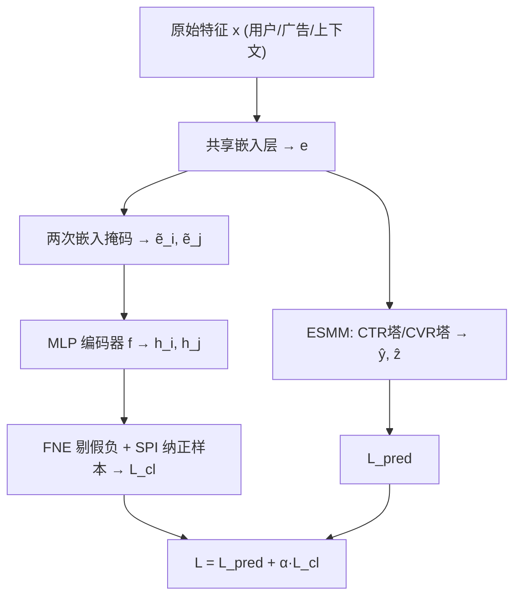
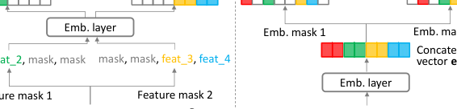

# Contrastive Learning for Conversion Rate Prediction (面向转化率预估的对比学习)

- **会议/期刊**: SIGIR 2023 (短论文, 5 页)
- **作者与机构**: Wentao Ouyang, Rui Dong, Xiuwu Zhang, Chaofeng Guo, Jinmei Luo, Xiangzheng Liu, Yanlong Du（阿里巴巴集团）
- **推荐链路定位**: 精排（CVR / CTCVR 预估）
- **研究方向**: CTR/CVR 预估与特征交叉 / 自监督对比学习与交互去噪
- **论文原文**: [论文原文链接](https://arxiv.org/abs/2307.05974v1)
- **开源代码**: [开源代码仓库链接](https://github.com/DongRuiHust/CL4CVR)

## TL;DR (1分钟核心速览)

CVR 预估是典型"点击多、转化极少"的稀疏监督问题（工业集转化率仅 ~1.04%），纯监督深度模型易过拟合。本文提出 CL4CVR：在 ESMM 监督任务旁挂一条对比学习辅助任务，把特征掩码（Feature Masking）换成**嵌入掩码（EM）**以适配多域特征场景，并用**假负样本剔除（FNE）**与**监督正样本纳入（SPI）**重写对比损失的分母/分子。在工业与淘宝公开两套数据上按 AUC 全样本排序评估，AUC 分别达 0.8637（+0.0079）与 0.6590（+0.0066），显著优于 RFM/CFM 等特征掩码基线（$p\le0.01$）。

## Background & Motivation (背景与核心矛盾)

- **主流范式**: 以 ESMM 为代表的多塔监督模型在**全样本空间**上联合建模 CTR 与 CTCVR、隐式学习 CVR，是工业 CVR 预估的事实标准。
- **前人局限**: ①深度模型数据饥渴，而转化事件极稀疏（工业集 6450 万点击仅 67 万转化），监督信号不足以训练鲁棒表征；②推荐领域现有对比增广几乎都是 ID 序列/图增广，或面向"物品推荐"的**特征掩码**（RFM/CFM），无法直接用于用户-物品-上下文-交互多域并存的 CVR 特征场景。
- **核心洞察 (Key Insight)**: 特征掩码把广告 ID/标题整块遮蔽后，模型根本无从判断"该用户是否会转化"，两个视图语义已崩坏；但若只遮蔽**拼接嵌入向量的部分维度**，每个视图仍保留全部特征域信息，对比损失便能迫使嵌入本身更具表征力与抗噪性。
- **本文切入点**: 用"嵌入维度掩码 + 依据特征重复性剔除假负样本 + 依据转化标签扩充正样本"三件套，把通用 InfoNCE 改造成贴合广告行为数据性质的 CVR 专用对比损失。

## Method (核心方法设计)

### 1. 整体框架 (Overall Architecture)

每个样本的特征向量 $\mathbf{x}$（60/17 个域）经共享嵌入层拼接为长向量$\mathbf{e}$，随后分两路：一路进入 ESMM 的 CTR/CVR 双塔输出$\hat{y},\hat{z}$，计算监督损失；另一路对$\mathbf{e}$施加两次随机元素级掩码得到$\tilde{\mathbf{e}}_i,\tilde{\mathbf{e}}_j$，经同一 MLP 编码器$f$得$\mathbf{h}_i,\mathbf{h}_j$，在 FNE/SPI 修正后的样本集合上计算对比损失。两任务共享嵌入层端到端联合训练，推理阶段**完全丢弃对比分支**，线上打分开销与 Base 模型一致。

### 2. 关键设计拆解 (Key Designs)

1. **嵌入掩码 EM（替代特征掩码的增广算子）**：痛点在于特征掩码（维度 $F$）会整域丢弃广告信息导致视图不可辨识；EM 将掩码作用在维度为$FK$的拼接嵌入上，即$\tilde{\mathbf{e}}=\mathbf{m}\odot\mathbf{e}$，$\mathbf{m}\in\{0,1\}^{FK}$。物理直觉：随机失活部分嵌入维度等价于在隐空间做"信息冗余压缩"，迫使剩余维度独立承载判别信息，从而学到更紧致的特征交叉表征。

<figure class="paper-figure" markdown="span">
  <figcaption>图2：(a) 特征掩码。(b) 嵌入掩码。</figcaption>
</figure>

2. **假负样本剔除 FNE + 监督正样本纳入 SPI（重写对比目标的两个集合）**：广告反复曝光使同一 $(user, ad)$产生多条特征完全相同、转化标签却可能矛盾的样本，传统 InfoNCE 会把它们当作负样本互相推远（假负）。FNE 构造$\mathcal{M}(i)=\{j\}\cup\{k\mid \mathbb{I}(o(\tilde{\mathbf{e}}_i),o(\tilde{\mathbf{e}}_k))=0\}$，把重复特征样本从分母剔除（仅作用于对比分支，监督分支仍保留全部样本以保证概率校准）。SPI 则利用稀疏但珍贵的转化标签，令$\mathcal{S}(i)=\{j\}\cup\{k\mid z(\tilde{\mathbf{e}}_k)=z(\tilde{\mathbf{e}}_i)=1\}$；仅当锚点为转化正样本时扩充正例，避免全负 mini-batch 下"无对比可言"的退化。

3. **训练目标、负采样与推理效率**：对比损失在 $\mathcal{Q}(i)=\mathcal{S}(i)\cap\mathcal{M}(i)$ 上取平均，
$\mathcal{L}_{cl}=-\frac{1}{2N}\sum_{i=1}^{2N}\frac{1}{|\mathcal{Q}(i)|}\sum_{q\in\mathcal{Q}(i)}\log\frac{\exp(s(\mathbf{h}_i,\mathbf{h}_q)/\tau)}{\sum_{k\in\mathcal{M}(i)}\exp(s(\mathbf{h}_i,\mathbf{h}_k)/\tau)}$，
总损失 $\mathcal{L}=\mathcal{L}_{pred}+\alpha\mathcal{L}_{cl}$，$\mathcal{L}_{pred}=\frac{1}{N}\sum_n l(\hat{y}_n,y_n)+\frac{1}{N}\sum_n l(\hat{y}_n\hat{z}_n,y_nz_n)$。负样本即 **in-batch 其余增广样本**（免额外负采样），相似度用余弦、温度$\tau$ 可调。

## Experimental Setup & Evaluation Protocol (实验设置与评估协议)

- **数据集与预处理**: 无 5-core 过滤（广告日志天然长尾），两套真实转化日志：

| 数据集 | #Fields | #Train | #Val | #Test | #Show / #Click / #Conv | 转化率(点击→转化) |
| :--- | :---: | :---: | :---: | :---: | :---: | :---: |
| Industrial (2022 资讯信息流广告) | 60 | 278.8M | 49.2M | 48.4M | 376.4M / 64.5M / 0.67M | 1.04% |
| Public (淘宝展示广告) | 17 | 2.3M | 0.98M | 3.3M | 6.6M / 3.3M / 0.018M | 0.55% |

- **数据划分与防穿越 (Splitting Strategy)**: 采用 **比例划分**（train/val/test 三段），文中未声明按全局时间戳切分，属随机日志采样切分，理论上存在轻微时序泄漏风险。
- **排名评测协议 (Ranking Protocol)**: 使用 **CVR AUC**，在测试集全部点击样本上做**全样本排序**（未做负采样下采样），衡量正样本排在负样本之前的概率。
- **对比基线与超参设置**: Base=ESMM；FD（监督任务随机特征 dropout）、SO（Spread-Out 正则）、RFM（随机特征掩码对比）、CFM（相关特征掩码对比）。预测塔与编码器 FC 维度 $\{512,256,128\}$，batch=64，Adagrad 优化，TensorFlow 实现，每法跑 3 次取均值，配对 t 检验$p\le0.01$。

## Key Experimental Results (实验关键数据)

### 1. 主实验对比 (Main Results)

| 方法 | Industrial AUC | Gain | Public AUC | Gain |
| :--- | :---: | :---: | :---: | :---: |
| Base (ESMM) | 0.8558 | - | 0.6524 | - |
| FD | 0.8452 | -0.0106 | 0.6469 | -0.0055 |
| SO | 0.8563 | +0.0005 | 0.6534 | +0.0010 |
| RFM | 0.8522 | -0.0036 | 0.6536 | +0.0012 |
| CFM | 0.8539 | -0.0019 | 0.6541 | +0.0017 |
| **CL4CVR** | **0.8637\*** | **+0.0079** | **0.6590\*** | **+0.0066** |

### 2. 消融实验 (Ablation Study)

| 配置 | Industrial AUC | Gain | Public AUC | Gain |
| :--- | :---: | :---: | :---: | :---: |
| Base | 0.8558 | - | 0.6524 | - |
| + EM | 0.8586 | +0.0028 | 0.6572 | +0.0048 |
| + EM + FNE | 0.8605 | +0.0047 | 0.6581 | +0.0057 |
| + EM + SPI | 0.8617 | +0.0059 | 0.6580 | +0.0056 |
| + EM + FNE + SPI | **0.8637** | **+0.0079** | **0.6590** | **+0.0066** |

### 3. 关键实验发现 (Key Findings)

1. **增广粒度决定成败**：仅换增广算子，EM（0.8586）已超过最优特征掩码基线 CFM（0.8539）约 0.0047 AUC，且 RFM/FD 在工业集上甚至**低于** Base（-0.0036/-0.0106），说明整域遮蔽在特征异构场景是负增益而非噪声正则。
2. **两个集合修正互补且不重叠**：FNE 单独贡献 +0.0019（工业）、SPI 单独贡献 +0.0031，二者叠加达 +0.0079，接近各自增益之和，表明"去假负"（改善负样本分布）与"纳正例"（改善正样本密度）作用于不同误差来源。
3. **增益随数据规模稳健且超参可控**：工业集样本量约为公开集 120 倍，AUC 提升幅度（+0.0079 vs +0.0066）同向且同量级；$\tau$偏大时表现更好、$\alpha$ 呈先升后降的倒 U 形（过大则过度强调对比任务反而掉点），说明辅助任务权重需限制在较小量级。

## Highlights & Limitations (亮点、对比与审稿批判)

- **与代表作对比 (vs. Prior Work)**: 相较 RFM/CFM（物品推荐的特征掩码，掩在原始特征域），本文掩在嵌入维度域，保留全部特征域语义；相较 SO（表征散布正则，仅 +0.0005），本文引入了样本对级的关系结构；相较 ESM2/GMCM/HM3（依赖收藏/加购等后点击行为），本文**不增加任何额外行为数据依赖**，可直接套在 ESMM 上。
- **可迁移亮点**: ①"嵌入维度掩码"可作为 CTR/CVR/多域特征模型的通用增广插件，几乎零成本；②FNE 的"重复特征判等"思想可迁移到任何日志重复曝光场景下的对比/去噪训练。
- **审稿级局限批判**: ①仅 5 页短文，两数据集均来自同一广告生态（阿里），跨厂商泛化性未知；②划分未做严格时间切分，AUC 绝对值可能偏乐观；③FNE 需在 batch 内做 $O(N^2)$ 特征判等，工业级大 batch 下开销与实现成本未讨论；④对比分支使训练显存/计算约翻倍，论文未给出训练成本量化。

## Rating (四维评分)

- **方法创新性 (Novelty)**: ⭐⭐⭐⭐ （增广算子从特征域迁移到嵌入域的思路朴素但切中要害，FNE/SPI 是对 InfoNCE 的合理领域化改造，理论分析偏工程直觉）
- **评估协议与实验扎实度 (Protocol & Experiments)**: ⭐⭐⭐ （双数据集 + 显著性检验 + 完整消融较规范，但缺时间切分、缺线上 A/B、缺训练成本与超参敏感度的系统分析）
- **写作与数学规范度 (Clarity & Rigor)**: ⭐⭐⭐⭐ （集合定义与公式推导干净清晰，$\mathcal{M}/\mathcal{S}/\mathcal{Q}$ 三层集合记号明确，5 页篇幅下表达高效）
- **工业落地与复现价值 (Industrial & Practical Value)**: ⭐⭐⭐⭐⭐ （推理零额外开销、代码开源、直接复用 ESMM 骨架，是极易上线的"白捡 AUC"方案）

