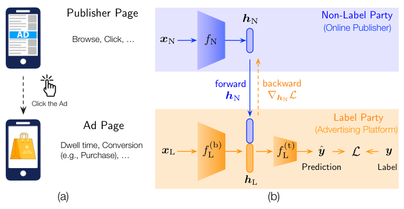
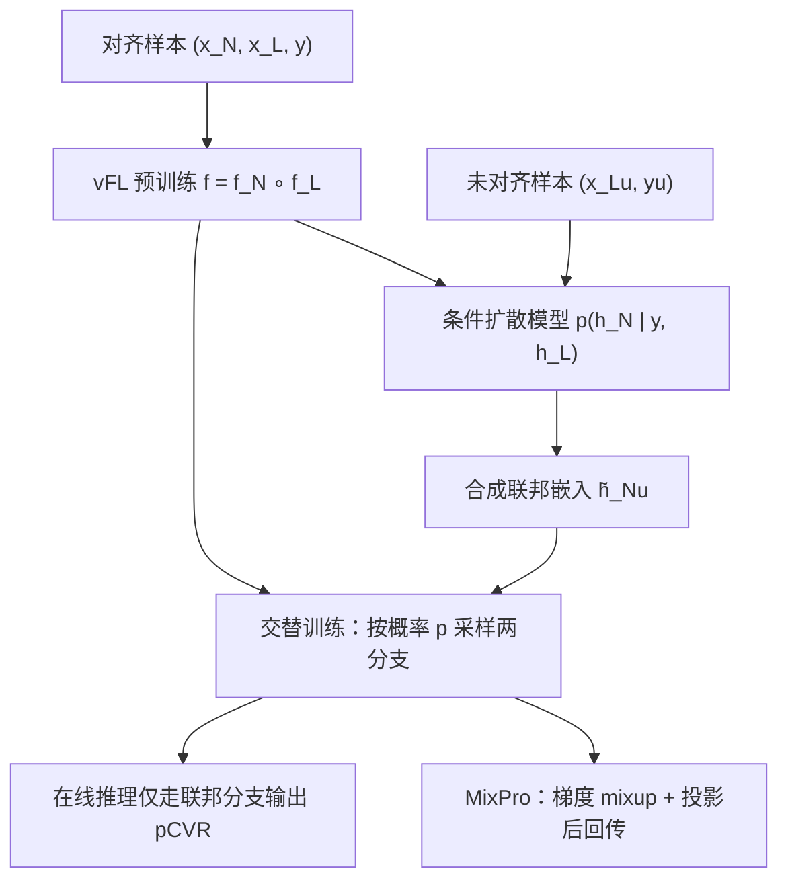
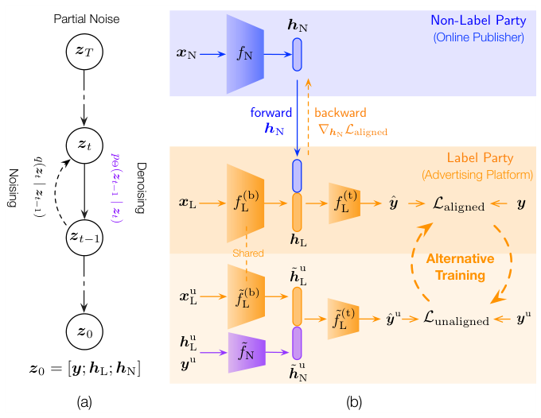

# FedAds: A Benchmark for Privacy-Preserving CVR Estimation with Vertical Federated Learning (面向隐私保护 CVR 预估的纵向联邦学习基准)

- **会议/期刊**: SIGIR 2023 (Resource Track)
- **作者与机构**: Penghui Wei, Hongjian Dou, Shaoguo Liu, Rongjun Tang, Li Liu, Liang Wang, Bo Zheng（阿里巴巴集团；CUHK-Shenzhen、HKUST-GZ）
- **推荐链路定位**: 精排（CVR 预估 / 竞价排序）
- **研究方向**: CTR/CVR 预估与特征交叉 / 去偏公平、可信隐私与工业架构
- **论文原文**: [https://arxiv.org/abs/2305.08328v1](https://arxiv.org/abs/2305.08328v1)
- **开源代码**: [https://github.com/alibaba/Elastic-Federated-Learning-Solution](https://github.com/alibaba/Elastic-Federated-Learning-Solution)

## TL;DR (1分钟核心速览)

线上媒体侧掌握用户浏览/点击特征，广告平台侧掌握转化标签，二者以纵向联邦学习 (vFL) 联合训练 CVR 模型可兼顾效果与隐私。但现有研究缺乏标准数据，只能对公开数据手工切分特征来"伪仿真" vFL，无法公平对比。本文发布 FedAds：阿里真实投放日志构建的 1130 万样本两方 vFL 数据集，并提出 Diffu-AT（用条件扩散模型为标签方未对齐样本合成联邦嵌入）与 MixPro（梯度 mixup+投影抗标签推断攻击），在真实划分上系统评测 9 种 vFL 算法，Diffu-AT 取得 AUC 0.645（较 VanillaVFL 相对提升 4.0%）。

## Background & Motivation (背景与核心矛盾)

- **主流范式**: 两方 vFL 将 CVR 模型按特征切分为 $f=f_N\circ f_L$，双方经 PSI 求样本交集 (aligned samples)，前传只交换 cut layer 的联邦嵌入$\boldsymbol{h}_N$，后传只交换梯度$\boldsymbol{g}$。
- **前人局限一（效果）**: 训练仅依赖 PSI 交集，样本量往往远小于任一方本地数据；虽已有自监督 (SS-VFL/FedHSSL)、半监督 (FedCVT)、映射合成 (JPL) 等利用未对齐样本的方案，但各自在不同私有数据上验证，**缺乏同一数据下的横向可比性**。
- **前人局限二（隐私）**: 由 $\boldsymbol{g}=\frac{\partial \boldsymbol{l}}{\partial \boldsymbol{h}_N}(\hat{\boldsymbol{y}}-\boldsymbol{y})$ 可知梯度幅度与方向直接编码标签，诚实但好奇的非标签方可发起标签推断攻击；DP/Marvell 等扰动方案的效果与效用折衷从未在真实工业数据上被统一度量。
- **核心洞察 (Key Insight)**: 广告平台本地存在大量"站内广告"转化样本（有 $\boldsymbol{x}_L^u,\boldsymbol{y}^u$但缺$\boldsymbol{x}_N^u$），其标签信息量远高于无监督预训练；而缺失的联邦嵌入可由生成模型**条件化于$(\boldsymbol{y}^u,\boldsymbol{h}_L^u)$ 直接合成**。
- **本文切入点**: 同时交付"真实数据 + 标准协议 + 两个新方法"，把 vFL 研究从手工仿真的孤岛拉到统一擂台上。

<figure class="paper-figure" markdown="span">
  <figcaption>图1：(a) 用户浏览广告后的反馈行为。(b) 用于训练转化率估计模型的纵向联邦学习框架。在线发布商和广告平台提供收集到的用户反馈数据，并协同训练模型。</figcaption>
</figure>

## Method (核心方法设计)

### 1. 整体框架 (Overall Architecture)

FedAds 的评测基座是标准两方 vFL：非标签方子模型 $f_N$输出$\boldsymbol{h}_N$，标签方$f_L$拼接自身表征$\boldsymbol{h}_L$后经 top 层输出$\hat{y}$，以交叉熵训练。Diffu-AT 在其上增加三阶段闭环：① 用对齐样本预训练 vFL，得到三元组$\{(\boldsymbol{h}_N,\boldsymbol{h}_L,\boldsymbol{y})\}$；② 以$[\boldsymbol{y};\boldsymbol{h}_L]$为条件学习扩散模型$\tilde{f}_N$，对未对齐样本推理出合成嵌入$\tilde{\boldsymbol{h}}_N^u$；③ 用概率$p=|\mathcal{D}_{aligned}|/(|\mathcal{D}_{aligned}|+|\tilde{\mathcal{D}}_{unaligned}|)$交替采样两个分支，联邦分支与本地分支共享$f_L^{(b)}$ 底层参数。在线推理只保留联邦分支，本地分支丢弃——作者明确否定了"蒸馏成纯本地模型"的路线，实测掉点严重、工业不可接受。

### 2. 关键设计拆解 (Key Designs)

1. **条件扩散合成联邦嵌入 (Diffu-AT)**：痛点是无对齐样本缺 $\boldsymbol{x}_N$，常规做法只能启发式猜。本文将前向加噪只施加在$\boldsymbol{h}_N$分量、条件$[\boldsymbol{y};\boldsymbol{h}_L]$全程冻结：$q(\boldsymbol{h}_{N,t}\mid\boldsymbol{h}_{N,t-1})=\mathcal{N}(\sqrt{1-\beta_t}\boldsymbol{h}_{N,t-1},\beta_t\mathbf{I})$，反向用标准 DDPM 目标$\mathcal{L}_{DDPM}=\sum_t\mathbb{E}\|\tilde{\boldsymbol{\mu}}_t(\boldsymbol{z}_t,\boldsymbol{z}_0)-\boldsymbol{\mu}_\Theta(\boldsymbol{z}_t,t)\|^2$。直觉：标签与标签方表征已足以约束"另一半视图"的分布，生成而非映射可避免 JPL 那类一对一映射的过强假设。
2. **交替训练与参数共享**：直接混合两个分布会引入表征漂移，故用双分支共享底部 $f_L^{(b)}$、各自独立 top 层与 BN，按批次随机选路更新。这使得未对齐样本只塑造"另一视角"的 top 层而不污染联邦分支的 BN 统计量。
3. **MixPro 梯度防御**：先做批内 mixup $\boldsymbol{g}_{mixed,i}=\lambda\boldsymbol{g}_i+(1-\lambda)\boldsymbol{g}_r,\ \lambda\sim\mathrm{Beta}(\alpha,\alpha),\lambda>0.5$（保留主信息量），再以$\phi_i=\cos(\boldsymbol{g}_{mixed,i},\bar{\boldsymbol{g}})$衡量方向泄露，若$\phi_i<\phi_{goal}$则沿批均值方向投影：$\boldsymbol{g}_{proj,i}=\boldsymbol{g}_{mixed,i}+\frac{\|\boldsymbol{g}_{mixed,i}\|(\phi_{goal}/\sqrt{1-\phi_i^2}-\phi_i/\sqrt{1-\phi_{goal}^2})}{\|\bar{\boldsymbol{g}}\|\sqrt{1-\phi_{goal}^2}}\bar{\boldsymbol{g}}$。把梯度方向压缩进一个窄锥体，使正负样本的梯度锥在攻击者看来不可分。
4. **训练目标与推理开销**: 均由交叉熵驱动，无负采样环节；Diffu-AT 的扩散采样 $T=1000$ 步仅在训练前一次性离线执行，在线开销与 VanillaVFL 完全一致（多一次前传）。

<figure class="paper-figure" markdown="span">
  <figcaption>图3：(a) 学习条件扩散模型以生成标签方未对齐样本的联邦嵌入。(b) 用于在 vFL 训练中利用未对齐样本的 Diffu-AT 框架。</figcaption>
</figure>

## Experimental Setup & Evaluation Protocol (实验设置与评估协议)

- **数据集与预处理**: 阿里电商广告 1 个月连续点击日志，每样本对应一次唯一点击事件；特征侧 16 个来自标签方（用户画像/历史购买、广告/商品属性、转化时间戳）、7 个来自非标签方（历史点击、曝光统计、点击时间戳）；连续特征等频离散化，离散特征重映射为匿名 ID。

| 划分 | #Samples | #Users | #Ads | CVR | 特征/场景说明 |
| :--- | :---: | :---: | :---: | :---: | :--- |
| Training+Test | 11.3 mil. | 4.1 mil. | 1.3 mil. | 0.6% | 全量，规模为 Criteo(4.5M)/Avazu(4M) 的 2.5 倍 |
| Training | 10.0 mil. | 3.7 mil. | 1.2 mil. | 0.6% | 其中 20% 作 aligned，80% 抹去 $\boldsymbol{x}_N$ 作 unaligned |
| Test | 1.3 mil. | 0.7 mil. | 0.4 mil. | 0.6% | 按点击时间戳切分，取最后一周 |

- **数据划分与防穿越**: 全局时间戳切分（末周为测试集），转化标签采用 24 小时归因窗、last-touch 归因，天然规避未来信息泄漏。
- **排名评测协议**: 测试集内 `Full-Ranking`（对全量 130 万条候选打分），指标为 **AUC**（排序）+ **NLL**（校准），未做负采样。
- **对比基线与超参**: 效果侧对比 Local / VanillaVFL / HeuristicVFL / SS-VFL / FedCVT / VFL-MPD / FedHSSL / JPL，并设 ORALE（未对齐样本特征真实已知）为上界；隐私侧对比 No Defense / DP / Marvell / MixPro。骨干为 YouTube-DNN，特征嵌入 8 维，$f_N$=[128,32]、$f_L^{(b)}$=[256,128]，batch 256，$\alpha=0.6$、$\phi_{goal}=\sqrt{3}/2$，扩散$T=1000$、线性$\beta$ schedule，基于 XDL + EFLS 实现。原文未报告显著性检验。

## Key Experimental Results (实验关键数据)

### 1. 主实验对比 (Main Results)

| 方法 | 是否用未对齐样本 | AUC | NLL↓ | 相对 VanillaVFL |
| :--- | :---: | :---: | :---: | :---: |
| Local（仅标签方特征） | — | 0.609 | 0.0391 | −1.1 |
| VanillaVFL | ✗ | 0.620 | 0.0389 | — |
| HeuristicVFL | ✓（用户均值） | 0.630 | 0.0387 | +1.0 |
| SS-VFL | ✓（自监督） | 0.636 | 0.0381 | +1.6 |
| FedCVT | ✓（半监督） | 0.639 | 0.0379 | +1.9 |
| VFL-MPD | ✓（匹配对检测） | 0.641 | **0.0373** | +2.1 |
| FedHSSL | ✓（两阶段预训练） | 0.642 | 0.0375 | +2.2 |
| JPL | ✓（映射合成） | 0.644 | 0.0374 | +2.4 |
| **Diffu-AT (Ours)** | ✓（扩散生成） | **0.645** | 0.0375 | **+2.5 (Improv. 4.03%)** |
| ORALE（上界） | ✓（特征真实已知） | 0.658 | 0.0367 | +3.8 |

**隐私侧（以联邦嵌入聚类攻击为威胁模型）**：

| 防御方法 | ΔLeakAUC↓ | AUC | 备注 |
| :--- | :---: | :---: | :--- |
| No Defense | — | 0.620 | 基线 |
| DP | −5.7% | 0.602 | 通用高斯机制，防护极弱 |
| Marvell | **−24.7%** | 0.601 | 假设梯度服从高斯，隐私最优 |
| MixPro (Ours) | −11.3% | 0.602 | 无分布假设，防护居中 |

### 2. 消融实验 (Ablation Study)

原文未提供组件级 `w/o` 消融，仅以"数据可用性分组"作为代理消融，并给出两个超参的定性讨论：

| 配置（分组代理消融） | AUC | Δ vs VanillaVFL |
| :--- | :---: | :---: |
| 无跨方特征（Local） | 0.609 | −1.1 |
| 有 vFL、仅对齐样本 | 0.620 | 0 |
| + 未对齐·启发式合成 | 0.630 | +1.0 |
| + 未对齐·自监督/半监督学习 | 0.636–0.642 | +1.6~+2.2 |
| + 未对齐·标签感知映射 (JPL) | 0.644 | +2.4 |
| + 未对齐·扩散生成 (Diffu-AT) | 0.645 | +2.5 |
| 上界（真实 $\boldsymbol{x}_N^u$） | 0.658 | +3.8 |

### 3. 关键实验发现 (Key Findings)

1. **跨方特征的价值是确定性的**：Local→VanillaVFL 提升 1.1pt AUC（0.609→0.620），印证媒体侧行为特征是 CVR 的强信号；而引入未对齐样本后最好再涨 2.5pt，挽回约 66%（0.025/0.038）的通向上界差距，说明"样本量"而非"模型容量"才是当前 vFL 的瓶颈。
2. **"用了标签"比"用了什么架构"更重要**：带标签监督的合成路线（JPL 0.644、Diffu-AT 0.645）显著优于纯自监督路线（SS-VFL 0.636、FedHSSL 0.642），且最朴素的用户均值启发式已达 0.630——说明未对齐样本的收益主要来自标签信号注入，而非复杂的预训练目标设计。
3. **效用-隐私折衷尚未解决**：Marvell 把 LeakAUC 压低 24.7% 但 AUC 掉 0.019；MixPro 只降 11.3%、AUC 掉 0.018，作者自陈正向样本极稀疏导致 mixup 常混合同类梯度是主因。同时 Diffu-AT 的 NLL（0.0375）不及 VFL-MPD（0.0373），说明生成嵌入改善了排序却未改善校准。

## Highlights & Limitations (亮点、对比与审稿批判)

- **与代表作对比 (vs. Prior Work)**: 相较 SS-VFL/FedHSSL/VFL-MPD 的"预训练+微调"范式，Diffu-AT 直接生成缺失视图，无需假设对齐/未对齐分布同构；相较 JPL 的映射合成，扩散生成避免了确定性映射对稀疏正样本的过拟合；相较 Marvell 的高斯梯度假设，MixPro 的 mixup+投影对梯度分布零假设，可与任意 vFL 框架即插即用。
- **可迁移亮点**: ① "以标签为条件合成缺失模态嵌入"可迁移到跨域推荐中的非重叠用户对齐、多模态缺失补全；② "批内 mixup + 余弦锥投影"可作为通用梯度混淆手段用于任何切分式联邦训练。
- **审稿级局限批判**: ① 评测仅覆盖阿里单一业务、单一两方场景与单一攻击（联邦嵌入聚类），未涉及输入重构攻击、多方 vFL、横向/异构联邦；② 缺少组件级消融与多次重复实验的方差/显著性报告，0.001–0.003 量级的 AUC 差异（如 Diffu-AT vs JPL）难以判定是否显著；③ 扩散模型 $T=1000$ 步离线生成 + 交替训练使训练成本显著上升，论文未给出任何训练时长对比；④ MixPro 明确弱于 Marvell，防御强度仍有明显改进空间。

## Rating (四维评分)

- **方法创新性 (Novelty)**: ⭐⭐⭐⭐ （首次将条件扩散生成用于补全 vFL 未对齐样本，MixPro 的梯度锥投影思路亦属新组合，但两者均为已有模块的巧妙拼接，理论分析偏薄）
- **评估协议与实验扎实度 (Protocol & Experiments)**: ⭐⭐⭐ （真实工业数据 + 时间切分 + Full-Ranking + 校准指标值得肯定，但单数据集、无显著性检验、无组件消融、隐私侧仅一种攻击者）
- **写作与数学规范度 (Clarity & Rigor)**: ⭐⭐⭐⭐ （vFL 前/后传与两套方法的公式链条完整清晰，算法伪代码与超参交代充分，隐私度量 ΔLeakAUC 定义明确）
- **工业落地与复现价值 (Industrial & Practical Value)**: ⭐⭐⭐⭐⭐ （1130 万真实样本、开源数据+EFLS/XDL 代码、在线推理零额外延迟，是 vFL 与隐私保护 CVR 研究难得的可复现基线）

