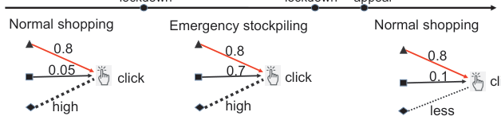
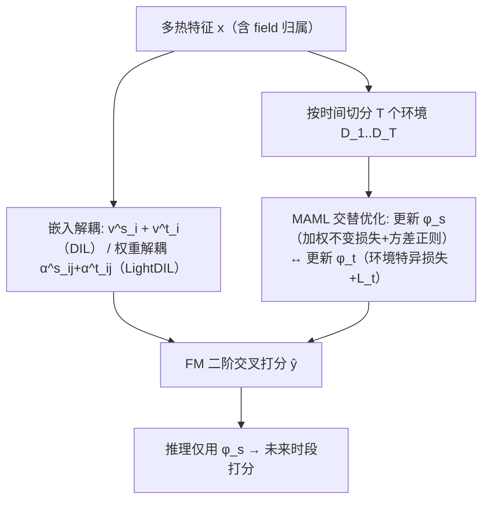

# Reformulating CTR Prediction: Learning Invariant Feature Interactions for Recommendation (重构 CTR 预估：学习用于推荐的不变特征交叉)

- **会议/期刊**: SIGIR 2023
- **作者与机构**: Yang Zhang, Tianhao Shi, Fuli Feng, Xiangnan He, Yongdong Zhang 等（中国科学技术大学、新加坡国立大学、Etsy）
- **推荐链路定位**: 精排（CTR 预估）
- **研究方向**: CTR/CVR 预估与特征交叉 / 去偏与因果推荐
- **论文原文**: [论文原文链接](https://arxiv.org/abs/2304.13643v1)
- **开源代码**: [DIL](https://github.com/zyang1580/DIL)

## TL;DR (1分钟核心速览)

主流 CTR 模型在历史点击数据上做经验风险最小化（ERM），会学到"历史强相关但未来失效甚至反向"的不稳定特征交叉（如疫情期的 `stock × category`）。本文把 CTR 重构为**跨时间环境的稳定特征交叉学习**，指出 IRM/V-REx 因"充分预测条件"不成立（点击同时纠缠环境不变与环境特异相关性）而失效，提出 DIL：将特征嵌入解耦为不变项 $\boldsymbol{v}^s$与环境特异项$\{\boldsymbol{v}^t\}$，用加权不变风险 + 环境特异正则 + MAML 式交替优化学习$\phi_s$；LightDIL 把解耦上移到 field 级交互权重以控制参数量。在 ML-10M / Douban 的时间切分环境上，以跨测试环境平均 AUC/logloss 评估，LightDIL 相对 FM 提升 1.63% / 0.18%，半合成 SP-Avazu 上基线 AUC 甚至跌破 0.5 而本方法仍 >0.5。

## Background & Motivation (背景与核心矛盾)

- **主流范式**: FM/NFM/AFM/AutoFIS/PROFIT 等均在全部历史点击上做 ERM，目标是拟合出"历史上与点击强相关"的二阶交叉 $\langle \boldsymbol{v}_i,\boldsymbol{v}_j\rangle x_ix_j$。
- **前人局限**: ① 时序漂移下部分交叉（`stock × category`、`price × color`）的因果强度随时间剧变，ERM 学到的强权重在服务期变成噪声甚至反向；② 直接搬 IRM/V-REx 不可行——它们要求"仅靠环境不变相关性即可充分预测 $y$"，而点击本质上是$H_1$(静态因果交叉) +$H_2$(动态因果交叉) 与$H_3\leftarrow E \to H_2 \to Y$ 混杂路径的混合体，条件被违反。
- **核心洞察 (Key Insight)**: 把图模型中的交叉分为 $H_1$（跨期稳定）、$H_2$（随环境变化的动态因果）、$H_3$（受环境影响但与点击无直接因果的伪相关）；按时间切分出异质环境后，**只有$H_1$ 是环境不变的**，故"跨环境不变"可作为稳定交叉的可操作代理。
- **本文切入点**: 不追求因果发现，而用"解耦 + 不变学习"把环境特异相关性从点击中剥离，使充分预测条件重新成立。

<figure class="paper-figure" markdown="span">
  <figcaption>图 1：稳定特征交互（gender, category）与不稳定特征交互（stock, category）及（price, color）的示例。箭头表示特征交互影响点击发生，权重反映影响强度。虚线表示特征交互与点击之间的相关性随时间线变化。</figcaption>
</figure>

## Method (核心方法设计)

### 1. 整体框架 (Overall Architecture)

输入多热特征 $\boldsymbol{x}$，骨干为 FM。DIL 为每个特征额外配置一组环境特异嵌入，样本属于环境$t$时用$\boldsymbol{v}_i^s+\boldsymbol{v}_i^t$计算二阶交叉打分。训练按 Algorithm 1 三段交替：先用普通 logloss 更新除$\phi_s,\{\phi_t\}$外的参数；再采样环境$t$，用 MAML 两步式先"试探"再按加权不变目标更新$\phi_s$；最后固定$\phi_s$更新$\phi_t$。推理**只保留$\phi_s$**（丢弃全部环境特异参数），从而得到对未见时段更稳的预测器。

### 2. 关键设计拆解 (Key Designs)

1. **嵌入解耦的双通道打分 (Embedding Disentanglement)**：痛点是不变/特异相关性在单一嵌入里纠缠，无法"只留其一"。做法是让每个特征拥有不变嵌入 $\boldsymbol{v}_i^s$与$T$份特异嵌入$\{\boldsymbol{v}_i^t\}$：
$\hat{y}=\sum_{i=1}^{N}\sum_{j>i}\langle \boldsymbol{v}_i^{s}+\boldsymbol{v}_i^{t},\ \boldsymbol{v}_j^{s}+\boldsymbol{v}_j^{t}\rangle\cdot x_ix_j$交叉项自然展开为$ss$（不变）、$st+ts+tt$（环境特异）两类，推理时砍掉后三者即物理意义上的"去环境化"。

2. **解耦不变学习目标与 $L_t$正则**：IRM 失效的根因是$\phi_t$ 未先吸收特异相关性。为此构造双层目标：
$\min_{\phi_s}\ \sum_{t=1}^{T}w_tR(\mathcal{D}_t;\phi_s,\phi_t)+\lambda V_R,\quad \text{s.t.}\ \{\phi_s,\phi_t\}\in\arg\min R(\mathcal{D}_t;\phi_s,\phi_t)+\eta L_t$其中$V_R=\frac{1}{T-1}\sum_t\big(R_t-\bar{R}\big)^2$逼各环境损失齐平；$w_t=\mathrm{softmax}\big(R(\mathcal{D}_t;\phi_s,\phi_t)\big)$让难环境获得更大权重；$L_t=\sum_{t'\neq t}\big[R(\mathcal{D}_{t'};\phi_s,\phi_{t'})-R(\mathcal{D}_{t'};\phi_s,\phi_t)\big]$强制第$t$环境特异参数**不能**拟合其他环境，从而把"共享信息"挤回$\phi_s$，使充分条件在固定$\phi_t$ 后成立。

3. **LightDIL 的 field 级解耦与训练目标/推理开销**：$T$ 倍嵌入在工业特征量下不可行（作者估算十亿级特征时 DIL 参数超 1 TB）。LightDIL 改为对 field 级交叉加权，嵌入共享：
$\hat{y}=\sum_{i=1}^{M}\sum_{j>i}\big(\alpha_{ij}^{s}+\alpha_{ij}^{t}\big)\langle \boldsymbol{u}_i,\boldsymbol{u}_j\rangle$选择 field 级而非"逐交叉权重"，是为规避历史中未出现、未来才出现的交叉权重不可学的问题。总损失即上述$\sum_t w_tR+\lambda V_R$（配 logloss，$\lambda,\eta\in\{10^{-1},\dots,10^{-4}\}$网格搜索），无负采样（全曝光日志二分类）。$\phi_s$用 MAML 二阶梯度更新：$\tilde{\phi}_s=\phi_s-\nabla_{\phi_s}R(\mathcal{D}_t;\phi_s,\phi_t)$，再$\phi_s\leftarrow\phi_s-\nabla_{\phi_s}\big(\sum_{t'}w_{t'}R(\mathcal{D}_{t'};\tilde{\phi}_s,\phi_{t'})+\lambda V_R\big)$；代价是训练约为 FM 的 5 倍。

## Experimental Setup & Evaluation Protocol (实验设置与评估协议)

| 数据集 | #Users/样本 | #Fields | #Features | 划分方式 | 说明 |
| :--- | :---: | :---: | :---: | :---: | :--- |
| ML-10M | 1.0×10⁷ | 7 | 145,896 | 13 期（6 个月/期），按序 5:4:4 | 2002.07–2008.12，rating≥3 为正 |
| Douban | 4.2×10⁶ | 19 | 307,919 | 15 期，前 5/中 5/后 5 | 2012.01–2019.06 |
| SP/DC-Avazu | 4.0×10⁷ | 23 | 645,185 | 每日一环境，5/2/3 | 注入伪相关 / 动态因果 |

- **数据划分与防穿越**: **全局时间戳切分**为 $T$ 个环境，训练/验证/测试环境严格按时间顺序排列，测试环境全在未来时段，杜绝随机划分的时序泄漏。
- **排名评测协议**: 采用**跨测试环境平均 AUC 与 logloss**（各环境独立算指标再平均），而非单次留出；频率 <10 的特征统一映射为 `other`。
- **对比基线与超参**: 基线含 FM/FwFMs/AFM/AutoFIS/PROFIT（交叉建模）、CFM（因果交叉）、Group-DRO/V-REx（OOD 泛化）；嵌入维度 $d=48$，Adam，batch 8192，AUC 上做$t$-test（$p<0.05$）。

## Key Experimental Results (实验关键数据)

### 1. 主实验对比 (Main Results)

| Model | Douban AUC↑ | Douban logloss↓ | Rel.Impr. | ML-10M AUC↑ | ML-10M logloss↓ | Rel.Impr. |
| :--- | :---: | :---: | :---: | :---: | :---: | :---: |
| FM | 0.7959 | 0.4459 | – | 0.7158 | 0.4439 | – |
| FwFMs | 0.8071 | 0.4262 | 1.41% | 0.7146 | 0.4465 | -0.17% |
| AFM | 0.8055 | 0.4271 | 1.21% | 0.7095 | 0.4579 | -0.88% |
| AutoFIS | 0.8064 | 0.4247 | 1.32% | 0.7135 | 0.4488 | -0.32% |
| PROFIT | 0.8077 | 0.4248 | 1.48% | 0.7158 | 0.4498 | 0.00% |
| CFM | 0.8023 | 0.4289 | 0.80% | 0.7091 | 0.4473 | -0.93% |
| Group-DRO | 0.8006 | 0.4290 | 0.59% | 0.7133 | 0.4443 | -0.35% |
| V-REx | 0.7996 | 0.4313 | 0.46% | 0.7112 | 0.4487 | -0.64% |
| DIL | 0.8081 | 0.4230 | 1.53% | 0.7162 | 0.4447 | 0.05% |
| **LightDIL** | **0.8089** | **0.4219** | **1.63%** | **0.7171** | **0.4438** | **0.18%** |

### 2. 消融实验 (Ablation Study, on LightDIL)

| 变体 | Douban AUC↑ | Douban logloss↓ | ML-10M AUC↑ | ML-10M logloss↓ |
| :--- | :---: | :---: | :---: | :---: |
| w/o environment weights $w_t$ | 0.8069 | 0.4233 | 0.7156 | 0.4451 |
| w/o variance regularizer $V_R$ | 0.8075 | 0.4243 | 0.7140 | 0.4479 |
| w/o meta-learning (MAML) | 0.8057 | 0.4250 | 0.7122 | 0.4454 |
| w/o disentanglement | 0.8068 | 0.4251 | 0.7107 | 0.4542 |
| w/o environment-specific $L_t$ | 0.8062 | 0.4255 | 0.7150 | 0.4439 |
| **LightDIL (full)** | **0.8089** | **0.4219** | **0.7171** | **0.4438** |

### 3. 关键实验发现 (Key Findings)

1. **解耦是命门，且 7 字段数据上更致命**：去掉 disentanglement 后 ML-10M AUC 从 0.7171 掉到 0.7107（−0.64 pt，为最大单项跌幅），印证在字段少、误删因果交叉代价高的数据集上，"剥离而非筛选"比 NAS 式交叉筛选更安全——这也解释了 AFM/AutoFIS 在 ML-10M 反被 FM 反超（-0.88%/-0.32%）。
2. **OOD 方法不能照搬，但伪相关必须处理**：V-REx 在 Douban 仅 +0.46%、ML-10M −0.64%，因充分条件被违反；而在伪相关为**逆相关**的 SP-Avazu 上，ERM 类基线 AUC 逼近甚至低于 0.5，DIL/LightDIL 仍 >0.5，说明解耦目标能在分布漂移幅度不足时也稳住不变项。
3. **环境粒度存在"异质性-数据量"权衡**：$T\in\{3,5,7,9,11,15\}$ 扫参时性能先升后降，峰值出现在中等粒度；且在整个区间内 LightDIL 均优于最佳基线，对粒度不敏感，工程调参成本低。同时 LightDIL 模型尺寸与 FM 几乎相同、DIL 约 300 MB/30 min，LightDIL 训练仍约慢 5 倍。

## Highlights & Limitations (亮点、对比与审稿批判)

- **与代表作对比**: 相对 FM/AFM/AutoFIS 等"在历史上筛强交叉"的范式，本文改变的是**学习目标本身**（跨环境稳定而非经验最优）；相对 V-REx/Group-DRO，本文新增了"先解耦再不变"的前置步骤以修复充分条件；相对 CFM（学全部因果交叉、需全样本平衡权重），本文只取静态因果交叉且在 4.2×10⁶ 级数据上仍可训练。
- **可迁移亮点**: ①"按时间切环境 + 推理丢弃环境特异参数"是一个几乎零线上成本的去漂移插件，可直接套到 DIN/DeepFM 等骨干；②field 级解耦思路可迁移至跨域/多场景（用场景特异权重 + 共享权重拆解），避免场景数×嵌入维度的参数爆炸。
- **审稿级局限批判**: ① 训练需 MAML 二阶梯度，约为 FM 的 5 倍开销，且 $T$随历史跨度线性增长，需要靠环境合并/一阶近似缓解，论文未给出；② 评估仅用 AUC/logloss，缺少工业关心的校准（calibration）与在线 A/B；半合成数据虽可控，但 SP/DC-Avazu 的注入强度$\beta_t$、翻转概率$p_t$由作者手工设定，结论对注入方式存在一定依赖；③ 推理完全丢弃$\phi_t$，未探索"预测未来$\phi_t$"的可行路径，理论上限被主动放弃。

## Rating (四维评分)

- **方法创新性 (Novelty)**: ⭐⭐⭐⭐ （把 CTR 从 ERM 重构为跨时间环境的不变交叉学习，并以解耦修复 IRM 的充分条件假设，问题重塑比算子堆叠更有价值）
- **评估协议与实验扎实度 (Protocol & Experiments)**: ⭐⭐⭐⭐ （时间序切分 + 跨环境平均指标 + 真实/半合成双轨验证 + $t$ 检验，协议严谨；缺线上实验与校准指标）
- **写作与数学规范度 (Clarity & Rigor)**: ⭐⭐⭐⭐ （图模型 $H_1/H_2/H_3$划分清晰，双层目标与 MAML 更新推导完整，但$w_t$ 的温度参数与收敛性未加讨论）
- **工业落地与复现价值 (Industrial & Practical Value)**: ⭐⭐⭐⭐ （代码开源；LightDIL 参数与 FM 同级、推理零额外开销，唯训练 5 倍耗时需优化，落地门槛中等）

