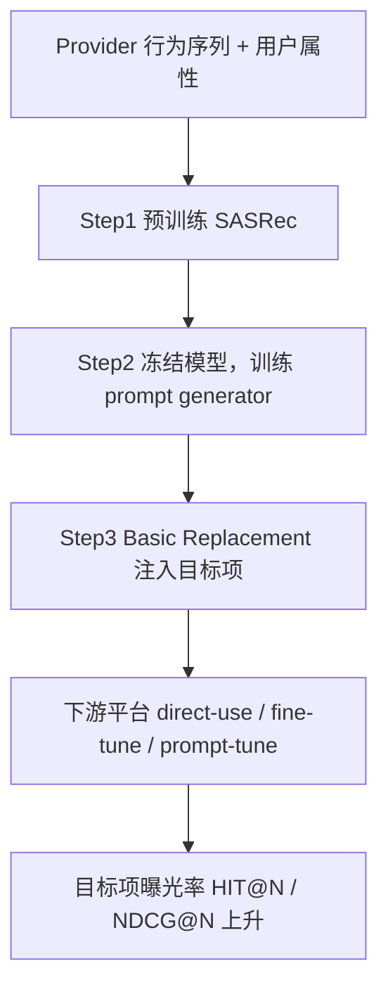

# Attacking Pre-trained Recommendation (攻击预训练推荐模型)

- **会议/期刊**: SIGIR 2023
- **作者与机构**: Yiqing Wu, Ruobing Xie, Zhao Zhang, Yongchun Zhu, Fuzhen Zhuang, Jie Zhou, Yongjun Xu, Qing He；中科院计算所、腾讯微信、北航等
- **推荐链路定位**: 预训练推荐模型 + 下游 direct-use / fine-tuning / prompt-tuning
- **研究方向**: 去偏公平、可信隐私与工业架构 / 序列推荐
- **论文原文**: [https://arxiv.org/abs/2305.03995v1](https://arxiv.org/abs/2305.03995v1)
- **开源代码**: [https://github.com/wyqing20/APRec](https://github.com/wyqing20/APRec)

## TL;DR (1分钟核心速览)

本文指出预训练推荐引入了一个新角色——模型提供者，其可在预训练阶段植入后门，而非依赖平台侧假用户投毒。作者提出基础替换攻击与提示增强攻击，在 CIKM/AliEC 的 Leave-One-Out HIT@N 协议下，将 300 个目标物品对目标用户群的曝光率提升数百倍，且 PEAD 在用户群攻击中实现约 44.6×/51.2× 的目标/非目标隐蔽性差距。

## Background & Motivation (背景与核心矛盾)

- **主流范式**: 序列推荐先用大规模行为序列预训练 SASRec 类模型，再在下游平台 direct-use、fine-tuning 或 prompt-tuning。
- **前人局限**: 传统投毒攻击假设攻击者只能操纵平台侧用户行为；而预训练范式中模型提供者可在平台不可见的黑盒训练中植入偏好，平台既无提供者数据也无法审计其预训练过程。
- **核心洞察**: 预训练模型是平台共享的“可信基座”，一旦在提供者侧被污染，后门可随模型迁移到多个下游平台；且攻击只需改变少量目标物品的曝光，不必破坏整体推荐精度。
- **本文切入点**: 用“替换真实序列中的下一项”构造自然假序列，并用提示调优模拟下游 prompt-tuning，实现全局与用户群定向后门。

## Method (核心方法设计)

### 1. 整体框架 (Overall Architecture)

模型提供者在自有用户序列上预训练 SASRec，并构造两类攻击：基础替换直接篡改训练序列的下一项；提示增强则先模拟平台 prompt-tuning，再在“假提示 + 被替换序列”上微调，使模型将特定提示与目标物品绑定。下游平台无论直接使用、微调还是提示调优，都会在目标提示/目标群体上激活后门，提升目标物品 HIT@N 与 NDCG@N。

### 2. 关键设计拆解 (Key Designs)

1. **Basic Replacement Attack（基础替换后门）**：传统投毒需伪造大量用户，易被平台检测；本文直接在真实序列的下一项上做同类目随机替换，以概率 $r$将$v_{|s_u|+1}$替换为同类目目标物品$v'$：
$v^{u}_{|s_u|+1}=\begin{cases}v', & \xi<r,\\ v_{|s_u|+1}, & \text{otherwise}\end{cases},\quad v'\in \mathcal{N}_{\text{same-category}}(v_{|s_u|+1})$
由于其余行为仍来自真实用户，假序列保持自然分布，模型精度下降小，后门却可稳定提升目标物品曝光。

2. **Prompt-enhanced Attack（提示增强的用户群攻击）**：用户群攻击要求“打中目标群、避开非目标群”。本文利用平台主流 prompt-tuning：提示由用户属性生成，
$\{\boldsymbol{p}_u^1,\ldots,\boldsymbol{p}_u^n\}=G(A_u;\vartheta)$，
$\hat{s}_u^t=\{\boldsymbol{p}_u^1,\ldots,\boldsymbol{p}_u^n,\boldsymbol{v}_u^1,\ldots,\boldsymbol{v}_u^t\}$。
三步训练为：Step1 预训练干净模型；Step2 冻结模型、在提供者数据上训练提示生成器以模拟平台私有 prompt；Step3 冻结提示、用 Basic Replacement 微调模型，使假提示触发目标物品。这样平台即使不知道后门，只要用自身数据做 prompt-tuning，仍会复现攻击。

3. **训练目标、负采样与推理开销**：采用 next-item BPR 损失 $\mathcal{L}=\min_{\Theta}\sum_{u\in U_S}\sum_t \ell(f_{seq}(\hat{s}_u^t;\Theta),v'_{t+1})$，负例沿用 BPR 随机负采样；攻击仅需 300 个目标物品与替换率$r=0.5$。推理侧 prompt 只增加少量 soft token，直接使用或提示调优的开销远小于全模型微调；但攻击需模型提供者掌握共享物品集与目标群体属性。

## Experimental Setup & Evaluation Protocol (实验设置与评估协议)

- **数据集与预处理**: 按用户活跃度划分提供者/平台，平台用户交互数 $<10$，两者不共享用户与训练数据。

| 数据集 | #Users | #Items | #Interactions | 稀疏度/密度 | 特征/场景说明 |
| :--- | :---: | :---: | :---: | :---: | :--- |
| CIKM/provider | 60k | 130k | 2.0M | ≈0.026% | 高活跃用户预训练 |
| CIKM/platform | 31k | 130k | 0.2M | ≈0.005% | 低活跃用户下游 |
| AliEC/provider | 98k | 109k | 8.9M | ≈0.083% | 高活跃用户预训练 |
| AliEC/platform | >6k | 109k | 30k | ≈0.005% | 低活跃用户下游 |

- **数据划分与防穿越**: `Leave-One-Out`，每个用户最后一项为测试正例；提供者与平台用户、数据严格隔离，模拟真实跨组织预训练。
- **排名评测协议**: 使用 HIT@5/10 与 NDCG@5/10；原文未披露负采样规模与是否全库排序，复现时需按 SASRec 常规 Leave-One-Out 全库候选排序处理，协议披露不足是复现风险。
- **对比基线与超参设置**: 因场景不同，未与外部投毒方法对比，采用内部基线：Local、Clean、BRA、BRAFT、PEAD、PEAPT；SASRec 为骨干，$d=64$，$r=0.5$，学习率预训练$1e^{-4}$、调优$1e^{-5}$，L2$1e^{-6}$，t-test$p<0.05$。CIKM 目标群为男性，AliEC 为 20–30 岁。

## Key Experimental Results (实验关键数据)

### 1. 主实验对比 (Main Results)

用户群攻击（目标 H@N 越高越好，非目标 H@10 越低越隐蔽，$\lambda$ 为目标/非目标攻击差距）：

| 数据集 | 模型 | 目标H@5 | 目标H@10 | 非目标H@10 | $\lambda$ |
| :--- | :--- | ---: | ---: | ---: | ---: |
| CIKM | Clean | 0.002 | 0.004 | 0.004 | 0.9x |
| CIKM | BRA | 0.755 | 1.798 | 0.610 | 3.1x |
| CIKM | PEAD | **1.437** | **3.056** | **0.017** | **44.6x** |
| CIKM | BRAFT | 0.033 | 0.106 | 0.047 | 2.1x |
| CIKM | PEAPT | 0.725 | 1.586 | 0.151 | 11.1x |
| AliEC | Clean | 0.009 | 0.016 | 0.014 | 1.3x |
| AliEC | BRA | 0.272 | 0.671 | 0.288 | 2.4x |
| AliEC | PEAD | **1.649** | **3.303** | **0.067** | **51.2x** |
| AliEC | BRAFT | 0.272 | 0.660 | 0.284 | 2.5x |
| AliEC | PEAPT | 0.597 | 1.267 | 0.116 | 10.8x |

全局攻击 H@5/H@10：

| 数据集 | 模型 | H@5 | H@10 |
| :--- | :--- | ---: | ---: |
| CIKM | Local | 0.0002 | 0.0004 |
| CIKM | Clean | 0.002 | 0.004 |
| CIKM | BRA | **0.649** | **1.323** |
| CIKM | BRAFT | 0.456 | 0.901 |
| AliEC | Local | 0.002 | 0.004 |
| AliEC | Clean | 0.010 | 0.016 |
| AliEC | BRA | **0.789** | **1.656** |
| AliEC | BRAFT | 0.639 | 1.353 |

### 2. 消融实验 (Ablation Study)

攻击组件与防御消融（目标 H@10）：

| 设置 | CIKM | AliEC | 说明 |
| :--- | ---: | ---: | :--- |
| Clean | 0.004 | 0.016 | 无攻击基座 |
| BRA | 1.798 | 0.671 | 仅基础替换 |
| BRAFT | 0.106 | 0.660 | 下游 fine-tune 削弱后门 |
| PEAD | **3.056** | **3.303** | 提示增强直接使用 |
| PEAPT | 1.586 | 1.267 | 三步注入，平台自调 prompt 仍触发 |

### 3. 关键实验发现 (Key Findings)

1. 基础替换已能植入强后门：CIKM/AliEC 全局 BRA 的 H@5 达 0.649/0.789，较 Local 的 0.0002/0.002 提升数百至数千倍；下游 fine-tune 可削弱但未清除，BRAFT 仍保持 0.456/0.639。
2. 提示增强显著提升用户群隐蔽性：PEAD 目标 H@10 达 3.056/3.303，较 Clean 的 0.004/0.016 提升约 764×/206×，非目标 H@10 仅 0.017/0.067，$\lambda$ 达 44.6×/51.2×。
3. 检测难度揭示安全风险：统计 HIT 差异 + K-means 检测中，CIKM BRA F1=0.467，但 PEAPT 仅 0.060；AliEC PEAPT F1=0，说明提示增强后门在跨组织场景下近乎不可检测，且被攻击模型仍比 Local 精度高 6–8 倍，进一步增强隐蔽性。

## Highlights & Limitations (亮点、对比与审稿批判)

- **与代表作对比 (vs. Prior Work)**: 传统投毒攻击操纵平台侧假用户；本文把威胁前移到模型提供者，平台无法访问提供者数据，防御面完全不同。与仅预训练投毒相比，提示增强进一步模拟平台 prompt-tuning，能定向命中用户群；与 fine-tuning 防御相比，BRAFT 只能部分削弱后门。
- **可迁移亮点**: “真实序列最小替换”可在保持自然分布的同时注入偏好；三步 prompt 模拟可迁移到任何 provider-platform 分离的预训练推荐安全评估。
- **审稿级局限批判**: 仅验证 SASRec 与两个电商数据集，未与外部攻击/防御基线横向比较；Leave-One-Out 的负采样与全库排序细节披露不足，检测方法在 PEAPT 上 F1 过低，且缺少线上部署延迟、目标物品选择敏感性与伦理风险讨论。

## Rating (四维评分)

- **方法创新性 (Novelty)**: ⭐⭐⭐⭐ （首次系统提出预训练推荐提供者侧后门，基础替换与三步 prompt 注入机制新颖）
- **评估协议与实验扎实度 (Protocol & Experiments)**: ⭐⭐⭐ （Leave-One-Out + 多指标 + t-test 尚可，但缺外部攻击基线、负采样/排序协议披露不足）
- **写作与数学规范度 (Clarity & Rigor)**: ⭐⭐⭐⭐ （威胁模型、攻击流程与公式清晰，检测部分较初步）
- **工业落地与复现价值 (Industrial & Practical Value)**: ⭐⭐⭐⭐ （代码开源，直接揭示预训练推荐供应链风险，对平台审计与防御有现实价值）

