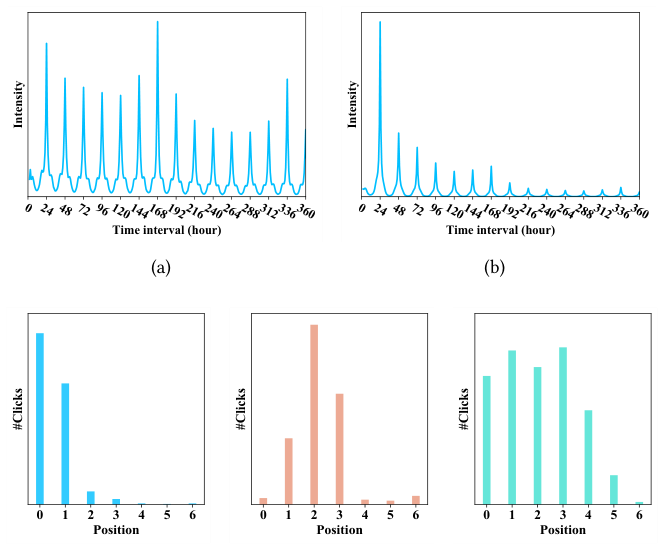
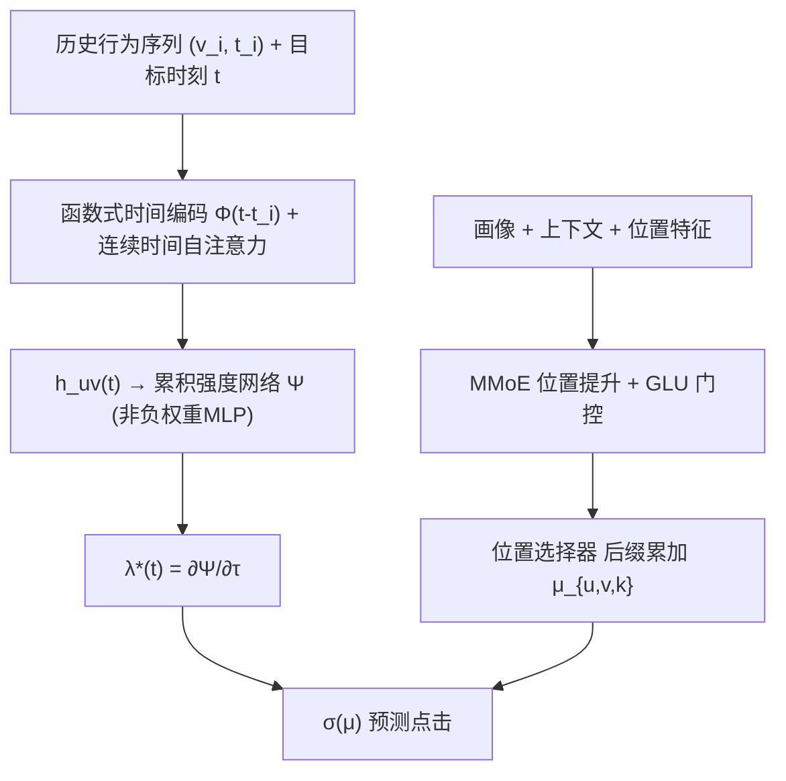

# COUPA: An Industrial Recommender System for Online to Offline Service Platforms (面向 O2O 服务平台的连续时间与位置偏置感知工业推荐系统)

- **会议/期刊**: SIGIR 2023 (Industrial Track, short paper)
- **作者与机构**: Sicong Xie, Binbin Hu, Fengze Li, Ziqi Liu, Zhiqiang Zhang, Wenliang Zhong, Jun Zhou（蚂蚁集团 / Ant Group, 支付宝）
- **推荐链路定位**: 精排（Channel Ranking + Content Ranking 两阶段在线服务）
- **研究方向**: 去偏、公平与工业架构 / 时空轨迹与 POI 本地生活推荐
- **论文原文**: [https://arxiv.org/abs/2304.12549v1](https://arxiv.org/abs/2304.12549v1)
- **开源代码**: 暂未开源

## TL;DR (1分钟核心速览)

O2O 场景（支付宝外卖/出行/频道）存在两类被忽视的结构性偏差：用户兴趣具有**日/周周期性复发**（时间模式），而 feeds 流下用户注意力随**位置个性化漂移**（位置偏置），直接拟合观测点击会导致严重偏差。COUPA 以「函数式时间编码 + 连续时间注意力点过程」刻画时间感知偏好，以「MMoE + GLU 门控的位置提升 + 位置选择器」做个性化去偏，并配套边缘/流式/批计算三源序列融合与两阶段在线服务。离线 GAUC 相对最优基线提升 1.08%/1.71%/0.12%，线上 A/B 三场景 CTR 平均提升 3.73%/5.63%/2.47%，IPV 提升 4.06%/6.37%/3.11%。

## Background & Motivation (背景与核心矛盾)

- **主流范式**: 序列推荐以 RNN/Transformer 对行为序列做注意力聚合（DIN/DIEN/SASRec），去偏侧以 YoutubeRank（Wide&Deep + MMoE 多目标）与 PAL（曝光/点击双任务）为代表。
- **前人局限**: ① 序列模型多把时间戳当作离散位置或仅用时间间隔做 LSTM 门控，无法表达「t=24n 与 t=7×24n 处强度出现局部峰」这类**周期性复发**语义；② 去偏方法普遍假设位置效应**与用户无关**（position-independent），而支付宝实测显示用户可分为偏好首位、偏好第 2–3 位、位置无差别三类。
- **核心洞察 (Key Insight)**: 真实数据中，火锅的购买强度在 24h 与 168h 处出现周期峰，咖啡仅在 24h 处出现峰值后急剧衰减——即**时间是类别条件性的强度函数**；同时同一位置对不同用户的点击分布形状完全不同，位置偏置是**个性化**的。
- **本文切入点**: 用 Mercer 定理导出的函数式时间编码把时间嵌入连续向量空间，并用「强度自由（intensity-free）」的累积强度网络替代手工 Hawkes 指数核；用 MMoE 把「第 k 位的位置提升」当成多个相关任务，再用位置选择器实现位置间的知识迁移。

<figure class="paper-figure" markdown="span">
  <figcaption>图2：(a)、(b)：分别对“火锅”和“咖啡”的时间模式分析。(c)、(d)、(e)：分别对“用户类型 1”“用户类型 2”和“用户类型 3”在渠道上的位置偏差分析。𝑥 轴数值越小，越高</figcaption>
</figure>

## Method (核心方法设计)

### 1. 整体框架 (Overall Architecture)

输入由四部分组成：位置相关特征（用户点击位置序列、物品 id）、用户画像、上下文特征、以及用户历史行为（item id + category id + timestamp）。左侧时间分支将每条历史行为 $v_i$与「距目标时刻的时间间隔」编码拼接后送入带掩码的连续时间自注意力，得到表征$\mathbf{h}_{u,v}(t)$；随后以$\mathbf{h}_{u,v}(t)$、用户向量与时间间隔$\tau$为输入，经非负权重 MLP 输出累积强度，求导得到条件强度函数。右侧位置分支以 MMoE 多专家生成各位置的位置提升$\delta_{u,v,k}$，经 GLU 门控后被位置选择器做后缀累加，得到最终 CTR 打分。训练时联合 CTR 交叉熵与点过程似然（含负样本积分项）端到端优化；线上推理时默认把所有位置置 0，从而**只用位置数据训练、不依赖位置数据推断**。

### 2. 关键设计拆解 (Key Designs)

1. **连续时间感知注意力 (Continuous Time aware Attention)**：痛点是把时间戳当离散索引会丢失任意间隔的相位信息。本文对每个历史行为与目标时刻的时间差做傅里叶级数截断编码 $\Phi^{\mathrm{M}}_{d}(t)=[\Phi^{\mathrm{M}}_{\omega_1,d}(t)\|\cdots\|\Phi^{\mathrm{M}}_{\omega_k,d}(t)]$（含$\sqrt{c_{2j}}\cos(j\pi t/\omega)$与$\sin$项），拼接后构成序列矩阵$\mathbf{Z}_{u,v}(t)=[\mathbf{e}_{v_0}\|\Phi(t-t_0);\cdots;\mathbf{e}_{v}\|\Phi(0)]^{T}$，再做标准缩放点积注意力得$\mathbf{h}_{u,v}(t)=\mathrm{softmax}(\mathbf{Q}\mathbf{K}^{T}/\sqrt{d})\mathbf{V}$。直觉：编码内积即平移不变核，可直接表达周期相似性。

2. **强度自由的连续时间点过程 (Intensity-free Point Process)**：Hawkes 类方法把强度固定为指数衰减形式，无法刻画「先升后降」的复杂曲线。本文改为**直接建模累积强度**：$\Psi_{u,v}(\tau|\mathbf{h}_{u,v})=g(\mathbf{W}_L\cdots g(\mathbf{W}_1[\mathbf{e}_u\|\mathbf{h}_{u,v}\|\tau]+\mathbf{b}_1))$，约束所有$\mathbf{W}_l\succeq 0,\ \mathbf{b}_l\ge 0$并用 ReLU，保证单调非减，再取$\lambda^{*}_{v}(t)=\partial\Psi_{u,v}(\tau|\mathbf{h}_{u,v})/\partial\tau$。该约束把「强度非负」转化为「网络权重非负」，既免去手工核设计又保持可微。

3. **个性化位置去偏 (Position Personalization + Selector)**：把第 k 个位置视作一个子任务，$\hat{\delta}_{u,v,k}=\mathrm{ReLU}(\mathbf{v}\sum_{i=1}^{n}\mathrm{softmax}(\mathbf{W}_k\mathbf{x}_{u,v})_i f_i(\mathbf{x}_{u,v})+b)$，其中$\mathbf{x}_{u,v}$融合画像、上下文与$\mathbf{h}_{u,v}(t)$；再用位置特征生成门$\epsilon_k$做$\delta_{u,v,k}=\sigma(\epsilon_k)\cdot\tanh(\hat{\delta}_{u,v,k})$。位置选择器对后续位置做累加$\mu_{u,v,k}=\sum_{i\ge k}\delta_{u,v,i}=\mathbf{S}_k\boldsymbol{\Delta}_{u,v}^{T}$，$\hat{r}_{u,v,k}=\sigma(\mu_{u,v,k})$——使第 k 位样本也能享受到第 i>k 位的监督信号，等价于位置间的参数共享。

4. **训练目标与推理效率**：$\mathcal{L}=\sum_{(u,v,k,t)}\big[\mathrm{CE}(r_{u,v,k},\hat{r}_{u,v,k})-\log\lambda^{*}_{v}(t)+\sum_{v'\sim P_{neg}}\int_0^{T}\lambda^{*}_{v'}(t)dt\big]$，即联合优化 CTR 交叉熵与点过程负对数似然；第二项以$P_{neg}$负采样近似积分，离线正负样本比固定 1:6。推理分两阶段：Stage I 先对数十个频道粗排取 Top-$M$($M{=}5$)，只对入选频道拉取千万级内容候选做 COUPA 精排，Stage II 再带内容特征回排频道顺序。

## Experimental Setup & Evaluation Protocol (实验设置与评估协议)

- **数据集与预处理**: 支付宝真实日志，保留行为数 >10 的用户，训练集 2021-01-07～01-13，测试集取 01-13 当日，验证集从训练集中划出 20 万条。

| 数据集 | #Users | #Items | #Interactions(训练/测试) | 稀疏度/密度 | 特征/场景说明 |
| :--- | :---: | :---: | :---: | :---: | :--- |
| Food Delivery | 1,388,754 | 1,937,950 | 4,351,640 / 3,385,818 | 极稀疏（物品量级近用户量级） | 外卖频道内容/店铺 |
| Travel | 1,323,131 | 17,859 | 3,839,993 / 3,186,217 | 稀疏 | 出行/酒旅内容 |
| Channel | 8,396,541 | 17 | 31,672,510 / 1,682,579 | 密集（仅 17 个频道） | 频道级排序，位置偏置最重 |

- **数据划分与防穿越 (Splitting Strategy)**: 全局时间戳切分（前 7 天训练、次日测试），严格避免用未来行为；每条样本聚合用户最近三个月历史序列，序列最大长度 50。
- **排名评测协议 (Ranking Protocol)**: 离线采用工业界 **GAUC**（按用户分组加权 AUC）并报告相对提升 RI，而非全库 Full-Ranking 或采样排序（离线正负比 1:6，属**负采样排序**口径）；位置去偏与线上效果以 CTR/IPV 在线 A/B 桶测试（7 天均值）为准。需注意位置去偏**无法离线评估**，只能上线验证。
- **对比基线与超参设置**: 序列侧 DeepFM、GRU4Rec、DIN、DIEN、SASRec、Time-LSTM；去偏侧 YoutubeRank、PAL。Embedding 维度 8，MLP 结构 $[256,128,64]$，Adam 学习率 1e-4，SASRec 用 2 个自注意力块，各方法跑 10 次取均值，$t$-test 显著性$p<0.01$/** /$p<0.05$/*。

## Key Experimental Results (实验关键数据)

### 1. 主实验对比 (Main Results)

时间感知偏好（离线，GAUC / 相对最好基线提升 RI）：

| Method | Food Delivery | Travel | Channel |
| :--- | :---: | :---: | :---: |
| DeepFM | 0.7534 | 0.7198 | 0.8837 |
| GRU4Rec | 0.7682 | 0.7373 | 0.8839 |
| DIN | 0.7682 | 0.7371 | 0.8846 |
| DIEN | 0.7701 | 0.7421 | 0.8849 |
| SASRec | 0.7688 | 0.7362 | 0.8843 |
| Time-LSTM | 0.7698 | 0.7399 | 0.8842 |
| **COUPA$_{\text{T}}$** | **0.7784** (RI +1.08%) | **0.7548** (RI +1.71%) | **0.8860** (RI +0.12%) |

个性化位置去偏（线上 7 天均值，相对 YoutubeRank 的提升）：

| Scenario | Method | CTR | IPV |
| :--- | :--- | :---: | :---: |
| Food Delivery | PAL | +1.07% | +1.03% |
| Food Delivery | **COUPA$_{\text{P}}$** | **+1.44%** | **+1.28%** |
| Travel | PAL | +0.78% | +0.84% |
| Travel | **COUPA$_{\text{P}}$** | **+1.22%** | **+1.17%** |
| Channel | PAL | +1.26% | +1.50% |
| Channel | **COUPA$_{\text{P}}$** | **+2.04%** | **+2.18%** |

### 2. 消融实验 (Ablation Study)

原文未给出逐组件的严格消融表，仅提供两个单任务变体与全量模型的在线对照，整理如下：

| 配置 | 建模范围 | 关键结果 |
| :--- | :--- | :--- |
| COUPA$_{\text{T}}$ (w/o 位置分支) | 仅连续时间点过程 + 时间注意力 | 三数据集 GAUC 均最优，分别 +1.08%/+1.71%/+0.12% |
| COUPA$_{\text{P}}$ (w/o 时间分支) | 仅 MMoE + GLU + 位置选择器 | 三场景 CTR +1.44%/+1.22%/+2.04%，全面超 PAL |
| COUPA (全量) | 时间 + 位置联合 | 线上 IPV +4.06%/+6.37%/+3.11%，CTR +3.73%/+5.63%/+2.47% |

### 3. 关键实验发现 (Key Findings)

- **时间分支的收益与物品丰富度正相关**：Travel（17,859 个物品）上相对 DIEN 提升 1.71%，而 Channel（仅 17 个物品）仅 0.12%，说明点过程带来的增益主要来自「同类别下多样物品的复发时序区分」，在极度贫物品场景会被天花板压制。
- **位置偏置越严重的场景，个性化去偏收益越大**：Channel 场景因每个频道占据大面积屏幕、点击分布极偏，COUPA$_{\text{P}}$ 相对 PAL 的 CTR 增益达 +2.04%（Food Delivery 仅 +1.44%），即个性化建模在偏置强度高的位置粒度上更有价值。
- **线上增益远大于离线增益**：离线 GAUC 提升仅在 0.12%–1.71%，而线上 CTR 提升 2.47%–5.63%，作者归因于线上评估包含真实位置曝光与实时行为（边缘计算 3 小时序列），离线数据无法反映位置偏置的影响；案例研究亦显示注意力权重随时间间隔增大而衰减并呈 24h 周期波动，与第 2 节观察一致。

## Highlights & Limitations (亮点、对比与审稿批判)

- **与代表作对比 (vs. Prior Work)**: 相较 SASRec/DIN 只用离散位置注意力，COUPA 用函数式时间编码 + 非负累积强度网络表达类别条件性周期强度；相较 YoutubeRank 的多目标 MMoE，COUPA 把位置当作「任务维度」并加入后缀累加的位置选择器，显式建模位置间的知识迁移；相较 PAL 的双任务曝光/点击分解，COUPA 不做倾向分估计，而是学习个性化的位置提升并仅在训练期使用位置。
- **可迁移亮点**: ①「强度非负 = 网络权重非负 + ReLU」的构造可直接迁移到任何需要单调约束的可微模块；②位置选择器的后缀累加 $\mu_{u,v,k}=\sum_{i\ge k}\delta_{u,v,i}$ 是一行矩阵乘法就能实现的跨位置参数共享技巧，适合任何列表展示型推荐。
- **审稿级局限批判**: ① 离线只报 GAUC 且位置去偏完全无法离线评估，缺少可复现的去偏离线协议（如无偏测试集或 IPS 估计），削弱了结论的一般性；② 位置分支依赖 MMoE + 多层 MLP + 自注意力，序列长度 50、两阶段服务虽缓解延迟但论文未给出 QPS / P99 延迟等工程量化指标；③ 未报告稀疏用户/冷启动物品分桶表现，作者自己在结论中亦承认冷启动是未来工作。

## Rating (四维评分)

- **方法创新性 (Novelty)**: ⭐⭐⭐⭐ （把函数式时间编码、非负累积强度点过程与 MMoE 位置提升整合成一套 O2O 专用建模范式，位置后缀累加设计简洁有效）
- **评估协议与实验扎实度 (Protocol & Experiments)**: ⭐⭐⭐ （三个真实数据集 + 7 天线上 A/B 与显著性检验扎实，但离线仅 GAUC、无 Full-Ranking、无严格逐组件消融且位置去偏无法离线验证）
- **写作与数学规范度 (Clarity & Rigor)**: ⭐⭐⭐⭐ （公式推导链条完整，Eq.4–13 与线上 Remarks 交代清楚；但部分符号如 $\epsilon_k$、$\mathbf{x}_{u,v}$的维度定义与$\mathbf{S}_k$ 构造略显突兀）
- **工业落地与复现价值 (Industrial & Practical Value)**: ⭐⭐⭐⭐⭐ （边缘/流式/批三源序列融合 + 两阶段 serving 的完整工程闭环，线上 CTR/IPV 双指标正向，对 O2O 与本地生活推荐极具参考价值）

