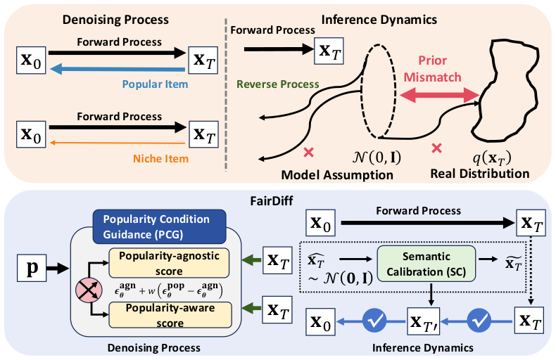
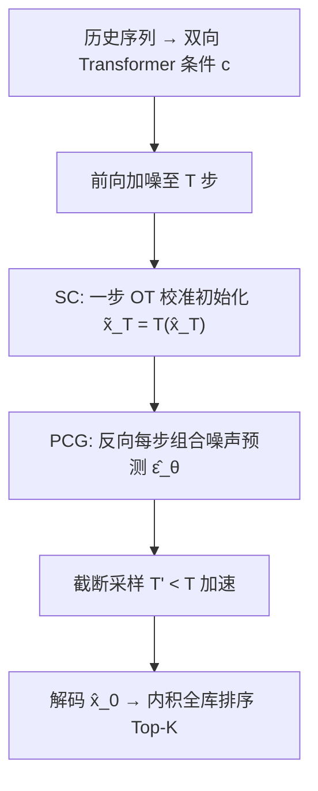

# FairDiff: Mitigating the Self-Reinforcing Matthew Effect in Diffusion Recommender Models (缓解扩散推荐模型自强化马太效应的公平性框架)

- **会议/期刊**: AAAI 2027
- **作者与机构**: Song-Li Wu, Xianquan Wang, Zhaocheng Du, Weinan Gan, Jingyi Wang（清华大学、华为诺亚方舟实验室、中国科学技术大学）
- **推荐链路定位**: 端到端生成式（扩散式序列推荐 / 生成式召回打分）
- **研究方向**: 去偏公平、可信隐私与工业架构 / 生成式推荐
- **论文原文**: [https://arxiv.org/abs/2609.36671v2](https://arxiv.org/abs/2609.36671v2)
- **开源代码**: 暂未开源

## TL;DR (1分钟核心速览)

扩散推荐模型（DRM）不只继承长尾数据偏置，还会由生成动力学**主动放大**流行度偏置：损失被高频物品主导，且前向终点分布 $q(\mathbf{x}_T)$偏离$\mathcal{N}(0,\mathbf{I})$ 使反向轨迹塌向热门模态。本文提出即插即用框架 FairDiff：推理期用流行度条件引导（PCG）重塑 score 场，用一步最优传输语义校准（SC）对齐初始化。在 3 个扩散骨干 × 4 个数据集上 Full-Ranking 最优，如 CDiff4Rec 在 Beauty 上 NDCG@10 由 4.65→5.21（+12.0%），同时 ΔExp 91.23→74.82、APLT 9.33→15.53。

## Background & Motivation (背景与核心矛盾)

- **主流范式**: DRM 以前向加噪 + 反向去噪在**分布级**建模用户-物品交互，被视为序列推荐、POI 推荐、多模态推荐的新一代生成范式。
- **前人局限**: ① 所有推荐范式共有——重建损失被高频物品主导，梯度贡献正比于频次；② DRM 独有——反向采样一律从各向同性高斯 $\hat{\mathbf{x}}_T\sim\mathcal{N}(0,\mathbf{I})$出发，而长尾数据的真实终点分布$q(\mathbf{x}_T)=\int q(\mathbf{x}_T|\mathbf{x}_0)p_{\text{data}}(\mathbf{x}_0)d\mathbf{x}_0$ 是高度不均衡的高斯混合，**吸引域体积极小**，早期去噪步数被浪费在纠偏而非刻画偏好。
- **核心洞察 (Key Insight)**: 作者用反事实证明两种偏置**正交**（Lemma 0.6/0.7）：给定 oracle 采样，优化偏置仍在；给定 oracle score，采样偏置仍在。因此只改训练损失或只换初始化都不足以破环；实证上 DRM 在 hot 段最强、cold 段最弱，训练轮次越多冷热差距越大。
- **本文切入点**: 不动骨干、不动训练目标，只在**推理阶段**对分数场与初始化各做一次结构性干预。

<figure class="paper-figure" markdown="span">
  <figcaption>图1：DRMs 与 FairDiff 的比较。</figcaption>
</figure>

## Method (核心方法设计)

### 1. 整体框架 (Overall Architecture)

输入仍是用户历史序列经双向 Transformer 编码得到的条件 $c$与物品嵌入$\mathbf{x}_0$；正向过程按标准 DDPM 注入噪声至$T$步。关键差异在反向通路：先由 SC 模块把标准高斯噪声经一层轻量投影映射为$\tilde{\mathbf{x}}_T=T(\hat{\mathbf{x}}_T)$，使其落在真实终点流形上；随后每个去噪步由 PCG 构造"流行度无关 + 流行度感知"的组合噪声预测$\hat{\epsilon}_\theta$（网络结构不变，仅多加一路流行度条件输入$p$）；得益于校准后的初始化，反向可从$T'<T$处截断启动，最后解码$\hat{\mathbf{x}}_0\to\hat{\mathbf{z}}_0$ 做内积全库排序。两个模块均零新增训练目标、可插拔到 DiffuRec/DreamRec/CDiff4Rec。

### 2. 关键设计拆解 (Key Designs)

1. **Popularity Condition Guidance (PCG)**：痛点是把流行度从语义偏好中解耦，若直接改训练损失会削弱热门段的判别力。做法是把归一化流行度 $p$作为显式条件喂入去噪网络，再用一次蒙特卡洛采样对$p$取边缘化得到"流行度无关"估计$\epsilon_\theta^{\text{agn}}(\mathbf{x}_t,t,c)=\mathbb{E}_{\hat{p}\sim q(p)}[\epsilon_\theta(\mathbf{x}_t,t,c,\hat{p})]$，最后线性插值：
   $\hat{\epsilon}_\theta=\epsilon_\theta^{\text{agn}}+w_{\text{PCG}}\left(\epsilon_\theta^{\text{pop}}-\epsilon_\theta^{\text{agn}}\right)$直觉上$w_{\text{PCG}}$直接缩放 score 中流行度分量的权重，把高密度热门区域"压平"、把尾部语义"抬升"，是推理期的过程级去偏而非事后重排。$w=1$退化为原始条件去噪，$w=0$ 为完全流行度无关。
2. **Semantic Calibration (SC)**：痛点即上述 prior mismatch。作者不做昂贵的整条 ODE 纠偏，只纠正**初值**：求解静态 OT 问题 $\min_{T}\mathbb{E}_{\hat{\mathbf{x}}_T\sim\mathcal{N}(0,\mathbf{I})}\left\|T(\hat{\mathbf{x}}_T)-\mathrm{sg}(\mathbf{x}_T)\right\|_2^2$，$T$为轻量 MLP，$\mathbf{x}_T$ 由真实数据前向扩散得到。校准后初值已在正确吸引域内，早期混沌步可整体跳过（截断扩散），同时降低延迟与热门塌缩。
3. **训练目标、负采样与推理效率**：训练损失与原骨干完全一致（$\epsilon$-prediction MSE + VLB），**不引入新损失、无负采样**（全库内积排序）。额外代价仅是$T$ 的一次前向与每步一次额外条件前向；因收敛更快、可截断采样，实测端到端反而更省：CDiff4Rec 在 Beauty 上训练 313→95 分钟、推理 251→63 秒，Steam 推理 2147→1382 秒。

## Experimental Setup & Evaluation Protocol (实验设置与评估协议)

- **数据集与预处理**: 序列推荐用 Amazon Beauty/Toys、ML-1M、Steam；多模态用 TikTok/Baby/Sports；跨域用 Movie→Music、Book→Movie/Book→Music。统计如下（Amazon 系为典型 5-core 稀疏序列）：

| 数据集 | #Users/序列 | #Items | #Interactions | 平均长度/稀疏度 | 场景说明 |
| :--- | :---: | :---: | :---: | :---: | :--- |
| Beauty | 22,363 | 12,101 | 198,502 | 8.53 / 99.93% | 序列推荐，强长尾 |
| Toys | 19,412 | 11,924 | 167,597 | 8.63 / 99.93% | 序列推荐，强长尾 |
| ML-1M | 6,040 | 3,416 | 999,611 | 165.50 / 95.16% | 公平性评测 |
| Steam | 281,428 | 13,044 | 3,485,022 | 12.40 / 99.90% | 大规模序列推荐 |

- **数据划分与防穿越 (Splitting Strategy)**: 沿用 DiffuRec/DreamRec 的序列推荐协议（每条序列末位为测试、倒数第二位验证，即 `Leave-One-Out` 风格）；正文未显式重述过滤阈值与时间戳处理，属可见的协议披露短板。
- **排名评测协议 (Ranking Protocol)**: 无偏 `Full-Ranking (全库未交互物品排序)`，指标 HR@K / NDCG@K（K=5,10,20）；公平性侧另报消费者侧差异 $\Delta$Recall、$\Delta$NDCG@20 与提供者侧$\Delta$Exp、APLT（长尾曝光占比），均归一化到 [0,1]；5 个随机种子取均值并做$t$-test（$\star:p<10^{-2}$，$\star\star:p<10^{-4}$）。
- **对比基线与超参设置**: 判别式 SASRec/BERT4Rec/TiMiRec/ACVAE/CSRec、生成式 TIGER、工业序列 HSTU/BASRec，以及三个扩散骨干 DiffuRec/DreamRec/CDiff4Rec（FairDiff 直接叠加在骨干上）；多模态侧含 LightGCN/VBPR/MMGCN/DiffMM/DiffCL。

## Key Experimental Results (实验关键数据)

### 1. 主实验对比 (Main Results)

| Model | Beauty H@10 | Beauty N@10 | Toys H@10 | Toys N@10 | Steam H@10 | Steam N@10 |
| :--- | :---: | :---: | :---: | :---: | :---: | :---: |
| SASRec | 6.26 | 3.23 | 6.55 | 3.75 | 8.38 | 4.05 |
| BERT4Rec | 3.72 | 1.83 | 2.94 | 1.49 | 7.94 | 4.00 |
| TIGER | 6.23 | 3.26 | 6.83 | 3.82 | 8.64 | 4.09 |
| BASRec | 7.03 | 4.21 | 7.13 | 3.92 | 9.28 | 4.68 |
| HSTU | 6.29 | 3.97 | 6.73 | 4.27 | 9.45 | 4.71 |
| CSRec | 7.08 | 4.18 | 7.16 | 4.54 | 9.57 | 4.96 |
| DiffuRec | 7.21 | 4.44 | 7.22 | 4.75 | 10.51 | 5.50 |
| DreamRec | 7.13 | 4.19 | 7.25 | 4.62 | 9.68 | 5.17 |
| CDiff4Rec | 7.71 | 4.65 | 7.70 | 5.00 | 10.09 | 5.79 |
| **CDiff4Rec + FairDiff** | **8.69** | **5.21** | **8.47** | **5.49** | **11.85** | **6.32** |
| **Improv.% (vs CDiff4Rec)** | +12.7% | +12.0% | +10.0% | +9.8% | +17.4% | +9.2% |

公平性侧（表 2）：DreamRec Recall@10 11.08→13.02、NDCG@10 13.91→16.17，同时 $\Delta$Exp 95.25→71.87、APLT 9.15→14.73；CDiff4Rec 由 11.29/14.13/91.23/9.33 变为 13.85/16.25/74.82/15.53。

### 2. 消融实验 (Ablation Study)

以 CDiff4Rec 为骨干（与表 2 同设置）：

| 变体 | Recall@10 | NDCG@10 | ΔRecall↓ | ΔNDCG↓ | APLT↑ | ΔExp↓ |
| :--- | :---: | :---: | :---: | :---: | :---: | :---: |
| CDiff4Rec (backbone) | 11.29 | 14.13 | 0.58 | 2.49 | 9.33 | 91.23 |
| + PC only ($w=1.0$) | 12.01 | 14.72 | 0.46 | 2.12 | 10.84 | 86.41 |
| + PCG ($w=0.5$) | 12.94 | 15.53 | 0.22 | 1.63 | 13.41 | 80.36 |
| + PCG ($w=0.0$) | 12.48 | 15.02 | 0.11 | 1.29 | 14.02 | 78.91 |
| + SC (OT init) | 12.36 | 15.01 | 0.34 | 1.88 | 12.67 | 84.75 |
| + SC + 截断采样 | 13.02 | 15.84 | 0.26 | 1.54 | 14.61 | 79.83 |
| **+ FairDiff (PCG+SC)** | **13.85** | **16.25** | **0.09** | **1.18** | **15.53** | **74.82** |

### 3. 关键实验发现 (Key Findings)

1. **去偏不必以精度为代价，但需两模块协同**：单独用 PC($w=1$) 只把$\Delta$Exp 从 91.23 降到 86.41，说明"注入流行度条件"本身不解偏；PCG 单独降幅到 80.36 且 Recall 反升（12.94），SC 单独 12.36/84.75；二者叠加达 13.85/74.82，验证优化偏置与采样偏置确为正交来源，必须分别干预。
2. **尾部收益显著大于头部，且头部不被牺牲**：Toys 冷物品 H@20 由 CDiff4Rec 的 2.87 提升到 6.45（+125%），Steam 冷物品 0.85→1.02，而 hot 段同步 18.08→19.14——说明 SC 把弱信号保留在正确吸引域内，PCG 只是解耦而非抹除流行度，符合"精度—公平非权衡"的论断。
3. **校准强度存在拐点，且带来效率红利**：$w=0$（完全流行度无关）把$\Delta$Exp 压到最低 78.91 但 Recall 掉至 12.48，$w=0.5$ 是最佳折中；同时 SC 使前向终点与反向初值的 KL 由 10.6447 降至 0.2475，支持截断采样——CDiff4Rec 在 Steam 上推理 2147s→1382s、Beauty 训练 313→95 分钟，去偏与加速同源。

## Highlights & Limitations (亮点、对比与审稿批判)

- **与代表作对比 (vs. Prior Work)**: 相比 DiffuRec/CDiff4Rec 这类纯生成式骨干，FairDiff 不改架构与损失即完成去偏；相比 DiffMM/DiffCL 一类"条件控制/对比增广"路线，它定位到 DRM 独有的 prior mismatch 并给出 OT 层面的显式修补；相比传统曝光控制与后处理重排（Anderson 等、Gao 等），它把公平性内化为生成动力学的**过程属性**而非结果端补偿。
- **可迁移亮点**: ① 用"边缘化某敏感条件 + 线性插值"构造免训练的推理期引导强度旋钮，可平移到任何带辅助条件的生成式推荐（如类目、时段、地域）；② 用一步 OT 把标准高斯对齐到经验终点分布以支持截断采样，是通用的扩散推荐加速 trick。
- **审稿级局限批判**: ① 关键协议披露不足——5-core 阈值、划分细节、冷/热 20%-60%-20% 分桶的依据均在正文缺席，公平性结论对分桶方式可能敏感；② 主干实验集中在单一评价环境（正文表格多来自 Amazon 系与 Steam），跨域与多模态结果置于附录且数字量级差异大，泛化性证据偏弱；③ SC 需要预先用真实数据前向扩散采样训练映射网络 $T$，在分布漂移的线上场景存在维护成本，且论文未给$w_{\text{PCG}}$ 的自适应选择策略。

## Rating (四维评分)

- **方法创新性 (Novelty)**: ⭐⭐⭐⭐⭐ （首次把 DRM 的马太效应拆成"优化偏置 + 终端先验失配"两条正交机制并给出 $P(\text{generate }i)\le C\cdot p(i)$ 的界定，PCG/SC 分别精准对应，机理与算子一一映射）
- **评估协议与实验扎实度 (Protocol & Experiments)**: ⭐⭐⭐⭐ （3 个扩散骨干 × 7 数据集 + 公平性/效用双视角 + 显著性检验与效率分析齐全，但划分与过滤细节未在正文交代，附录结果偏多）
- **写作与数学规范度 (Clarity & Rigor)**: ⭐⭐⭐⭐ （两阶段偏置的正交性证明与概率流 ODE 分析清晰，PCG 与 classifier-free guidance 的对应关系讲得利落；部分附录定理表述略有符号冗余）
- **工业落地与复现价值 (Industrial & Practical Value)**: ⭐⭐⭐⭐ （零新增损失、可插拔、推理反而更快，工程友好度极高；但代码未开源，SC 映射网络需随数据分布迭代，复现与线上维护仍有门槛）

