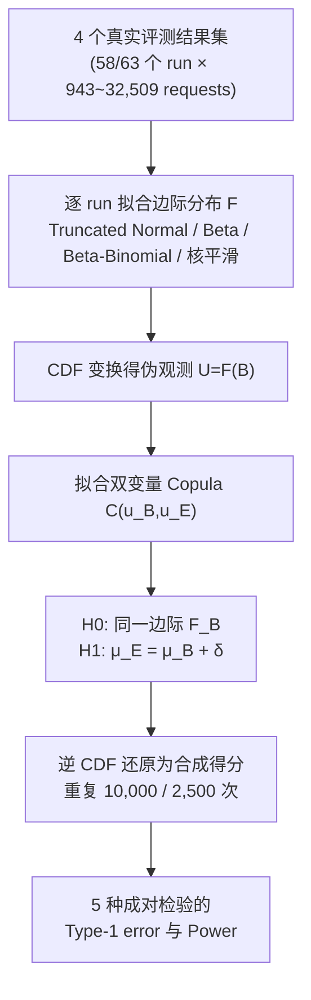
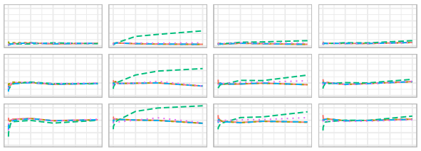

# Inference at Scale: Significance Testing for Large Search and Recommendation Experiments (大规模搜索与推荐实验中的显著性检验)

- **会议/期刊**: ACM SIGIR 2023 (short paper)
- **作者与机构**: Ngozi Ihemelandu, Michael D. Ekstrand (Boise State University)
- **推荐链路定位**: 离线评测与实验分析协议（非模型侧）
- **研究方向**: 去偏公平、可信隐私与工业架构 / 评测基准与统计推断
- **论文原文**: [https://arxiv.org/abs/2305.02461v2](https://arxiv.org/abs/2305.02461v2)
- **开源代码**: 论文未发布自研代码；实验所用的 MS MARCO 官方评测脚本见 [microsoft/MSMARCO-Passage-Ranking](https://github.com/microsoft/MSMARCO-Passage-Ranking)

## TL;DR (1分钟核心速览)

TREC 时代（<100 topics）得出的「Sign/Wilcoxon 检验可用」结论被推荐系统与大规模检索实验直接沿用，但后者有上千至数万 request、qrel 稀疏且存在流行度偏斜。本文用 Copula 生成式模拟，在**已知原假设真假**的条件下对 5 种成对双尾检验做 18 万次（Type-1）与 140 万次（功效）试验：大样本下 Sign/Wilcoxon 的一类错误率随 $n$单调膨胀并远高于名义$\alpha$，$t$-test 与 randomization 全程贴近$\alpha$；而$n\ge5000$时所有检验功效趋近 100%，即使$\delta=0.01$ 的 RR 差异也被判显著，故必须改以效应量判定实际意义。

## Background & Motivation (背景与核心矛盾)

- **主流范式**: 成对双尾检验（$t$-test、bootstrap shift、randomization、sign、Wilcoxon signed-rank）在共享同一 topic/user 集合的两系统上比较平均有效性差异$\bar{d}$；RecSys 论文中逾半数甚至不做检验。
- **前人局限**: (1) Smucker、Urbano、Parapar 等的模拟研究全部基于 TREC 式 50 topics 的小样本，且彼此结论冲突（一方推 $t$-test，一方推 sign/Wilcoxon）；(2) 大规模检索与 Top-$N$推荐的 request 数达$10^3\sim10^4$ 量级，qrel 稀疏不完备、少数热门物品被大量用户命中，分数差分布并不满足对称性假设。
- **核心洞察 (Key Insight)**: Sign/Wilcoxon 检验的原假设是「差值中位数/对称性」，而非均值；$n$ 极大时，零附近**微小但系统性的非对称偏差**会被判为统计显著，导致 Type-1 错误率随样本量膨胀。
- **本文切入点**: 放弃以某个检验作为 ground truth，改用 Urbano & Nagler 的 Copula 模拟器直接控制 $H_0$真伪，量化各检验在$n=25\sim20{,}000$ 下的校准度与功效。

## Method (核心方法设计)

### 1. 整体框架 (Overall Architecture)

把每个系统的逐 request 有效性得分 $E_1,\dots,E_n$视为随机变量的观测（Sakai 视角），而非固定总体。对真实评测结果中的每个 run 拟合边际分布$F$，再用双变量 Copula$C$刻画两个 run 之间的相关性（同一 topic 上的难度耦合）；模拟时先从 Copula 采样伪观测$(V_B,V_E)$，再经边际逆 CDF 变换回分数尺度，从而在**任意指定的$n$与效应量$\delta$** 下生成大量合成实验，最后统计 5 种检验的假阳性率与功效，给出检验选择与报告规范。

### 2. 关键设计拆解 (Key Designs)

1. **Copula 成对 run 模拟器（把「评测集」变成可控实验台）**：痛点是不知真实 $H_0$何时成立，无法直接统计错误率$\to$用 Sklar 定理把联合分布分解为边际与相关结构$F_{B,E}(b,e)=C\big(F_B(b),F_E(e)\big)$，$\delta$只作用于边际均值$\mu_E=\mu_B+\delta$而不改动相关结构$\to$于是「两系统等价」可由共用同一$F_B$ 精确构造，错误率与功效第一次在大样本场景下可被真值标定。
2. **校准判据与功效判据（两个可量化的靶子）**：良好校准要求 $\Pr(p\le\alpha\mid H_0)=\alpha$且$p$值 CDF 贴近对角线；功效定义为$\Pr(p\le\alpha\mid \mu_E-\mu_B=\delta)$。以$\alpha\in\{0.01,0.05,0.1\}$、$\delta\in[0.01,0.1]$ 网格扫描，即可把「检验是否可靠」从经验争论转为可复现的数值结论。
3. **实验规模与统计稳定性**：Type-1 面板对每个 (数据集, 指标, $n$) 组合重复 10,000 次，共 180,000 次试验；功效面板对每个$\delta$重复 2,500 次，共 1,400,000 次试验——足以把$10^{-2}$ 量级的错误率偏差分辨出来；全部检验为双尾，无需负采样，无训练开销，纯离线仿真（单机可复现）。

## Experimental Setup & Evaluation Protocol (实验设置与评估协议)

- **数据集与预处理**:

| 数据集 | 任务 | #Systems | #Requests | #Ratings | 密度 | 说明 |
| :--- | :--- | :---: | :---: | :---: | :---: | :--- |
| ML-100K | Top-$N$ 推荐 | 58 | 943 | 100,000 | 6.3% | 稠密小规模参照 |
| ML-25M | Top-$N$ 推荐 | 58 | 32,509 | 25,000,000 | 0.26% | 万级 user，主流大样本 |
| AZ-Video | Top-$N$ 推荐 | 58 | 6,000 | 583,933 | 0.01% | 极稀疏、长尾严重 |
| MS MARCO passage | 大规模段落检索 | 63 | 6,980 | — | 稀疏 qrel | dev set 官方 run 池 |

- **数据划分与防穿越**: 推荐侧按**用户 5 折切分**，每个测试用户随机留出 20% 交互作测试、其余（含其他用户数据）作训练，评分数 <5 的用户被剔除（等价 5-core 过滤）；每个测试用户生成 100 条推荐列表。检索侧直接使用 MS MARCO 官方 dev run 与官方脚本，无重训。
- **排名评测协议**: 逐 request 计算 **Reciprocal Rank (RR)**，与 MS MARCO 官方指标口径一致（nDCG 亦计算但因篇幅未展示）；比较粒度为「同一 request 集合上的成对差值」，即 paired 双尾检验，不涉及采样负例排序。
- **对比基线与超参**: 「基线」即 5 种检验本身（$t$-test / bootstrap / randomization / sign / Wilcoxon）；系统池由 Item-kNN、User-kNN、ALS-BiasedMF、ALS-ImplicitMF 的超参网格（nnbrs 5–50；features 5–500；iterations 5–20）组合出 58 个 run。显著性水平$\alpha\in\{0.01,0.05,0.1\}$，样本量$n\in\{25,50,100,500,1000,5000,10{,}000,20{,}000\}$。

## Key Experimental Results (实验关键数据)

### 1. 主实验对比 (Main Results：Type-1 错误率 @ $\alpha=0.05$)

下表按图 1/图 2 的定性读图整理（✓ 表示与名义 $\alpha$一致，↑/↓ 表示显著高于/低于$\alpha$）：

| 检验 | $n=50$|$n=500$|$n=5000$|$n=20{,}000$ | 校准结论 |
| :--- | :---: | :---: | :---: | :---: | :--- |
| **Randomization** | ✓ | ✓ | ✓ | ✓ | 全程最稳，推荐首选 |
| **$t$-test** | ✓ | ✓ | ✓ | ✓ | 全程贴近$\alpha$ |
| **Bootstrap** | ↑ | ✓ | ✓ | ✓ | 仅小样本偏激进，大样本收敛 |
| **Sign** | ↓ | ↑ | ↑ | ↑↑ | 大样本严重膨胀，**不推荐** |
| **Wilcoxon** | ✓ | ↑ | ↑ | ↑↑ | 小样本尚可、大样本失效，**不推荐** |

### 2. 消融/敏感性分析 (功效随 $n$与$\delta$变化，@$\alpha=0.05$)

| 配置 | Sign | Wilcoxon | Bootstrap | Randomization | $t$-test |
| :--- | :---: | :---: | :---: | :---: | :---: |
| $n=50$，中等$\delta$ | **最高** | 高 | 中 | 中 | **最低** |
| $n=1000$，小$\delta$ | 高 | 高 | 高 | 高 | 高 |
| $n\ge5000$，$\delta\ge0.01$ | ≈1.0 | ≈1.0 | ≈1.0 | ≈1.0 | ≈1.0 |

<figure class="paper-figure" markdown="span">
  <figcaption>图1：双尾检验的假阳性率。预期行为：检验的假阳性率应与指定显著性水平（𝛼=0.01、0.05、0.1）直接成正比。</figcaption>
</figure>

### 3. 关键实验发现 (Key Findings)

1. **错误率随样本量单调恶化，且只发生在中位数类检验上**：$n=50$时 Sign 反而低于$\alpha$（保守），$n=20{,}000$时 Sign 与 Wilcoxon 双双显著高于$\alpha$，而$t$-test / randomization 在全部$n$与$\alpha\in\{0.01,0.05,0.1\}$上都与对角线重合——说明失效根源是「对称性/中位数假设 + 大$n$」，而非数据本身；改用 nDCG 后该膨胀更严重。
2. **功效差异只是小样本幻觉**：$n=50$时 Sign/Wilcoxon 功效最高、$t$-test 最低（这正是 Parapar 等推荐 Sign 的依据），但$n\ge5000$ 后五条功效曲线重合于 1.0，任何基于「某检验更有功效」的推荐在大规模场景下都不再成立。
3. **$p$值在大规模评测中失去区分度**：Top-$N$推荐与大规模检索实验下，即使$\delta=0.01$的 RR 差异也有近 100% 概率被判显著，因此「$p<0.05$」不构成改进证据，必须同时报告效应量$\delta$ 及其置信区间才能判断实用价值。

## Highlights & Limitations (亮点、对比与审稿批判)

- **与代表作对比 (vs. Prior Work)**: Smucker 等（2007）把 randomization 当 ground truth 只在 TREC 50 topics 上成立，本文用可控 $H_0$证明其结论方向正确但未覆盖大样本；Urbano 等（2019, 推$t$-test）与 Parapar 等（2020, 推 Sign/Wilcoxon）的冲突在本文框架下被解释为**样本量区间的差异**，而非模拟方法之争。
- **可迁移亮点**: (1) Copula 模拟器可作为任何新评测指标/检验方法的「标定沙盒」，只需拟合真实 run 池即可生成带真值的合成实验；(2) 「报告 $p$ 值 + 效应量 + 置信区间」应写进推荐系统论文的审稿清单，尤其当 request 数过万时。
- **审稿级局限批判**: (1) 主结论仅基于 RR 单一指标（nDCG 结果被省略），而列表指标（nDCG/Recall@k）的分布更偏态，结论外推需谨慎；(2) 系统池规模有限（58/63 个 run）、来自 4 个数据集，边际分布族与 Copula 选择本身可能影响校准结论，未做跨 Copula 族的敏感性分析；(3) 未讨论推荐场景特有的**用户内多交互相关性**（一个用户多条交互非独立）与分层 bootstrap 等更合适的替代方案。

## Rating (四维评分)

- **方法创新性 (Novelty)**: ⭐⭐⭐ （不改模型、不提出新检验，创新在于把 Copula 模拟首次系统迁移到万级 request 的大规模推荐/检索评测，并给出反直觉的定量结论）
- **评估协议与实验扎实度 (Protocol & Experiments)**: ⭐⭐⭐⭐⭐ （$H_0$真伪可控、18 万 + 140 万次试验、4 个异质数据集、$\alpha$与$\delta$ 全网格扫描，统计推断类工作的高标准范式）
- **写作与数学规范度 (Clarity & Rigor)**: ⭐⭐⭐⭐ （5 种检验的原假设与模拟步骤定义清晰，但关键数值多藏于图 1–3，正文缺乏表格化的错误率数字，复现需读图）
- **工业落地与复现价值 (Industrial & Practical Value)**: ⭐⭐⭐⭐ （直接约束线上 A/B 与离线评测的报告规范：大流量下 $p$ 值必然显著，应以效应量为准；模拟代码逻辑简单易复现，但未开源）

