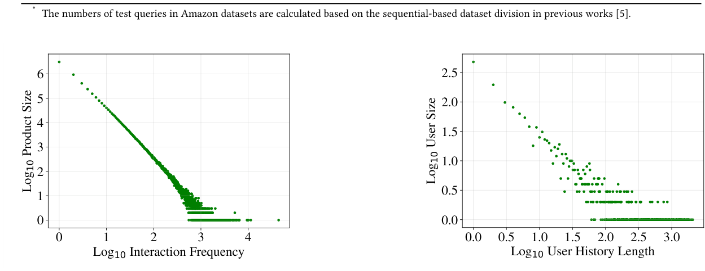
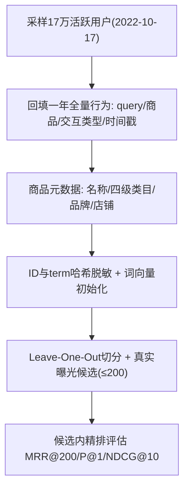

# JDsearch: A Personalized Product Search Dataset with Real Queries and Full Interactions (真实查询与全量交互的个性化商品搜索数据集)

- **会议/期刊**: SIGIR 2023
- **作者与机构**: Jiongnan Liu, Zhicheng Dou (中国人民大学 高瓴人工智能学院) ; Guoyu Tang, Sulong Xu (京东)
- **推荐链路定位**: 精排（候选列表内个性化重排）
- **研究方向**: 去偏公平与工业架构 / 冷启动与长尾推荐
- **论文原文**: [https://arxiv.org/abs/2305.14810v1](https://arxiv.org/abs/2305.14810v1)
- **开源代码**: [https://github.com/rucliujn/JDsearch](https://github.com/rucliujn/JDsearch)

## TL;DR (1分钟核心速览)

现有工作几乎全部在 Amazon 子类目数据集上评测个性化商品搜索，而该数据集的 query 是「类目词拼接」的伪查询、强制 `5-core` 过滤并强制单类目语料，导致离线指标与线上真实满意度脱节。本文发布 JDsearch：来自京东的 17.4 万用户、1287 万商品、2667 万条含 click/cart/follow/purchase 的全量交互与 **940 万条真实 query**，且**不删除任何冷门用户与长尾商品**；测试集采用 `Leave-One-Out`，并为每条测试 query 保留平台真实曝光的至多 200 个候选做候选内精排。代表性基线上 TEM 取得 MRR 0.2229 / NDCG@10 0.2192，较非个性化神经检索 QEM 分别提升 25.6% / 28.6%。

## Background & Motivation (背景与核心矛盾)

- **主流范式**: 个性化商品搜索在 AEM / ZAM / TEM / HEM / DREM 等模型上快速迭代，但评测统一依赖 Amazon 子类目数据（2014 年商品评论 + 由类目词拼接生成的伪 query）。
- **前人局限 1（查询失真）**: 伪 query 只由商品类目字段构造，而真实用户会依据品牌、型号、甚至描述词发起查询；仅 21.82% 的真实 query 是纯类目词，38.77% 是纯商品名，其余为组合类型。
- **前人局限 2（数据裁剪失真）**: `5-core` 过滤与单类目语料抹掉了冷商品、短历史用户与跨类目兴趣，而这些恰是个性化最需要处理的分布；作者统计发现商品交互频次严格服从幂律（图 1），裁剪等于人为删除最难的那部分数据。
- **核心洞察 (Key Insight)**: 在真实平台数据上，用户兴趣是**可延续**的——用 JS 散度度量，多数用户的「个人兴趣散度」小于「全局兴趣散度」；同时 51.87% 的重复 query 交互熵 $IE>1$，说明 query 本身歧义严重、个性化确有必要。
- **本文切入点**: 直接用工业平台全量行为重建一套「真实 query + 全量商品 + 真实曝光候选」的评测基准，并用数据集变体消融量化「Amazon 式预处理」到底带来多少指标偏差。

<figure class="paper-figure" markdown="span">
  <figcaption>图1：产品交互频数的双对数分布</figcaption>
</figure>

## Method (核心方法设计)

### 1. 整体框架 (Overall Architecture)

JDsearch 的构建是一条「采样—记录—脱敏—切分」流水线：先在 2022-10-17 随机采样约 17 万当日有查询行为的活跃用户，回填其一年内（2021-10-18 至 2022-10-17）的**全部**交互商品、查询序列、交互类型标签与时间戳，且不要求交互必须发生在 query 之下（搜索、推荐、闲逛等渠道的行为一并保留）；随后补齐商品名称、四级类目、品牌、店铺等元信息；再对 ID 与分词后的 term id 随机哈希脱敏；最后按 `Leave-One-Out` 取用户当日最后一条 query 为测试 query，抓取其真实曝光列表去重后截断为至多 200 个候选，得到「测试 query + 候选集 + 曝光/交互标签」的精排式评测单元。

### 2. 关键设计拆解 (Key Designs)

1. **真实查询 + 全量商品保留（去掉两类裁剪偏差）**：痛点在于 Amazon 式伪 query 与 `5-core`/单类目裁剪会使模型学到「类目匹配捷径」并回避冷启动。本文不做任何流行度过滤，语料横跨全部四级类目，交互类型保留四档标签。直接后果是数据极稀疏（密度约 0.0012%）、平均历史长度达 153，模型必须自己从长历史中判别哪些行为与当前 query 相关，而不是靠预处理帮忙去噪。
2. **面向精排的候选列表构造（把「检索」升级为「重排」）**：Amazon 数据集没有曝光结果，只能在整库上做粗粒度检索；本文记录平台真实曝光的商品列表并去重截断为 $\mathcal{C}_u$（$|\mathcal{C}_u|\le 200$），使评估目标变为在真实候选内排序，更贴近线上精排阶段，也天然引入了真实的位置/曝光分布。
3. **数据集质量度量：交互熵与兴趣散度**：为量化「query 是否歧义、个性化是否有空间」，提出交互熵

$$IE(q)=\sum_{p\in\mathcal{I}(q)}-P(p|q)\log_2 P(p|q),\quad P(p|q)=\frac{|\text{Interaction}(q,p)|}{\sum_{p'\in\mathcal{I}(q)}|\text{Interaction}(q,p')|}$$

其中 $\mathcal{I}(q)$为 query$q$下被交互（点击/加购/关注/购买）的商品集合。$IE\ge 1$即视为歧义查询；统计显示 51.87% 的重复 query 满足$IE>1$（$IE<1$ 仅 18.69%）。配合 JS 散度比较个人/全局兴趣分布，可从数据侧证明个性化必要且可行。
4. **训练目标、负采样与推理开销**：各基线沿用自身损失（pairwise 排序损失，$\mathcal{L}=-\sum\log\sigma(\hat{y}_{pos}-\hat{y}_{neg})$）；负采样统一为**全库均匀采样 5 个负例**（非 in-batch、非难负例）。由于文本被哈希脱敏、词表极稀疏，词嵌入用 word2vec 初始化；又因 1287 万商品逐一点嵌入必然过拟合、且测试集含训练期未见冷商品，商品/用户表示改为**由文本动态生成**：对标题、品牌、类目词向量取平均后过一层非线性函数。超参：历史截断 50、维度$d=128$、训练 30 epoch、Transformer 层数$\{1,2\}$、attention head 8。推理为 200 候选内打分，开销可忽略。

## Experimental Setup & Evaluation Protocol (实验设置与评估协议)

- **数据集与预处理**: 不做 `5-core`、不做单类目裁剪；交互含 click / add-to-cart / follow / purchase 四类标签。

| 数据集 | #Users | #Items | #Interactions | 密度 | 特征/场景说明 |
| :--- | :---: | :---: | :---: | :---: | :--- |
| Cell Phones & Accessories | 27,879 | 10,429 | 194,439 | 0.067% | Amazon 伪 query、单类目、5-core |
| Clothing, Shoes & Jewelry | 39,387 | 23,033 | 63,001 | 0.007% | 同上 |
| Sports & Outdoors | 35,598 | 18,357 | 278,677 | 0.043% | 同上 |
| Electronics | 192,403 | 63,001 | 1,689,188 | 0.014% | 同上，最大子集 |
| **JDsearch** | **173,831** | **12,872,636** | **26,667,260** | **0.0012%** | 真实 query、跨四级类目、含冷尾商品/短长历史用户、四类交互 |
| JDsearch #Test Queries | — | — | **171,728** | — | 远超 Amazon（Electronics 仅 3,221） |

- **数据划分与防穿越 (Splitting Strategy)**: `Leave-One-Out`——取用户在 2022-10-17 当天最后一条 query 为测试 query，其之前的所有行为用于训练；无交互的约 2,000 名用户从测试部分剔除，保证时间上无穿越。
- **排名评测协议 (Ranking Protocol)**: **候选列表内排序（真实曝光候选，至多 200 个，含全库未交互负例之外的平台真实曝光）**，非 Full-Ranking 也非随机采样排序；指标为 MRR@200、Precision@1、NDCG@10。
- **对比基线与超参设置**: 稀疏检索 BM25、神经 ad-hoc QEM，以及个性化模型 HEM（生成式隐向量）、DREM（KG）、AEM/ZAM（attention 用户画像）、TEM（Transformer 编码器）、HGN（KG + 个性化融合）。KG 类模型仅能用类目/品牌构建 item–attribute 图（平台不提供 "bought together" 关系）。$d=128$，30 epoch，历史长度上限 50，5 个均匀负例；未报告显著性检验。

## Key Experimental Results (实验关键数据)

### 1. 主实验对比 (Main Results)

| 模型 | 类型 | MRR@200 | P@1 | NDCG@10 | MRR Improv. (vs QEM) |
| :--- | :---: | :---: | :---: | :---: | :---: |
| BM25 | Ad-hoc (稀疏) | 0.1114 | 0.0402 | 0.0940 | −37.2% |
| QEM | Ad-hoc (神经) | 0.1774 | 0.0728 | 0.1705 | — |
| HEM | Personalized | 0.1955 | 0.0847 | 0.1905 | +10.2% |
| DREM | Personalized (KG) | 0.1647 | 0.0632 | 0.1578 | −7.2% |
| HGN | Personalized (KG) | 0.1662 | 0.0634 | 0.1591 | −6.3% |
| AEM | Personalized | 0.1971 | 0.0851 | 0.1920 | +11.1% |
| ZAM | Personalized | 0.1969 | 0.0849 | 0.1920 | +11.0% |
| **TEM** | Personalized | **0.2229** | **0.1049** | **0.2192** | **+25.6%** |

### 2. 消融实验 (Ablation Study)

以 TEM 为被试模型，逐个复刻「Amazon 式预处理」形成数据集变体（表 6）：

| 数据集变体 | 操作 | MRR | P@1 | NDCG@10 | ΔMRR |
| :--- | :--- | :---: | :---: | :---: | :---: |
| JDsearch | 完整数据 | **0.2229** | **0.1049** | **0.2192** | — |
| JDsearch_fakequery | 训练集 query 换成类目拼接伪查询 | 0.1644 | 0.0661 | 0.1539 | **−26.3%** |
| JDsearch_samecate | 历史只保留与测试商品同类目 | 0.1925 | 0.0840 | 0.1869 | −13.6% |
| JDsearch_w/o cold | 历史只保留 ≥5 次交互的商品 | 0.2296 | 0.1088 | 0.2272 | +3.0% |
| JDsearch_short | 测试仅保留历史长度 ≤2 的用户 | 0.2080 | 0.1012 | 0.1979 | −6.7% |
| JDsearch_long | 测试仅保留历史长度 >300 的用户 | 0.2294 | 0.1096 | 0.2215 | +2.9% |

### 3. 关键实验发现 (Key Findings)

1. **伪查询是最大的评测偏差源**：把训练 query 换成 Amazon 式类目拼接伪查询后，TEM 的 MRR 从 0.2229 掉到 0.1644（−26.3%），说明伪 query 上学到的用户画像无法迁移到真实 query 分布——旧基准上的排序结论存在系统性高估。
2. **同质类目裁剪同样有害但程度较轻**：限制为单类目后 MRR 下降 13.6%，印证了用户兴趣跨类目延伸的普遍性（图 3 显示多数 5-core 用户历史跨多个一级类目）；而删除冷商品反而带来 +3.0% 的「虚高」，代价是掩盖了模型真正的去噪与冷启动能力。
3. **冷用户才是当前模型的天花板**：历史 ≤2 条的用户上 MRR 仅 0.2080（−6.7%），而长历史用户达 0.2294；同时 KG 类模型（DREM 0.1647 / HGN 0.1662）反而低于非个性化 QEM，说明稀疏元数据下知识图谱建模收益为负，短历史场景的分层个性化策略仍是空白。

## Highlights & Limitations (亮点、对比与审稿批判)

- **与代表作对比 (vs. Prior Work)**: 相比所有以 Amazon 5-core 子类目为基准的个性化商品搜索工作（AEM/ZAM/TEM/HEM），本文不提出新模型，而是回到评测层：用真实 query 取代伪 query、用「真实曝光 ≤200 候选」取代整库检索、用幂律全量商品取代 5-core 稠密子集。它把「榜单上 1–3 个点的提升」重新校准到一个更难、更接近线上的难度刻度（TEM 在 JDsearch 上仅比 QEM 高 25.6%，且 KG 类方法直接失效）。
- **可迁移亮点**: ①「用数据集变体做消融」的基准论证范式，可迁移到跨域推荐、POI 推荐等同样依赖裁剪型公开数据的领域；②因商品表无法逐点学习而采用「文本动态生成表示 + word2vec 初始化哈希词表」的工程约定，对处理匿名化/冷启动商品表有直接复用价值。
- **审稿级局限批判**: ①评测协议是**真实曝光候选内的重排**而非 Full-Ranking，候选由线上排序系统产生，模型优劣部分受曝光选择偏差与 200 上限影响，且未做显著性检验，小差距（如 AEM 0.1971 vs ZAM 0.1969）不可区分；②文本被哈希、评论缺失、商品关系缺失，导致 HEM/DREM/HGN 等强基线被削弱，其「失效」更多反映数据可得性而非方法本身；③仅单平台、单一年度、中文/单站点，跨语言跨平台的外部效度与冷商品上界仍需验证。

## Rating (四维评分)

- **方法创新性 (Novelty)**: ⭐⭐⭐ （不提供新模型；创新在于用交互熵、JS 散度与数据集变体消融来系统性质疑既有基准的构念效度，属方法论级贡献但技术增量有限）
- **评估协议与实验扎实度 (Protocol & Experiments)**: ⭐⭐⭐⭐ （Leave-One-Out + 真实曝光候选 + 8 个代表性基线 + 5 组数据集变体消融，覆盖冷/短/长历史分桶；扣分在于缺显著性检验与候选选择偏差讨论）
- **写作与数学规范度 (Clarity & Rigor)**: ⭐⭐⭐⭐ （数据字段、统计口径、超参与负采样设置交代详实，公式仅交互熵一处但定义完整；对弱基线成因的自我披露也较诚实）
- **工业落地与复现价值 (Industrial & Practical Value)**: ⭐⭐⭐⭐⭐ （CC BY-NC-SA 4.0 公开、GitHub 含完整格式说明与 170k 级真实测试 query，是难得的可复现工业精排基准）

