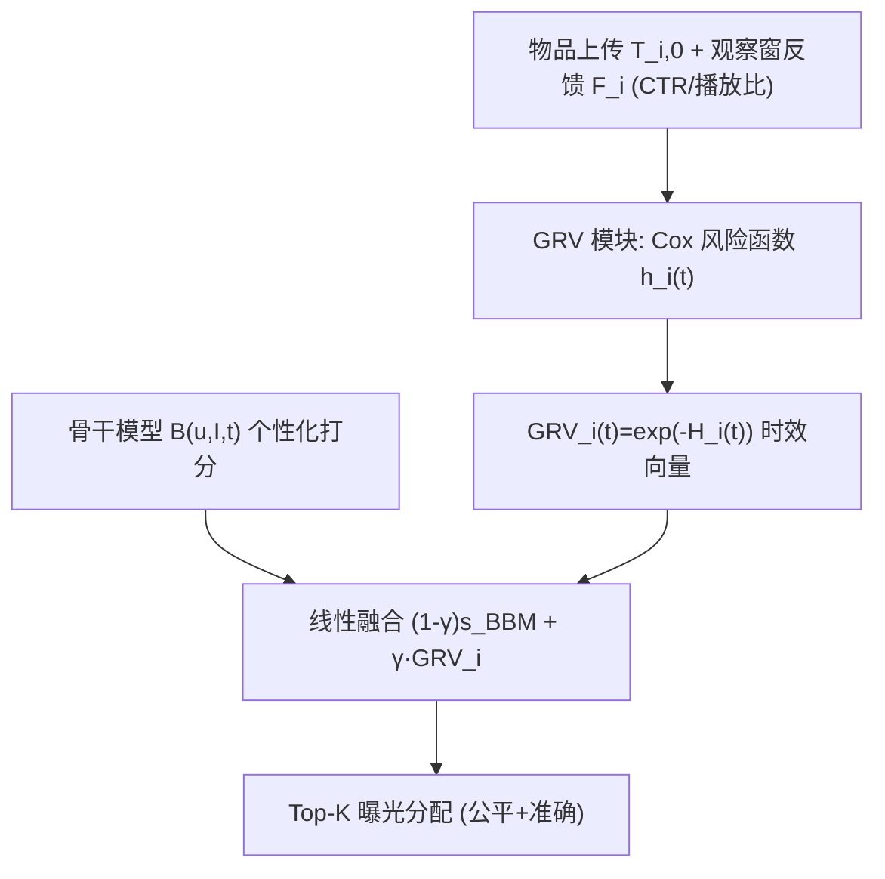

# Measuring Item Global Residual Value for Fair Recommendation (度量物品全局残余价值以实现公平推荐)

- **会议/期刊**: SIGIR 2023
- **作者与机构**: Jiayin Wang, Weizhi Ma, Chumeng Jiang, Min Zhang（清华大学 DCST/BNRist & AIR）；Yuan Zhang, Biao Li, Peng Jiang（快手）
- **推荐链路定位**: 精排/重排阶段的打分融合（模型无关插件，作用于 Top-K 曝光分配）
- **研究方向**: 去偏公平、可信隐私与工业架构 / 冷启动与长尾推荐
- **论文原文**: [https://arxiv.org/abs/2307.08259v1](https://arxiv.org/abs/2307.08259v1)
- **开源代码**: [https://github.com/Alice1998/TaFR](https://github.com/Alice1998/TaFR)

## TL;DR (1分钟核心速览)

信息流场景中早上传物品凭历史曝光滚雪球式垄断资源，新物品即使 CTR 相当也难以获得曝光。本文把物品侧效用从"静态分数"升级为随时间衰减的**时效分布**，借生存分析（Cox 比例风险）显式建模物品的 Global Residual Value（GRV）——即未来各时刻仍"活跃"的概率向量，并以 $s=(1-\gamma)s^{\text{BBM}}+\gamma\,\text{GRV}_i$ 注入任意骨干模型。在 MIND/Kuai 的 test-all 全库排序下，GRV 令 NeuMF 的 HR@5 提升 131%、新物品覆盖率 N_Cov@5 由 0.0026 升至 0.2992。

## Background & Motivation (背景与核心矛盾)

- **主流范式**: 公平推荐把物品效用视为**静态**值（如历史 CTR），要求曝光与效用成比例；去偏研究则聚焦流行度偏差以提升准确率，二者都不建模效用的时间演化。
- **前人局限**: ①静态效用无法区分"今日头条型"与"长尾常青型"物品的不同衰减曲线，导致早期积累曝光的物品被永久性优待；②直接用上传时间做时间编码（越新越优先）只是粗粒度偏置，既牺牲准确率也未必带来真正的公平竞争环境。
- **核心洞察 (Key Insight)**: 图1/图2 的实证显示，两组 CTR 相当、仅上传时间相差 1 小时的物品，曝光量差数倍；图3 进一步表明物品存在差异极大的时效模式，因此**时间因素（而非流行度）才是 Snowball Effect 的主因**，且必须"逐物品"建模而非全局衰减。
- **本文切入点**: 把物品效用重构为宏观视角下的"失效时间分布"，用生存分析预测未来活跃概率，作为公平竞争的软约束注入排序分数。

## Method (核心方法设计)

### 1. 整体框架 (Overall Architecture)

TaFR 解耦为两支：骨干推荐器 $s^{\text{BBM}}_{u,i}(t)=\mathcal{B}(u(t),I,t)$负责用户兴趣；GRV 模块在物品上传后固定观察窗$T_{\text{obs}}$（MIND 12h / Kuai 24h）结束时，读取该窗口内的用户反馈序列（CTR、播放比等）与系统预测分，输出长度$T_{\text{pred}}$的时效向量$\text{GRV}_i(t)$，表示"物品在$t$ 时刻仍有潜在感兴趣用户未触达"的概率。线上仅做一次线性融合并排序，全流程对骨干模型零侵入，可即插即用于 NCF/序列/时间感知模型。

### 2. 关键设计拆解 (Key Designs)

**设计一：相对化 Cox 风险函数（把"热度"换成"竞争位势"）**
痛点：绝对 CTR 高的老物品天然占优。做法：设 $\text{GRV}_i(t)=P(T_{i,d}>t\mid \mathcal{F}_i)=\exp(-H_i(t))$，其中$H_i(t)=\int_0^t h_i(x)\mathrm{d}x$；再按 Cox 假设令风险率为

$$h_i(t)=h_0(t)\cdot\exp\!\Big[\sum_{t_x=T_{i,0}}^{T_{i,0}+T_{\text{obs}}}\sum_{f\in F}\alpha_f(t_x)\big(f_i(t_x)-f_I(t_x)\big)\Big]$$

关键在于协变量用的是 $f_i-f_I$（物品反馈减去**系统同时刻均值**）。直觉：模型学习的是"相对同期大盘的超额表现"，一旦老物品的反馈回落到均值以下，其风险率即上升、GRV 快速衰减，马太效应被自动惩罚，无需显式公平性约束项。

**设计二：无反标的失活标签 + 删失感知训练**
痛点：真实系统没有"物品何时失效"的标注（大量样本被删失），MSE 不可用。做法：定义活力分 $v_i(t)=\mathbb{I}_{Exp_i(t)>0}(R_i(t)-\beta_E)+\mathbb{I}_{Exp_i(t)=0}(-\beta_{nE})$，其中$R_i(t)$为反馈的系统内百分位；当累计活力$\sum v_i(t)<\beta_d$时触发失活，得到$T_{i,d}$。训练最大化含删失的对数似然：

$$\mathcal{L}=-\sum_{i\in\mathcal{D}}\big[\log h_i(T_{i,d})-H_i(T_{i,d})\big]-\sum_{j\in\mathcal{C}}H_j(T_j^{\text{obs}})$$

即失效样本贡献风险项、删失样本只贡献生存项，避免把"尚未失效"误判为"永不失效"。

**设计三：融合与推理开销**
最终打分 $s_{u,i}(t)=(1-\gamma)\,s^{\text{BBM}}_{u,i}(t)+\gamma\,\text{GRV}_i(t)$，$\gamma\in\{0.1,0.2,0.3\}$ 按骨干/数据集网格搜索。GRV 向量在观察窗结束后离线预计算一次，线上仅一次加权，单物品开销 O(1)；无需负采样，属"免负采样"打分修正范式。

## Experimental Setup & Evaluation Protocol (实验设置与评估协议)

- **数据集与预处理**:

| 数据集 | #Users | #Items | #Interactions | 稀疏度/密度 | 特征/场景说明 |
| :--- | :---: | :---: | :---: | :---: | :--- |
| MIND | 原文未报告 | 原文未报告 | 7 天日志 | 高稀疏、快迭代 | PC 新闻，`10-core` 过滤；GRV 随机抽 20% 物品作测试集以防信息泄漏 |
| Kuai | 原文未报告 | 2 天上传物品 | 7 天曝光反馈 | 相对稠密 | 短视频，反馈含播放比/评论；第 1 天物品训 GRV，第 2 天物品构造推荐集 |

- **数据划分与防穿越 (Splitting Strategy)**: 「时间切分 + 随机划分」混合——前 3 天为训练集，后 2 天随机划为验证/测试；GRV 的 $T_{\text{obs}}+T_{\text{pred}}$ 固定为 7×24h，预测窗内日志对推理严格不可见。
- **排名评测协议 (Ranking Protocol)**: **Full-Ranking（test-all，候选为全库物品，不做负采样）**，原文明确指出该设置会整体压低准确率数值，但更真实反映曝光分配。
- **对比基线与超参设置**: 三类骨干 NeuMF / GRU4Rec / TiSASRec，各自对比「仅骨干」「+上传时间倒数编码 $\text{TaFR}_{time}$」「+GRV」；指标 HR@k、NDCG@k、新物品覆盖率 N_Cov@k（MIND 取最晚 20% 为 new items，Kuai 取最新 10%）与总体 Cov@k；种子 0–4 取均值，$p<0.05$（**）/$p<0.1$（*）显著性检验。

## Key Experimental Results (实验关键数据)

### 1. 主实验对比 (Main Results)

格式为「骨干 → TaFR$_{GRV}$（相对提升）」，最优值加粗：

| 数据集 | 骨干 | HR@5 | NDCG@5 | N_Cov@5 | HR@10 | NDCG@10 | N_Cov@10 |
| :--- | :--- | :---: | :---: | :---: | :---: | :---: | :---: |
| MIND | NeuMF | 0.0953 → **0.2204** (+131%) | 0.0754 → **0.1511** | 0.0026 → **0.2992** | 0.1251 → **0.2403** (+92%) | 0.0846 → **0.1574** | 0.0026 → **0.4698** |
| MIND | GRU4Rec | 0.1344 → 0.2141 (+59%) | 0.0906 → 0.1494 | 0.0031 → 0.0110 | 0.1626 → 0.2453 (+51%) | 0.0995 → 0.1592 | 0.0037 → 0.0147 |
| MIND | TiSASRec | 0.1321 → 0.1764 (+34%) | 0.0897 → 0.1158 | 0.0698 → 0.1417 (+103%) | 0.1867 → 0.2219 (+19%) | 0.1071 → 0.1303 | 0.1050 → 0.2247 |
| Kuai | NeuMF | 0.2422 → 0.2440 (+1%) | 0.1911 → 0.1923 | 0.1128 → 0.1158 | 0.3114 → 0.3140 (+1%) | 0.2134 → 0.2149 | 0.1579 → 0.1598 |
| Kuai | GRU4Rec | 0.2892 → **0.3129** (+8%) | 0.2105 → **0.2328** | 0.0150 → 0.0245 | 0.3885 → **0.4111** (+6%) | 0.2425 → **0.2645** | 0.0169 → **0.0357** (+111%) |
| Kuai | TiSASRec | 0.3903 → 0.3893 | 0.3298 → 0.3278 | 0.4211 → 0.4236 | 0.4713 → 0.4706 | 0.3559 → 0.3540 | 0.4862 → 0.5013 |

### 2. 消融实验 (Ablation Study)

拆解"时间信息如何注入"（HR@10 / N_Cov@10）：

| 设置 | MIND-GRU4Rec | MIND-TiSASRec | Kuai-NeuMF | Kuai-GRU4Rec |
| :--- | :---: | :---: | :---: | :---: |
| 仅骨干 (w/o GRV) | 0.1626 / 0.0037 | 0.1867 / 0.1050 | 0.3114 / 0.1579 | 0.3885 / 0.0169 |
| + 上传时间编码 $\text{TaFR}_{time}$ | 0.1533 / 0.0026 | 0.1479 / 0.0142 | 0.3025 / 0.2015 | 0.3912 / 0.0169 |
| **+ GRV (TaFR 完整)** | **0.2453 / 0.0147** | **0.2219 / 0.2247** | **0.3140 / 0.1598** | **0.4111 / 0.0357** |

### 3. 关键实验发现 (Key Findings)

1. **"越新越优先"的粗粒度时间编码是有害的，逐物品时效建模才有效**：MIND 上 $\text{TaFR}_{time}$ 反而把 TiSASRec 的 HR@10 从 0.1867 打到 0.1479、N_Cov@10 从 0.1050 崩至 0.0142；而 GRV 在相同骨干上同时拿到 0.2219 与 0.2247，说明公平收益不能靠上传时间这一单变量硬编码获得。
2. **收益与场景时效强度正相关**：MIND（跨天上传、新闻快迭代、极稀疏）提升远大于 Kuai（物品集中在 24h 内），NeuMF 上 HR@5 相对提升分别为 131% 与 1%，N_Cov@10 在 Kuai-GRU4Rec 上提升 111% 却也仅在 0.0169→0.0357 的低基数上——说明 GRV 的边际价值取决于物品间时效差异是否显著。
3. **GRV 是比历史 CTR 更准确的"未来效用"代理**：图7 的十等分桶实验中，按 GRV 分组后各组的播放率与评论率呈单调递增，而按历史 CTR 分组几乎无区分度；图6 显示上传越晚的分组，TaFR 带来的覆盖率提升百分比越大，正是对时间段性不公平的直接纠偏。

## Highlights & Limitations (亮点、对比与审稿批判)

- **与代表作对比 (vs. Prior Work)**: 相较静态效用约束的公平推荐（如按曝光比例约束），本文首次把物品效用建成**随时间演化的生存分布**；相较 MIND/Kuai 上常见的 +upload-time 编码，GRV 用"相对大盘的超额反馈"而非绝对时间先后；相较 TiSASRec 等时间感知序列模型，本文在**物品侧**建模，实验显示两者叠加仍有增益，说明二者正交。
- **可迁移亮点**: ①以 $f_i-f_I$（相对均值）构造协变量，可低成本地将任何绝对量指标改造为"抗马太"的相对信号；②用累计活力分阈值自动生成失活标签 + Cox 删失似然，可迁移到内容生命周期预测、用户流失预警等无标注场景。
- **审稿级局限批判**: ①**依赖观察窗与阈值**：物品必须先积累 $T_{\text{obs}}$（12/24h）反馈才能算 GRV，窗口内冷启动物品仍缺乏公平工具；$\beta_E,\beta_{nE},\beta_d$与删失率需人工调参，鲁棒性未做敏感性分析。②**评估与指标偏弱**：仅两个离线数据集、无线上 A/B；公平性只用覆盖率 N_Cov/Cov 衡量，未验证与严格公平公理（如曝光效用成比例、envy-free）的偏离度；且 Kuai-TiSASRec 上准确率出现轻微负向（HR@10 0.4713→0.4706），说明强时间感知骨干下融合权重$\gamma$ 的选取较为敏感。

## Rating (四维评分)

- **方法创新性 (Novelty)**: ⭐⭐⭐⭐ （首次将生存分析/Cox 风险模型用于物品侧时效公平，相对化协变量的设定有清晰的抗马太物理直觉，但整体属"经典工具 + 新场景"式创新）
- **评估协议与实验扎实度 (Protocol & Experiments)**: ⭐⭐⭐⭐ （Full-Ranking test-all、三类骨干 × 两类场景、5 种子显著性检验与分桶验证齐备，可惜仅离线、公平性指标单一）
- **写作与数学规范度 (Clarity & Rigor)**: ⭐⭐⭐⭐ （GRV 定义—风险函数—似然训练的推导链条完整，符号表清晰；失活标签生成部分超参含义解释略简）
- **工业落地与复现价值 (Industrial & Practical Value)**: ⭐⭐⭐⭐⭐ （模型无关插件、线上仅一次线性融合、开源代码完整，且来自快手真实系统日志，可直接嵌入现有 feed 排序链路）

