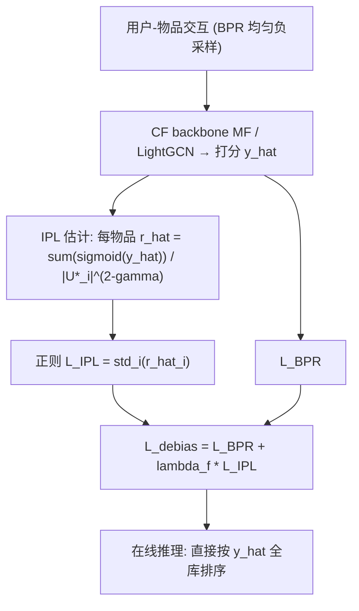

# Popularity Debiasing from Exposure to Interaction in Collaborative Filtering (从曝光到交互：协同过滤中的流行度去偏)

- **会议/期刊**: SIGIR 2023 (Short Paper)
- **作者与机构**: Yuanhao Liu, Qi Cao, Huawei Shen, Yunfan Wu, Shuchang Tao, Xueqi Cheng — 中科院计算所数据智能系统研究中心 / UCAS
- **推荐链路定位**: 排序(精排)阶段的正则化训练
- **研究方向**: 去偏公平、可信隐私与工业架构 / 协同过滤
- **论文原文**: [https://arxiv.org/abs/2305.05204v1](https://arxiv.org/abs/2305.05204v1)
- **开源代码**: [https://github.com/UnitDan/IPL](https://github.com/UnitDan/IPL)

## TL;DR (1分钟核心速览)

现有流行度去偏方法只盯着“曝光量均衡”(IPW/因果干预/对抗训练)，但把冷门物品硬推给不喜欢它的用户，几乎换不来额外交互——图 1(b) 显示去偏后能获得“公平交互量”的冷门物品比例仍不足 0.01。本文提出 **IPL 准则**：物品获得的交互量应正比于“喜欢它的用户数”。用 IPS 估计出离线不可观的 $\hat{r}_i$并构造$\mathrm{std}$ 正则项，在 MovieLens-1M 上将 MF 的 Pre@20 从 19.977 提至 **20.397**(+2.1%)、DI 从 3.723 降至 **3.254**(-12.6%)，四个数据集与两种 backbone 上均实现“去偏 + 精度”双赢。

## Background & Motivation (背景与核心矛盾)

- **主流范式**: 协同过滤(CF)从长尾交互中学习，会进一步放大流行度偏差；主流去偏沿三条路线——IPW 重加权训练(IPW)、因果干预去流行度混杂(MACR/PO)、对抗训练拉平物品打分布(DPR)，目标都是让**曝光量**相等或与流行度成比例。
- **前人局限**: ①“曝光公平”不等于“收益公平”，冷门物品被推给对其无兴趣的用户后，点击数并不会增加，形成虚假公平；②盲目加曝光会挤占热门物品给对的用户的推荐位，导致推荐精度普遍下滑 10%–18%。
- **核心洞察 (Key Insight)**: 物品在推荐中的真实收益是**交互**(点击/购买)而非曝光；一个被更多用户喜欢的物品理应获得更多交互，因此“公平”的正确形式是**交互量 ∝ 喜欢它的用户数**，而非人人均等。
- **本文切入点**: 以 IPL 为优化目标，用 IPS 把离线数据中不可观测的“交互量 $C_i$”与“喜欢者数$Q_i$”还原为可微比值$\hat{r}_i$，用物品间$\hat{r}_i$ 的方差做正则，直接压向准则而无需改模型结构。

## Method (核心方法设计)

### 1. 整体框架 (Overall Architecture)

模型不改动 CF backbone(MF / LightGCN)打分结构：对每条观测交互，BPR 损失维持原样；同时把每个物品 $i$在其全部历史正反馈用户集$U^*_i$上的预测概率$\sigma(\hat{y}_{u,i})$求和，按喜欢者规模$|U^*_i|^{2-\gamma}$归一化得到 IPL 估计$\hat{r}_i$；再对全部物品的$\{\hat{r}_i\}$ 取标准差作为正则，与 BPR 加权联合训练。推理阶段完全复用 backbone 打分排序，**零额外在线开销**。

### 2. 关键设计拆解 (Key Designs)

1. **IPL 准则 (Interaction Proportional to Likers)**：把去偏目标从“曝光 $\to$均等”换成“交互$\to$按喜欢者比例”。形式化定义为$\forall i,j\in\mathcal{I},\ \frac{C_i}{Q_i}=\frac{C_j}{Q_j}$，其中$C_i$为$i$在推荐中可获得的交互数，$Q_i$ 为其对全体用户曝光时可获得的交互数(即“喜欢它的人数”)。它的两点取舍很关键：以交互而非曝光度量收益；以喜欢者数而非流行度作为应得份额，从根上消解“去偏 vs 精度”的零和博弈。
2. **IPS 离线估计 (把不可观量变成可微比值)**：$C_i$与$Q_i$在离线日志里都不可直接观测，于是先由$\hat{C}^{\text{IPS}}_i=\sum_{u\in U_i}\frac{O_{u,i}}{P_{u,i}}R_{u,i}$保证$\mathbb{E}[\hat{C}^{\text{IPS}}_i]=C_i$；再借用曝光倾向假设$P_{u,i}=P_{*,i}\propto p^{\text{expose}}_{*,i}\cdot Q_i$与$p^{\text{expose}}_{*,i}\propto(Q^*_i)^{\gamma}$，推出$Q_i\propto(Q^*_i)^{1-\gamma}$，最终得到可计算比值$\hat{r}_i\propto C^*_i/(Q^*_i)^{2-\gamma}$。物理直觉是：把观测交互数用幂次项$2-\gamma$惩罚，$\gamma$ 越大(数据生成时流行偏置越强)，冷门物品的“应得交互”被抬升越多，从而在离线端还原线上公平基准。
3. **IPL 正则与训练目标**：以模型参数 $\Theta$ 代入得可微估计
$$\hat{r}_i=\mathbb{E}[r_i\mid\Theta]=\frac{\sum_{u\in U^*_i}\sigma(\hat{y}_{u,i})}{|U^*_i|^{\,2-\gamma}},$$
并定义 $\mathcal{L}_{\text{IPL}}=\mathrm{std}_{i\in\mathcal{I}}(\hat{r}_i)$；总损失$\min_{\Theta}\ \mathcal{L}_{\text{debias}}=\mathcal{L}_{\text{BPR}}+\lambda_f\cdot\mathcal{L}_{\text{IPL}}$。之所以用标准差而非加权求和，是因为准则式 (1)(4) 本质上要求所有$\hat{r}_i$**彼此相等**，最小化离散度即最紧的松弛。理论侧 Proposition 2.1 进一步证明：给定 Recall$=c$，总存在同时满足 IPL 的推荐结果(ML-1M 上$c=0.99$时违反概率$<10^{-10}$)，即去偏与精度不必然冲突。训练负采样沿用 BPR 的均匀采样，无额外负例开销。

## Experimental Setup & Evaluation Protocol (实验设置与评估协议)

- **数据集与预处理**: 四个公开基准，按物品均匀采样交互记录，并沿用文献用 MF 拟合数据生成偏置强度 $\gamma$：

| 数据集 | $\gamma$ 拟合值 | 划分 | 来源说明 |
| :--- | :---: | :---: | :--- |
| MovieLens-1M | 1.826 | 70/10/20 | 电影评分 |
| Gowalla | 1.285 | 70/10/20 | LBS 签到 |
| Yelp | 1.552 | 70/10/20 | 商户点评 |
| Amazon Book | 1.446 | 70/10/20 | 图书电商 |

- **数据划分与防穿越**: `比例划分`(70% 训练 / 10% 验证 / 20% 测试)，按物品维度均匀采样后切分；原文未给出用户/物品/交互量统计与 5-core 过滤细节。
- **排名评测协议**: 指标为 Pre@20、Recall@20、NDCG@20(×100)，判分协议原文未显式声明采样负例比，按惯例理解为 `Full-Ranking`；训练侧 BPR 采用标准 1:1 均匀负采样。
- **去偏评估指标**: MI(交互比值 $r_i$与物品流行度$Q^*_i$的互信息，衡量流行度残留相关)与 **DI**(Deviation of Interaction distribution，即$\mathrm{std}_{i}(r_i)/\mathrm{mean}_{i}(r_i)$，直接对齐 IPL 准则)，均越低越好。
- **对比基线与超参**: backbone 为 MF 与 LightGCN，基线含 IPW、PO、MACR、DPR(均在两个 backbone 上复现)；$\lambda_f$在对数尺度$10^{-2}\sim10^{-6}$ 间网格搜索 20 个等距值；原文未报告显著性检验。

## Key Experimental Results (实验关键数据)

### 1. 主实验对比 (Main Results)

MovieLens-1M 全指标($\uparrow$越高越好，$\downarrow$ 越低越好，粗体为最优)：

| Model | Pre@20 $\uparrow$| Recall@20$\uparrow$| NDCG@20$\uparrow$| MI$\downarrow$| DI$\downarrow$ |
| :--- | :---: | :---: | :---: | :---: | :---: |
| MF (backbone) | 19.977 | 27.685 | 30.777 | 2.138 | 3.723 |
| + IPW | 16.350 | 22.110 | 23.540 | 2.073 | 3.500 |
| + PO | 17.329 | 23.097 | 25.877 | 1.997 | 3.461 |
| + DPR | 16.630 | 23.010 | 25.240 | 1.985 | 3.467 |
| + MACR | 17.248 | 23.253 | 25.782 | 2.211 | 3.458 |
| **+ IPL (本文)** | **20.397** | **28.642** | **31.397** | **1.942** | **3.254** |
| LightGCN (backbone) | 19.808 | 27.217 | 30.599 | 2.010 | 4.032 |
| **+ IPL (本文)** | **19.979** | **27.545** | **30.949** | **1.921** | **3.005** |

其余三数据集核心列(Pre@20 / DI)：

| Model | Gowalla Pre | Gowalla DI | Yelp Pre | Yelp DI | Amazon Pre | Amazon DI |
| :--- | :---: | :---: | :---: | :---: | :---: | :---: |
| MF | 4.738 | 3.067 | 2.557 | 3.989 | 2.618 | 3.061 |
| + IPW | 4.021 | 2.974 | 1.950 | 3.882 | 2.220 | 3.004 |
| + PO | 4.442 | 2.918 | 1.951 | 4.594 | 2.606 | 2.928 |
| + DPR | 3.983 | 4.042 | 2.104 | 5.757 | 2.238 | 5.194 |
| + MACR | 3.977 | 2.905 | 1.685 | 4.891 | 2.140 | 3.173 |
| **+ IPL** | **5.136** | **2.882** | **2.715** | 3.808 | **2.891** | **2.889** |
| LightGCN | 5.381 | 2.623 | 2.934 | 4.403 | 2.905 | 3.016 |
| **+ IPL** | **5.385** | **2.011** | **2.954** | **3.848** | **2.913** | **2.886** |

### 2. 消融实验 (Ablation Study)

原文未设组件级消融，本质消融等价于 $\lambda_f=0$(退化为 backbone)与$\lambda_f>0$ 的对照，其余为强度敏感性：

| 设置 | 数据集 | Pre@20 | DI | 说明 |
| :--- | :---: | :---: | :---: | :--- |
| MF 无 IPL ($\lambda_f=0$) | ML-1M | 19.977 | 3.723 | 偏差最强 |
| MF + IPL ($\lambda_f>0$) | ML-1M | 20.397 | 3.254 | 精度↑、DI↓ |
| LGCN 无 IPL ($\lambda_f=0$) | ML-1M | 19.808 | 4.032 | 偏差最强 |
| LGCN + IPL ($\lambda_f>0$) | ML-1M | 19.979 | 3.005 | DI 降 25.5% |

$\lambda_f$在$10^{-2}\sim10^{-6}$间取 20 个值时(图 2)，IPL 在$1/\text{DI}$–Recall_SNIPS 平面上始终位于 backbone 的结果点**右上侧**，说明收益非偶发超参幸运点。

### 3. 关键实验发现 (Key Findings)

1. **去偏反涨精度，兑现理论承诺**：MF 上 Pre 从 19.977 升至 20.397(+2.1%)、NDCG 30.777 升至 31.397(+2.0%)，同时 DI 下降 12.6%；LightGCN 上 DI 从 4.032 骤降至 3.005(-25.5%)，Pre/NDCG 同步微涨——与 Proposition 2.1 的“win-win”预测一致。
2. **曝光驱动式去偏的代价被定量坐实**：IPW/DPR/PO/MACR 在 ML-1M 上 Pre 损失 11.1%–18.1%(19.977 $\to$ 16.350–17.329)，且 DPR 在 Yelp/Gowalla 上 DI 反而恶化至 5.757/4.042，说明对抗/重加权只改曝光分布，未触及“交互收益”这一根本矛盾。
3. **对更强 backbone 仍然有效**：Gowalla 上 LightGCN 本身 DI 已较低(2.623)，IPL 仍将其压至 2.011(-23.3%)，且 Pre 不降(5.381 $\to$ 5.385)，表明该正则与图卷积表征正交、可叠加增益。

## Highlights & Limitations (亮点、对比与审稿批判)

- **与代表作对比 (vs. Prior Work)**: IPW 用 IPS 重加权训练样本、以曝光均衡为目标；PO 在 item ranking 阶段做正则以消除流行度对排序的直接影响；MACR 做因果干预切断流行度混杂通路；DPR 用对抗训练拉平物品间打分布。本文与它们最本质的分歧是**优化对象从“曝光”换成了“交互 / 喜欢者数比值”**，且以“物品间 $\hat{r}_i$ 的散度”而非重加权或对抗的方式落地，因此不做精度-公平权衡。
- **可迁移亮点**: ①“先 IPS 还原不可观测的应得量、再对其跨物品散度做 $\mathrm{std}$正则”是一套通用的公平约束模板，可直接搬到多场景公平曝光、创作者扶持等任务；②用 MF 拟合$\gamma$ 反推数据生成期流行偏置强度的做法，成本极低且可复用到任意 IPS 型去偏框架。
- **审稿级局限批判**: ①核心假设 $P_{u,i}=P_{*,i}$(曝光倾向与用户无关)过强，忽略了用户活跃度/兴趣分层导致的 MNAR 结构，短论文未做敏感性验证；②训练需对每个物品聚合其全部正反馈用户的$\sigma(\hat{y}_{u,i})$，复杂度随交互数线性增长且需全物品参与，工业级大库(千万物品)上的每步开销与显存占用未评估；③评测仅限离线四个数据集与两种 CF backbone，MI/DI 为作者自设计指标，缺少显著性检验与线上 A/B，短论文亦未给出数据集统计量，复现细节偏薄。

## Rating (四维评分)

- **方法创新性 (Novelty)**: ⭐⭐⭐⭐ （从曝光转向“交互 ∝ 喜欢者数”的准则转向具洞察力，Proposition 2.1 给出了非平凡的存在性支撑，但落地形式仍为标准正则项）
- **评估协议与实验扎实度 (Protocol & Experiments)**: ⭐⭐⭐ （4 数据集 × 2 backbone 覆盖到位，但划分/打分协议表述含糊、无显著性检验、无严格组件消融，仅有 $\lambda_f$ 敏感性）
- **写作与数学规范度 (Clarity & Rigor)**: ⭐⭐⭐⭐ （符号精简、从准则到可微正则的推导链条连贯，但 IPS 假设的跳步较快，$\gamma$ 估计细节缺失）
- **工业落地与复现价值 (Industrial & Practical Value)**: ⭐⭐⭐⭐ （开源且不改模型结构、推理零开销、即插即用，但 item-wise 聚合的训练成本需在工业级规模上再验证）

