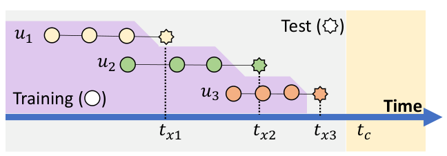
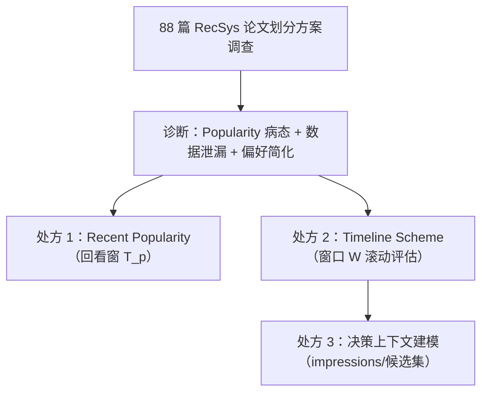

# Take a Fresh Look at Recommender Systems from an Evaluation Standpoint (从评估视角重新审视推荐系统)

- **会议/期刊**: SIGIR 2023 (Perspectives Paper Track)
- **作者与机构**: Aixin Sun (南洋理工大学 SCSE)
- **推荐链路定位**: 全链路离线评估协议（召回/精排通用，非单一环节模型）
- **研究方向**: 去偏公平、可信隐私与工业架构 / 序列与会话推荐
- **论文原文**: [论文原文链接](https://arxiv.org/abs/2210.04149v2)
- **开源代码**: 暂未开源

## TL;DR (1分钟核心速览)

本文是一篇立场/观点论文（Perspectives），不提出新模型，而是质疑"指标怎么算"这一被忽视的前置问题：主流离线评估在 `Random Split` 与 `Leave-One-Out` 下不维护全局时间线，导致 (1) Popularity 基线被"强制"用全训练集频次构造静态榜单而严重病态（按真实世界近期窗口定义可获 ≥70% 相对提升），(2) 模型在测试时刻 $t_c$ 之前即可见未来交互，构成数据泄漏。作者提出 **Recent Popularity** 与 **Timeline Scheme（时间窗滚动评测）** 两套方案，并以 RecSys 2020–2022 的 88 篇论文做实证调查：59.1% 的论文评测缺失全局时间线。

## Background & Motivation (背景与核心矛盾)

- **主流范式**: 学术离线评测几乎默认"固定训练集 + 固定测试集"的批式范式，对应 Gunawardana 等总结的 5 种设置中的 Setting 4（`Leave-One-Out`）与 Setting 5（`Random Split`）。
- **前人局限**: 近期多篇实证研究给出反直觉结论——交互**更多**、停留**更久**的用户反而获得**更差**推荐（BPR/NeuMF/LightGCN/SASRec 在 ML-25M、Yelp、Amazon 上一致复现）；且"只用数据集的近期部分"即可显著提升性能。这两个现象无法用现有建模范式解释。
- **核心洞察 (Key Insight)**: 反直觉现象的共同根源是评估缺失**全局时间线**。真实流行度具备强**时效性（transience）**（纽约时报周榜、Amazon 小时榜），而学术榜单由训练集全时段频次一次性静态算出；同时 LOO 让 $t_{x1}$ 时刻的测试实例"看到"了发生于其后的交互（图 3）。
- **本文切入点**: 将"时间"从模型特征提升为**评估协议的一等公民**，并把用户-物品交互重新理解为三维空间（user, item, time）中的"决策结果"而非孤立的偏好标签。

<figure class="paper-figure" markdown="span">
  <figcaption>图 3：留一划分下的训练/测试。</figcaption>
</figure>

## Method (核心方法设计)

### 1. 整体框架 (Overall Architecture)

论文的"方法"是两层评估/建模提案：先诊断（案例调查支撑）后开方。诊断链条为 88 篇 RecSys 论文的划分方案统计 → Popularity 病态分析 → 数据泄漏证明 → 用户偏好建模被过度简化。处方链条为：把交互按时间戳排序后切成等长窗口，逐窗评估并使模型只能消费当前窗口及之前的训练/测试实例；配套地把 Popularity 重构为可配置回看时长 $T_p$ 的 Recent Popularity。最后提出以**决策上下文**（impressions / 候选集 / 时间邻近度）替代单纯的交互结果来刻画用户偏好。

### 2. 关键设计拆解 (Key Designs)

1. **Recent Popularity（可配置时效的流行度基线）**：痛点是被迫用全训练集频次算出的静态榜单丢失了时效性；本文改为在测试时刻 $t$之前长度为$T_p$的窗口内计数，$\mathrm{pop}_{T_p}(i,t)=\sum_{(u,i,t')\in\mathcal{D}}\mathbb{I}\left[t-T_p<t'\le t\right]$，其中$T_p$ 可取 1 小时/1 天/1 月/全历史，成为超参。直觉：真实系统的榜单按时段刷新，静态榜单既不公平也不可比。

2. **Timeline Scheme（窗口滚动评估）**：测试实例固定后，把训练+测试交互按时间戳排序切成窗口 $W_1,\dots,W_N$，评估$W_{n+2}$时模型只允许使用$W_{n+2}$内的训练实例及$W_{n+2}$之前所有窗口的训练与测试实例，即允许学习集合为$\mathcal{D}_{<W_{n+2}}$。该方案位于原 5 设置中的 Setting 2 与 Setting 3 之间：泄漏量由窗口宽度$W$控制（$W$越小泄漏越少），评估代价由窗口数$N$决定；当$W$ 覆盖全域时等价于当前主流离线评测。**重定义"公平比较"**：公平 = 两个模型可访问**同一训练集**，但用多少、怎么用（近期多少窗口）是模型自身的超参，而不是强制所有模型吃下全量历史。

3. **决策上下文建模与训练/推理成本**：同一物品在手机发布首日与停产前夕被购买，其候选替代品与流行度截然不同，仅凭"交互相同"判定偏好相似是被简化的根源。可行的代用信号有三种：impressions 列表（ContentWise Impressions、MIND、FINN.No Slates）、match 阶段候选集相似度（比最终排序结果更少受特定排序器影响）、以及"短时间窗内决策上下文近似不变"假设下用时间间隔函数做衰减。此路线无需新增损失函数即可嵌入现有 CFR/序列模型；代价是需要带时间戳且带曝光的数据集，且时间窗评估将导致模型需按窗口重复训练/更新。

## Experimental Setup & Evaluation Protocol (实验设置与评估协议)

- **"数据集"实为文献语料**: 统计 ACM RecSys 2020–2022 全部 full/industry 论文，剔除系统类（训练效率/分布式/联邦）、用户研究类、冷启动专用 2 篇、按新闻主题划分 1 篇，最终 **88 篇**有明确实验设置描述。

| 数据划分方案 | 论文数 | 占比 | 全局时间线 | 对应 Setting |
| :--- | :---: | :---: | :---: | :---: |
| Random Split | 30 | 34.1% | 否 | Setting 5 |
| Leave-One-Out | 22 | 25.0% | 否 | Setting 4 |
| Single Time Point | 17 | 19.5% | 部分 | Setting 3 |
| Simulation-based Online | 15 | 17.0% | 是 | Setting 2 |
| Sliding Window | 4 | 4.5% | 是 | Setting 1/2 变体 |

- **数据划分与防穿越**: 核心诉求即防穿越；结论是 **59.1%** 论文（Setting 4+5）完全不维护全局时间线，仅 <20% 使用单时间点切分，17% 的 simulation-based 设置主要源于 RL/Bandit 算法需要而非评估理念。
- **排名评测协议**: 本文不涉及 Full-Ranking/Sampled Ranking 之争，指出更前置的失效点——即使协议正确，若打分所用频次统计跨越未来交互，结果仍不可比、不可复现。
- **对比基线与定量参照**: 26% 的被调查论文以 Popularity 为基线；引用 Ji 等结论：按真实世界近期窗口定义 Popularity，MovieLens 上性能可提升 **≥70%**；MovieLens-25M 覆盖 520 周、用户最后交互散布全时段（图 4），静态榜单与真实榜单严重偏离。

## Key Experimental Results (实验关键数据)

### 1. 主调查结果 (Case Study of Splitting Schemes)

| 观察维度 | 定量结果 | 含义 |
| :--- | :--- | :--- |
| 缺失全局时间线论文占比 | **59.1%** (52/88) | 离线评测并非在线过程的良好仿真 |
| 单时间点切分（无泄漏）| 19.5% (17/88) | 防穿越方案占比不足两成 |
| 使用 Popularity 作基线 | 26% | 最简基线被"病态定义"最普遍 |
| Popularity 按近期窗定义后 | **≥70%** 相对提升 | 静态频次严重低估真实基线 |
| MovieLens-25M 时间跨度 | 520 周 | 长周期数据集中时效性不可忽略 |

### 2. 时间窗方案权衡分析 (Trade-off "Ablation")

| 窗口设置 $W$ | 每窗泄漏量 | 训练/更新次数 | 在线仿真度 |
| :--- | :---: | :---: | :---: |
| $W$ = 全域（主流做法） | 最大 | 1 | 最低（Setting 5 等价） |
| $W$ = 1 月（10 年数据） | 小 | 120 | 中高 |
| 仅使用历史窗口 | 0 | 依窗口数 | 高（近 Setting 2） |
| $W$ = 单实例 | 0 | 极多 | 最高（Setting 1） |

### 3. 关键实验发现 (Key Findings)

1. **泄漏是系统性的而非个别疏漏**：59.1% 的顶会论文在长周期数据集上使用 Random/LOO 划分，意味着这些数据集中"测试时刻之后才出现的物品"被当作候选，跨论文数值本质上不可比，也解释了部分复现失败。
2. **最弱基线被最不公平地评估**：Popularity 在 26% 论文中承担"下限"角色，但其静态全历史频次定义与真实系统的小时/周榜相差一个量级，修正定义即带来 ≥70% 相对提升——说明许多论文的"显著优于 Popularity"实为定义红利。
3. **时间线缺失同时损伤建模理解**：以 MovieLens-25M 为例，用户最后交互散布于 520 周内，10 年跨度内两笔交互被建模为与同日交互等价，这正是"交互越多推荐越差""只用近期数据反而更好"两类反直觉现象的合理解释——近期交互与测试时刻的系统上下文更接近。

## Highlights & Limitations (亮点、对比与审稿批判)

- **与代表作对比 (vs. Prior Work)**: 相较于 Ji 等聚焦"时间线感知划分对排序指标的影响"与 Zhao 等的 benchmark 复现性分析，本文把结论上升为**评测哲学**：不仅问"是否切分时间"，还问"基线是否被公平定义"以及"公平比较是否等于强制同量训练数据"；与 Gunawardana 等的 5 设置分类相比，本文补上了文献分布的实证画像（88 篇）与可视化泄漏路径。
- **可迁移亮点**: ①"模型可访问同一训练集，但使用量是超参"这一公平性重定义，可直接用于近期数据训练（recency as hyperparameter）的实验设计；②用 match 阶段候选集作为决策上下文的代理信号，在缺少 impressions 的数据集上为上下文感知推荐提供了低成本替代。
- **审稿级局限批判**: ①立场论文无新模型与受控实验，"时间窗方案能否改变既有模型排序结论"被作者明确列为未解决问题，说服力依赖他文（[19][40]）；②Timeline Scheme 仍保留窗内泄漏，且引入窗口宽度 $W$、回看时长$T_p$ 两个新的可调参数，存在"用评测参数刷分"的风险；③案例统计仅覆盖单一会议三年 88 篇，且时间窗评估需按窗重复训练，在学术算力预算下的可行性与三维稀疏（冷启动普遍化）代价缺乏量化评估。

## Rating (四维评分)

- **方法创新性 (Novelty)**: ⭐⭐⭐ （无新算法，但"公平=同训练集而非同用量"与"决策上下文代理"两个概念重构具有观点级新意）
- **评估协议与实验扎实度 (Protocol & Experiments)**: ⭐⭐⭐ （88 篇文献画像清晰、泄漏路径论证严密，但缺受控实证、方案有效性依赖引用文献）
- **写作与数学规范度 (Clarity & Rigor)**: ⭐⭐⭐⭐⭐ （概念-图-设置编号一一对应，$T_p$/$W$ 权衡表述精确，几乎无冗余公式）
- **工业落地与复现价值 (Industrial & Practical Value)**: ⭐⭐⭐⭐ （直指学术与工业数据时效性错配，时间窗评测与近期数据训练可直接落地，但无开源代码）

