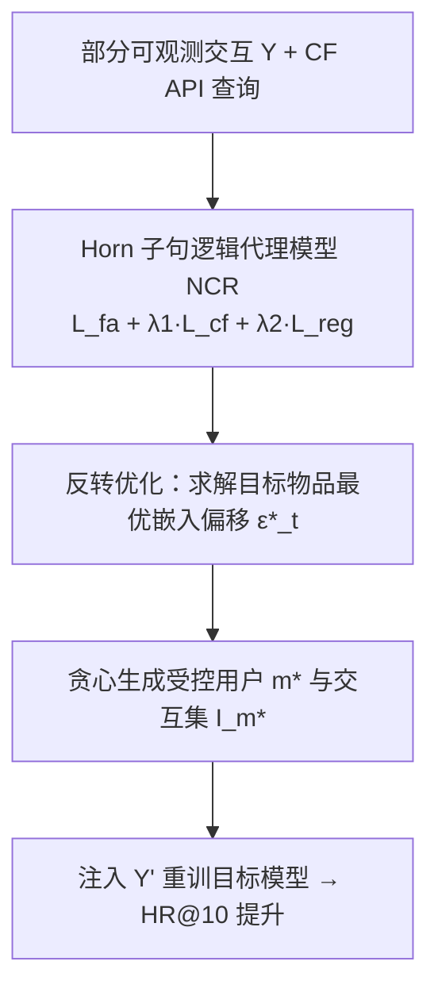
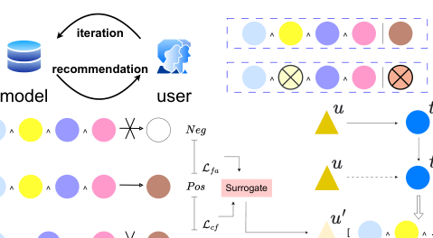
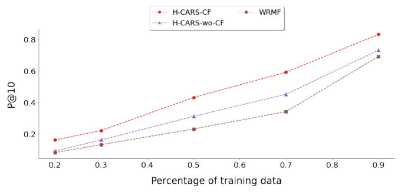

# The Dark Side of Explanations: Poisoning Recommender Systems with Counterfactual Examples (解释的暗面：利用反事实样本投毒推荐系统)

- **会议/期刊**: SIGIR 2023 (Short Paper, 5 pages)
- **作者与机构**: Ziheng Chen (Stony Brook)、Fabrizio Silvestri & Gabriele Tolomei (Sapienza University of Rome)、Jia Wang (XJTLU)、Yongfeng Zhang (Rutgers)
- **推荐链路定位**: 召回（协同过滤 Recall，训练阶段数据投毒）
- **研究方向**: 去偏公平、可信隐私与工业架构 / 可解释推荐安全
- **论文原文**: [https://arxiv.org/abs/2305.00574v1](https://arxiv.org/abs/2305.00574v1)
- **开源代码**: 暂未开源

## TL;DR (1分钟核心速览)

本文指出：为提升透明度而开放的**反事实解释 (CF) API** 恰恰泄露了推荐模型的决策边界，可被攻击者反向利用。作者提出 H-CARS，先用 CF + 事实交互联合训练一个 Horn 子句形式的神经逻辑代理模型（新增反事实损失 $\mathcal{L}_{cf}$），再**反转**传统"先造虚假交互、后看效果"的优化方向：先解出目标物品的最优嵌入偏移$\varepsilon^*_t$，再贪心构造虚假用户画像去逼近该偏移。在 Yelp 与 MovieLens-100K 上以 `HR@10×100` 度量，仅 5% 受控用户即将命中率推至 0.35（MovieLens/NCF），较 RAPU-R 提升约 21%、较 DL-Attack 提升约 52%。

## Background & Motivation (背景与核心矛盾)

- **主流范式**: 深度推荐模型黑盒化催生 XAI 需求，反事实解释（移除最小关键交互集 $\mathcal{I}^{CF}_{u,t}$使目标物品$t$掉出 top-$k$）已成为推荐解释的主流工具，且通常通过公开 API 供用户查询。
- **前人局限 (1)**: 已有工作（Aïvodji 等、DualCF、Pawelczyk 等）仅在**分类任务**上证明 CF 可被用于模型抽取与成员推理，推荐场景下的 CF 安全风险尚属空白。
- **前人局限 (2)**: 传统投毒工作（DL-Attack、RAPU-R）依赖在代理模型上反复"注入—重训—评估"，在只能观测部分交互、且训练代价高的黑盒推荐场景中代价高昂且易陷入局部解。
- **核心洞察 (Key Insight)**: CF 本身刻画了"去掉哪几条交互就会改变排序"的局部决策边界信息，因此用 CF 训练的代理模型保真度显著高于仅用事实交互的代理模型；同时 CF 天然剔除了与标签伪相关的偶然交互，起到去伪相关（denoising）的作用。
- **本文切入点**: 把 CF 当作**攻击者的信息源**而非用户的解释工具——用 CF 抽取高保真逻辑代理模型，再以"目标嵌入偏移"为桥梁反向求解虚假交互。

## Method (核心方法设计)

### 1. 整体框架 (Overall Architecture)

H-CARS 分两阶段闭环。**抽取阶段**：攻击者用公开 CF API 对部分可观测的交互矩阵 $\mathbf{Y}$生成反事实集，将每条交互$(u,j)$编码为事件向量，并用 AND/OR/NOT 神经逻辑模块把"历史交互$\Rightarrow$目标物品"写成 Horn 子句，以 BPR 事实损失 + 反事实损失 + 逻辑律正则联合训练 NCR 代理模型。**投毒阶段**：不直接求解双层优化，而是从攻击目标出发反向传播——先对目标物品求得使其逻辑表达式最趋近于"真"的最优嵌入偏移，再贪心逐个生成受控用户$m^*$及其交互集$\mathcal{I}_{m^*}$，使其逻辑子句恰好指向该偏移方向，最终把伪造画像注入目标系统重训。

<figure class="paper-figure" markdown="span">
  <figcaption>图1：我们提出的 H-CARS 投毒攻击框架。</figcaption>
</figure>

### 2. 关键设计拆解 (Key Designs)

1. **Horn 子句逻辑代理 + 反事实对比损失**：常规代理模型只学 $P(y=1\mid u,i)$的统计相关，在部分观测下会把"共现但非必要"的物品当成推荐依据，导致生成的攻击交互迁移性差。本文将交互序列写成蕴含式$\boldsymbol{c}^+_{u,x}=(\neg\boldsymbol{e}_{u,1}\vee\cdots\vee\neg\boldsymbol{e}_{u,j})\vee\boldsymbol{e}_{u,x}$，以$\mathrm{sim}(\boldsymbol{c}^+_{u,x},\mathbf{1})$作为打分；关键增量是引入 CF 子句$\boldsymbol{c}^{CF}_{u,x}=(\bigvee_{j\in\mathcal{I}_u\setminus\mathcal{I}^{CF}_{u,x}}\neg\boldsymbol{e}_{u,j})\vee\boldsymbol{e}_{u,x}$ 并施加
$$\mathcal{L}_{cf}=-\sum_{u}\sum_{x\in\mathcal{I}^+_u}\log \mathrm{sim}\big(\boldsymbol{c}^+_{u,x},\ \boldsymbol{c}^{CF}_{u,x}\big),$$
迫使"含必要交互"与"缺必要交互"两种逻辑表达在向量空间中被拉开。物理直觉：这正是对决策边界做**对比式数据增广**，把伪相关交互压到低权重，使代理模型对目标系统的高保真抽取在少量数据下仍成立。
2. **反向优化 (Reverse Optimization) 的偏移—画像生成**：直接求解双层优化 $\max\sum_t HR(t)$s.t.$\boldsymbol{\theta}^*=\arg\min_\theta \mathcal{L}_{train}(\mathbf{Y}\cup\mathbf{Y}')$ 在代理模型上不可微且维度爆炸。本文改为先求目标物品的最优扰动
$$\varepsilon^*_t=\arg\max_{\varepsilon}\ \mathrm{sim}\Big(\big(\textstyle\bigvee_{j\in\mathcal{I}_u}\neg\boldsymbol{e}_{u,j}\big)\vee\boldsymbol{e}_{u,t+\varepsilon},\ \mathbf{1}\Big),$$
把"提升命中率"转译为"把 $t$的嵌入推到$t+\varepsilon$"；随后每轮贪心构造新受控用户$m^*,\mathcal{I}_{m^*}=\arg\max_{m,\mathcal{I}_m}\mathrm{sim}(\boldsymbol{c}^+_{m,t+\varepsilon},\mathbf{1})$，即寻找在逻辑空间中"最能代言偏移后目标物品"的画像。因为只需正向推理一次代理模型即可评估候选画像，单轮开销远低于"注入—重训"的迭代搜索。
3. **训练目标、负采样与推理开销**：总损失 $\mathcal{L}=\mathcal{L}_{fa}+\lambda_1\mathcal{L}_{cf}+\lambda_2\mathcal{L}_{reg}$，其中$\mathcal{L}_{fa}$采用 BPR 成对损失，负样本为均匀随机采样的未交互物品（非硬负采样）；$\mathcal{L}_{reg}$约束逻辑模块满足逻辑律。攻击端无需梯度回传至目标模型，仅需调用 CF API 与 top-$k$ API，属于典型黑盒、部分数据可观测的威胁模型。

## Experimental Setup & Evaluation Protocol (实验设置与评估协议)

| 数据集 | #Users | #Items | #Interactions | 稀疏度/密度 | 特征/场景说明 |
| :--- | :---: | :---: | :---: | :---: | :--- |
| Yelp | 31,668 | 38,048 | 原文未报告 | 未报告 | 二值评分（隐式反馈） |
| MovieLens-100K | 943 | 1,682 | 100,000 | ≈6.3% | 评分 >4 置 1，否则 0 |

- **数据划分与防穿越**: 采用比例划分，分别报告 **80% 训练数据**与**仅 30% 训练数据**两种设定，用于模拟攻击者在数据稀缺工业场景下的能力；抽取阶段固定使用 60% 交互生成 CF。
- **排名评测协议**: 采用 `HR@10`（命中率，乘以 100 报出），即目标物品 $t\in\mathcal{T}$出现在合法用户 top-10 推荐列表中的用户比例$\mathbb{P}(\{t\in\hat{\mathcal{I}}^k_u\mid u\in\mathcal{U}\})$；基于全物品打分排序（非采样排序）。
- **攻击设定**: 采样 5 个目标物品构成 $\mathcal{T}$；受控用户上限 MovieLens 100 人、Yelp 15 人，受控比例扫描$\{0.5\%,1\%,3\%,5\%\}$；学习率 0.001；$\lambda_1=0.76,\lambda_2=10^{-4}$（MovieLens）、$\lambda_1=0.68,\lambda_2=10^{-5}$（Yelp）。
- **对比基线**: 目标模型 NCF、RCF；CF 生成方法 ACCENT（影响函数）；攻击基线 DL-Attack（双层优化注入）、RAPU-R（反向优化，同为最相关对手）、Bandwagon（流行度搭便车）。原文未报告显著性检验。

## Key Experimental Results (实验关键数据)

### 1. 主实验对比 (Main Results)

下表摘取 MovieLens（80% 训练数据，NCF/RCF）与 Yelp（30% 训练数据，NCF/RCF）在 5% 受控用户比例下的 `HR@10×100`，并给出相对最强基线的提升：

| 数据集 / 目标模型 | DL-Attack | RAPU-R | Bandwagon | **H-CARS** | Improv. (vs 最优基线) |
| :--- | :---: | :---: | :---: | :---: | :---: |
| MovieLens / NCF | 0.82 | 0.86 | 0.26 | **0.91** | +5.8% |
| MovieLens / RCF | 0.71 | 0.73 | 0.14 | **0.76** | +4.1% |
| Yelp / NCF (30%) | 0.11 | 0.12 | 0.08 | **0.16** | +33.3% |
| Yelp / RCF (30%) | 0.15 | 0.16 | 0.10 | **0.20** | +25.0% |

低受控比例区间的对比（MovieLens/NCF，80% 数据）：1% 受控用户时 H-CARS 0.42 vs RAPU-R 0.38 vs DL-Attack 0.39；MovieLens/NCF（30% 数据）1% 受控用户时 H-CARS 0.18 vs 基线 0.14，相对提升 28.6%。

### 2. 消融实验 (Ablation Study)

原文在 MovieLens + NCF 上以代理模型的 $P@10$ 比较三种代理，结果仅以图 2 曲线给出（未报告绝对数值），此处如实记录趋势：

| 代理模型变体 | 是否用 CF | $P@10$ 趋势 | 说明 |
| :--- | :---: | :---: | :--- |
| WRMF | ✗ | 最低 | 传统 MF 代理，无逻辑推理能力 |
| H-CARS-wo-CF | ✗ | 中 | 仅事实交互训练 NCR |
| **H-CARS-CF** | ✓ | **最高** | $\mathcal{L}_{cf}$ 引入 CF 对比信号 |

<figure class="paper-figure" markdown="span">
  <figcaption>图2：CFs 对代理模型的影响。</figcaption>
</figure>

### 3. 关键实验发现 (Key Findings)

1. **CF 是代理模型保真度的关键放大器**：H-CARS-CF 的 $P@10$ 全程高于 H-CARS-wo-CF 与 WRMF，且**差距随训练数据增多而扩大**，说明 CF 与事实交互在数据增广上是互补而非替代关系，直接解释了投毒阶段为何能精准迁移到黑盒目标模型。
2. **数据越稀缺，CF 的相对优势越大**：在仅 30% 训练数据时，H-CARS 相对 RAPU-R 在 Yelp/NCF 上提升 33.3%、Yelp/RCF 上提升 25.0%，远高于 80% 数据下的 4–6%；原因是朴素反向优化在稀疏监督下难以定位偏移方向，而 CF 提供的边界信号起到了"稀疏补偿"作用。
3. **受控比例上升时优势被放大而非收敛**：受控用户比例由 0.5% 增至 5%，H-CARS 与 RAPU-R 的差距在 MovieLens 上从 0.05 拉大到 0.05–0.06（绝对值），Yelp/NCF 上从 0.01 拉大到 0.04；说明本文生成的虚假画像彼此方向一致（共同指向同一 $\varepsilon^*_t$），具备可叠加性，而 DL-Attack/RAPU-R 的画像方向噪声较大。

## Highlights & Limitations (亮点、对比与审稿批判)

- **与代表作对比 (vs. Prior Work)**: 相较 DL-Attack 的双层优化"注入—重训"范式与 RAPU-R 的纯反向优化，H-CARS 的本质差异在于**代理模型的构造方式**：前两者只用事实交互拟合黑盒，本文额外消费 CF API 提供的决策边界信息，并把逻辑推理（Horn 子句）作为归纳偏置，因此生成的不是"高分共现物品堆砌"，而是逻辑上"必要"的交互组合。与 CF 安全领域前人工作（DualCF、Pawelczyk 等）相比，本文首次把威胁从分类任务的隐私泄露扩展到推荐任务的**训练数据投毒**。
- **可迁移亮点**: (1) 用反事实样本构造对比损失 $\mathcal{L}_{cf}$ 来抑制伪相关，这一"解释即增广"的思路可直接迁移到可解释推荐的鲁棒训练与去噪召回；(2) "先解目标嵌入偏移、再反解输入画像"的反向优化链路，可迁移到冷启动物品扶持、物品侧流量调控等需要"制造可迁移干预样本"的场景。
- **审稿级局限批判**: (1) **评估规模偏小且缺乏显著性检验**——仅 2 个数据集、5 个目标物品、单次运行，HR@10 的绝对差异常在 0.01–0.05 量级，未给出方差或 $p$值，Yelp 上 0.5%–1% 区间的优势（0.26 vs 0.25）几乎不可区分于噪声；(2) **威胁模型假设偏理想**——同时要求存在 CF 解释 API 与 top-$k$查询 API、且假设可获取 60% 交互用于 CF 生成，真实工业系统通常对解释接口限流并对新用户画像做审核，论文也未提供任何防御基线（如注入检测、鲁棒训练、CF API 加噪）来量化攻击成本；(3) 消融仅以曲线示意，缺少对$\lambda_1$ 及受控用户数上限的敏感性分析。

## Rating (四维评分)

- **方法创新性 (Novelty)**: ⭐⭐⭐⭐ （首次将 CF 安全风险从分类迁移到推荐投毒，Horn 子句代理 + 反事实对比损失 + 反向优化的组合有清晰的新意，但各组件均借自 NCR/RAPU-R 已有框架）
- **评估协议与实验扎实度 (Protocol & Experiments)**: ⭐⭐ （仅 2 个数据集、5 个目标物品、无显著性检验与置信区间，消融只有趋势图，防御侧完全缺位）
- **写作与数学规范度 (Clarity & Rigor)**: ⭐⭐⭐ （Horn 子句与偏移—画像生成的推导链条清晰，但式 (12)(13) 符号存在笔误/排版错误，$\mathcal{I}_u\setminus\mathcal{I}^{CF}_{u,x}$ 与式 (7) 的集合定义在正文中略有混用）
- **工业落地与复现价值 (Industrial & Practical Value)**: ⭐⭐⭐ （无需目标模型内部梯度、仅依赖公开 API，攻击成本低、威胁现实性强，对解释接口的限流/加噪设计有直接指导意义；但未开源、且未给出防御方案与在线延迟分析）

