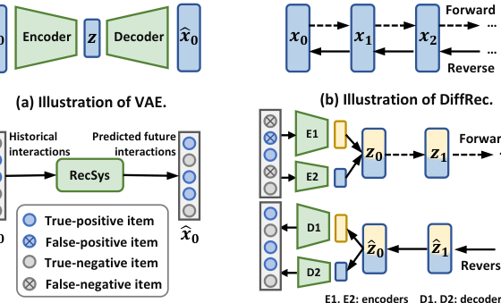
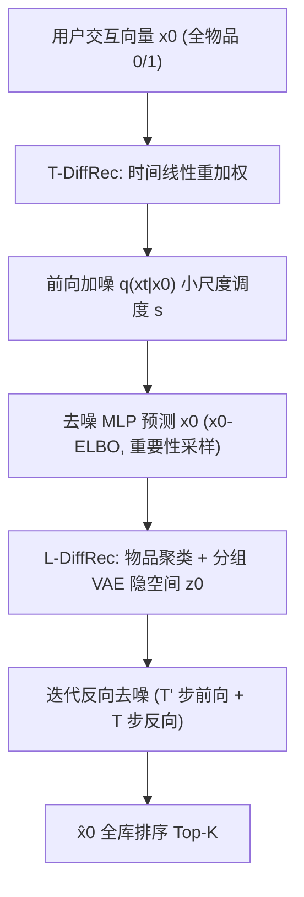
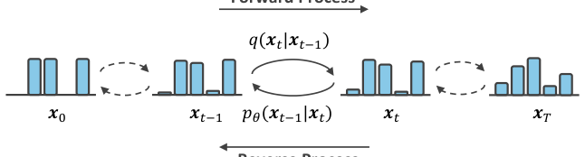

# Diffusion Recommender Model (扩散推荐模型)

- **会议/期刊**: SIGIR 2023
- **作者与机构**: Wenjie Wang, Yiyan Xu, Fuli Feng, Xinyu Lin, Xiangnan He, Tat-Seng Chua（新加坡国立大学 / 中国科学技术大学）
- **推荐链路定位**: 端到端生成式（对全物品交互向量一次性生成概率并排序）
- **研究方向**: 生成式推荐与离散语义 ID / 协同过滤
- **论文原文**: [https://arxiv.org/abs/2304.04971v3](https://arxiv.org/abs/2304.04971v3)
- **开源代码**: [https://github.com/YiyanXu/DiffRec](https://github.com/YiyanXu/DiffRec)

## TL;DR (1分钟核心速览)

本文针对 GAN 训练不稳定、VAE 在「后验可解性 vs. 表征能力」间被迫折衷（导致含假阳性噪声的隐式反馈建模不准）的痛点，提出 DiffRec：把用户的全物品交互向量当作图像去噪，用多步高斯前向加噪 + 迭代反向重建预测 $\hat{\boldsymbol{x}}_0$。为避免破坏个性化，噪声尺度$s$被压到$10^{-4}$级且推理只用$T' \le T/4$（甚至$T'=0$）步。在 Amazon-book/Yelp/ML-1M 三数据集、7:2:1 时间切分 + **Full-Ranking** 协议下，Clean 训练 R@10 相对最优基线提升 10.67%/2.47%/4.86%，且 L-DiffRec 省 56% 参数、25% 显存。

## Background & Motivation (背景与核心矛盾)

- **主流范式**: 生成式推荐分为 GAN 系（对抗训练估计交互概率）与 VAE 系（MultiVAE/MultiDAE 用编码器逼近隐变量后验、解码全物品多分类似然）。
- **前人局限**: ① GAN 对抗训练不稳定，推荐精度常不如下述 AE 系；② VAE 受「可解性与表征力折衷」限制——简单编码器抓不住异构偏好，复杂编码器后验不可解；③ 现有扩散推荐 CODIGEM 用多套 AE 逐步加噪，推理却只用第一个 AE，等价于一个小噪声尺度的 MultiDAE，性能反而更差。
- **核心洞察 (Key Insight)**: 推荐任务本身与扩散模型目标天然同构——推荐正是"从被污染的历史交互（假阳性/假阴性）推断未来交互"。因此无需像图像合成那样扩散至纯高斯噪声，**保留部分个性化信号**即可，且应直接预测 $\boldsymbol{x}_0$而非噪声$\boldsymbol{\epsilon}$。
- **本文切入点**: 用小尺度噪声调度 + 少步推理把 DM 改造成推荐器，并对大规模物品预测、偏好时序漂移两个工程痛点各给一个扩展。

<figure class="paper-figure" markdown="span">
  <figcaption>图1：VAE、DiffRec、推荐系统目标与L-DiffRec的示意图。</figcaption>
</figure>

## Method (核心方法设计)

### 1. 整体框架 (Overall Architecture)

输入用户 $u$的二元交互向量$\boldsymbol{x}_0=\boldsymbol{x}_u \in \{0,1\}^{|\mathcal{I}|}$。训练时随机采样步$t$，按闭式重参数化$\boldsymbol{x}_t=\sqrt{\bar{\alpha}_t}\boldsymbol{x}_0+\sqrt{1-\bar{\alpha}_t}\boldsymbol{\epsilon}$一次性得到损坏交互，送入共享 MLP（拼接步嵌入）预测$\hat{\boldsymbol{x}}_0$，最小化各步去噪匹配损失。推理时先对$\boldsymbol{x}_0$前向加噪$T'$步得$\hat{\boldsymbol{x}}_T$，再沿$t=T\to1$迭代确定性去噪（取$\boldsymbol{\mu}_\theta$、忽略方差，仿 MultiVAE），最终以$\hat{\boldsymbol{x}}_0$ 对未交互物品排序出 Top-K。L-DiffRec 把扩散搬到聚类隐空间，T-DiffRec 则在输入处施加时间权重。

<figure class="paper-figure" markdown="span">
  <figcaption>图2：DiffRec概览，其中直方图表示某用户在所有物品上的损坏交互。前向过程通过转移步骤 𝑞(𝒙𝑡|𝒙𝑡−1) 逐步损坏用户的交互历史，随后模型学习使用 𝑝𝜃(𝒙𝑡−1|𝒙𝑡) 逐步恢复 𝒙0。</figcaption>
</figure>

### 2. 关键设计拆解 (Key Designs)

1. **小噪声调度 + $\boldsymbol{x}_0$-ELBO（保留个性化的核心）**：图像扩散把$\boldsymbol{x}_T$推向标准高斯，会抹掉用户偏好。本文把线性调度写为$1-\bar{\alpha}_t=s\cdot[\alpha_{\min}+\frac{t-1}{T-1}(\alpha_{\max}-\alpha_{\min})]$并取极小$s$（如$10^{-4}$），使$\boldsymbol{x}_T$仍含个性化信息；同时用贝叶斯展开后的$\boldsymbol{x}_0$ 预测损失
   $\mathcal{L}_t=\mathbb{E}_{q(\boldsymbol{x}_t|\boldsymbol{x}_0)}\big[\tfrac{1}{2}\big(\tfrac{\bar{\alpha}_{t-1}}{1-\bar{\alpha}_{t-1}}-\tfrac{\bar{\alpha}_t}{1-\bar{\alpha}_t}\big)\|\hat{\boldsymbol{x}}_\theta(\boldsymbol{x}_t,t)-\boldsymbol{x}_0\|_2^2\big]$替代$\boldsymbol{\epsilon}$-ELBO。直觉：推荐的目标本就是输出$\hat{\boldsymbol{x}}_0$排序，而随机噪声$\boldsymbol{\epsilon}$对稀疏交互下的 MLP 近乎不可学（表 5 显示$\boldsymbol{\epsilon}$-ELBO 直接崩到 0.0157）。
2. **L-DiffRec 隐空间扩散（降本）**：全物品维度扩散参数随 $|\mathcal{I}|$爆炸。先用 LightGCN 物品表征做 k-means 聚$C$类，把$\boldsymbol{x}_0$切成$\{\boldsymbol{x}_0^c\}_{c=1}^C$，每组一个独立 VAE 压成低维$\boldsymbol{z}_0^c$（均值方差$\boldsymbol{\mu}_{\phi_c},\boldsymbol{\sigma}^2_{\phi_c}\boldsymbol{I}$），拼接后在$\boldsymbol{z}_0$上做扩散，再由分组解码器还原$\hat{\boldsymbol{x}}_0$。分组打断全连接既省参数又支持并行；总损失为 VAE 项与扩散项加权$\mathcal{L}_v+\lambda\mathcal{L}(\boldsymbol{z}_0,\theta)$。
3. **T-DiffRec 时间重加权 + 训练/推理效率**：对长 $M$的交互序列按时间线性赋权$w_m=w_{\min}+\frac{m-1}{M-1}(w_{\max}-w_{\min})$（$w_{\max}=1$），构造$\bar{\boldsymbol{x}}_0=\boldsymbol{x}_0\odot\bar{\boldsymbol{w}}$后直接喂回 DiffRec，无需引入 RNN/Transformer。总目标为$\sum_{t=1}^{T}\mathcal{L}_t$的期望，**无负采样**（全物品多分类似然）；步采样默认$t\sim\mathcal{U}(1,T)$，可换成重要性采样$\mathcal{L}_\triangle=\mathbb{E}_{t\sim p_t}[\mathcal{L}_t/p_t]$，$p_t\propto\sqrt{\mathbb{E}[\mathcal{L}_t^2]}$，把优化重心压到高损失的"难步"。推理开销为$T$次 MLP 前传（默认$T=5$），远低于逐物品打分的检索范式。

## Experimental Setup & Evaluation Protocol (实验设置与评估协议)

- **数据集与预处理**（Clean 设置下丢弃 rating $<4$，噪声设置则把$<4$ 的交互作为自然假阳性加回，物品集随之扩张）：

| 数据集 | #Users | #Items (Clean/Noisy) | #Interactions (Clean/Noisy) | 密度 | 特征/场景说明 |
| :--- | :---: | :---: | :---: | :---: | :--- |
| Amazon-book | 108,822 | 94,949 / 178,181 | 3,146,256 / 3,145,223 | 0.032% | 图书评论，极稀疏长尾 |
| Yelp | 54,574 | 34,395 / 77,405 | 1,402,736 / 1,471,675 | 0.075% | 本地商户评论 |
| ML-1M | 5,949 | 2,810 / 3,494 | 571,531 / 618,297 | 3.42% | 电影评分，稠密 |

- **数据划分与防穿越 (Splitting Strategy)**: 先按时间戳全局排序，再 `7:2:1` 比例切分为 train/valid/test（时间序切分，杜绝未来交互泄漏）；噪声设置保持 test 不变、仅污染 train/valid；时序设置额外使用时间戳。
- **排名评测协议 (Ranking Protocol)**: 无偏 `Full-Ranking`——对每个用户在所有未交互物品上排序，报告 Recall@{10,20} 与 NDCG@{10,20}，不使用采样负例。
- **对比基线与超参设置**: 对比 MF、LightGCN、CDAE、MultiDAE、自建 MultiDAE++（与 DiffRec 同噪声但单步解码）、MultiVAE、CODIGEM、ACVAE（时序）。步嵌入 10 维，MLP 隐层搜 {[300],[200,600],[1000]}，$T\in\{2,5,10,40,50,100\}$，$T'\in\{0,T/4,T/2\}$，$s\in[10^{-5},0.5]$，$\alpha_{\max}\in\{5e{-3},1e{-2},2e{-2}\}$；以 valid R@20 选参，单样本 t 检验$p<0.05$ 标 `*`。

## Key Experimental Results (实验关键数据)

### 1. 主实验对比 (Main Results)

Clean 训练（Amazon-book / Yelp / ML-1M）：

| 方法 | A-book R@10 | A-book R@20 | A-book N@20 | Yelp R@10 | Yelp N@20 | ML-1M R@10 | ML-1M N@20 |
| :--- | :---: | :---: | :---: | :---: | :---: | :---: | :---: |
| MF | 0.0437 | 0.0689 | 0.0339 | 0.0341 | 0.0276 | 0.0876 | 0.0966 |
| LightGCN | 0.0534 | 0.0822 | 0.0411 | 0.0540 | 0.0436 | 0.0987 | 0.1083 |
| MultiDAE | 0.0571 | 0.0855 | 0.0442 | 0.0522 | 0.0419 | 0.0995 | 0.1067 |
| MultiDAE++ | 0.0580 | 0.0864 | 0.0448 | 0.0544 | 0.0438 | 0.1009 | 0.1079 |
| MultiVAE | 0.0628 | 0.0935 | 0.0485 | 0.0567 | 0.0458 | 0.1007 | 0.1076 |
| CODIGEM | 0.0300 | 0.0478 | 0.0245 | 0.0470 | 0.0385 | 0.0972 | 0.1087 |
| **DiffRec** | **0.0695\*** | **0.1010\*** | **0.0547\*** | **0.0581\*** | **0.0478\*** | **0.1058\*** | **0.1148\*** |
| Improv.% | +10.67% | +8.02% | +12.78% | +2.47% | +4.37% | +4.86% | +6.69% |

### 2. 消融实验 (Ablation Study)

| 变体 | 关键改动 | R@10 | R@20 | N@20 | 资源 |
| :--- | :--- | :---: | :---: | :---: | :---: |
| DiffRec (ML-1M) | $\boldsymbol{x}_0$-ELBO 全量 | **0.1058** | **0.1787** | **0.1148** | 4M / 495MB |
| 替换 $\boldsymbol{\epsilon}$-ELBO | 改为预测噪声 | 0.0157 | 0.0266 | 0.0204 | — |
| L-DiffRec (C=2, A-book) | 隐空间扩散 | 0.0694 | **0.1028** | 0.0540 | **75M / 3077MB** |
| DiffRec (A-book) | 原始空间 | 0.0695 | 0.1010 | 0.0547 | 190M / 5049MB |
| MultiVAE (A-book) | VAE 基线 | 0.0628 | 0.0935 | 0.0485 | 114M / 3711MB |
| T-DiffRec (A-book) | 时间重加权 | 0.0819 | 0.1139 | 0.0661 | 190M |
| LT-DiffRec (A-book) | 时间+隐空间 | **0.0838** | **0.1188** | **0.0665** | 75M / 3077MB |
| ACVAE (A-book) | 时序 SOTA 基线 | 0.0770 | 0.1107 | 0.0647 | 13M / 37,711MB |

### 3. 关键实验发现 (Key Findings)

1. **去噪训练 = 隐式鲁棒性**：自然噪声设置下 DiffRec（A-book R@10 0.0546、N@10 0.0335）同时超过 MultiVAE（0.0536/0.0316）与 LightGCN（0.0400/0.0231）；LightGCN 的 R@20 从 Clean 的 0.0822 崩到 0.0659（−20%），说明高阶图传播会放大假阳性噪声，而逐步去噪相当于对噪声做多尺度平滑。
2. **噪声尺度是双刃剑**：$s=0$（退化为普通 AE）性能劣于小幅加噪，但$s$增大到$10^{-1}$级则明显掉点（图 6）；$T'>0$反而更差，最优为$T'=0$——因为真实交互本身已含噪，推理再破坏一次会伤个性化，这与图像扩散"必须从纯噪声起步"的常识相反。
3. **隐空间压缩近乎无损且更抗噪**：L-DiffRec 仅用 DiffRec 37.6% 参数与 75.4% 显存即取得相当甚至更优精度；在噪声训练下反而全面超越 DiffRec（A-book R@10 0.0586 vs 0.0546，+7.3%），原因是被聚到小类中的稀疏高频假阳性在表征压缩时被削弱。时间维度上，LT-DiffRec 以 ACVAE 1/12 的显存取得 A-book R@20 0.1188 vs 0.1107 的优势。

## Highlights & Limitations (亮点、对比与审稿批判)

- **与代表作对比 (vs. Prior Work)**: 相较 MultiVAE 的单步变分解码，DiffRec 用共享 MLP 做多步去噪、以更简单的可解前向换取更强表征力；相较 CODIGEM 的多套 AE + 仅用首个 AE 推理，本文共享网络且推理全程迭代；相较 T-DiffRec 对标 ACVAE 的对比学习+对抗训练，本文只用线性重加权即超越，且显存低一个量级。
- **可迁移亮点**: ① "小噪声 + $T'=0$ 起步"的调度技巧可迁到任何非图像域（交互/序列/图结构）扩散；② 用 k-means + 分组 VAE 把高维 one-hot 扩散压到 300 维隐空间，是把生成式推荐推向工业规模的通用降本套路。
- **审稿级局限批判**: ① 推理需 $T$次全连接前传（默认 5），全库打分下延迟仍高于 LightGCN 的单次内积，论文未报时延/吞吐；② 噪声尺度$s$、$\alpha_{\max}$、$T'$三者强耦合且需细网格搜索，超参敏感度高，论文对$\boldsymbol{\epsilon}$-ELBO 失效仅给"MLP 难学随机噪声"的经验解释，缺乏理论刻画；③ 只在 3 个中小规模数据集验证，未与 SASRec/扩散语义 ID 类生成式检索做端到端对比。

## Rating (四维评分)

- **方法创新性 (Novelty)**: ⭐⭐⭐⭐⭐ （首次把 DM 正式移植到全物品交互生成，且指出推荐域必须"减噪 + 预测 $x_0$"的两条反直觉修正）
- **评估协议与实验扎实度 (Protocol & Experiments)**: ⭐⭐⭐⭐ （三数据集 × clean/noisy/temporal 三套设置 + Full-Ranking + 显著性检验完备，但缺少效率与大规模工业验证）
- **写作与数学规范度 (Clarity & Rigor)**: ⭐⭐⭐⭐ （ELBO 推导与调度/重要性采样公式清晰，对 $x_0$-ELBO 优于$\epsilon$-ELBO 的解释偏经验化）
- **工业落地与复现价值 (Industrial & Practical Value)**: ⭐⭐⭐⭐ （代码开源，L-DiffRec 将参数与显存降 50%+，但多步推理延迟与超参调优成本仍是上线门槛）

