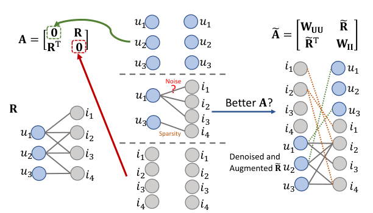
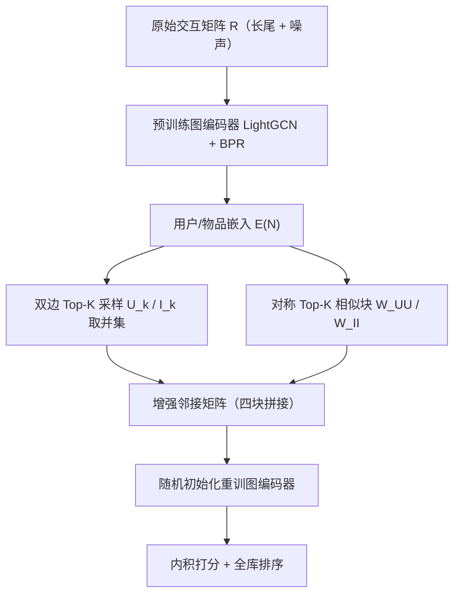
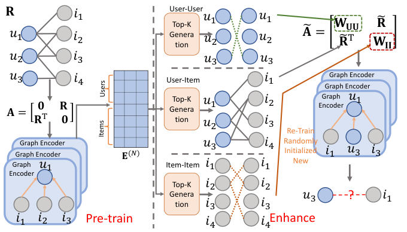

# Graph Collaborative Signals Denoising and Augmentation for Recommendation (面向推荐的图协同信号去噪与增广)

- **会议/期刊**: SIGIR 2023 (Short Paper, 6 pages)
- **作者与机构**: Ziwei Fan, Ke Xu, Philip S. Yu (University of Illinois Chicago); Zhang Dong (Amazon Ads); Hao Peng (Beihang University); Jiawei Zhang (UC Davis)
- **推荐链路定位**: 召回（图协同过滤表征学习）
- **研究方向**: 图神经网络与知识图谱推荐 / 自监督对比学习与交互去噪
- **论文原文**: [https://arxiv.org/abs/2304.03344v2](https://arxiv.org/abs/2304.03344v2)
- **开源代码**: [https://github.com/zfan20/GraphDA](https://github.com/zfan20/GraphDA)

## TL;DR (1分钟核心速览)

本文指出图协同过滤（GCF）的性能瓶颈不在卷积层数，而在**二部邻接矩阵本身的定义**：它让高度活跃用户被大量噪声边淹没、让稀疏用户邻域严重不足，且丢失了用户-用户/物品-物品的直接相似性。作者提出 GraphDA 两阶段流水线：先用 LightGCN 预训练得到嵌入，再以**双边 Top-K 采样**重连用户-物品矩阵（活跃用户被截断去噪、稀疏用户被补边增广），并在邻接矩阵两个全零对角块填入对称的 `$\mathbf{W}_{UU}$` / `$\mathbf{W}_{II}$` 相似块后从随机初始化重训。在 Amazon 四个类目、5-core 过滤 + Leave-One-Out + **全库排序**协议下，NDCG@20 相对最强基线 LightGCN 提升 **6.9%–13.4%**。

## Background & Motivation (背景与核心矛盾)

- **主流范式**: GCF 以 `$\mathbf{A} = \begin{bmatrix} \mathbf{0} & \mathbf{R} \\ \mathbf{R}^{\top} & \mathbf{0} \end{bmatrix}$` 为邻域定义，堆叠$N$ 层归一化拉普拉斯传播聚合高阶协同信号（NGCF / LightGCN / GTN / UltraGCN）。
- **前人局限①（噪声）**: 活跃用户交互过多，其邻域边质量参差，堆叠层数越多噪声越被放大；作者在 Amazon Beauty 上复现出反直觉现象——交互量最大的用户桶 NDCG@5 反而低于中等活跃用户桶（图 1）。
- **前人局限②（稀疏与结构缺失）**: 长尾用户/物品邻域几乎为空；同时 `$\mathbf{A}$` 的两个对角块恒为零，用户-用户、物品-物品相关性只能靠多跳消息传递间接、远距离地"兜圈"获得，而长距离传播本身会引入新的学习问题（过平滑）。
- **核心洞察 (Key Insight)**: 图上的"度数分布"就是隐式的采样策略——与其改进传播算子，不如**直接把邻接矩阵改造成度数受控的稀疏图**：给所有节点统一 Top-K 度数，就同时完成了对活跃节点的去噪和对稀疏节点的增广。
- **本文切入点**: 用预训练嵌入作为"相似度裁判"，一次性重连 $\tilde{\mathbf{R}}$、$\mathbf{W}_{UU}$、$\mathbf{W}_{II}$ 三块子图，再重训编码器。

<figure class="paper-figure" markdown="span">
  <figcaption>图2：含一个玩具示例的动机示意图。A 和 R 分别是基于图的推荐中的二部邻接矩阵与用户-物品交互矩阵。</figcaption>
</figure>

## Method (核心方法设计)

### 1. 整体框架 (Overall Architecture)

GraphDA 是"预训练 → 图重构 → 重训练"的两阶段框架。第一阶段用 $N$层 LightGCN 在原始 `$\mathbf{A}$` 上以 BPR 损失训练一个图编码器，只取其输出的用户/物品嵌入 `$\mathbf{E}^{(N)}$` 作为结构先验；第二阶段以该嵌入为依据做三件事：对每个用户取 Top-$U_k$物品、对每个物品取 Top-$I_k$用户并取并集得$\tilde{\mathbf{R}}$；对每个用户/物品取 Top-$UU_k$/$II_k$相似邻居得对称的 `$\mathbf{W}_{UU}$`、`$\mathbf{W}_{II}$`；拼成 `$\tilde{\mathbf{A}} = \begin{bmatrix} \mathbf{W}_{UU} & \tilde{\mathbf{R}} \\ \tilde{\mathbf{R}}^{\top} & \mathbf{W}_{II} \end{bmatrix}$` 后**从随机初始化重训**同一结构的编码器，最终以内积在全库上排序。注意预训练嵌入本身不被复用为初始化，避免把旧图的噪声"继承"下来。

<figure class="paper-figure" markdown="span">
  <figcaption>图3：GraphDA 的工作流程图。GraphDA 包括两个步骤：1. 预训练步骤推断用户/物品嵌入；2. 利用嵌入为用户-物品组件、用户-用户组件和物品-物品组件生成 top-K 邻居，增强邻接矩阵用于重新训练图编码器。</figcaption>
</figure>

### 2. 关键设计拆解 (Key Designs)

1. **双边 Top-K 用户-物品重连（Denoise + Augment 一体化）**：解决"活跃者噪声多、稀疏者边太少"的双向失配。对用户 $u$直接在其全部物品打分上取前$U_k$个（而非仅在其已交互集合内筛选），物品侧同理取前$I_k$ 个用户，两侧结果取并集：

$$\tilde{\mathbf{R}}[u,i]=1 \iff i \in \operatorname{TopK}_{U_k}\big(\mathbf{e}_u^{\top}\mathbf{E}^{(N)}_{I}\big) \ \cup\ u \in \operatorname{TopK}_{I_k}\big(\mathbf{e}_i^{\top}\mathbf{E}^{(N)}_{U}\big)$$

   物理直觉：把每个节点的出度**钳位到常数**，等价于对长尾度分布做自适应截断 + 自适应补全；并集操作保证召回侧（用户视角）与推荐侧（物品视角）的语义都被保留，且重连后矩阵密度显著低于原始 `$\mathbf{R}$`，传播更省算力。

2. **对称用户-用户 / 物品-物品相关块**：解决"对角块恒零、直接相似性被浪费"。以 `$\mathbf{W}_{UU}[u,u_k]=1$` 标记$u_k \in \operatorname{TopK}_{UU_k}(\mathbf{e}_u^{\top}\mathbf{E}^{(N)}_{U})$，`$\mathbf{W}_{II}$` 同构，并**强制对称化**以保证无向图上的拉普拉斯归一化合法。这样相似用户/相似物品之间的信号只需 1 跳即可对齐，无需依赖多跳迂回，直接绕开过平滑；实验显示很小的$UU_k$、$II_k$（如 3）就已够用。

3. **训练目标、负采样与推理开销**：预训练与重训均用标准 BPR，训练期**仅采 1 个均匀负样本**：

$$\mathcal{L}=-\sum_{(u,i^{+},i^{-})}\log\sigma\big(\mathbf{e}_u^{\top}\mathbf{e}_{i^{+}}-\mathbf{e}_u^{\top}\mathbf{e}_{i^{-}}\big)$$

   推理为纯内积，与 LightGCN 同量级；额外开销只有一次离线预训练 + 一次全库 Top-K 排序（$O(|\mathcal{U}||\mathcal{I}|d)$ 的一次性成本），在线阶段零增量。

## Experimental Setup & Evaluation Protocol (实验设置与评估协议)

- **数据集与预处理**: Amazon Reviews 四个类目，沿用 5-core 过滤，把"有评论"统一视作隐式正反馈：

| 数据集 | #Users | #Items | #Interactions | 密度 | 说明 |
| :--- | :---: | :---: | :---: | :---: | :--- |
| Beauty | 22,363 | 12,101 | 198,502 | 0.05% | 长尾最重 |
| Toys | 19,412 | 11,924 | 167,597 | 0.07% | 中等稀疏 |
| Tools | 16,638 | 10,217 | 134,476 | 0.08% | 原文称噪声较多 |
| Office | — | — | — | — | 仅出现在主实验表，统计量原文未给 |

- **数据划分与防穿越**: 按用户交互时间戳排序后 `Leave-One-Out`——最后一条测试、倒数第二条验证，其余训练。
- **排名评测协议**: 无偏 `Full-Ranking`（对全部未交互物品排序，杜绝采样负例带来的乐观偏差），报告 HR@10/20 与 NDCG@10/20；⚠️ 正文文字写作 Recall@N，表格列头写作 H@N，实为同一 hit-ratio 指标。
- **对比基线与超参**: 基线为 NGCF、UltraGCN、GTN、LightGCN，外加本文弱化版 Enhanced-UI（仅重连 $\tilde{\mathbf{R}}$）。统一$d=128$、学习率 0.001，L2 在$\{0,0.01,0.001,0.0001\}$网格搜索；$U_k,I_k \in \{0,3,5,7,9\}$，$UU_k,II_k \in \{0,3,5,7\}$；按验证集最优取测试结果。原文未报告显著性检验（短论文常见短板）。

## Key Experimental Results (实验关键数据)

### 1. 主实验对比 (Main Results)

| 模型 | Beauty N@10 | Beauty N@20 | Toys N@10 | Toys N@20 | Tools N@10 | Tools N@20 | Office N@10 | Office N@20 |
| :--- | :---: | :---: | :---: | :---: | :---: | :---: | :---: | :---: |
| NGCF | 0.0232 | 0.0299 | 0.0251 | 0.0306 | 0.0179 | 0.0216 | 0.0159 | 0.0208 |
| UltraGCN | 0.0234 | 0.0304 | 0.0250 | 0.0308 | 0.0179 | 0.0217 | 0.0171 | 0.0210 |
| GTN | 0.0230 | 0.0289 | 0.0248 | 0.0301 | 0.0184 | 0.0221 | 0.0161 | 0.0204 |
| LightGCN | 0.0244 | 0.0309 | 0.0273 | 0.0325 | 0.0182 | 0.0219 | 0.0197 | 0.0238 |
| Enhanced-UI | 0.0252 | 0.0317 | 0.0276 | 0.0335 | 0.0195 | 0.0236 | 0.0208 | 0.0259 |
| **GraphDA** | **0.0264** | **0.0336** | **0.0289** | **0.0347** | **0.0205** | **0.0245** | **0.0225** | **0.0270** |
| Improv. (vs. 最优基线) | +8.2% | +8.7% | +5.9% | +6.9% | +11.4% | +10.8% | +14.2% | +13.4% |

HR@10/@20 趋势一致（如 Beauty HR@20：0.0730 → **0.0804**，+8.7%），此处从略。

### 2. 消融实验 (Ablation Study)

组件消融以 NDCG@20 为准（数值取自原文主表，第三行"增量"为相对 Enhanced-UI）：

| 设定 | Beauty | Toys | Tools | Office | 相对增量 |
| :--- | :---: | :---: | :---: | :---: | :---: |
| LightGCN（原始 $\mathbf{A}$，等价于全组件 w/o） | 0.0309 | 0.0325 | 0.0219 | 0.0238 | — |
| Enhanced-UI（仅 $\tilde{\mathbf{R}}$，w/o$\mathbf{W}_{UU},\mathbf{W}_{II}$） | 0.0317 | 0.0335 | 0.0236 | 0.0259 | +2.9%~+8.8% vs LightGCN |
| **GraphDA（全组件）** | **0.0336** | **0.0347** | **0.0245** | **0.0270** | **+3.5%~+5.0% vs Enhanced-UI** |

超参/结构消融（原文图 4，仅给趋势定性，未给逐点数值）：

| 变体 | NDCG@5 变化 | 结论 |
| :--- | :--- | :--- |
| $U_k=0$（仅物品侧生成边） | 显著下降 | 用户侧 Top-K 是主力增益来源 |
| $I_k=0$（仅用户侧生成边） | 下降但幅度小 | 物品侧属于补充性证据 |
| $U_k>0$且$I_k>0$ | 最优 | 双边并集优于单边 |
| $UU_k, II_k$ 取小值（3） | 明显提升 | 直接相似块有效 |
| $UU_k, II_k$继续增大 | 曲线几乎持平 | 小邻居数已足够，无需大$K$ |

### 3. 关键实验发现 (Key Findings)

1. **"重连"比"改卷积"更划算**：仅替换邻接矩阵的 `$\tilde{\mathbf{R}}$` 块（Enhanced-UI）就在四个数据集上把 NDCG@20 拉高 2.9%–8.8%，超过 NGCF/UltraGCN/GTN 相对 LightGCN 的全部改进幅度，说明该子方向的瓶颈确在图的定义而非传播算子。
2. **去噪与增广两块是正交增益**：追加 $\mathbf{W}_{UU},\mathbf{W}_{II}$后 NDCG@20 再涨 3.5%–5.0%（Beauty 0.0317→0.0336，Tools 0.0236→0.0245），证明用户-用户/物品-物品的相关性无法被多跳$R$-path 完全替代。
3. **双向受益的分桶证据**：按交互量分桶（图 5），交互 $<3$的非活跃用户提升 3.7%–19.6%（增广生效），交互$>7$的高活跃用户提升 5.1%–67.8%（去噪生效）；且在噪声最重的 Tools 上，追加$\mathbf{W}$ 块相对于稀疏 Tools 收益更明显，与"该数据集原图更脏"的判断一致。

## Highlights & Limitations (亮点、对比与审稿批判)

- **与代表作对比 (vs. Prior Work)**: ① vs **LightGCN/NGCF**：不改传播算子，只改图拓扑，改动正交可叠加；② vs **GTN**：GTN 用趋势滤波在传播层内做去噪，但不解决稀疏用户缺边问题，也无法引入直接相似块，本文是"去噪 + 补边"双管齐下；③ vs **UltraGCN**：UltraGCN 用固定权重的物品-物品相似度近似无穷层传播，其相似图不随训练更新，本文则以预训练嵌入动态生成并带对称约束。
- **可迁移亮点**: (1) "**预训练草稿图 → 度数钳位重连 → 重训**"这一范式可直接搬到序列推荐/多模态推荐的候选图构建中；(2) 用 `$\operatorname{TopK}$ 并集` 统一处理冷热节点，是一种廉价且 bagging 式的结构鲁棒化技巧。
- **审稿级局限批判**: ① **两阶段成本**：需完整预训练 + 一次 $O(|\mathcal{U}||\mathcal{I}|d)$全库 Top-K，超大规模工业场景（亿级物品）需 ANN 近似，但全文未讨论近似误差与延迟；② **超参与评估薄弱**：$U_k,I_k,UU_k,II_k$ 四组超参需分别网格搜索，泛化性存疑；仅在 Amazon 四个类目上验证，无显著性检验、无与 SGL/SimGCL 等图增广 SOTA 的对比，也未报告 Office 数据统计与训练耗时。

## Rating (四维评分)

- **方法创新性 (Novelty)**: ⭐⭐⭐ （"图定义而非卷积"的问题重定位有洞察，双边 Top-K 并集 + 对称相似块组合简洁实用，但缺少谱域或理论分析支撑）
- **评估协议与实验扎实度 (Protocol & Experiments)**: ⭐⭐⭐⭐ （Full-Ranking 全库排序 + 5-core + Leave-One-Out 规范无偏，四数据集 + 分桶分析到位，可惜无显著性检验且覆盖类目单一）
- **写作与数学规范度 (Clarity & Rigor)**: ⭐⭐⭐⭐ （四块矩阵重构的表述非常清晰，符号精简；但 Recall@N 与 HR@N 术语混用、超参消融仅给定性曲线）
- **工业落地与复现价值 (Industrial & Practical Value)**: ⭐⭐⭐⭐ （代码已开源，在线推理与 LightGCN 完全同构零增量，离线重构成本一次性可承受，是极少改动即可上线的结构增强方案）

