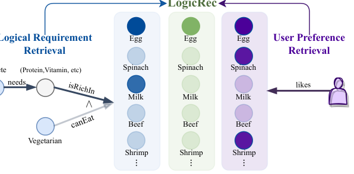
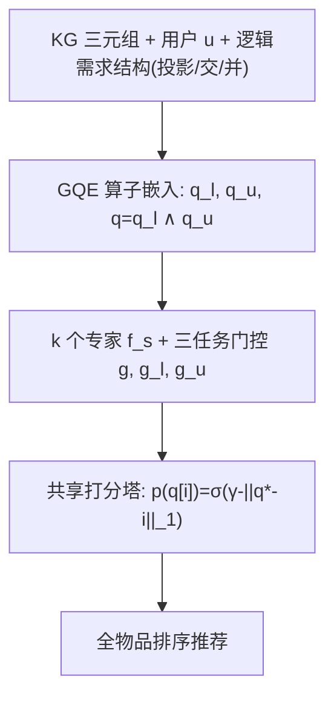

# LogicRec: Recommendation with Users' Logical Requirements (面向用户逻辑需求的推荐)

- **会议/期刊**: SIGIR 2023 (Short Paper, 5 pages)
- **作者与机构**: Zhenwei Tang, Griffin Floto, Armin Toroghi, Scott Sanner (University of Toronto); Shichao Pei, Xiangliang Zhang (University of Notre Dame)
- **推荐链路定位**: 召回（基于 KG 逻辑查询的候选物品检索）
- **研究方向**: 图神经网络与知识图谱推荐 / 多任务学习
- **论文原文**: [https://arxiv.org/abs/2304.11722v1](https://arxiv.org/abs/2304.11722v1)
- **开源代码**: [https://github.com/lilv98/LogicRec](https://github.com/lilv98/LogicRec)

## TL;DR (1分钟核心速览)

现有推荐只建模用户历史偏好，无法表达"既素食可食、又富含运动员所需营养"这类带交/并/投影算子的结构化逻辑需求。本文定义 **LogicRec** 任务：答案集 $A=A_u\cap A_l$，即偏好检索与逻辑需求检索的交集。针对 KG 天然不全（朴素子图遍历会漏掉缺失真值，如"素食者可食菠菜"）改用 LQE 做近似推理；针对$A_l$、$A_u$ 被浪费，设计多门专家多任务知识共享。在 Amazon-book / Yelp2018 上采用全物品打分 hit@20 评估，平均相对 FuzzQE 提升约 22.0% / 13.3%，并具备 zero-shot 查询结构泛化。

## Background & Motivation (背景与核心矛盾)

- **主流范式**: KGRec（RippleNet/KGCN/MKR/CFKG）把 KG 当作**背景知识**来丰富用户/物品表征，最终仍只做"用户偏好打分"。
- **前人局限 1**: 语言式与 critiquing 式推荐虽能接收需求反馈，但需求只是**无逻辑算子的单条约束**，无法表达交（$\wedge$）、并（$\vee$）与多跳投影的组合。
- **前人局限 2**: KG 严重不完整（Freebase/DBpedia 中 66% 以上人物条目缺出生地），若先"按需求子图检索、再与偏好取交"，缺失边会使真答案永久不可召回。
- **核心洞察 (Key Insight)**: 逻辑需求检索与用户偏好检索的答案集 $A_l$、$A_u$**并不相同**（图 1 中蓝/紫两簇），只监督二者交集$A$ 会丢掉大量可用的正样本监督信号。
- **本文切入点**: 用 LQE 把逻辑查询嵌入到实体空间做"软召回"以容忍缺失事实，再用多任务多门专家把 $A_l$、$A_u$ 的知识迁移进 LogicRec 主任务。

<figure class="paper-figure" markdown="span">
  <figcaption>图1：LogicRec 基于逻辑需求检索和用户偏好检索。所示用户可能刚结束锻炼，且最近成为素食者。因此，该用户需要素食者可食用且（∧）富含运动员所需营养（灰色节点）的食物，这构成了逻辑需求。注意，KGs 中可能存在缺失的真实事实，例如素食者可以吃菠菜（由浅色箭头表示），从而导致答案集不完整。此外，需求检索和偏好检索具有不同的待探索答案集。</figcaption>
</figure>

## Method (核心方法设计)

### 1. 整体框架 (Overall Architecture)

输入包含三部分：用户节点 $u$、需求查询的逻辑结构（投影链 + 交/并算子 + 锚实体）以及 KG 三元组。先按 GQE 的算子逐层把逻辑需求查询与偏好查询映射为$d$维向量$\mathbf{q}_l$、$\mathbf{q}_u$，二者经同一套注意力交集算子融合为 LogicRec 查询$\mathbf{q}$。随后$k$个专家网络从查询中抽取多视角知识，三个任务专属门控分别加权出$\mathbf{q}^*$、$\mathbf{q}_l^*$、$\mathbf{q}_u^*$，共享同一打分塔，对**全部候选物品**做$L_1$距离打分。训练时三条 BCE 支路分别用$A$、$A_l$、$A_u$监督；推理只用$\mathbf{q}^*$ 的分数排序。

### 2. 关键设计拆解 (Key Designs)

1. **逻辑需求查询嵌入（用近似答案替代子图遍历）**：投影沿路径相加 $\mathbf{q}_l=\mathbf{e}_1+\mathbf{r}_1+\cdots+\mathbf{r}_n$；交集不做硬过滤，而是注意力加权$\mathbf{q}_l=a(\mathbf{q}_1\oplus\mathbf{q}_2;\Omega)_1\odot\mathbf{q}_1+a(\mathbf{q}_1\oplus\mathbf{q}_2;\Omega)_2\odot\mathbf{q}_2$；并集取逐元素$\max(\mathbf{q}_1,\mathbf{q}_2)$。直觉：把"必须存在该边"松弛为"嵌入空间里离锚点近"，缺失真值仍能被召回，这正是应对 KG 不完整的关键。
2. **多门专家知识共享（把 $A_l$/$A_u$从废弃变监督）**：$k$个专家$\mathbf{q}_s=f_s(\mathbf{q};\theta_s)$抽多视角知识，三任务各用 softmax 门控$\mathbf{q}^*=g(\mathbf{q};\Gamma_g)[\mathbf{q}_1,\dots,\mathbf{q}_k]^\top$（$\mathbf{q}_l^*,\mathbf{q}_u^*$ 同理）。与 MMoE 的差别有二：输入门控的查询**因任务而异**（而非同输入+多塔），且三任务同塔，因为三者本质都是 LQE；门控设计目的是让辅助任务反哺主任务而非平等对待。
3. **训练目标、监督信号与推理开销**：打分 $p(q[i])=\sigma(\gamma-\lVert\mathbf{q}^*-\mathbf{i}\rVert_1)$，总损失为三支 BCE 之和$\mathcal{L}=\mathrm{BCE}(p(q),A)+\mathrm{BCE}(p(q_l),A_l)+\mathrm{BCE}(p(q_u),A_u)$；负样本即物品全集$\mathcal{I}$中未命中的物品（全库打分，无采样偏差）。推理仅需一次查询嵌入 + 全物品$L_1$距离，复杂度$O(|\mathcal{I}|d)$，比子图遍历更省且对缺失边鲁棒。

## Experimental Setup & Evaluation Protocol (实验设置与评估协议)

- **数据集与预处理**: 沿用 KGRec 常用的 Amazon-book 与 Yelp2018 作为 raw data，逻辑查询-答案对按 Query2Box/BetaE 的成熟流程生成。

| 数据集 | #Users | #Items | #Interactions | 稀疏度 | 特征/场景说明 |
| :--- | :---: | :---: | :---: | :---: | :--- |
| Amazon-book | 原文正文未列（见仓库） | 原文正文未列（见仓库） | 原文正文未列（见仓库） | — | 图书 KG，用户-物品二部图是 KG 子集 |
| Yelp2018 | 原文正文未列（见仓库） | 原文正文未列（见仓库） | 原文正文未列（见仓库） | — | 本地商户 KG，商家属性丰富 |

- **数据划分与防穿越**: 从 KG 中**留出 5% 边作为"已知缺失事实"**，并强制保证测试 LogicRec 查询的答案在训练 KG 中无法直接找到，从而严格检验推理（而非记忆）能力；基本查询类型（1p/2p/3p/2i/3i/ip/pi）参与训练与测试，zero-shot 类型（2u/up）**仅测试**。
- **排名评测协议**: 对全部物品 $\mathcal{I}$计算$p(q[i])$ 的**全库排序（Full-Ranking）**，报告 hit@20（表 1，3 次独立运行取均值）与 hit@10/20、ndcg@10/20（表 2）。
- **对比基线与超参**: KGRec 基线（RippleNet、CFKG、KGCN、MKR，经 RecBole 复现）与 LQE 四类代表（几何类 GQE/Q2B、分布类 BetaE、模糊逻辑类 FuzzQE），均扩展到 LogicRec 查询形式；另设 Shared-Bottom 多任务基线与两组消融。$L_1$距离、margin$\gamma$为超参，专家数$k$与嵌入维度$d$ 的搜索细节见仓库。

## Key Experimental Results (实验关键数据)

### 1. 主实验对比 (Main Results)

表 1（Amazon-book / Yelp2018，hit@20，9 类基本查询均值 avg）：

| 方法 | Amazon 1p | 2i | 3i | ip | Amazon avg | Yelp avg |
| :--- | :---: | :---: | :---: | :---: | :---: | :---: |
| GQE | 0.072 | 0.172 | 0.256 | 0.168 | 0.113 | 0.070 |
| Q2B | 0.034 | 0.158 | 0.292 | 0.156 | 0.102 | 0.071 |
| BetaE | 0.033 | 0.155 | 0.302 | 0.160 | 0.099 | 0.070 |
| FuzzQE | 0.087 | 0.191 | 0.271 | 0.155 | 0.118 | 0.083 |
| **LogicRec** | **0.086** | **0.228** | **0.345** | **0.192** | **0.144** | **0.094** |
| Improv.% (vs best baseline) | — | +19.4% | +14.2% | +14.3% | **+22.0%** | **+13.3%** |

表 2（Amazon-book，与 KGRec 及消融对比）：

| 方法 | hit@10 | hit@20 | ndcg@10 | ndcg@20 |
| :--- | :---: | :---: | :---: | :---: |
| RippleNet | 0.071 | 0.110 | 0.035 | 0.044 |
| KGCN | 0.048 | 0.080 | 0.021 | 0.028 |
| MKR | 0.042 | 0.070 | 0.018 | 0.025 |
| CFKG | 0.095 | 0.146 | 0.044 | 0.056 |
| GQE | 0.084 | 0.113 | 0.050 | 0.057 |
| **LogicRec** | **0.102** | **0.144** | **0.061** | **0.071** |

### 2. 消融实验 (Ablation Study)

| 变体 | hit@10 | hit@20 | ndcg@20 | 说明 |
| :--- | :---: | :---: | :---: | :--- |
| Shared-Bottom | 0.088 | 0.128 | 0.062 | 朴素多任务，弱于本文 |
| w/o $A_l$ | 0.072 | 0.097 | 0.048 | 去掉需求检索支路，**跌破 GQE** |
| w/o $A_u$ | 0.100 | 0.138 | 0.069 | 去掉偏好检索支路，仍优于 GQE |
| **LogicRec** | **0.102** | **0.144** | **0.071** | 三答案集齐全时最优 |

### 3. 关键实验发现 (Key Findings)

1. **逻辑需求是真实增益而非装饰**：仅引入 $A_l$ 一条需求检索支路，LogicRec 就在 hit@20 上超过最强 KGRec 基线 CFKG（0.144 vs 0.146 大致持平、hit@10 反超 0.102 vs 0.095），且远超纯偏好型 KGCN（0.080）与 MKR（0.070），说明"当次意图"与"长期偏好"是互补信号。
2. **$A_l$学习难度显著高于$A_u$**：去掉$A_l$后性能反而低于单任务 GQE（0.097 vs 0.113），原因是偏好检索过于容易、模型被其主导而逻辑需求支路欠拟合；而单独去掉$A_u$ 仍有 0.138，印证"难任务必须保留、易任务可作为辅助正则"这一非对称多任务结论。
3. **zero-shot 结构泛化成立**：在训练中从未出现的 2u/up 查询上，LogicRec 于 Amazon 得 0.091/0.087、Yelp 得 0.062，均高于 GQE（0.082/0.081、0.035/0.031）与 FuzzQE（0.075/0.070、0.041/0.034），表明嵌入空间的算子代数（交/并/投影）具备组合外推能力。

## Highlights & Limitations (亮点、对比与审稿批判)

- **与代表作对比**: 与 RippleNet/KGCN 等 KGRec 的本质区别是——KG 不只是"背景特征源"，而是**用户显式需求的查询载体**；与 GQE/Query2Box/BetaE 的本质区别是——后者的查询就是唯一的监督单元（只用到 $A$），本文把$A_l$、$A_u$ 提升为并列监督目标，是多任务视角而非新的几何/分布嵌入。
- **可迁移亮点**: ① "难任务 + 易任务"非对称门控设计可直接搬用于多目标精排（如 CTR 易、LTV 难）；② 全库 $L_1$ 打分 + 单查询嵌入的推理路径适合作为召回侧结构化约束过滤，替代硬性属性过滤。
- **审稿级局限批判**: ① 仅 5 页 short paper，未见数据规模、$k$、$d$、专家数与$\gamma$ 的敏感性分析，也**缺少点击/线上 A/B 与显著性检验**，泛化结论的说服力受限；② 以 GQE 为基础模型，对并集仅用逐元素 max 近似，表达能力弱于 BetaE/ConE 的概率或锥形嵌入；③ 依赖人工/模板构造的逻辑查询-答案对，真实用户能否给出这类查询结构本身未被验证，且推理需对全物品打分的开销随类目规模线性增长。

## Rating (四维评分)

- **方法创新性 (Novelty)**: ⭐⭐⭐⭐ （首次形式化 LogicRec 任务并把"需求检索 vs 偏好检索答案集不一致"转化为多任务知识共享问题，机制清晰但 LQE 主干沿用 GQE 而非新嵌入理论）
- **评估协议与实验扎实度 (Protocol & Experiments)**: ⭐⭐⭐ （留出 5% KG 边制造真实缺失、全库排序、zero-shot 查询不参与训练等设计严谨，但数据集统计与超参披露不足，无显著性检验与线上验证）
- **写作与数学规范度 (Clarity & Rigor)**: ⭐⭐⭐⭐ （算子公式与任务定义紧凑清楚，$A/A_l/A_u$ 三支损失表述明确；并集算子与门控记号略显简化，缺复杂度分析）
- **工业落地与复现价值 (Industrial & Practical Value)**: ⭐⭐⭐⭐ （代码仓库开源且基于 RecBole 生态易复现，单次查询嵌入 + 全库距离的推理方式工程上可直接嵌入召回侧约束过滤）

