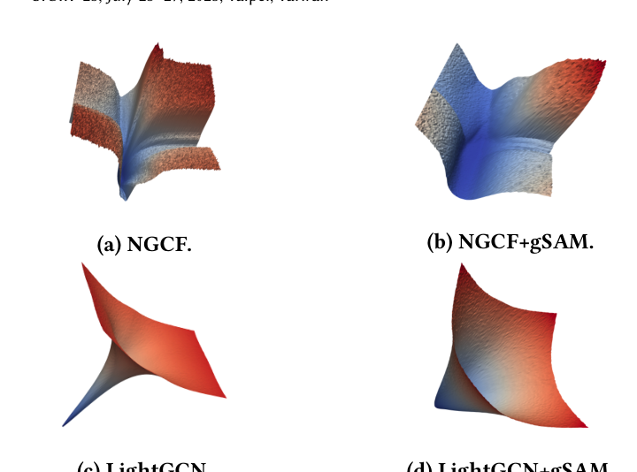
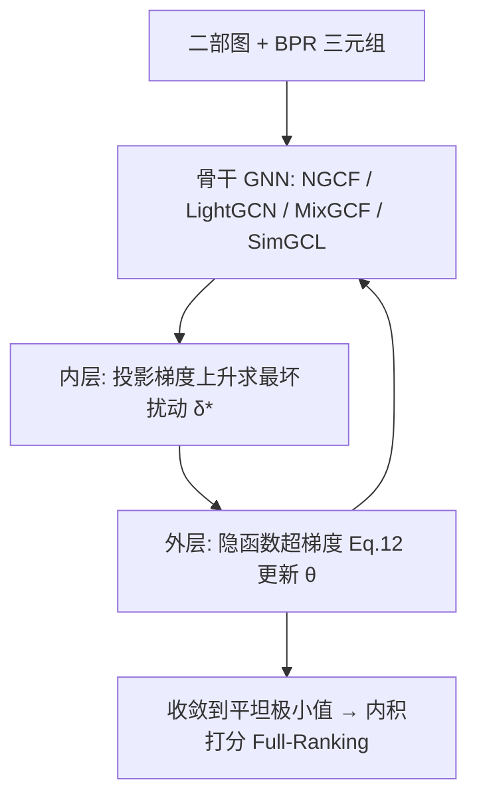
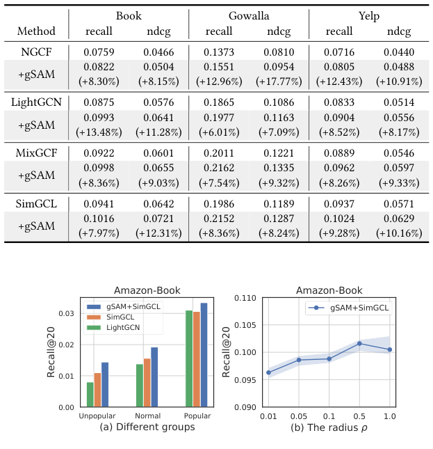

# Sharpness-Aware Graph Collaborative Filtering (锐度感知的图协同过滤)

- **会议/期刊**: SIGIR 2023 (Short Paper, 5 pages)
- **作者与机构**: Huiyuan Chen, Chin-Chia Michael Yeh, Yujie Fan, Yan Zheng, Junpeng Wang, Vivian Lai, Mahashweta Das, Hao Yang（Visa Research）
- **推荐链路定位**: 召回（图协同过滤的训练范式改进，推理零额外开销）
- **研究方向**: 图神经网络与知识图谱推荐 / 冷启动与长尾推荐
- **论文原文**: [https://arxiv.org/abs/2307.08910v1](https://arxiv.org/abs/2307.08910v1)
- **开源代码**: [https://github.com/kuandeng/LightGCN](https://github.com/kuandeng/LightGCN)（官方 gSAM 实现暂未开源，该仓库为文中使用的骨干模型与数据集来源）

## TL;DR (1分钟核心速览)

GNN 协同过滤在训练/测试分布不对齐时极易收敛到**尖锐极小值（sharp minima）**，泛化与稳定性差；而经典 SAM 的一步梯度上升近似在非 i.i.d. 图数据上方差极大，Yelp 上甚至劣于 LightGCN。本文提出 **gSAM**：把锐度感知写成"外层正常训练 + 内层跳出尖锐区"的**双层优化**，用 Cauchy 隐函数定理 + Neumann 级数展开求出含 Hessian 的**超梯度**，做曲率自适应的平坦极小值搜索。在 Amazon-Book/Gowalla/Yelp 三数据集、逐用户 8:1:1 划分、**Full-Ranking** 协议下，LightGCN+gSAM 的 Recall@20 提升 13.48%，四类骨干平均 Recall/NDCG 提升 8.3%–9.3%。

## Background & Motivation (背景与核心矛盾)

- **主流范式**: 将用户-物品交互视为二部图，用 NGCF/LightGCN/MixGCF/SimGCL 做邻居聚合得到节点表征，成对 BPR 损失 + Adam 一阶优化。
- **前人局限 1（数据侧）**: 真实图呈幂律分布，邻居聚合天然偏向高 degree 物品，长尾物品协同信号被淹没；训练/测试分布漂移则进一步放大过拟合。
- **前人局限 2（优化侧）**: GNN 过参数化，训练损失趋零并不等于泛化好；一阶优化器只最小化训练误差，**完全丢弃 loss 曲率（高阶信息）**，易停在鞍点或尖锐极小值。作者沿两个随机方向扰动参数画出 3D loss landscape，发现 NGCF 曲面因非线性变换而比 LightGCN 更崎岖，但**两者都收敛在尖锐处**（图 1a/1c）。
- **核心洞察 (Key Insight)**: PAC-Bayes 上界（式 4）表明测试误差由"经验损失 + KL 复杂度"控制，而邻域内最坏损失 $\max_{\|\boldsymbol{\delta}\|_2\le\rho}\mathcal{L}_{bpr}(\boldsymbol{\theta}+\boldsymbol{\delta})$ 正是该界的一个可计算代理——压平曲面即压紧上界。
- **本文切入点**: SAM 的一步梯度只是该 minimax 问题的粗糙一阶近似；本文改用它关于内层最优响应 $\boldsymbol{\delta}^{*}(\boldsymbol{\theta})$ 的**隐式微分**，把一阶近似升级为带 Hessian 的二阶超梯度。

<figure class="paper-figure" markdown="span">
  <figcaption>图 1：与具有尖锐曲面的原始基线（如 NGCF 和 Light-GCN）相比，我们的训练方案 gSAM 在 Amazon-Book 数据集上生成的曲面更加平滑。</figcaption>
</figure>

## Method (核心方法设计)

### 1. 整体框架 (Overall Architecture)

输入为二部图 $\mathcal{G}=(\mathcal{U}\cup\mathcal{I},\mathcal{O}^{+})$与 BPR 三元组；每个训练步先做**内层**：在半径$\rho$的$\ell_2$球内用投影梯度上升寻找使损失最大的扰动$\boldsymbol{\delta}$（"最坏邻居"）；再做**外层**：用含二阶信息的超梯度更新模型参数$\boldsymbol{\theta}$，使$\boldsymbol{\theta}$所在的整片邻域都低损失。训练结束后丢弃$\boldsymbol{\delta}$，推理与骨干模型完全相同，打分仍为$\hat{y}_{ui}=\mathbf{e}_u^{\top}\mathbf{e}_i$ 的 ANN/内积检索，**在线零额外开销**。

### 2. 关键设计拆解 (Key Designs)

1. **双层锐度目标（Bilevel Sharpness Objective）**：把原 minimax 问题改写为带最优响应的双层形式，使"逃出尖锐区"变成一个可微的内层子问题而非一次性扰动：
$$\min_{\boldsymbol{\theta}}\ \mathcal{L}_{out}\big(\boldsymbol{\theta},\boldsymbol{\delta}^{*}(\boldsymbol{\theta})\big),\quad \text{s.t.}\ \boldsymbol{\delta}^{*}(\boldsymbol{\theta})=\arg\min_{\|\boldsymbol{\delta}\|_2\le\rho}\mathcal{L}_{in}(\boldsymbol{\theta},\boldsymbol{\delta})$$
其中 $\mathcal{L}_{out}=-\mathcal{L}_{in}=\mathcal{L}_{bpr}$，内层等价于在球内**最大化** BPR 损失。直觉：优化的不再是单点损失，而是"邻域内的最坏损失"，因此曲率大的方向被系统性惩罚。

2. **隐函数超梯度（Implicit Hypergradient）**：一阶 SAM 用 $\boldsymbol{\delta}^{*}\approx\rho\,{\nabla_{\boldsymbol{\theta}}\mathcal{L}_{bpr}}/{\|\nabla_{\boldsymbol{\theta}}\mathcal{L}_{bpr}\|_2}$截断泰勒展开，方向只由梯度决定、方差大。本文由 Cauchy 隐函数定理给出$\partial\boldsymbol{\delta}^{*}/\partial\boldsymbol{\theta}$ 的解析式，并用 Neumann 级数截断逆 Hessian，得到可落地实现：
$$\nabla_{\boldsymbol{\theta}}\mathcal{L}_{out}\approx\frac{\partial\mathcal{L}_{out}}{\partial\boldsymbol{\theta}}-\frac{\partial\mathcal{L}_{out}}{\partial\boldsymbol{\delta}}\sum_{j=0}^{J}\Big(\mathbf{I}-\frac{\partial^{2}\mathcal{L}_{in}}{\partial\boldsymbol{\delta}\partial\boldsymbol{\delta}^{\top}}\Big)^{j}\frac{\partial^{2}\mathcal{L}_{in}}{\partial\boldsymbol{\delta}\partial\boldsymbol{\theta}^{\top}}$$
二阶项 $\partial^2\mathcal{L}_{in}/\partial\boldsymbol{\delta}\partial\boldsymbol{\delta}^{\top}$充当**逐维度的曲率缩放**：平坦方向放大步长、尖锐方向收缩步长，这正是"比 SAM 更容忍曲率变化"的物理来源；$J$ 项截断避免了显式求逆的内存爆炸，可扩展到百万级参数。

3. **训练目标、负采样与推理效率**：总损失仍为骨干的 BPR 损失（$\mathcal{L}_{bpr}=\sum_{(u,i,j)}-\ln\sigma(\hat{y}_{ui}-\hat{y}_{uj})$），负采样完全沿用骨干设置（LightGCN 均匀采样、MixGCF 硬负采样、SimGCL 均匀噪声增广），因此 gSAM 是**与骨干正交的 trainer 插件**。新增超参仅半径$\rho$；每步代价为 1 次内层投影（$\mathcal{P}_\rho[\mathbf{x}]=\rho\mathbf{x}/\max\{\rho,\|\mathbf{x}\|_2\}$）+$J$次 Hessian-向量积，训练开销约为 SAM 的$(J+1)$ 倍量级，推理开销为 0。

## Experimental Setup & Evaluation Protocol (实验设置与评估协议)

| 数据集 | #Users | #Items | #Interactions | 稀疏度/密度 | 特征/场景说明 |
| :--- | :---: | :---: | :---: | :---: | :--- |
| Amazon-Book | 52.6k | 91.6k | 2984.1k | 0.06% | 图书隐式反馈，长尾最重 |
| Gowalla | 29.9k | 41.0k | 1027.4k | 0.06% | LBSN 签到二部图 |
| Yelp-2018 | 31.7k | 38.0k | 1561.4k | 0.13% | 本地生活商户评论 |

- **数据划分与防穿越**: 逐用户**随机 8:1:1** 划分 train/valid/test（非全局时间戳切分，存在轻度未来信息穿越风险，原文未讨论）。
- **排名评测协议**: **Full-Ranking 全库未交互排序**（all-ranking protocol），指标 Recall@20 与 NDCG@20。
- **对比基线与超参**: 骨干 NGCF（非线性消息传递）、LightGCN（去非线性）、MixGCF（mix-up 硬负采样）、SimGCL（表征均匀噪声对比）；表征维度 $d\in\{32,64,128,256\}$，半径$\rho\in\{0.01,0.05,0.1,0.5,1.0\}$网格搜索，其余超参与骨干原设置一致；文中未报告显著性检验（$p$ 值）。

## Key Experimental Results (实验关键数据)

### 1. 主实验对比 (Main Results)

| 骨干 (+gSAM) | Book R@20 | Book N@20 | Gowalla R@20 | Gowalla N@20 | Yelp R@20 | Yelp N@20 |
| :--- | :---: | :---: | :---: | :---: | :---: | :---: |
| NGCF | 0.0759 | 0.0466 | 0.1373 | 0.0810 | 0.0716 | 0.0440 |
| NGCF + gSAM | 0.0822 (+8.30%) | 0.0504 (+8.15%) | 0.1551 (+12.96%) | 0.0954 (+17.77%) | 0.0805 (+12.43%) | 0.0488 (+10.91%) |
| LightGCN | 0.0875 | 0.0576 | 0.1865 | 0.1086 | 0.0833 | 0.0514 |
| LightGCN + gSAM | 0.0993 (+13.48%) | 0.0641 (+11.28%) | 0.1977 (+6.01%) | 0.1163 (+7.09%) | 0.0904 (+8.52%) | 0.0556 (+8.17%) |
| MixGCF | 0.0922 | 0.0601 | 0.2011 | 0.1221 | 0.0889 | 0.0546 |
| MixGCF + gSAM | 0.0998 (+8.36%) | 0.0655 (+9.03%) | 0.2162 (+7.54%) | 0.1335 (+9.32%) | 0.0962 (+8.26%) | 0.0597 (+9.33%) |
| SimGCL | 0.0941 | 0.0642 | 0.1986 | 0.1189 | 0.0937 | 0.0571 |
| **SimGCL + gSAM** | **0.1016 (+7.97%)** | **0.0721 (+12.31%)** | **0.2152 (+8.36%)** | 0.1287 (+8.24%) | **0.1024 (+9.28%)** | **0.0629 (+10.16%)** |

（加粗为各列最优；MixGCF+gSAM 的 Gowalla N@20 = 0.1335 为该列最优。原文未给绝对 SOTA 之外的误差棒。）

### 2. 消融/变体对比 (Ablation & Variants)

原文以"同一骨干换训练范式"作为核心消融，逐组件消融（如去掉 Hessian 项、$J$ 取值敏感性）未给出完整数值表，故下表以可得数据整理：

| 训练范式（骨干 = LightGCN） | Book R@20 | Gowalla R@20 | Yelp R@20 | 30 次运行稳定性 |
| :--- | :---: | :---: | :---: | :---: |
| 一阶 Adam（$\rho=0$，原版） | 0.0875 | 0.1865 | 0.0833 | 中 |
| SAM（one-step 扰动，等价 $J=0$ 的一阶截断） | — | — | 低于 0.0833 | 低（方差显著更大） |
| **gSAM（隐函数超梯度，$J$ 项 Neumann）** | **0.0993** | **0.1977** | **0.0904** | 高 |

（SAM 行的绝对值原文未以表格给出，仅由图 2 的 30 次运行分布与"Yelp 上劣于 LightGCN"的文字结论支撑；这也是本文最薄弱的一处论证——缺少与 gSAM 同预算的 SAM 精确数值对照。）

<figure class="paper-figure" markdown="span">
  <figcaption>图 3：(a) 不同物品组的性能比较。(b) 半径 𝜌 的影响。</figcaption>
</figure>

### 3. 关键实验发现 (Key Findings)

1. **增益幅度与骨干"崎岖度"正相关**：曲面最复杂的 NGCF 拿到最大增益（Gowalla NDCG **+17.77%**、Yelp +10.91%），而去掉非线性的 LightGCN 增益回落到 6.01%–13.48%，说明 gSAM 补偿的正是高阶曲率信息，而非简单"训练更久"。
2. **平坦化与数据增广互补而非替代**：SimGCL+gSAM 在 Book 上达 0.1016/0.0721（NDCG 相对 **+12.31%**），MixGCF+gSAM 在 Gowalla NDCG 达 0.1335（+9.32%）；两者已用噪声/硬负样本做了隐式正则，仍被 gSAM 叠加提升，证明锐度惩罚作用在"损失几何"这一不同维度上。
3. **长尾与稳定性双收益**：图 3(a) 中在 Unpopular/Normal/Popular 三组划分上 gSAM 全面优于 LightGCN 与 SimGCL，稀疏物品组提升最明显；图 2 的 30 次运行显示 gSAM 方差最小（SAM 波动最大），且 $\rho$在 0.01–1.0 内性能曲线平缓，$\rho\approx0.5$ 最优，超参不敏感。

## Highlights & Limitations (亮点、对比与审稿批判)

- **与代表作对比 (vs. Prior Work)**: 与 SGL/SimGCL 这类"改数据增广/加对比损失"的正则路线不同，gSAM 不改模型结构也不改损失形式，只改**优化轨迹的几何性质**，因而可与任意骨干叠加；与 SAM/ASAM/FisherSAM 相比，关键区别是**放弃一步梯度近似**，改用隐函数微分引入 Hessian，从而解决非 i.i.d. 图数据上方差过大的问题。
- **可迁移亮点**: ①把 gSAM 当作即插即用 trainer，直接套在序列推荐（SASRec/BERT4Rec）与多模态融合骨干上；②Neumann 截断逆 Hessian 的写法是内存友好的二阶优化范式，可复用到任何百万参数的推荐模型。
- **审稿级局限批判**: ①**成本不透明**：每步多 $J+1$次 Hessian-向量积，论文完全未报告训练 wall-clock、显存与收敛步数，工业落地成本存疑；②**实验覆盖不足**：仅 3 个 10^5–10^6 级公开数据集、无百万级工业数据与线上 A/B，且随机 8:1:1 划分与全库排序下缺少显著性检验，SAM 对照值仅以图 2 定性呈现，逐组件消融（$J$、$\rho$、Hessian 项）缺失，5 页短文难以支撑"二阶优于一阶"的强主张。

## Rating (四维评分)

- **方法创新性 (Novelty)**: ⭐⭐⭐⭐ （把 SAM 重新解释为双层优化并用隐函数定理求超梯度，视角新颖且与图数据非 i.i.d. 特性高度契合）
- **评估协议与实验扎实度 (Protocol & Experiments)**: ⭐⭐⭐ （Full-Ranking + Recall/NDCG@20 协议规范、四个骨干交叉验证，但仅 3 个数据集、无显著性检验、消融与 SAM 精确对照缺失）
- **写作与数学规范度 (Clarity & Rigor)**: ⭐⭐⭐⭐ （PAC-Bayes 动机→minimax→双层→超梯度的推导链条清晰，式 9–12 定义完整，代价是对 $J$ 与复杂度的量化交代不足）
- **工业落地与复现价值 (Industrial & Practical Value)**: ⭐⭐⭐ （推理零开销、超参仅 $\rho$ 且不敏感是最大卖点，但二阶训练开销未量化且官方实现未开源，线上大规模验证缺位）

