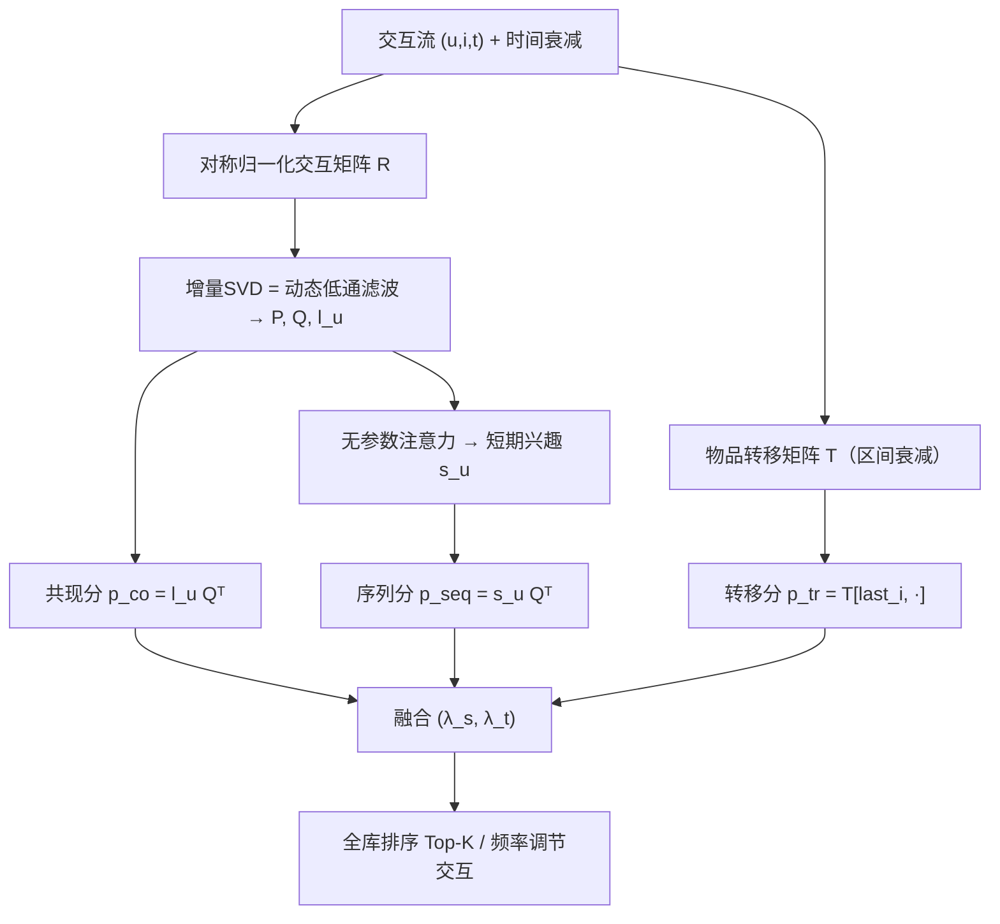
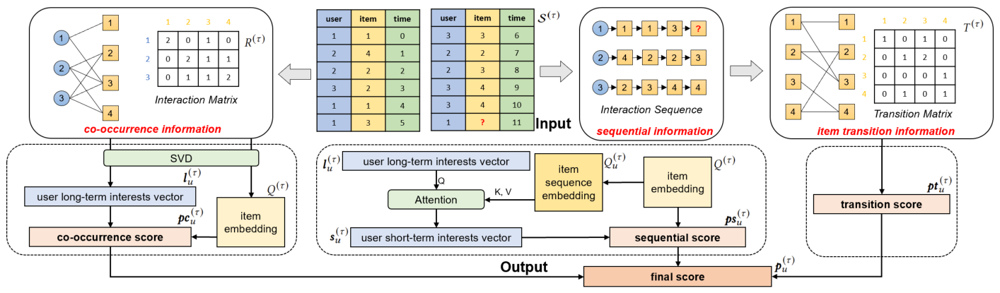

# Triple Structural Information Modelling for Accurate, Explainable and Interactive Recommendation（三重结构信息建模：面向精准、可解释与可交互推荐）

- **会议/期刊**: SIGIR 2023（46th ACM SIGIR，Taipei）
- **作者与机构**: Jiahao Liu, Tun Lu, Peng Zhang, Li Shang, Ning Gu（复旦大学），Dongsheng Li（微软亚洲研究院），Hansu Gu
- **推荐链路定位**: 召回（动态交互图上的 next-item / next-interaction 打分）
- **研究方向**: 图神经网络与知识图谱推荐 / 序列与会话推荐
- **论文原文**: [论文原文链接](https://arxiv.org/abs/2304.11528v1)
- **开源代码**: 暂未开源

## TL;DR (1分钟核心速览)

动态交互图上，"用户-物品共现""用户行为序列""物品转移概率"三类结构信息各自有效，但序列模型只看序列、图模型只看共现，无人同时利用三者。本文提出 TriSIM4Rec：用**增量 SVD**（被证明等价于动态理想低通图滤波）挖共现、用**无参数注意力**挖序列、用**带区间衰减的转移矩阵**挖转移，三路分数线性融合，且全程无梯度训练、支持单次交互增量更新。在 6 个公开数据集、80/10/10 时间切分的全库排序协议下，HR@10 最高相对 FreeGEM 提升 203.8%（ML-1M），LastFM 上 MRR 相对 HILI 提升 37.3%。

## Background & Motivation (背景与核心矛盾)

- **主流范式**: 序列方法（RRN / Time-LSTM / JODIE / DeepCoevolve）把用户建模为物品序列并配 RNN/时间门；图方法（LightGCN / CoPE / FreeGEM）直接在交互图上做邻域聚合或 ODE/Hawkes 演化。
- **前人局限**: ①序列模型完全不显式建模共现图结构，稀疏场景下学不动；②图模型（尤其 LightGCN 类静态 GNN）丢弃序列顺序与物品间转移统计，而转移概率恰恰承载强个性化信号；③JODIE / CoPE / FreeGEM 靠大量可训练参数 + 多 epoch 训练 + 测试时训练，效率低下。
- **核心洞察 (Key Insight)**: 作者从图信号处理 (GSP) 视角证明**截断 SVD 与理想低通图滤波在数学上等价**（$G=V,\ H=U$，且$U\Sigma V^{\top}=UU^{\top}R=RV V^{\top}$），因此增量 SVD 就是"动态低通滤波"；进一步，SVD 特征向量的每一维（一个"频率"）对应一类**兴趣**，频率权重可被用户直接调节。
- **本文切入点**: 不做深度参数化，而是让三类结构信息各出一个分数、用一个两参数加权融合，并用增量 SVD 把这套"闭式模型"变成可实时演进的模型。

## Method (核心方法设计)

### 1. 整体框架 (Overall Architecture)

模型对每条新交互 $(u,i,t)$维护三套结构状态：①带时间衰减与对称归一化的交互矩阵$R^{(\tau)}$，截断 SVD 后得到用户长期兴趣$\boldsymbol{l}_u^{(\tau)}=P^{(\tau)}[u,\cdot]$与物品矩阵$Q^{(\tau)}$，产出共现分$p_{co}$；②以$\boldsymbol{l}_u$为 query、以该用户历史物品嵌入$Q_u$为 key/value 做无参数缩放点积注意力，得到短期兴趣$\boldsymbol{s}_u$，产出序列分$p_{seq}$；③维护$|I|\times|I|$物品转移矩阵$T$，取最近交互物品对应行作为转移分$p_{tr}$。三路分数按$\lambda_s,\lambda_t$ 加权得到最终打分，全库排序输出 Top-K；新交互到达时用增量 SVD 与秩一更新原地刷新状态，无需重训。

<figure class="paper-figure" markdown="span">
  <figcaption>图1：TriSIM4Rec 的架构。</figcaption>
</figure>

### 2. 关键设计拆解 (Key Designs)

1. **动态理想低通滤波的共现挖掘**：痛点是小批量重训 SVD 不可行。先构造 $\tilde{R}^{(\tau)}[u,i]=\sum_{(u,i,t)}\exp\{-\beta_t(1-t/t^{(\tau)})\}$，再做度归一化$R=D_U^{-1/2}\tilde{R}D_I^{-1/2}$抑制流行度偏置，最后截断 SVD 得$P=U\Sigma^{1/2},Q=V\Sigma^{1/2}$，共现分$p_{co,u}=l_uQ^{\top}$。有效直觉：截断即丢高频（噪声）保留低频（兴趣团簇），等价于在用户/物品相似图上做一次平滑传播。
2. **无参数注意力序列建模**：$s_u^{(\tau)}=\mathrm{softmax}\!\left(l_u^{(\tau)}(Q_u^{(\tau)})^{\top}/\sqrt{k}\right)Q_u^{(\tau)}$，$p_{seq,u}=s_uQ^{\top}$。关键在"无参数"——$l_u$与$Q_u$本就由同一次 SVD 映射到同一傅里叶空间，无需特征变换矩阵；时间衰减充当位置编码，使注意力偏向近期行为。因$s_u$是历史物品的线性组合，新交互会使其剧烈变化，故称"短期兴趣"，而$l_u$ 平滑变化故称"长期兴趣"。
3. **转移矩阵与增量更新 / 推理开销**：$T[i_1,i_2]=\sum_{u}\sum_{(i_1,t_1)\to(i_2,t_2)}\exp\{\beta_i(t_2-t_1)/t^{(\tau)}\}$，转移分取$T[i_u^{(n)},\cdot]$。融合式$p_u=(1-\lambda_t)\big((1-\lambda_s)p_{co}+\lambda_s p_{seq}\big)+\lambda_t p_{tr}$。难点：$\Delta R^{(\tau)}=R^{(\tau+1)}-R^{(\tau)}$因两侧度归一化同时变化而是**秩二**矩阵，无法直接喂给增量 SVD；于是拆成三个秩一分量$e_u\Delta_u^{\top}+\Delta_i e_i^{\top}+\Delta_{ui}e_ue_i^{\top}$（式13），调用三次 iSVD，单次更新复杂度约为$O((|U|+|I|)k^2)$。**训练目标**：本文无梯度损失、无负采样，全部参数（$\beta_t,\beta_i,\lambda_s,\lambda_t,k$）在验证集上网格搜索；推理为一次$|I|\times k$ 矩阵乘法。

## Experimental Setup & Evaluation Protocol (实验设置与评估协议)

- **数据集与预处理**: 未做 `5-core` 过滤；前四者为单次交互场景，Wikipedia/LastFM 允许重复交互（后两者 密度>100% 即人均重复交互）。

| 数据集 | #Users | #Items | #Interactions | 稀疏度/密度 | 特征/场景说明 |
| :--- | :---: | :---: | :---: | :---: | :--- |
| Video | 5,130 | 1,685 | 37,126 | 0.43% | Amazon 评论，单次交互，未来物品推荐 |
| Game | 24,303 | 10,672 | 231,780 | 0.09% | Amazon 评论，最稀疏 |
| ML-100K | 943 | 1,349 | 99,287 | 7.80% | 电影评分 |
| ML-1M | 6,040 | 3,416 | 999,611 | 4.84% | 电影评分，含可解释 case study |
| Wikipedia | 8,227 | 1,000 | 157,474 | 1.91% | 重复交互，下一交互预测 |
| LastFM | 980 | 1,000 | 1,293,103 | 132% | 高频重复交互，转移信号强 |

- **数据划分与防穿越 (Splitting Strategy)**: **全局时间戳切分**——按交互时间前 80% 训练、随后 10% 验证、最后 10% 测试（严格 leave-future-out，无穿越）。
- **排名评测协议 (Ranking Protocol)**: 按 ground-truth 在**全部物品**中的排名计算 $MRR=\frac{1}{N}\sum 1/r_i$与$HR@10$，不采样负例（属全库排序），但为逐交互 point-wise 排序而非列表级。
- **对比基线与超参设置**: 未来物品推荐对比 LightGCN、Time-LSTM、RRN、DeepCoevolve、JODIE、CoPE、FreeGEM；下一交互预测对比 Last-10、Time-LSTM、RRN、LatentCross、CTDNE、DeepCoevolve、JODIE、CoPE、HILI、FreeGEM。$k\in\{64,128,256,512\}$，$\beta_t,\beta_i\in\{0,10,\dots,50\}$，$\lambda_s,\lambda_t\in\{0.0,0.1,\dots,1.0\}$；未报告显著性检验。

## Key Experimental Results (实验关键数据)

### 1. 主实验对比 (Main Results)

表 1：未来物品推荐（HR@10）

| Model | Video | Game | ML-100K | ML-1M |
| :--- | :---: | :---: | :---: | :---: |
| LightGCN | 0.036 | 0.026 | 0.025 | 0.029 |
| Time-LSTM | 0.044 | 0.020 | 0.058 | 0.033 |
| RRN | 0.068 | 0.029 | 0.065 | 0.043 |
| DeepCoevolve | 0.050 | 0.027 | 0.069 | 0.030 |
| JODIE | 0.078 | 0.035 | 0.074 | 0.035 |
| CoPE | 0.088 | 0.047 | 0.081 | 0.049 |
| FreeGEM | 0.113 | 0.050 | 0.114 | 0.053 |
| **TriSIM4Rec** | **0.149** | **0.052** | **0.200** | **0.161** |
| Improv.% | +31.9% | +4.0% | +75.4% | +203.8% |

表 2：下一交互预测（Wikipedia / LastFM）

| Model | Wiki MRR | Wiki HR@10 | LastFM MRR | LastFM HR@10 |
| :--- | :---: | :---: | :---: | :---: |
| Last-10 | 0.792 | 0.842 | 0.139 | 0.263 |
| RRN | 0.522 | 0.617 | 0.089 | 0.182 |
| LatentCross | 0.424 | 0.481 | 0.148 | 0.227 |
| JODIE | 0.746 | 0.822 | 0.195 | 0.307 |
| CoPE | 0.750 | 0.890 | 0.200 | 0.446 |
| HILI | 0.761 | 0.853 | 0.252 | 0.427 |
| FreeGEM | 0.786 | 0.852 | 0.195 | 0.453 |
| **TriSIM4Rec** | **0.813** | 0.881 | **0.346** | **0.512** |
| Improv.% | +2.7% | −1.0% | +37.3% | +13.0% |

### 2. 消融实验 (Ablation Study)

表 3（C=共现、T=转移、S=序列；因 S 依赖 C，故仅 4 个合法变体）

| 变体 | C | T | S | Wiki HR@10 | Wiki MRR | LastFM HR@10 | LastFM MRR |
| :--- | :---: | :---: | :---: | :---: | :---: | :---: | :---: |
| A1 | ✗ | ✓ | ✓ | 0.858 | 0.804 | 0.451 | 0.321 |
| A2 | ✓ | ✗ | ✗ | 0.771 | 0.555 | 0.341 | 0.151 |
| A3 | ✓ | ✓ | ✗ | 0.875 | 0.809 | 0.486 | 0.336 |
| A4 | ✓ | ✗ | ✓ | 0.869 | 0.708 | 0.374 | 0.177 |
| **Full** | ✓ | ✓ | ✓ | **0.881** | **0.813** | **0.512** | **0.346** |

### 3. 关键实验发现 (Key Findings)

1. **共现结构是骨架，序列与转移是增益**：A2（仅共现）在 LastFM 上 MRR 仅 0.151，加入序列后 A4 升至 0.177、再加转移到 0.346（+129%）；说明无参数注意力必须寄生在 SVD 的用户/物品嵌入空间上才生效，单用序列或单用图都会失效。
2. **转移信息偏"精确命中"，共现信息偏"召回覆盖"**：调节 $\lambda_t$使转移权重上升时，$MRR/HR$ 比值单调上升，故 LastFM 上 MRR 相对 HILI 暴涨 37.3% 而 HR 只涨 13.0%；这也解释了 Wikipedia 上 HR@10 反而略低于 CoPE（0.881 vs 0.890）——该数据集高度重复交互，转移统计被"同物品自转移"稀释。
3. **稀疏场景收益最大、且对训练规模鲁棒**：越稀疏、交互次数越少（ML-1M 密度 4.84%、Video 0.43%），相对提升越大（+203.8% / +31.9%），而训练集比例从 10% 调到 80% 时 Wikipedia/LastFM 的 HR 与 MRR 曲线几乎平坦，印证闭式低通滤波对样本量不敏感。

## Highlights & Limitations (亮点、对比与审稿批判)

- **与代表作对比 (vs. Prior Work)**: 与 JODIE/DeepCoevolve 相比，本文不学 RNN 隐状态，而用 SVD 的谱基向量直接承载长期兴趣，避免序列漂移；与 LightGCN 相比，本文的"传播"不是固定层数邻域聚合，而是由截断秩 $k$ 控制的全图低通滤波，且天然支持增量；与 FreeGEM 相比，本文把"动态更新"从在线监控+离线重训换成三次增量 SVD，但代价是牺牲了 side-information 与非线性拟合能力。
- **可迁移亮点**: ①将"秩二增量拆成三个秩一 → 调三次 iSVD"的技巧可直接用于任何带双侧归一化的矩阵分解在线更新；②"频率即兴趣、可调频率权重"提供了一个零成本的交互式重排接口（放大第 3 频率 100 倍，喜剧占比显著上升）。
- **审稿级局限批判**: ①**冷启动硬伤**：纯 ID 共现 + SVD，新物品无谱分量、新用户无 $l_u$，论文完全未做冷启动实验；②**效率并非最优**：LastFM 单 epoch 99m15s，约为 FreeGEM（51m56s）的两倍，与摘要宣称的 "very efficient" 有落差，且每次交互 3 次 iSVD 在高并发线上场景仍需批处理；③**评估与解释性证据偏弱**：仅 HR/MRR 两指标、无 NDCG 与显著性检验，可解释性与交互性只靠单用户 1081 的 case study，缺少用户研究或人工评测。

## Rating (四维评分)

- **方法创新性 (Novelty)**: ⭐⭐⭐⭐ （SVD≡理想低通滤波的等价性证明把"经典矩阵分解"与"GSP 图滤波"打通，并由此衍生频率级可解释交互，是有理论支撑的增量创新）
- **评估协议与实验扎实度 (Protocol & Experiments)**: ⭐⭐⭐☆ （6 数据集 + 严格时间切分 + 全库排序 + 完整消融与鲁棒性分析，但缺显著性检验与冷启动/长尾分桶）
- **写作与数学规范度 (Clarity & Rigor)**: ⭐⭐⭐⭐ （三类信息到融合式的推导链条清晰，式 24 的等价性证明简洁有力；但符号排版较密，算法 2 的中间量 $\Delta_u,\Delta_i,\Delta_{ui}$ 物理含义解释不足）
- **工业落地与复现价值 (Industrial & Practical Value)**: ⭐⭐⭐☆ （无梯度、可增量、支持交互式调控，工程友好；但无开源代码、无 side-info 接入路径，且 iSVD 延迟尚未在真实线上验证）

