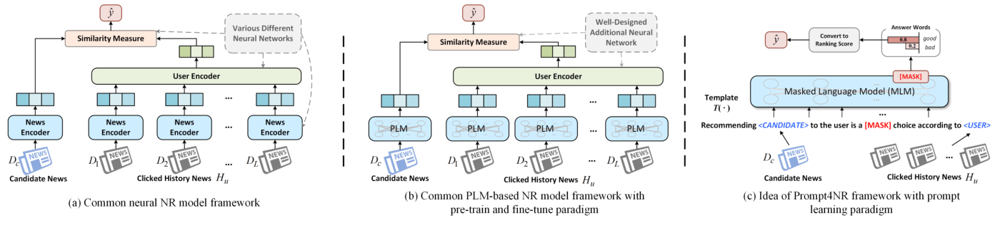
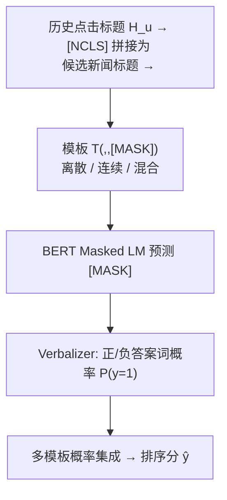
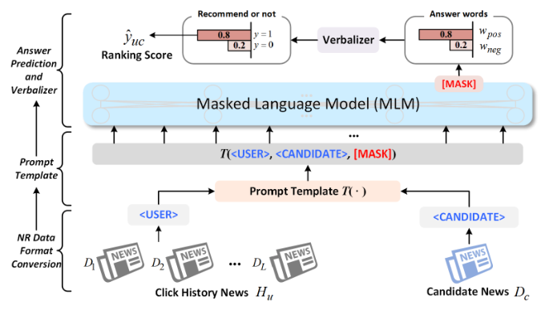

# Prompt Learning for News Recommendation (面向新闻推荐的提示学习框架)

- **会议/期刊**: SIGIR 2023
- **作者与机构**: Zizhuo Zhang, Bang Wang（华中科技大学电子信息与通信学院）
- **推荐链路定位**: 精排（候选新闻点击概率打分与列表排序）
- **研究方向**: 大语言模型推荐 / 冷启动与长尾推荐
- **论文原文**: [https://arxiv.org/abs/2304.05263v1](https://arxiv.org/abs/2304.05263v1)
- **开源代码**: [https://github.com/resistzzz/Prompt4NR](https://github.com/resistzzz/Prompt4NR)

## TL;DR (1分钟核心速览)

主流 PLM 新闻推荐沿用「预训练 + 微调」：BERT 只当新闻编码器，另配任务专属用户编码器与推荐目标，下游二分类目标与 MLM 预训练目标不一致，预训练语义知识未被充分激活。Prompt4NR 首次把「用户是否点击候选新闻」改写为完形填空：历史标题串成 `<USER>`、候选标题为 `<CANDIDATE>`，经离散/连续/混合三类模板拼接 `[MASK]`，直接以 BERT 预测正/负答案词的概率作排序分，并用多模板概率求和集成。MIND 上 1:4 负采样排序评测，跨类型集成取得 AUC 69.64、NDCG@5 38.30，相对最优基线 BERT-NRMS 提升 1.5%/4.8%。

## Background & Motivation (背景与核心矛盾)

- **主流范式**: 神经 NR 模型（NPA/LSTUR/NRMS/FIM）以新闻编码器 + 用户编码器 + 相似度打分三段式建模，词向量多由 Word2Vec/GloVe 静态初始化；后续工作将新闻编码器替换为 BERT 做预训练-微调。
- **前人局限**: 其一，微调阶段使用推荐专属目标（点击二分类/BPR），与 MLM 预训练目标不一致，PLM 的百科式语义与语言知识未被探测；其二，PLM 之外仍需自造用户编码器与序列聚合网络，小样本下这些随机初始化模块更易过拟合。
- **核心洞察 (Key Insight)**: 若把 NR 输入改写成「像被插进预训练语料里的句子」并让 PLM 预测 `[MASK]` 处的答案词，即可直接读取预训练知识；不同措辞的模板会唤起知识的不同侧面（相关性、情感、行为、效用），因此模板本身就是归纳偏置。
- **本文切入点**: 任务重构为 cloze-style 填空 + 标签到答案词的 verbalizer 映射 + 跨模板概率集成，全模型只调 PLM 参数。

<figure class="paper-figure" markdown="span">
  <figcaption>图1：神经NR模型、基于PLM的预训练与微调模型以及我们的Prompt4NR框架之间的区别。</figcaption>
</figure>

## Method (核心方法设计)

### 1. 整体框架 (Overall Architecture)

输入侧不做任何神经编码：用户历史 $H_u=\{D_1,\dots,D_L\}$的每条标题前加虚拟词元 `[NCLS]` 后拼接成 `<USER>`（隐式充当用户兴趣摘要，同时以 `[NCLS]` 做新闻级切分），候选新闻标题直接作为 `<CANDIDATE>`；模板$T(\cdot)$将二者与 `[MASK]` 组合成一句自然语言送入 BERT-MLM，verbalizer 把标签$y\in\{0,1\}$ 映射到词表内一对反义答案词，取正类答案词概率即点击置信度与排序分；多模板场景下对各模板正类概率求和作为最终打分。整个框架不含任务专属用户编码器，训练与推理均在单一 PLM 内闭环。

<figure class="paper-figure" markdown="span">
  <figcaption>图2：Prompt4NR框架示意图。</figcaption>
</figure>

### 2. 关键设计拆解 (Key Designs)

1. **三类模板族（把「匹配信号如何表述」变成可搜索的超参）**：痛点是 NR 中"用户-新闻匹配"缺少统一的自然语言表述。作者从四个视角给出模板：相关性（`related/unrelated`）、情感（`interesting/boring`）、行为（`yes/no`）、效用（`good/bad`）。离散模板纯人工措辞；连续模板在 `<USER>`/`<CANDIDATE>`/`[MASK]` 前分别插入 $n_1,n_2,n_3$个可学习虚拟词元$[P_i],[Q_j],[M_k]$；混合模板保留$[P],[Q]$而把$[M]$ 换成自然语句，兼顾「自动搜索格式」与「自然语言指引答案方向」。核心算子即
$x_{prompt}=T(\langle USER\rangle,\langle CANDIDATE\rangle,[MASK])$，
直觉是虚拟词元提供额外自由度但随机初始化缺乏预训练知识，故数量宜少不宜多。
2. **答案空间与 Verbalizer（把分类标签落到词表上）**：痛点在于推荐标签 $\{0,1\}$与 MLM 词表空间不对齐。作者为每个模板手工指定二元答案空间$\mathcal{W}_a=\{w_{pos},w_{neg}\}\subset\mathcal{W}$，令
$P(y\mid H_u,D_c)=P_{\mathcal{M}}\!\left([MASK]=v(y)\mid x_{prompt}\right),\quad v(y)=w_{pos}\ \text{if}\ y=1$，
并以 $P(y=1\mid\cdot)$ 作为排序分。这样"是否推荐"被表达为 PLM 最擅长的词汇级概率预测，避免引入新参数。
3. **训练目标、答案空间与推理开销**：仅用交叉熵
$\mathcal{L}=-\frac{1}{N}\sum_{i=1}^{N}\left[y_i\log P_i+(1-y_i)\log(1-P_i)\right]$，
AdamW（lr=2e-5）+ L2；训练沿用 1:4 负采样，无额外 hard negative 挖掘。集成时 $\hat{y}=\sum_{e\in\mathcal{E}}P_e$，即把不同模板的正类概率直接相加（同类集成与跨类型集成两种）。推理需对每个「用户历史 + 候选新闻」拼接序列做一次 BERT 前向，属 cross-encoder 式逐候选打分，长历史（50 条标题 × 10 词）导致序列长、在线延迟与候选数线性增长。

## Experimental Setup & Evaluation Protocol (实验设置与评估协议)

- **数据集与预处理**: 公开 MIND 基准（用户行为以 impression 日志组织），按前四击历史构造，标题截断为历史 10 词 / 候选 20 词，历史长度固定取最近 50 条。

| 数据集 | #Users | #Items | #Interactions | 稀疏度/密度 | 特征/场景说明 |
| :--- | :---: | :---: | :---: | :---: | :--- |
| MIND | 94,057 | 65,238 | 347,727 clicks / 230,117 impressions | 每用户约 3.7 次点击 | 仅用新闻标题文本，无类目/实体等边信息；英文新闻 impression 日志 |

- **数据划分与防穿越 (Splitting Strategy)**: 全局时间戳切分——前四周日志构造用户历史，倒数第二周为训练集，最后一周为测试集，并从训练集抽 5% 作验证集，严格避免未来行为穿越。
- **排名评测协议 (Ranking Protocol)**: `Sampled Ranking`，每 impression 采用 1:4 负采样（1 正 4 负）构造候选，指标为所有 impression 上的平均 AUC、MRR、NDCG@5、NDCG@10；**未报告 Full-Ranking 全库排序结果**。
- **对比基线与超参设置**: 神经基线 NPA/LSTUR/NRMS/FIM；BERT 增强基线 BERT-NPA/BERT-LSTUR/BERT-NRMS（仅替换新闻编码器）。骨干为 bert-base-uncased（12 层），单卡 batch 16 × 8 卡 = 128，显著性以 student's t-test 检验（$p<0.01$）。

## Key Experimental Results (实验关键数据)

### 1. 主实验对比 (Main Results)

| 类别 | 模型 | AUC | MRR | NDCG@5 | NDCG@10 |
| :--- | :--- | :---: | :---: | :---: | :---: |
| 神经 | NPA | 64.65 | 30.01 | 33.14 | 39.47 |
| 神经 | LSTUR | 65.87 | 30.78 | 33.95 | 40.15 |
| 神经 | NRMS | 65.63 | 30.96 | 34.13 | 40.52 |
| 神经 | FIM | 65.34 | 30.64 | 33.61 | 40.16 |
| PLM 微调 | BERT-NPA | 67.56 | 31.94 | 35.34 | 41.73 |
| PLM 微调 | BERT-LSTUR | 68.28 | 32.58 | 35.99 | 42.32 |
| PLM 微调 | BERT-NRMS | 68.60 | 32.97 | 36.55 | 42.78 |
| **Prompt** | **Cross-Type Ensembling** | **69.64** | **34.26** | **38.30** | **44.33** |
| Improv.% vs BERT-NRMS | — | +1.52% | +3.91% | +4.79% | +3.62% |

### 2. 消融实验 (Ablation Study)

| 变体（模板类型 / 集成 / 骨干） | AUC | MRR | NDCG@5 | NDCG@10 |
| :--- | :---: | :---: | :---: | :---: |
| Discrete-Utility（单模板最优） | 68.94 | 33.62 | 37.47 | 43.61 |
| Continuous-Utility（单模板最优） | 69.10 | 33.96 | 37.91 | 43.92 |
| Hybrid-Action（单模板最优） | 69.37 | 34.02 | 37.96 | 44.00 |
| Discrete-Ensembling（4 离散模板融合） | 69.34 | 33.76 | 37.71 | 43.80 |
| Continuous-Ensembling（4 连续模板融合） | 69.43 | 34.06 | 38.11 | 44.14 |
| Hybrid-Ensembling（4 混合模板融合） | 69.22 | 33.78 | 37.77 | 43.87 |
| **Cross-Type Ensembling（D-U + C-U + H-A）** | **69.64** | **34.26** | **38.30** | **44.33** |
| NullPrompt（去掉全部虚拟词元, $n=0$） | 68.9 | — | — | — |
| Discrete-Utility 换 RoBERTa / DeBERTa 骨干 | 69.20 / 69.01 | 34.00 / 33.98 | 37.77 / 37.67 | 43.96 / 43.74 |

### 3. 关键实验发现 (Key Findings)

1. **范式收益大于模板细节**：即便 $n=0$ 的 NullPrompt（无任何虚拟词元）AUC 已达 68.9，仍高于所有 BERT 微调基线（最高 68.60）；而 12 个单模板中 10 个超过 BERT-NRMS，说明收益主要来自目标对齐（MLM 填空替掉推荐二分类头），而非模板花样。
2. **"直问任务"的模板优于"迂回推断"**：离散/连续最优均为 Utility（68.94 / 69.10），混合最优为 Action（69.37），而 Relevance/Emotion 需要绕一层语义或情感推断，混合版 Relevance 甚至跌至 68.47（低于 BERT-NRMS）。模板措辞与任务目标越直接对齐，越能唤起有效知识。
3. **集成增益依赖子模板质量均衡，跨类型最优**：Discrete/Continuous 集成较其最佳单模板只提升 +0.40/+0.33 AUC，而 Hybrid 集成（69.22）反而低于其 Action 单模板（69.37），因 Hybrid 内部四个模板差距过大；跨类型融合三个各自最优模板取得 69.64（较最佳单模板 +0.27 AUC、NDCG@5 +0.34），且在小样本下始终高于所有单模板与 BERT-NRMS，连续/混合模板的虚拟词元随数据减少训练不足，此时 Discrete-Utility 反更稳健。

## Highlights & Limitations (亮点、对比与审稿批判)

- **与代表作对比 (vs. Prior Work)**: 相较 NRMS（多头注意力三段式）与 BERT-NRMS（BERT 仅作新闻编码器 + 推荐目标微调），本文取消独立用户编码器与推荐专用损失，把整个排序过程压进一个 MLM 前向；相较同期 PLM 多任务/多域增强（如 BERT 多任务微调）也无需额外标注字段。差别本质是**目标函数对齐**而非网络容量扩张。
- **可迁移亮点**: ①「模板视角正交化 + 概率求和」可低成本移植到 CTR 预估、会话推荐等二分类打分任务，作为冷启动/少样本的正则化手段；②`[NCLS]` 虚拟标记做新闻级切分，比依赖自然句读更适配长短不一的列表输入；③混合模板（虚拟词元管格式、自然句管答案方向）是可复用的 prompt 工程折中方案。
- **审稿级局限批判**: ①评测只在 MIND 单个子集、且用 1:4 采样的 Sampled Ranking，缺少 Full-Ranking 与跨站数据，AUC 级差异（~1%）在采样协议下易被放大；②cross-encoder 逐候选前向 + 50 条历史拼成超长序列，线上打分成本随候选数线性增长，论文未给延迟/显存实测；③虚拟词元数量 $n$、模板措辞与答案词均为人工设定且集成权重固定为等权求和，缺少自适应选择与显著性检验覆盖集成模型。

## Rating (四维评分)

- **方法创新性 (Novelty)**: ⭐⭐⭐⭐ （首次把 NR 重构为 MLM 完形填空并系统比较离散/连续/混合模板族，思路清晰但机制本身来自通用 prompt learning 迁移）
- **评估协议与实验扎实度 (Protocol & Experiments)**: ⭐⭐⭐ （MIND 单数据集 + 1:4 采样排序、未见 Full-Ranking 与线上验证，消融覆盖模板与骨干但仍较单薄）
- **写作与数学规范度 (Clarity & Rigor)**: ⭐⭐⭐⭐ （模板、verbalizer、集成公式定义简洁无歧义，注意力可视化与 case study 佐证充分，缺乏复杂度与延迟分析）
- **工业落地与复现价值 (Industrial & Practical Value)**: ⭐⭐⭐ （代码开源，全模型仅调 PLM 易于实现，但超长序列 cross-encoder 打分在工业召回/精排链路上的延迟成本较高）

