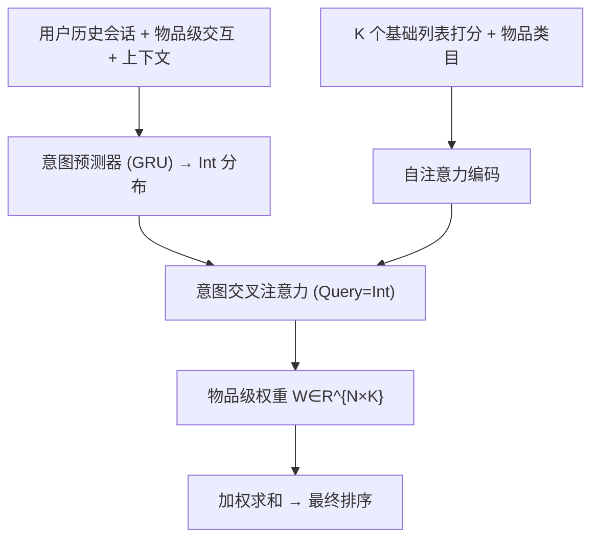
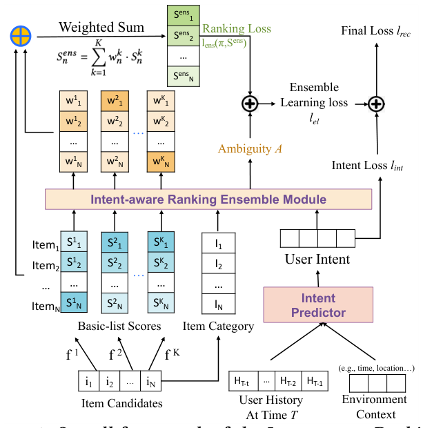

# Intent-aware Ranking Ensemble for Personalized Recommendation (面向个性化推荐的意图感知排序集成)

- **会议/期刊**: SIGIR 2023
- **作者与机构**: Jiayu Li, Peijie Sun, Zhefan Wang, Weizhi Ma, Yangkun Li, Min Zhang (清华大学/北京智源), Zhoutian Feng, Daiyue Xue (美团)
- **推荐链路定位**: 重排 (排序集成 / 融合层)
- **研究方向**: 多任务学习与列表级重排 / CTR 特征交叉
- **论文原文**: [论文原文链接](https://arxiv.org/abs/2304.07450v1)
- **开源代码**: [开源代码仓库链接](https://github.com/JiayuLi-997/IntEL-SIGIR2023)

## TL;DR (1分钟核心速览)

线上推荐每次访问由点击、收藏、购买等多个单目标模型各自产出候选列表，需融合成一个列表，但已有排序集成方法只处理**同质同目标**列表且用**列表级静态权重**，无法适配并发多样的用户意图。本文提出 IntEL：先由序列模型预测「行为×类目」意图分布，再用自注意力+意图交叉注意力为**每个物品×每个基础列表**学习个性化权重，并以误差-歧义分解证明物品级权重在 point/pair/list-wise 三种损失下均优于任一基础模型；在两份大规模数据集上全目标 NDCG@3 提升 22–28%。

## Background & Motivation (背景与核心矛盾)

- **主流范式**: 工业界用预定义列表级权重求和多个单目标排序列表；学术界则沿用 IR 的无监督秩聚合 (Borda/MRA/RRA) 或监督式 (λRank/ERA/aWELv)。
- **前人局限**: ① 秩聚合方法多为**同质列表**（同一目标）融合，未考虑推荐中多行为目标 (点击 vs 购买) 的异构性；② aWELv 等给整个列表一个共享权重 $w_{kn}=w_{km}$，抹平了列表内部物品类目差异，在长会话、多类目场景下失效。
- **核心洞察**: 用户一次访问的意图可定义为「行为意图 × 物品类目意图」的联合分布，它恰是决定"该偏向哪个目标列表的哪个物品"的关键side information；且集成权重应下放到物品级。
- **本文切入点**: 先用误差-歧义 (EA) 分解证明物品级加权集成的损失上界严格更优，再据此设计可学习的意图感知集成网络。

## Method (核心方法设计)

### 1. 整体框架 (Overall Architecture)

输入为用户历史会话+物品级交互+环境上下文，意图预测器输出意图分布 $\hat{Int}$；集成模块把$K$个基础列表的打分矩阵$S\in\mathbb{R}^{N\times K}$与物品类目$I\in\mathbb{R}^{N}$分别做自注意力，再用$\hat{Int}$作为 Query 做交叉注意力注入意图，最终投影得到权重矩阵$W\in\mathbb{R}^{N\times K}$，加权求和得最终分数并排序。端到端联合优化排名损失、歧义项与意图 KL 损失。

<figure class="paper-figure" markdown="span">
  <figcaption>图2：意图感知排序集成学习（IntEL）模型的整体框架，其中 𝑙𝑒𝑛𝑠 和 𝑙𝑟𝑒𝑐 分别由式24和式29生成。</figcaption>
</figure>

### 2. 关键设计拆解 (Key Designs)

1. **物品级异质集成与 EA 分解理论 (Item-level Ensemble)**：前人只在列表级加权、且无法处理异构目标。本文定义 $S^{ens}_n=\sum_{k=1}^{K}w_{kn}(u,c)\,S_{kn}(u,c)$，并证明对 MSE 损失有精确分解$l_m(\pi_n,S^{ens}_n)=\sum_k w_{kn}l_m(\pi_n,S_{kn})-\sum_k w_{kn}A_{kn}$，其中歧义项$A_{kn}=(S_{kn}-S^{ens}_n)^2\ge 0$；BPR 与 Plackett-Luce 亦可在$|w_{kn}-w_{km}|\le\delta$ 约束下得到同类上界。直觉：只要权重非负且逐物品归一，集成损失必低于基础损失的加权和，且**歧义越大上界越紧**——这直接给出"最小化损失 + 最大化歧义"的训练范式。

2. **意图感知集成模块 (Intent-aware Ensemble Module)**：痛点是不知该给哪个目标、哪类物品更高权重。对打分矩阵与类目序列各做 $T$层多头自注意力得到$\mathbf{S},\mathbf{I}$，再以意图嵌入$\mathbf{Int}_d$为 Query 做交叉注意力$A_s=\mathrm{Attn}(W_Q\mathbf{Int}_d,\mathbf{S},\mathbf{S})$、$A_i=\mathrm{Attn}(W_Q\mathbf{Int}_d,\mathbf{I},\mathbf{I})$，拼接后投影$W=\mathbf{W}_w\cdot[A_s,A_i,\mathbf{Int}_d]$。物理直觉：自注意力刻画列表内相对竞争关系，交叉注意力让"想买充电器"的意图放大购买列表里类目匹配物品的权重。

3. **训练目标与推理开销**：最终损失 $\mathcal{L}_{rec}=l_{ens}(\pi,S^{ens})-\alpha A+\gamma\,l_{int}$，$l_{int}$为意图分布的 KL 散度；$l_{ens}$ 可选 MSE/BPR/P-L。基础列表**离线预生成并冻结**，集成层仅含两层注意力与轻量 GRU，在线只做前向打分，无负采样开销，适合重排级时延。

## Experimental Setup & Evaluation Protocol (实验设置与评估协议)

| 数据集 | #Users | #Items | #Interactions | 稀疏度/密度 | 特征/场景说明 |
| :--- | :---: | :---: | :---: | :---: | :--- |
| Tmall | 148.4k | 142.5k | 2.439m Click / 185.5k Buy / 271.9k Fav / 743.3k Session | 极稀疏 | 电商三行为，类目 357，意图维度 1071，平均会话长 68.37 |
| LifeData | 82.7k | 165.5k | 819.4k Click / 82.5k Buy / 559.2k Session | 极稀疏 | 本地生活两行为，类目 6，意图维度 12，平均会话长 32.78 |

- **数据划分与防穿越**: 全局时间戳切分——最后一周为测试集，训练集最后三天为验证集；基础模型训练数据与集成数据**无重叠**（Tmall 用前 3 周生成基础打分）。
- **排名评测协议**: 每会话中每个基础模型取 Top-30 并集 + 会话正反馈构成候选集，在候选集内做 **Full-Ranking** 排序；评价指标为对多级真值 (Buy>Fav>Click>Examine) 及单行为的 NDCG@3/5/10。
- **对比基线与超参**: 基线含 Single Click/Fav/Buy、无监督 RRA/Borda、监督 λRank/ERA/aWELv 及其意图变体；GRU 意图预测器 $d=128$，自注意力$T=2$(Tmall)/$T=1$(LifeData)，batch=512，Adam，5 个随机种子取均值，显著性$p<0.05/0.01$。

## Key Experimental Results (实验关键数据)

### 1. 主实验对比 (Main Results)

| 模型 | Tmall All@3 | Tmall Click@3 | Tmall Buy@3 | LifeData All@3 | LifeData Click@3 | LifeData Buy@3 |
| :--- | :---: | :---: | :---: | :---: | :---: | :---: |
| Single Click | 0.1356 | 0.1435 | 0.0918 | 0.4004 | 0.4009 | 0.6365 |
| Borda | 0.1258 | 0.1317 | 0.0830 | 0.4094 | 0.4097 | 0.7030 |
| λRank | 0.2742 | 0.3104 | 0.1376 | 0.4129 | 0.4133 | 0.6866 |
| ERA | 0.3325 | 0.2301 | 0.1921 | 0.4063 | 0.4181 | 0.5782 |
| aWELv | 0.1387 | 0.1469 | 0.1025 | 0.4074 | 0.4077 | 0.7063 |
| aWELv+IntEL | 0.1427 | 0.1535 | 0.1042 | 0.4174 | 0.4189 | 0.7036 |
| **IntEL-MSE** | **0.4257\*\*** | **0.4693\*\*** | **0.2433\*** | 0.4253\*\* | 0.4257\*\* | 0.7096 |
| IntEL-BPR | 0.3992\* | 0.4417\*\* | 0.2344\* | 0.4308\*\* | 0.4312\*\* | 0.7115\* |
| **IntEL-PL** | 0.4041\*\* | 0.4367\*\* | 0.2355\* | **0.4378\*\*** | **0.4382\*\*** | **0.7604\*\*** |
| **Improv.%** (vs 最优基线) | +28.0% | +51.2% | +26.6% | +4.9% | +4.8% | +1.7% |

### 2. 消融实验 (Ablation Study)

| 变体 | Tmall All-NDCG@3 | Δ | LifeData All-NDCG@3 | Δ |
| :--- | :---: | :---: | :---: | :---: |
| w/o Intent (-Int) | 0.3913 | −0.0344 | 0.4123 | −0.0255 |
| w/o Item category (-I) | 0.3833 | −0.0424 | 0.4253 | −0.0125 |
| w/o Basic scores (-S) | 0.3099 | −0.1158 | 0.4333 | −0.0045 |
| w/o Cross-Attention (-Cross) | 0.3958 | −0.0299 | 0.4270 | −0.0108 |
| w/o Self-Attention (-Self) | 0.3463 | −0.0794 | 0.4318 | −0.0060 |
| IntEL (full) | **0.4257** | — | **0.4378** | — |

### 3. 关键实验发现 (Key Findings)

1. **物品级权重是主因**：Tmall 上 IntEL-MSE (0.4257) 相比列表级 aWELv+IntEL (0.1427) 提升近 3 倍，而 aWELv 系家族甚至不如 ERA——证明长会话 (68.37) 下"一个列表一个权重"根本无法表达列表内部类目竞争，颗粒度才是收益来源。
2. **意图缺失代价与数据规模强相关**：LifeData 上去掉意图 (0.4378→0.4123) 降幅远超去掉类目或自注意力，因其仅 12 类意图却高度决定行为偏好；Tmall 上去掉基础打分 (-S) 崩塌至 0.3099，说明意图只是"再分配器"，打分信息仍是排序骨架。
3. **损失函数须匹配标签分布**：Tmall 四级真值、候选长，回归式 MSE 最优 (0.4257 > PL 0.4041)；LifeData 会话短、正反馈稀少 (1.47/session)，比较式 P-L 最优 (0.4378)。同一框架下损失选择应随数据密度切换。

## Highlights & Limitations (亮点、对比与审稿批判)

- **与代表作对比**: 相比 aWELv（列表级权重、同质列表），本文把权重下放至物品级并支持异构多目标；相比 ERA/λRank（把基础分当特征做黑盒学习2rank），本文给出可解释的 EA 分解保证，且显式引入意图分布而非仅用打分与类目。
- **可迁移亮点**: ①「加权和 − 歧义」损失 $l_{ens}-\alpha A$ 可直接迁移到任何模型融合/集成场景充当正则；②以意图分布作 Query 的交叉注意力，可低成本移植到多场景 (multi-scenario) 或多目标精排的融合层。
- **审稿级局限批判**: ① 基础列表只用了 DeepFM 单一生成器，未验证多行为联合模型 (如 MB-STR) 产出的列表；② Tmall 意图维度 1071 导致意图预测本身困难 (I-Perform 仅 0.2347)，意图预测误差与集成收益的耦合未被量化；③ 超参 $\alpha$ 敏感（过大即退化为只最大化歧义），线上调参成本高。

## Rating (四维评分)

- **方法创新性 (Novelty)**: ⭐⭐⭐⭐ （首次将排序集成推广到异构多目标+物品级权重，并用 EA 分解把 point/pair/list-wise 三种损失统一证明，理论增量扎实）
- **评估协议与实验扎实度 (Protocol & Experiments)**: ⭐⭐⭐⭐ （Tmall+LifeData 双数据集、时间切分、候选集 Full-Ranking、5 种子与显著性检验齐全，但候选集为 Top-30 并集而非全库，略降无偏性）
- **写作与数学规范度 (Clarity & Rigor)**: ⭐⭐⭐⭐ （三个定理证明清晰、符号统一，但 pair/list-wise 证明因篇幅省略较多关键步骤，$\delta$ 约束的松弛性缺乏讨论）
- **工业落地与复现价值 (Industrial & Practical Value)**: ⭐⭐⭐⭐⭐ （基础列表可离线冻结、在线仅两层注意力，代码与基线全部开源，天然契合工业多目标融合层）

