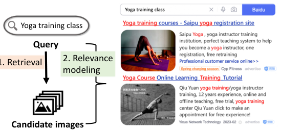
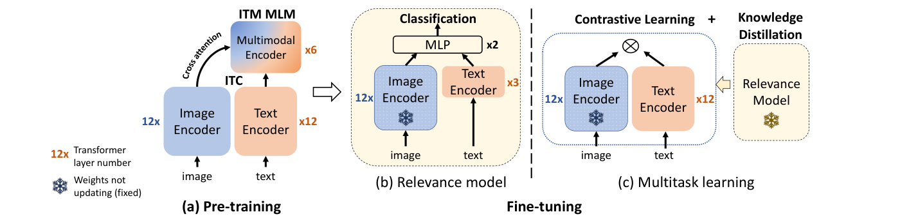
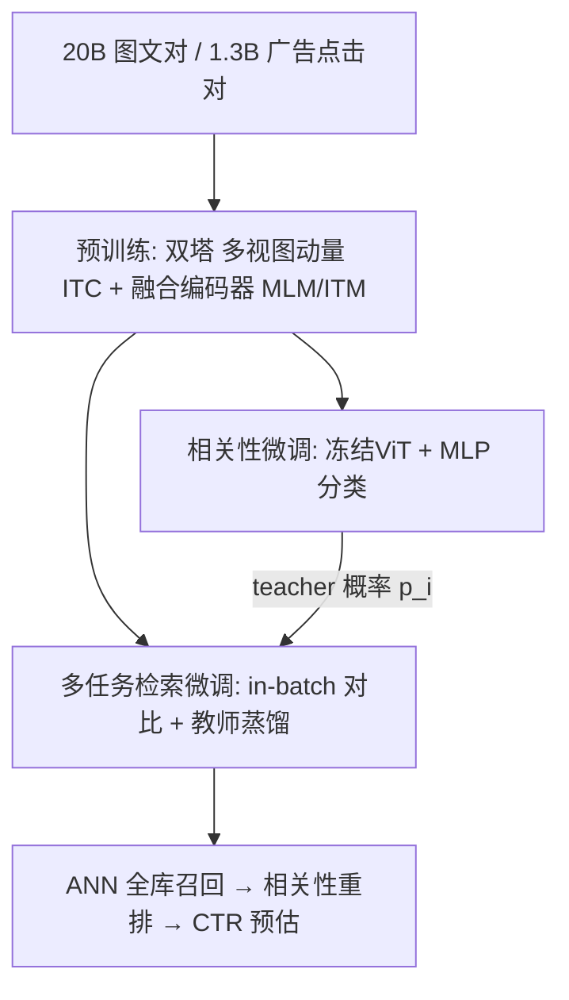

# Enhancing Dynamic Image Advertising with Vision-Language Pre-training (视觉-语言预训练增强动态图片广告)

- **会议/期刊**: SIGIR 2023 (Industry Track, 6 页短文)
- **作者与机构**: Zhoufutu Wen, Zhipeng Jin, Yi Yang, Wei Jia, Xiaodong Chen, Shuanglong Li, Lin Liu（百度搜索广告）；Xinyu Zhao（北京大学，实习期间完成）
- **推荐链路定位**: 召回（ANN 图库检索）+ 粗排（相关性重排），下游接 CTR 预估与图片广告生成
- **研究方向**: 多模态推荐 / CTR 预估与特征交叉（商业指标）
- **论文原文**: [论文原文链接](https://arxiv.org/abs/2306.14112v1)
- **开源代码**: 暂未开源

## TL;DR (1分钟核心速览)

DIA（动态图片广告）需要在海量图库召回「既相关又能点击」的广告图，但工业界旧方案把检索模型与相关性模型**分别单独训练**，单目标优化导致召回图不相关或相关性图不吸量，且广告域标注数据少、query 短而抽象。本文提出「大规模图文预训练 + 业务数据双任务微调」框架：先用 20B 图文对训练双塔 ITC（动量负样本）+ 融合编码器 MLM/ITM，再冻结 ViT 分别微调出相关性模型与多任务检索模型，后者用对比学习 + 相关性模型知识蒸馏联合优化。离线检索 Recall@1 在搜索私有域由 23.6 升至 36.1，相关性 AUC 由 82.00 升至 86.62；线上 15 天 A/B 主流量 CPM +1.04%、CTR +1.865%、P97 延迟仅 +0.05%。

## Background & Motivation (背景与核心矛盾)

- **主流范式**: DIA 采用两段式 query-image matching——先用 ANN 从图库召回候选广告图，再按 query-image 相关性重排，最后交给 CTR 模型与多模态广告生成模块 <figure class="paper-figure" markdown="span">
  <figcaption>图 1：Dynamic Image Advertising 示意图：(a) 首先，根据候选图像与查询的距离检索候选图像。然后，根据查询-图像相关性对图像重新排序。(b) 先前方案是分别训练任务特定模型。(c) 我们采用视觉-语言预训练和微调来统一检索模型与相关性模型。</figcaption>
</figure>。
- **前人局限 1（多模态）**: 旧方案训练的是任务特定小模型，跨模态交互不足；广告 query 比通用文本更短更抽象，长尾低频 query 上表征严重缺失。
- **前人局限 2（多目标）**: 检索模型只学「点击」、相关性模型只学「相关」，两个单目标模型互相拆台——召回高 CTR 图但不相关，或相关但不吸量；且两套模型训练与维护成本翻倍。
- **核心洞察 (Key Insight)**: 通用 VLP 的图文对齐能力恰好适配 query-image 相似度度量，但通用预训练数据是含噪网页图文，直接迁移到广告域会有分布偏移，必须用业务标注做域适配。
- **本文切入点**: 一次预训练、两种微调——把「相关」信号作为 teacher 蒸馏进「点击」召回塔，用一个双塔同时承担召回与相关性约束。

## Method (核心方法设计)

### 1. 整体框架 (Overall Architecture)

框架遵循「先预训练、再分头微调」范式，含三个模型 <figure class="paper-figure" markdown="span">
  <figcaption>图 2：我们的视觉-语言框架概览。(a) 我们使用对比损失联合预训练两个单模态编码器，以及一个多模态编码器；该编码器通过图像到文本交叉注意力融合模态，并使用掩码语言建模和图像-文本匹配损失。然后，在图像部分固定（不更新参数）的情况下，我们在两个任务上微调单模态编码器：(b) 对相关查询-图像对进行分类；(c) 计算查询-图像余弦相似度，以区分点击对并同时拟合相关性教师模型的输出。</figcaption>
</figure>。预训练阶段：ViT-B/16 图像塔与 RoBERTa-base 文本塔各自独立编码，通过多视图动量 ITC 对齐两个模态空间（4 个对比项：双向跨模态 + 两个模态内自对比，负样本用动量编码器扩充）；文本塔输出再送入 RoBERTa 融合编码器，以图像特征作 key/value 做 image-to-text 交叉注意力，用 MLM 与带难负样本挖掘的 ITM 捕捉细粒度交互。微调阶段：**冻结图像塔**（省算力、防过拟合），双塔 + MLP 分类头在 50 万条相关性标注上得到相关性模型；另一路同样冻结图像塔，用 in-batch 负采样的双向对比损失拟合 13 亿点击对，同时用 L2 损失把余弦相似度对齐到相关性模型的输出，得到多任务检索塔。线上以该塔建 ANN 索引完成召回，余弦分数与相关性分数共同供重排使用。

### 2. 关键设计拆解 (Key Designs)

1. **多视图动量对比预训练（补足长尾 query 的跨模态对齐）**: 旧小模型在长尾 query 上与图像空间几乎无交集 $\to$ 把 InfoNCE 扩展为跨模态双向 + 模态内双向四项之和，并用动量编码器维护大 batch 负样本队列：

$$\ell_{v\to t}(i)=-\log\frac{\exp(\langle z_i^{v},z_i^{t}\rangle/\tau)}{\sum_{j}\exp(\langle z_i^{v},z_j^{t}\rangle/\tau)}$$

单项模态自对比让模型先学会区分同模态内的细粒度语义，跨模态项再做空间对齐，因此短 query 也能落到合理图像邻域；融合编码器的 ITM 硬负样本进一步压制「高相似但无关」的图文对。

2. **相关性模型的域适配（把网页噪声换成广告标注）**: 预训练图文对来自网页爬取，与广告 query 的意图分布不一致 $\to$ 在双塔表示上接 MLP 输出二维 logits 做交叉熵分类：

$$\hat{y}_i=\mathrm{MLP}\big([h_i^{q};h_i^{v}]\big),\quad \mathcal{L}_{\text{rel}}=-\frac{1}{N}\sum_i\mathbb{I}[y_i=1]\log\hat{y}_i^{1}$$

关键工程决策是**只解冻文本侧**：广告域差异主要体现在 query 语义而非视觉外观，冻结 ViT 既避免 50 万级数据过拟合，又让相关性模型与检索模型共享同一图像空间，teacher 蒸馏才有意义。

3. **训练目标、负采样与推理效率**: 检索侧总损失为 $\mathcal{L}_{\text{ret}}=\mathcal{L}_{\text{ITC}}^{\text{in-batch}}+\lambda\mathcal{L}_{\text{KD}}$，其中蒸馏项为

$$\mathcal{L}_{\text{KD}}=\frac{1}{N}\sum_i\big\|\cos(q_i,v_i)-p_i\big\|_2^2$$

$p_i$ 为相关性模型给出的相关概率。负采样上，预训练用动量队列，检索微调改用 in-batch 负采样以压低显存；推理无任何 teacher 参与，仅一次双塔前向 + ANN 检索，模型规模与旧方案相当，故线上尾延迟无损。

## Experimental Setup & Evaluation Protocol (实验设置与评估协议)

- **数据集与预处理**:

| 用途 | 规模 | 说明 |
| :--- | :---: | :--- |
| 预训练 | 20B 图文对 | 通用图文 + 2021.01–2022.07 DIA 点击≥1 的 query-image 对，RandAugment 增广 |
| 相关性微调 | ~500K 对 | DIA 人工标注 0/1/2（0 负、1–2 正） |
| 检索多任务微调 | 1.3B 对 | 近半年点击≥2 的 query-image 对，约 2K 张唯一图 |
| 评测（公开） | Wukong / MSCOCO-CN / Flickr30k-CN | 中文图文检索基准 |
| 评测（私有） | search / ads / e-commerce | 三个业务域，不可复现 |

- **数据划分与防穿越 (Splitting Strategy)**: 无用户交互序列划分；检索侧为 **Zero-shot 跨域迁移评测**（预训练后未在目标域微调即直接测），相关性/多任务模型在独立标注集上训练、在另外 10K 对 / 10K 点击对上测试，训练测试无重叠。
- **排名评测协议 (Ranking Protocol)**: 检索为 **大规模全库排序**——对 860K 图库建索引，10K query 做 ANN top-K 检索，报 Text-to-Image `Recall@K (K=1,5,10)`；相关性用 `AUC`；业务侧另设 `Diversity Ratio`（top-15 去重占比）与长尾 `Irrelevant Ratio`（1K 长尾 query 人工标注 0/1/2）。
- **对比基线与超参设置**: 主要对手为中文 SOTA `CN-CLIP(base)`、旧任务特定检索器 `previous_retrieval` 与旧相关性模型 `previous_relevance`（基于 `<query, 图片描述, 图片>` 三元组）。图像塔 ViT-B/16、文本/融合塔 RoBERTa-base；论文未报告 $\lambda$、$\tau$ 取值与显著性检验，也未报告多次运行方差——这是短文工业 track 的普遍短板。

## Key Experimental Results (实验关键数据)

### 1. 主实验对比 (Main Results)

Zero-shot 图文检索（R@K，加粗为该列最优）：

| 模型 | Wukong R@1/5/10 | MSCOCO-CN R@1/5/10 | Search(私有) R@1/5/10 | E-com(私有) R@1/5/10 |
| :--- | :---: | :---: | :---: | :---: |
| CN-CLIP | 45.6/72.4/79.8 | **62.2/86.6/94.9** | 23.6/48.9/59.0 | 8.0/22.1/30.6 |
| ours$_{base}$ | **56.3/82.9/88.0** | 51.0/80.8/91.2 | **36.1/67.4/76.7** | **9.8/27.0/37.4** |
| Improv. (R@1) | +23.5% | −18.0% | **+53.0%** | +22.5% |

检索质量与相关性质量（同一 query-image matching 模块两侧）：

| 指标 | previous$_{retrieval}$/ previous$_{rel}$ | ours |
| :--- | :---: | :---: |
| Diversity Ratio ↑ | 6.11 | **9.40** |
| Irrelevant Ratio ↓（长尾） | 32.67 | **21.78** |
| Relevance AUC ↑ | 82.00 | **86.62** |
| 人工相关性胜出 | — | **+7%** |

### 2. 消融实验 (Ablation Study)

| 配置 | Recall@10 ↑ | Rel@10 ↑ |
| :--- | :---: | :---: |
| base（未做检索微调） | 75.3 | 78.5 |
| retrieval w/o KD（仅对比学习） | 92.8 | 77.7 |
| retrieval w/ KD（本文） | **94.1** | **79.5** |

线上 A/B（百度搜索广告主流量，15 天）：

| 指标 | CPM | CTR | P97 延迟 |
| :--- | :---: | :---: | :---: |
| ours$_{retrieval}$ | **+1.04%** | **+1.865%** | +0.05% |

### 3. 关键实验发现 (Key Findings)

1. **增益来自数据分布对齐，而非更大模型**: 在含噪中文网页图文构成的 Wukong 上 R@1 领先 CN-CLIP 10.7 点（56.3 vs 45.6），但 CN-CLIP 在其同源翻译数据 MSCOCO-CN/Flickr30k-CN 上反超（62.2 vs 51.0、62.7 vs 45.8）——说明预训练语料分布决定迁移边界，本文优势集中在商业域（Search R@1 +53.0%）。
2. **单目标优化确实存在 trade-off**: 「仅对比学习」的检索塔把点击召回从 75.3 拉到 92.8，却让 top-10 相关性从 78.5 **降到** 77.7；加入蒸馏后两项同时升到 94.1/79.5，直接证明 KD 是解耦该冲突的关键算子而非锦上添花。
3. **冻结视觉塔的预训练红利体现在长尾而非平均**: 多样性比率 6.11→9.40（+53.8%）、长尾无关率 32.67→21.78（−33.3%），即同一 query 能召回更丰富的图而非几张热门图；线上三项指标同向提升且尾延迟仅 +0.05%，证明收益不是用算力换来的。

## Highlights & Limitations (亮点、对比与审稿批判)

- **与代表作对比 (vs. Prior Work)**: 与 FashionBERT / Kaleido-BERT 只用电商域数据训练不同，本文坚持 20B 通用 + 业务混合预训练并显式验证域分布影响；与 AdsCVLR 侧重 query-ad 图文相关性不同，本文把相关性模型降格为 teacher，用蒸馏把商业 CTR 目标写进召回塔；与 CN-CLIP 相比，模型结构接近，差异在数据配方与两阶段任务解耦方式。
- **可迁移亮点**: ①「相关性 teacher 蒸馏到点击召回双塔」是任何「质量目标 vs 商业目标」冲突场景（短视频、电商搜索）的通用解法；②冻结视觉塔 + 只解冻文本侧的域适配策略，在标注量 10^5 量级时能同时省算力与防过拟合。
- **审稿级局限批判**: ①基线极少（公开集仅 CN-CLIP 一个），无显著性检验与方差报告，10K 评测集上的 ±1 点差异可信度存疑；②三处核心论断（20B 数据配比、$\lambda/\tau$ 取值、teacher 蒸馏温度）均未披露，且代码与私有数据未开源，离线结果实际不可复现；③图库仅 860K 张、未与「两模型分开训练」的旧方案在同一协议下做端到端业务指标对照，消融也缺「不冻结 ViT」与「蒸馏换成联合训练」两组关键对照。

## Rating (四维评分)

- **方法创新性 (Novelty)**: ⭐⭐⭐ （预训练 + 双任务微调的组合属工程整合创新，亮点在「相关性→点击召回」的蒸馏算子和长尾长尾实验证据，但无新理论或新架构）
- **评估协议与实验扎实度 (Protocol & Experiments)**: ⭐⭐⭐ （有 Zero-shot 全库检索、长尾人工标注与 15 天线上 A/B 三重证据，但基线仅 1 个、无显著性检验、无方差与超参披露）
- **写作与数学规范度 (Clarity & Rigor)**: ⭐⭐⭐ （6 页短文脉络清晰、公式聚焦增量，但缺符号表、缺损失权重与温度、蒸馏项未给出 teacher 输出的归一化细节）
- **工业落地与复现价值 (Industrial & Practical Value)**: ⭐⭐⭐⭐ （已部署百度「凤巢」主流量，P97 延迟几乎无损，冻结图像塔的部署成本极低，方法论可快速平移到其他图文召回场景；扣分在未开源）

