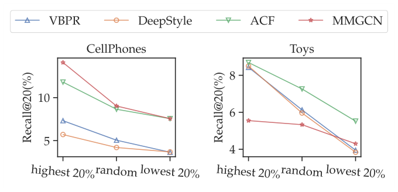
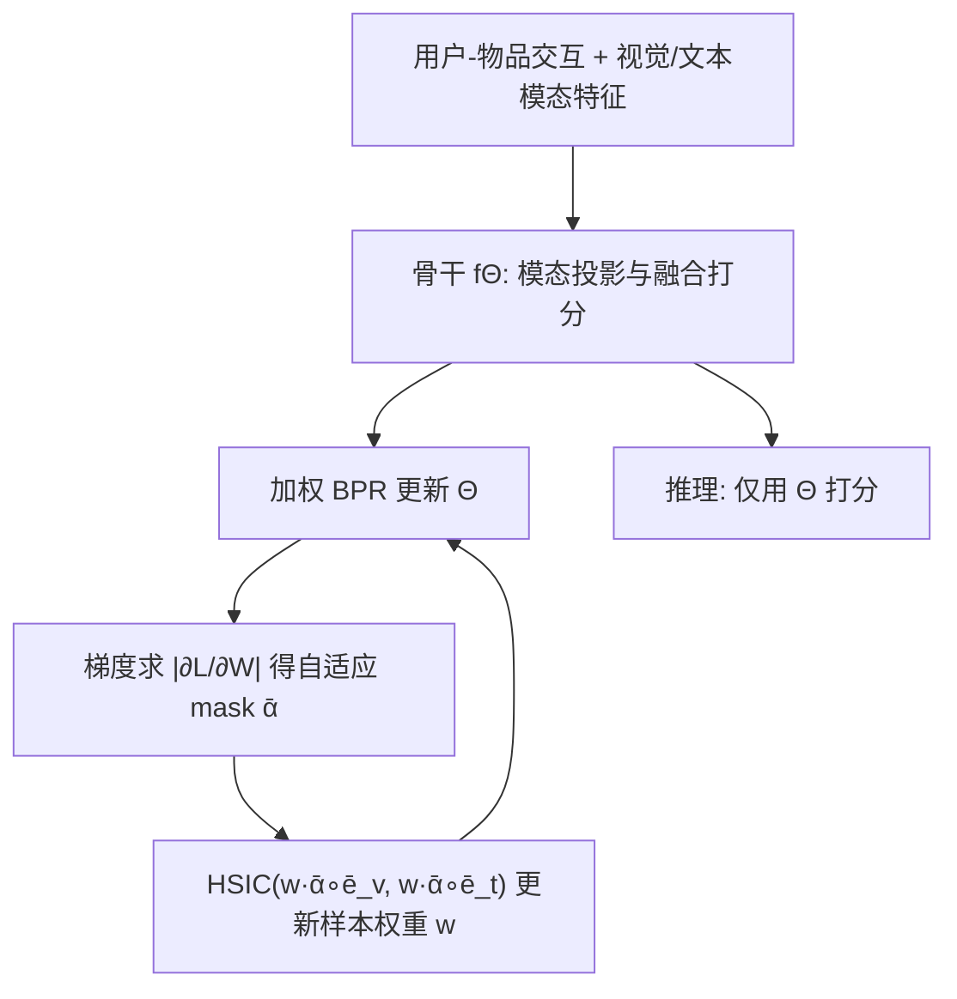
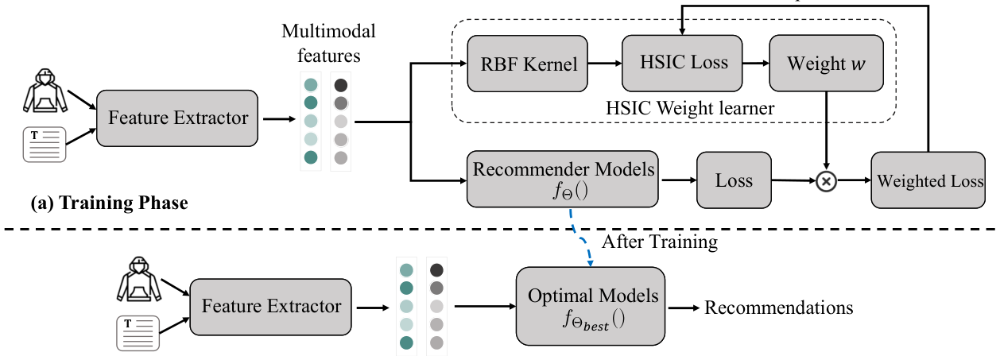

# Mining Stable Preferences: Adaptive Modality Decorrelation for Multimedia Recommendation (挖掘稳定偏好：面向多模态推荐的自适应模态去相关)

- **会议/期刊**: SIGIR 2023
- **作者与机构**: Jinghao Zhang, Qiang Liu, Shu Wu, Liang Wang（中科院自动化所 CRIPAC/MAIS，国科大人工智能学院）
- **推荐链路定位**: 精排（模态特征融合打分），以即插即用训练模块形式挂载
- **研究方向**: 多模态推荐 / 因果去偏与稳定学习
- **论文原文**: [https://arxiv.org/abs/2306.14179v1](https://arxiv.org/abs/2306.14179v1)
- **开源代码**: 暂未开源

## TL;DR (1分钟核心速览)

多模态推荐中视觉与文本特征高度统计相关，模型容易把"品牌 Nike"这一真实因果偏好错学成"类似视觉风格"的虚假偏好，一旦测试分布漂移就失效。本文提出 MODEST：把每个物品当作可重加权样本，用 HSIC（核独立性检验）在加权分布上最小化跨模态相关度，并用梯度自适应 mask 只约束"任务相关"的维度，与加权 BPR 交替优化。作为即插即用模块接入 VBPR/DeepStyle/ACF/MMGCN，随机划分下 Recall@20 平均提升 3.1%–22.1%，OOD 划分下提升 9.8%–27.2%。

## Background & Motivation (背景与核心矛盾)

- **主流范式**: 多模态推荐在 CF/BPR 框架上拼接视觉、文本内容向量（VBPR），或以模态专属图、注意力做细粒度融合（ACF、MMGCN），并结合对比学习对齐内容与协同信号。
- **前人局限**: ① 模型把"共现即偏好"当公理，无法区分模态中哪一部分对购买决策有真实因果效应；② 现有关注假阳性交互（如 GRCN 剪边）的方法针对的是交互噪声，而非"模态间统计相关"带来的虚假依赖。
- **核心洞察 (Key Insight)**: 作者构造强/弱模态相关两个测试集（图 2）发现：骨干在强相关测试集上 Recall@20 更高、在弱相关集上骤降，说明性能提升部分来自可被分布偏移摧毁的伪相关通道。
- **本文切入点**: 不改特征（保持模态内在相关），而是改**样本权重**——让加权后的训练分布中跨模态特征互信息近似为零，迫使模型去拟合那些"相关度弱、但因果信号强"的难样本。

<figure class="paper-figure" markdown="span">
  <figcaption>图2：在不同特征相关度的测试集上的初步研究。</figcaption>
</figure>

## Method (核心方法设计)

### 1. 整体框架 (Overall Architecture)

MODEST 是包裹在任意骨干 $f_\Theta(\boldsymbol{x}_u,\boldsymbol{x}_i,\boldsymbol{e}_i^m)$外层的双层交替优化器。每个 epoch 先固定物品权重$\boldsymbol{w}$，用加权 BPR 更新骨干参数；再固定骨干，计算各模态各维度的任务相关性 mask，并以最小化 mask 后加权特征的 HSIC 为目标更新$\boldsymbol{w}$；重复直至早停。推理阶段权重被完全丢弃，只保留训练好的骨干，因此**零推理延迟**。核心闭环是"权重引导模型 —— 模型梯度定义相关性 —— 相关性反过来决定权重"的互相校正。

<figure class="paper-figure" markdown="span">
  <figcaption>图3：我们提出的 MODEST 模型的总体框架，该模型可作为多媒体推荐骨干 𝑓Θ() 的即插即用模块。在训练阶段，我们交替优化模型参数和样本权重。在推理阶段，我们可以直接使用训练好的多媒体推荐模型进行推荐。</figcaption>
</figure>

### 2. 关键设计拆解 (Key Designs)

1. **HSIC 模态独立性度量（把"相关"变成可微损失）**：高维非线性特征的直方图式相关性估计不可行，故采用 RKHS 上交叉协方差算子的 Hilbert-Schmidt 范数，经验形式为 $\mathrm{HSIC}(\boldsymbol{U},\boldsymbol{V})=(d-1)^{-2}\,\mathrm{tr}(\boldsymbol{K}_U\boldsymbol{P}\boldsymbol{K}_V\boldsymbol{P})$，其中$\boldsymbol{K}$为 RBF 核矩阵$\exp(-\|\cdot\|_2^2/\sigma^2)$，$\boldsymbol{P}=\boldsymbol{I}_d-\frac{1}{d}\boldsymbol{1}\boldsymbol{1}^\top$为中心化矩阵，$d$ 为特征维度。该量当且仅当两变量独立时取 0，天然适配多维非线性模态向量。
2. **自适应任务相关 mask（解决 vanilla HSIC 的"任务无关"缺陷）**：以输入模态特征对 BPR 损失的梯度幅值定义维度重要性 $\alpha_i^m=\sum_{j}|\partial\mathcal{L}_{BPR}/\partial\boldsymbol{W}^m[i,j]|$，再经 softmax 归一化并乘以维度数得$\bar{\alpha}_i^m$，用$\bar{\alpha}^m\circ\bar{\boldsymbol{e}}^m$ 参与 HSIC。直觉：只对影响推荐决策的维度施加去相关约束，避免把与任务无关的风格细节也强行"打散"而损失信息量。
3. **交替重加权与训练目标**：内层参数更新 $\Theta^{(q+1)}=\arg\max_\Theta\sum_{(u,i,j)\in\mathcal{D}}w_i^{(q)}\ln\sigma(\hat{y}_{ui}-\hat{y}_{uj})$；外层权重更新$\boldsymbol{w}^{(q+1)}=\arg\min_{\boldsymbol{w}}\sum_{i}\sum_{m_1\neq m_2}\lambda\,\mathrm{HSIC}(w_i^{(q)}\bar{\alpha}^{m_1}\circ\bar{\boldsymbol{e}}_i^{m_1},\,w_i^{(q)}\bar{\alpha}^{m_2}\circ\bar{\boldsymbol{e}}_i^{m_2})$。$\lambda$实际充当权重学习步长，$\lambda=0$退化为原骨干。负样本为随机采样且不加权（仅对正物品$i$赋予$w_i$），实现上为"每正样本 1 负样本"的成对训练；推理侧与骨干完全一致，无额外开销。

## Experimental Setup & Evaluation Protocol (实验设置与评估协议)

- **数据集与预处理**: Amazon 四个类目，均采用 **5-core** 过滤，视觉 4096 维、文本 1024 维（sentence-transformers 编码标题+描述+类目+品牌）。

| 数据集 | #Users | #Items | #Interactions | 密度 |
| :--- | :---: | :---: | :---: | :---: |
| Cellphones | 27,879 | 10,429 | 165,192 | 0.00057 |
| Beauty | 22,363 | 12,101 | 172,188 | 0.00064 |
| Baby | 19,445 | 7,050 | 139,110 | 0.00101 |
| Toys | 19,412 | 11,924 | 145,004 | 0.00063 |

- **数据划分与防穿越 (Splitting Strategy)**: 三种设置。①**比例划分**：每用户随机 80%/10%/10% 训练/验证/测试；②**OOD-Propensity**：用 MLP 二分类器估计 $P(\boldsymbol{e}^v,\boldsymbol{e}^t)$的高低（正例为真实特征对，负例为跨物品错配），仅保留概率最低 20% 的物品交互作为测试集，模拟"弱模态相关"分布；③**合成 OOD**：按 8:1:1 与 1:1:8 混合 Baby 与 Toys（如 8:1:1 Baby + 1:1:8 Toys），使$P_{train}\neq P_{test}$。训练/验证集在 ② 中保持不变，避免穿越；样本权重仅用训练集学习。
- **排名评测协议 (Ranking Protocol)**: 指标为 Recall@20 / NDCG@20 / Precision@20；原文未明确声明候选集规模，从 BPR 全物品打分的常规实现推断为 **Full-Ranking**（训练期负样本为单负采样）。
- **对比基线与超参设置**: 骨干 VBPR、DeepStyle、ACF、MMGCN，外加 IRM 系稳定学习基线 InvRL 作为强对照；嵌入维度统一 $d=64$，Adam + batch 1024 + Xavier，学习率$\{1e\text{-}4,\dots,5e\text{-}3\}$、$L_2$ $\{1e\text{-}5,\dots,1e\text{-}2\}$、dropout$\{0,0.1,\dots,0.8\}$ 网格搜索，验证集 Recall@20 连续 10 epoch 不升即早停。

## Key Experimental Results (实验关键数据)

### 1. 主实验对比 (Main Results)

表 1 随机划分（IID），Recall@20，格式为 `骨干 → +MODEST (相对骨干提升)`：

| 骨干 | Toys | CellPhones | Beauty | Baby | 平均Δ_R |
| :--- | :---: | :---: | :---: | :---: | :---: |
| VBPR | 0.0613 → 0.0669 (+9.1%) | 0.0505 → 0.0520 (+3.0%) | 0.0598 → 0.0721 (+20.6%) | 0.0313 → 0.0321 (+2.6%) | +8.8% |
| + InvRL | 0.0649 | 0.0504 | 0.0652 | **0.0337** | — |
| DeepStyle | 0.0596 → 0.0648 (+8.7%) | 0.0420 → 0.0549 (+30.7%) | 0.0626 → 0.0739 (+18.1%) | 0.0269 → 0.0352 (+30.9%) | +22.1% |
| ACF | 0.0726 → 0.0746 (+2.8%) | 0.0865 → 0.0911 (+5.3%) | 0.0811 → 0.0837 (+3.2%) | 0.0488 → 0.0494 (+1.2%) | +3.1% |
| MMGCN | 0.0533 → 0.0549 (+3.0%) | 0.0903 → **0.0942** (+4.3%) | 0.0699 → 0.0788 (+12.7%) | 0.0586 → **0.0616** (+5.1%) | +6.3% |

表 2 OOD-Propensity 划分（低相关 20% 测试集），Recall@20：

| 骨干 | Toys | CellPhones | Beauty | Baby | 平均Δ_R |
| :--- | :---: | :---: | :---: | :---: | :---: |
| VBPR | 0.0395 → 0.0455 (+15.2%) | 0.0365 → 0.0383 (+4.9%) | 0.0516 → 0.0639 (+23.8%) | 0.0311 → 0.0338 (+8.7%) | +13.2% |
| DeepStyle | 0.0384 → 0.0441 (+14.8%) | 0.0369 → 0.0422 (+14.4%) | 0.0513 → 0.0699 (+36.3%) | 0.0212 → 0.0305 (+43.9%) | +27.2% |
| ACF | 0.0552 → 0.0564 (+2.2%) | 0.0750 → **0.0751** (+0.1%) | 0.0904 → 0.0980 (+8.4%) | 0.0326 → 0.0481 (+47.5%) | +14.6% |
| MMGCN | 0.0430 → 0.0456 (+6.0%) | 0.0756 → 0.0816 (+7.9%) | 0.0640 → 0.0737 (+15.2%) | 0.0637 → 0.0702 (+10.2%) | +9.8% |

### 2. 消融实验 (Ablation Study)

原文未逐组件拆解，可对比的"弱化版本"为去除加权（$\lambda=0$ 退化为骨干）与改用 IRM 式不变风险正则（InvRL）；合成混合数据集结果如下（Recall@20，相对骨干提升）：

| 设置 | 数据集组合 | VBPR | DeepStyle | ACF | MMGCN |
| :--- | :--- | :---: | :---: | :---: | :---: |
| IID 混合 | 8:1:1 Baby + 8:1:1 Toys | +2.97% | +2.60% | +2.29% | +1.53% |
| OOD 混合 | 8:1:1 Baby + 1:1:8 Toys | +5.97% | +6.43% | +6.74% | +8.94% |
| OOD 混合 | 8:1:1 Beauty + 1:1:8 Toys | +10.23% | +15.31% | +10.02% | +5.29% |
| OOD 混合 | 8:1:1 Beauty + 2.5:2.5:5 Toys | +15.63% | +7.02% | +2.39% | +13.28% |

### 3. 关键实验发现 (Key Findings)

- **收益与骨干的表达能力反相关**：DeepStyle（仅视觉风格）平均涨 22.1%，而 ACF/MMGCN 这类依赖注意力和模态专属图的强骨干只涨 3.1%/6.3%——说明弱骨干更易被伪相关带偏，去相关模块的边际价值随骨干鲁棒性上升而递减。
- **OOD 增益系统性大于 IID**：同一套权重在随机划分下 OOD 提升从 8.8%→13.2%（VBPR）、6.3%→9.8%（MMGCN）；混合数据集上 IID 平均 +2.75%、OOD 平均 +9.05%，验证提升来自"稳定因果通道"而非单纯正则化。
- **$\lambda$呈倒 U 形且存在个别失效点**：$\lambda\in(0,0.5]$ 稳定优于骨干，过大则性能骤降（权重更新步长过大破坏 BPR 收敛）；Beauty 上样本权重近似 Gamma 分布，多数落在 0.8–1.0（VBPR/MMGCN）而 DeepStyle 低至 0.4，说明重加权是"温和压缩强相关样本"而非硬性剔除。另需注意 VBPR+Baby 上 MODEST（0.0321）反而低于 InvRL（0.0337），并非全场景占优。

## Highlights & Limitations (亮点、对比与审稿批判)

- **与代表作对比 (vs. Prior Work)**: 与 GRCN 剪"假阳性交互边"不同，本文处理的是**内容模态间**的伪相关，且不改图结构；与 InvRL 等 IRM 方法不同，不构造环境划分，而是直接在样本权重空间做 HSIC 去相关；与 StableNet 用随机傅里叶特征近似不同，本文用 RBF 核 HSIC 并对维度做任务相关 mask，把"稳定学习"首次系统迁入多模态推荐。
- **可迁移亮点**: ①"梯度幅值即维度重要性"的 mask 可直接搬到任意多模态融合打分器上做特征选择式对齐；②"不改特征只改权重 + 推理丢弃"的范式对线上系统零成本，适合作为训练期插件嵌入已有精排模型。
- **审稿级局限批判**: ①**实验不够拆解**：缺少 w/o mask（vanilla HSIC）、w/o 重加权、RBF 核 vs 线性核的定量消融，$\lambda$仅给曲线无表格数值，ACF 上还出现未解释的 `MODEST*` 变体；②**可扩展性与协议风险**：HSIC 需对 batch 内物品构造$d\times d$ 核矩阵并逐 item 计算，训练开销随 batch 与模态对数量近似二次增长，论文未给复杂度或耗时；评测协议未声明 Full-Ranking/候选规模与显著性检验，OOD 测试集由自训 MLP 分类器筛出、本身带估计偏差，"因果稳定"的主张缺少反事实或干预式证据支撑。

## Rating (四维评分)

- **方法创新性 (Novelty)**: ⭐⭐⭐⭐ （把样本重加权+HSIC 稳定学习引入多模态推荐，并用梯度 mask 做任务相关化，机制清晰且是首次；但两大组件均来自稳定学习既有范式，属组合式创新）
- **评估协议与实验扎实度 (Protocol & Experiments)**: ⭐⭐⭐ （四数据集×四骨干+OOD+合成混合数据设计颇有说服力，但缺组件级消融、无显著性检验、评测协议交代含糊）
- **写作与数学规范度 (Clarity & Rigor)**: ⭐⭐⭐⭐ （HSIC 与 mask 公式定义完整、交替优化算法流程明确；但对 $\lambda$ 与权重求解的具体优化器、复杂度分析着墨不足）
- **工业落地与复现价值 (Industrial & Practical Value)**: ⭐⭐⭐⭐ （即插即用、推理零延迟、权重可解释为样本难度，落地友好；但训练期额外核矩阵计算与调参成本、且代码未开源，复现门槛偏高）

