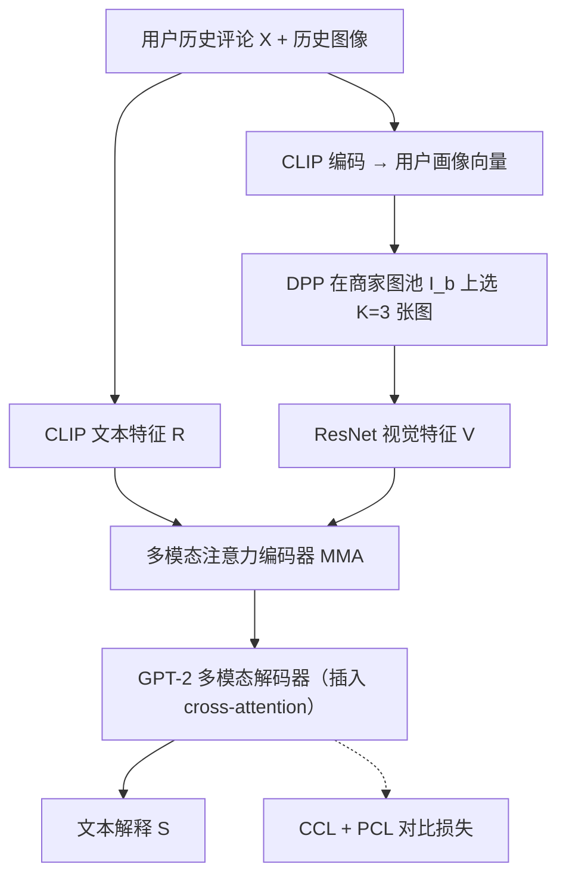

# Personalized Showcases: Generating Multi-Modal Explanations for Recommendations (个性化展示：为推荐生成多模态解释)

- **会议/期刊**: SIGIR 2023
- **作者与机构**: An Yan\*, Zhankui He\*, Jiacheng Li\*, Tianyang Zhang, Julian McAuley（UC San Diego）
- **推荐链路定位**: 推荐后置解释层（可解释生成，非排序链路）
- **研究方向**: 多模态推荐 / 对话推荐与可解释推荐
- **论文原文**: [https://arxiv.org/abs/2207.00422v2](https://arxiv.org/abs/2207.00422v2)
- **开源代码**: [https://github.com/zzxslp/Gest](https://github.com/zzxslp/Gest)

## TL;DR (1分钟核心速览)

现有推荐解释模型只生成文本，缺乏视觉 grounding，输出大量“food is great”式泛化句，多样性塌陷（Ref2Seq 的 Distinct-2 仅 5.89）。本文提出新任务 **personalized showcases**：先为用户从商家图片池中选出个性化图像集，再据图生成对齐文本，并构建 Google Local 多模态数据集 **Gest**（4.4M 图 / 1.77M 评论）。方法 **PC²L** 在 GPT-2 多模态解码器上叠加“实体替换硬负样本”的跨模态对比损失与“按用户历史相似度重加权”的个性化对比损失。在 K=3 图像选择（Prec@3 25.21→34.37 Recall@3）与文本生成上，Distinct-2 由 5.89 提升至 28.58，CLIP-Align 由 73.51 升至 85.31，人工评测表达性 3.72→4.25（$p<0.01$）。

## Background & Motivation (背景与核心矛盾)

- **主流范式**: 推荐解释生成以 Ref2Seq、Peter 等 text-only seq2seq/Transformer 为主，输入用户与物品侧历史评论，输出一句解释文本。
- **前人局限**: ① 无视觉 grounding，模型只能复述评论中的高频套话，Distinct-2 低至 1.27–5.89，解释几乎无信息增量；② 可用的多模态数据不匹配——Amazon 图片集中于单一商品、视觉多样性低，Yelp 图片质量高但**不含用户-图像交互**，两者都无法支撑“个性化图像解释”。
- **核心洞察 (Key Insight)**: 作者用 CLIP 余弦不相似度定义三层视觉多样性，发现 Gest 上 **Inter-User Div 最高、Intra-User Div 最低**——同一商家下不同用户拍摄/展示的内容差异极大，说明“用户上传了哪张图”本身就是个性化信号，可直接作为解释载体。
- **本文切入点**: 把解释从“一句话”扩展为“图集 + 对齐文本”的 showcase，并针对多图 grounding 与文本同质化两个新痛点设计对比学习目标。

## Method (核心方法设计)

### 1. 整体框架 (Overall Architecture)

任务被显式分解为两步级联：给定用户 $u$、商家$b$及商家图片候选池$I_b$，第一步用 CLIP 分别编码用户历史评论与历史图像，得到用户画像向量，再以**行列式点过程 (DPP)** 在$I_b$上做“相关性 + 多样性”联合的子集选择，贪心解码取$K=3$ 张图作为视觉解释；第二步把选中图像（ResNet 特征）与用户历史评论（CLIP 文本特征）投影对齐后送入多模态注意力编码器，再由插入 cross-attention 的 GPT-2 解码逐词生成文本解释，训练时额外施加跨模态对比与个性化对比两个辅助损失。最终文本与图集共同组织为面向用户的 showcase 呈现。

### 2. 关键设计拆解 (Key Designs)

1. **DPP 个性化图像集选择（相关性 × 多样性联合）**：逐张打分排序会选出 3 张几乎相同的菜品照，无信息量。本文把选择建模为子集概率正比于核矩阵行列式 $\hat{I}_{u,b}=\mathrm{DPP}(I_b,u)$，其中核矩阵元素由 CLIP 用户画像-图像相似度构成；行列式天然惩罚冗余（相似两图使行列式趋零），从而在 Precision 与 Div@3 之间取得自动平衡。

2. **跨模态对比损失 CCL（实体替换构造硬负样本）**：普通 InfoNCE 的批内负样本在隐空间极易区分，无法约束“文本是否真的描述了这几张图”。作者用 spaCy 抽取名词块，把目标句中的实体随机替换为语料内其他实体（“I like the sushi”→“I like the burger”），得到 $Y^{ent}$ 作为额外硬负样本：
$\mathcal{L}_{CCL}=-\sum_{i=1}^{N}\log\frac{\exp(s^{V,Y}_{i,i})}{\exp(s^{V,Y}_{i,i})+\sum_{j\in\mathcal{N}\cup ent}\exp(s^{V,Y}_{i,j})}$
负样本与正样本仅差一个名词，词面几乎重合，迫使模型把视觉信号真正用于实体决策——这是 CLIP-Align 提升的主要来源。

3. **个性化对比损失 PCL（按用户历史相似度重加权）**：把“A 用户”的句子当作“B 用户”的负样本并不等价，历史口味相近者本就该说得像。故对负样本按历史评论特征的余弦相似度加权：
$\mathcal{L}_{PCL}=-\sum_{i=1}^{N}\log\frac{\exp(s^{R,Y}_{i,i})}{\exp(s^{R,Y}_{i,i})+f(i,j)\sum_{j\in\mathcal{N}}\exp(s^{R,Y}_{i,j})},\quad f(i,j)=\alpha\big(1-\mathrm{sim}(\tilde{R}^{(i)},\tilde{R}^{(j)})\big)$
口味越不相似权重越大，等价于“只在真正不同的人之间做对比”，避免把合理的风格相似误判为错误。

4. **训练目标与推理开销**：$\mathcal{L}=\mathcal{L}_{CE}+\lambda_1\mathcal{L}_{CCL}+\lambda_2\mathcal{L}_{PCL}$，超参原文列为$(\lambda_1,\lambda_2,\alpha,\tau)=(0.2,0.2,e,0.1)$，无显式负采样队列（负样本全来自批内 + 实体替换，$batch=32$）；解码用 beam=2 兼顾效率，GPT-2-small 117M，编码器 3 层 / 解码器 12 层，hidden 768。

## Experimental Setup & Evaluation Protocol (实验设置与评估协议)

- **数据集与预处理**: 由 Google Local（maps）广度优先爬取，过滤评论长度 $<5$词、剔除含$>10$ 图的评论（2.13%），并删除仅有一条评论的用户以构造个性化数据。

| 数据集 | #Users | #Items (商家) | #Interactions (评论) | 密度 | 特征/场景说明 |
| :--- | :---: | :---: | :---: | :---: | :--- |
| Gest-raw | 1,010,511 | 65,113 | 1,771,160 | ≈2.7e-5 | 4,435,565 条图片 URL，平均评论长 36.26 词 |
| Gest-s1（选图） | 119,086 | 48,330 | 370,563 | ≈6.4e-5 | 1,722,296 图，平均每商家 35.63 图 |
| Gest-s2（生成） | 36,996 | 30,831 | 108,888 | ≈9.5e-5 | 203,433 图，经 CLIP 分类器蒸馏的图文对齐子集 |

- **数据划分与防穿越**: Gest-s1 **按用户随机划分** 95,270 / 11,908 / 11,908（train/val/test），保证同一用户不跨集；Gest-s2 的解释蒸馏标注集（1,000 条评论、9,930 图文对，3 名标注员迭代对齐）按 **8:1:1 比例划分** 训练 CLIP 二分类器（测试 AUC 0.97 / F1 0.71），再用其向全量数据传播标签。
- **排名评测协议**: 图像选择为 **Top-K 候选排序（$K=3$）**，候选池为商家全部图片（平均 35.63 张），**GT 图像被放入候选池**（论文脚注承认真实部署不成立）；文本侧不走排序协议，采用 n-gram（BLEU-1、METEOR、NIST）、多样性（Distinct-1/2）、嵌入（CLIP-Align、CLIP-Score、BERT-Score）与 500 例 × 3 人 5 点 Likert 人工评测。
- **对比基线与超参**: ST（CNN+LSTM 图像描述）、R2Gen（记忆驱动 Transformer）、Ref2Seq（推荐解释 seq2seq）、Peter（用户/物品 ID 增强 Transformer）；CLIP ViT-B/32 作编码器，用户画像与图像各经 MLP 压至 128 维，显著性用符号检验 $p<0.01$。

## Key Experimental Results (实验关键数据)

### 1. 主实验对比 (Main Results)

| Model | 输入模态 | BLEU-1 | METEOR | NIST | Distinct-1 | Distinct-2 | CLIP-Align | CLIP-Score | BERT-Score |
| :--- | :---: | :---: | :---: | :---: | :---: | :---: | :---: | :---: | :---: |
| Ground Truth | — | — | — | — | 6.06 | 43.23 | 90.47 | 28.41 | — |
| ST | img | 8.24 | 3.41 | 28.08 | 2.74 | 17.41 | 80.84 | 24.31 | 85.20 |
| R2Gen | img | 6.47 | 3.10 | 36.55 | 3.23 | 22.45 | 82.07 | 24.28 | 85.89 |
| Ref2Seq | text | 7.09 | 3.80 | 30.78 | 0.92 | 5.89 | 73.51 | 23.83 | 84.71 |
| Peter | text | 8.89 | 3.28 | 34.45 | 0.38 | 1.27 | 72.70 | 23.27 | 86.94 |
| Ours (PC²L) | img | 9.92 | 3.64 | 37.35 | 3.37 | 26.37 | 84.78 | **24.68** | 88.03 |
| **Ours (PC²L)** | **img+text** | **10.40** | **3.83** | **50.64** | **3.58** | **28.58** | **85.31** | 24.50 | **88.23** |
| Improv. (vs 最佳 text-only) | — | +17.0% | +0.8% | +47.0% | +289% | +385% | +16.1% | +1.0% | +1.5% |

### 2. 消融实验 (Ablation Study)

**(a) 选图模块（Table 3）与 (b) 对比学习模块（Table 4）**

| (a) 选图方法 | Prec@3 | Recall@3 | F1@3 | Div@3 |
| :--- | :---: | :---: | :---: | :---: |
| Random | 4.87 | 6.14 | 5.43 | **30.24** |
| text-only | 15.28 | 20.58 | 17.54 | 18.68 |
| img-only | 25.21 | 34.05 | 28.97 | 17.12 |
| **img+text (DPP)** | **25.21** | **34.37** | **29.09** | 17.07 |

| (b) 生成损失 | BLEU-1 | Distinct-2 | CLIP-Align |
| :--- | :---: | :---: | :---: |
| Baseline（仅 CE） | 7.96 | 25.90 | 82.50 |
| + CL(img) + CL(text) | 9.72 | 27.58 | 84.03 |
| + CCL + CL(text) | 10.19 | 28.10 | **85.12** |
| + CL(img) + PCL | 9.96 | 28.32 | 84.15 |
| **+ PC²L（完整）** | **10.40** | **28.58** | **85.31** |

人工评测：Ref2Seq 表达性 3.72 / 视觉对齐 3.65，PC²L 为 **4.25 / 4.10**（500 例、3 评委、符号检验 $p<0.01$）。

### 3. 关键实验发现 (Key Findings)

1. **文本基线在 n-gram 指标上“假性可用”**：Peter 的 BLEU-1 达 8.89，与本方法 10.40 仅差 17%，但其 Distinct-2 只有 1.27（本方法 28.58，约 22 倍）、CLIP-Align 72.70（低 12.6 个点）——证明 n-gram 指标对解释任务几乎无鉴别力，多样性/对齐指标才揭示真实差距。
2. **CCL 与 PCL 功能正交、可叠加**：CCL 把 CLIP-Align 从 82.50 拉到 85.12（+2.62），对 Distinct-2 只增 2.2；PCL 把 Distinct-2 从 27.58 提到 28.32 而对 CLIP-Align 仅 +0.12；二者合并得 85.31 / 28.58 的双优，说明“视觉 grounding”与“个性化去同质”是两条独立增益路径。
3. **多样性≠相关性，DPP 是折中器**：text-only 选图 Div@3 最高（18.68）但 Prec@3 仅 15.28（随机为 4.87），几乎退化为噪声；img-only 精度高（25.21）但多样性掉到 17.12；img+text 在 Precision 不降的前提下把 Recall@3 提到 34.37，验证行列式惩罚能在候选池中剔除近重复图而不牺牲相关性。

## Highlights & Limitations (亮点、对比与审稿批判)

- **与代表作对比 (vs. Prior Work)**: Ref2Seq 把解释当作“评论摘要”，Peter 引入用户/物品 ID 强化个性化，二者均无视觉 grounding，输出严重同质化；本文的差异在于把“图集”本身也当作解释产物，并用实体级硬负样本把文本牢牢绑到图上。相较通用图像描述模型 ST/R2Gen，本方法不是描述单图，而是以多图为 prompt 表达**主观体验**，故 CLIP-Align 高出 3.2 点以上。
- **可迁移亮点**: ① “实体替换构造硬负样本”成本极低、不需额外检索器，可直接迁移到跨模态检索与多模态推荐的负采样；② 用用户历史相似度对 InfoNCE 负样本重加权，可套用到 SGL/SimGCL 类图对比推荐的负样本筛选；③ CLIP-Align（图-句取 max 置信度再平均）比语料级 CLIP-Score 更能惩罚“套话刷分”。
- **审稿级局限批判**: ① **两阶段非端到端**，选图与生成各自优化，选图误差直接传导至生成，作者亦在结论中承认端到端是未来工作；② **评测存在候选池泄漏**——推理时候选池含 GT 图像（脚注自认部署时不可得），Prec@3 的绝对值被高估，且多图 grounding 仍未解决（Case 3 生成只描述其中一张图、遗漏实体）；③ 生成器仅 GPT-2-small（117M）且 beam=2，未与当代 LLM 解码器对比，n-gram 全面低于 GT 也提示文本质量天花板；④ Gest 来自 Google Local 抓取，存在平台合规与复现可持续性风险，且缺少冷启动用户与无图评论的处理。

## Rating (四维评分)

- **方法创新性 (Novelty)**: ⭐⭐⭐⭐ （提出 showcases 新任务并给出可复现的两阶段框架，实体替换硬负样本与用户相似度重加权两个损失设计简洁且互补，但骨架仍是 CLIP+GPT-2 的标准拼装）
- **评估协议与实验扎实度 (Protocol & Experiments)**: ⭐⭐⭐⭐ （Gest 数据集规模与视觉多样性分析扎实，自动指标 + 500 例人工评测双轨且报告显著性，但候选池含 GT 图像、无冷启动划分，削弱了排名指标的可信度）
- **写作与数学规范度 (Clarity & Rigor)**: ⭐⭐⭐⭐ （公式与符号定义清楚，CLIP-Align 有明确定义与动机；不足在于超参列表 “0.2, 0.2, e, 0.1” 与三个参数对不齐，且 Eq.(7)-(9) 中 $K$与选图阶段的$K=3$ 记号冲突易混淆）
- **工业落地与复现价值 (Industrial & Practical Value)**: ⭐⭐⭐⭐ （代码与数据集均开源、基于 CLIP/GPT-2 现成组件，复现门槛低；但两阶段串行推理 + 未验证无 GT 图像时的选图退化，线上部署前需补做候选池剔除实验）

