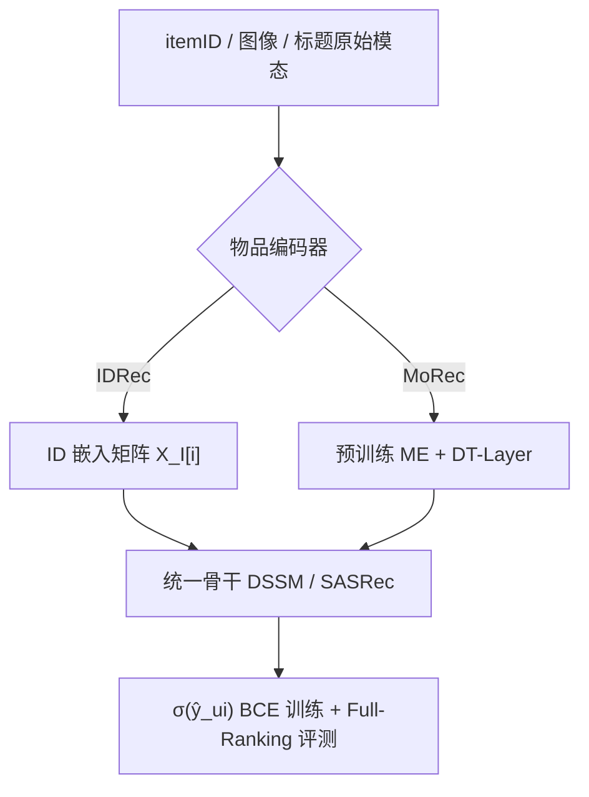

# Where to Go Next for Recommender Systems? ID- vs. Modality-based Recommender Models Revisited (推荐系统何去何从？ID 与模态推荐模型再审视)

- **会议/期刊**: SIGIR 2023
- **作者与机构**: Zheng Yuan, Fajie Yuan 等（西湖大学、之江实验室）
- **推荐链路定位**: 召回（DSSM 双塔）/ 序列召回（SASRec seq2seq）
- **研究方向**: 多模态推荐 / 冷启动与长尾推荐
- **论文原文**: [arXiv](https://arxiv.org/abs/2303.13835v4)
- **开源代码**: [westlake-repl/IDvs.MoRec](https://github.com/westlake-repl/IDvs.MoRec)

## TL;DR (1分钟核心速览)

针对"ID 嵌入是否仍是推荐必备"这一十年被默认的问题，本文锁定骨干、采样、损失一致，仅替换物品编码器，公平对比 IDRec 与纯模态模型 MoRec。结论：在 SASRec 序列骨干 + 端到端微调 SOTA 模态编码器下，MoRec 在常规场景反超 IDRec（MIND/Bili HR@10 相对提升 +5.48%/+8.25%），暖物品场景亦可追平，冷启动场景碾压 IDRec，但训练代价高达 >100×。

## Background & Motivation

- **主流范式**: 十余年来 IDRec 用 itemID/userID 嵌入矩阵作为物品/用户编码器，长期占据 SOTA。
- **前人局限**: (1) 依赖 ID 交互，冷启动与跨平台迁移彻底失效；(2) 无法继承 NLP/CV 基础模型红利；(3) 大 ID 矩阵的存储、更新、可解释性都是包袱。
- **核心洞察 (Key Insight)**: BERT/ViT 等基础模型的表征能力已远超十年前的 word2vec 浅层 ME，因此"IDRec 完胜 MoRec"的经典结论需要重审。
- **本文切入点**: 固定骨干、采样器与损失，仅换物品编码器，用 Q1–Q4 四问系统重访这一"老问题"。

## Method (核心方法设计)

### 1. 整体框架 (Overall Architecture)

本文不提出新网络，而是构建统一对比框架：给定骨干 $\mathcal{B}\in\{\text{DSSM},\text{SASRec}\}$，唯一差异在物品编码器$\mathbf{e}_i$。IDRec 取可学习 ID 嵌入矩阵$\mathbf{X}_{I}[i]$；MoRec 用预训练 ME（BERT/RoBERTa/ResNet/Swin）提取原始模态特征$\mathbf{x}_i$，接一层维度变换 DT-Layer 得到$\mathbf{e}_i=\mathrm{DT}(\mathrm{ME}(\mathbf{x}_i))$。MoRec 端到端联合优化 ME 与推荐网络，训练/验证/测试严格一致，从而保证"MoRec vs IDRec"是受控实验。

<figure class="paper-figure" markdown="span">
  <figcaption>图 1：IDRec 与 MoRec 对比示意图。𝑉𝑖 和 𝑇𝑖 分别表示视觉和文本模态的原始特征。𝐸𝑖 是输入推荐模型的物品表示向量。IDRec 与 MoRec 的唯一区别在于物品编码器。IDRec 使用 itemID 嵌入矩阵作为物品编码器，而 MoRec 使用预训练 ME（后接用于维度变换的全连接层，记为 DT-layer）作为物品编码器。</figcaption>
</figure>

### 2. 关键设计拆解 (Key Designs)

1. **统一对比协议 (Fair Comparison)**：前人对比常同时更换骨干、损失、采样，结论不可比。本文强制 $d$、$\gamma$、负采样、损失一致；每轮每正样本采 1 个随机负样本，共用 BCE 目标：$\mathcal{L}=-\sum_{<u,i,j>\in\mathcal{R}}\big[\log\sigma(\hat{y}_{ui})+\log(1-\sigma(\hat{y}_{uj}))\big]$；SASRec 对序列每位产生$L-1$ 个损失项，DSSM 为 1 个。

2. **端到端 vs 两阶段 (E2E vs TS)**：工业主流 TS 冻结 ME 输出特征后喂入推荐模型。本文量化其巨大鸿沟：视觉场景 TS 仅为 E2E 的 ~60%（HM）/~25%（Bili），即便叠 6 层可学习 MLP 仍不弥合。物理直觉：基础模型表征对推荐任务并非"通用"，必须在新数据上重新适配。

3. **冷/暖物品并查**：用 `Warm-20/50/200` 构造不同流行度子集，与冷/新物品对照，揭示"越热越偏 ID、越冷越偏模态"的互补规律，为工程选型提供依据。

## Experimental Setup & Evaluation Protocol (实验设置与评估协议)

- **数据集与预处理 (`5-core`)**：

| 数据集 | #Users | #Items | #Interactions (train) | 密度 | 模态/场景 |
| :--- | :---: | :---: | :---: | :---: | :--- |
| MIND | 630K | 80K | 8.41M | 0.0167% | 新闻标题 (文本), 微软新闻 |
| HM | 500K | 87K | 5.50M | 0.0127% | 服装封面图 (视觉), H&M |
| Bili | 400K | 128K | 4.40M | 0.0086% | 短视频封面 (视觉), Bilibili |

- **数据划分**: `Leave-One-Out`（末位测试、次末位验证、其余训练）。
- **排名评测协议**: 无偏 `Full-Ranking`（与记忆池中全部未交互物品比较），HR@10 / NDCG@10。
- **对比基线与超参**: 对比同一骨干下的 IDRec 及不同规模/预训练范式 ME；IDRec 搜 $d\in\{64\ldots4096\}$、$\gamma\in\{1e{-3}\ldots5e{-5}\}$；MoRec 固定$d=512$（显存所限），ME 采更小$\gamma\in\{1e{-4},5e{-5},1e{-5}\}$；DSSM batch=1024/512，SASRec=128/64。

## Key Experimental Results (实验关键数据)

### 1. 主实验对比 (SASRec 骨干, Table 2)

| 数据集 | 指标 | IDRec | BERTsmall | BERTbase | RoBERTabase | Improv. |
| :-- | :-: | :-: | :-: | :-: | :-: | :-: |
| MIND | HR@10 | 17.71 | 18.50 | 18.23 | **18.68** | +5.48% |
| MIND | NDCG@10 | 9.52 | 9.94 | 9.73 | **10.02** | +5.25% |
| 数据集 | 指标 | IDRec | ResNet50 | Swin-T | Swin-B | Improv. |
| HM | HR@10 | 6.84 | 6.67 | 6.97 | **7.24** | +5.85% |
| HM | NDCG@10 | **4.01** | 3.56 | 3.80 | 3.98 | -0.75% |
| Bili | HR@10 | 3.03 | 2.93 | 3.18 | **3.28** | +8.25% |
| Bili | NDCG@10 | 1.63 | 1.45 | 1.59 | **1.66** | +1.84% |

（DSSM 骨干下 MoRec 全线落后 IDRec，MIND HR@10 仅 3.07 vs 3.58，故正文聚焦 SASRec。）

### 2. 消融实验 (关键切片)

| 考察变量 | 设置 | 关键数值 (HR@10) |
| :-- | :-- | :-: |
| 暖物品 (MIND) | Warm-20 / Warm-50 / Warm-200 | 20.19>20.12 / 20.89>20.65 / 21.73<22.00 |
| 暖物品 (HM) | Warm-20 / Warm-50 / Warm-200 | 8.05>7.89 / 8.83<8.88 / 11.10<11.15 |
| ME 规模 (HM) | ResNet18/34/50 → Swin-T/B | 逐级递增至 7.24 |
| 两阶段 vs E2E (HM, Swin-T) | TS / TS-DNN6 / E2E | 3.45 / 5.28 / 6.97 |
| 预训练 vs TFS (HM, Swin-T) | 6.27 → 6.97 (+11.16%) | 小样本更显著 |
| 二次预训练 (MIND, BERTbase) | E2E 18.23 → 18.63 (+2.19%) | TS 提升更大 (+5.38%) |
| ID+模态融合 (HM, Swin-T) | 6.84 / 5.40 / 4.95 | 融合反而降 22.5% |
| 冷/新物品 (MIND) | 0.0036→3.06 / 0.0125→0.59 | 差 2–3 个数量级 |

### 3. 关键实验发现 (Key Findings)

1. **骨干比模态更关键**：DSSM 下任何 ME 都救不了 MoRec（MIND 3.07 < 3.58）；而 SASRec seq2seq + 端到端微调一换即反超 5.5%，说明 MoRec 必须搭配强序列骨干与逐位损失才能释放 ME 表达力。
2. **"越热越偏 ID，越冷越偏模态"**：`Warm-200` 时 IDRec 在 MIND (22.00 vs 21.73) 和 HM (11.15 vs 11.10) 均小幅反超，但在 MIND 冷/新物品上 MoRec 领先 IDRec 三个数量级（3.06 vs 0.0036），说明 IDRec 的"霸权"边界就是物品热度。
3. **"ID + 模态融合双赢"被实证否定**：Table 7 中 ID+E2E 融合在 HM 掉 22.5%、MIND 掉 6.1%，原因是常规场景下 IDRec 与 E2E-MoRec 都从同一交互数据学习用户偏好而缺乏互补性；融合还令 MoRec 丧失跨平台迁移这一核心优势。

## Highlights & Limitations (亮点、对比与审稿批判)

- **与代表作对比 (vs. Prior Work)**: 相比把模态当 side feature 的早期工作（VBPR、Peters 等），本文首次做到同骨干、同损失、同采样的"纯化"对比；相比 MoRec 早期专注冷启动的研究（Chen 等），本文实证 MoRec 已能在暖物品场景追平——直接动摇 "IDRec 在热物品场景不可替代" 的前提。
- **可迁移亮点**: ① ME 与主网络使用分离学习率、防止模型坍塌（Fig.5）；② ME 规模/预训练范式可作为模态召回选型依据；③ 冷物品比例高时，优先考虑 MoRec 而非使用 IDRec 打补丁。
- **审稿级局限批判**: (1) **训练成本**：最优 MoRec (SASRec+Swin-B) 相比 IDRec 训练 FLOPs/时间 >100×（Table 6，单次超参搜索约 $\$2,000$），且不当$\gamma$ 下极易坍塌，工业几乎无法承受；(2) **评估局限**：数据集规模中等（10⁵–10⁶ 用户），模态取单模态（仅标题/封面），未探索多模态融合、视频/音频模态，也未验证千倍工业级数据下结论是否成立。

## Rating (四维评分)

- **方法创新性 (Novelty)**: ⭐⭐⭐ （不提出新网络，但"公平对比协议"本身具方法论价值，Q1–Q4 框架系统性好）
- **评估协议与实验扎实度 (Protocol & Experiments)**: ⭐⭐⭐⭐⭐ （同骨干/同采样/同损失 + 留一法 + Full-Ranking，双模态三数据集覆盖冷/暖/规模/预训练/融合/成本六维）
- **写作与数学规范度 (Clarity & Rigor)**: ⭐⭐⭐⭐ （公式极简但清晰，Fig.1/Fig.5/Table 6 组合论证有力；部分结论依赖经验观察，缺少理论解释）
- **工业落地与复现价值 (Industrial & Practical Value)**: ⭐⭐⭐⭐ （代码开源可复现，明确揭示 >100× 训练代价与模型坍塌风险，反向指导工程选型落地）

