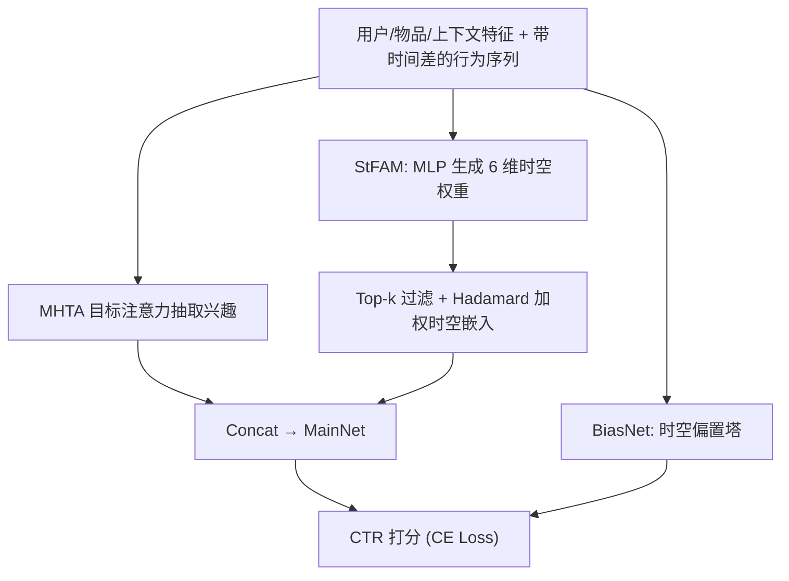
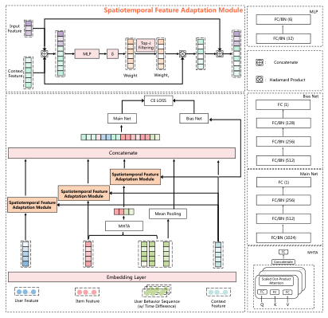

# Exploring the Spatiotemporal Features of Online Food Recommendation Service (在线外卖推荐服务的时空特征探究)

- **会议/期刊**: SIGIR 2023 (短论文)
- **作者与机构**: Shaochuan Lin, Jiayan Pei, Taotao Zhou, Hengxu He, Jia Jia, Ning Hu（阿里巴巴集团 / 饿了么）
- **推荐链路定位**: 精排（CTR 预估）
- **研究方向**: 时空轨迹与 POI 本地生活推荐 / CTR 预估与特征交叉
- **论文原文**: [https://arxiv.org/abs/2308.04019v1](https://arxiv.org/abs/2308.04019v1)
- **开源代码**: 暂未开源

## TL;DR (1分钟核心速览)

本文面向外卖在线食品推荐（OFRS）精排，系统回答了"哪些时空特征有用、为何 self-attention 在此失效、如何自动组合时空特征"三问。作者发现 `Week`（星期）与 `Time period`（餐段）组合远优于直觉上的"小时"，并揭示 self-attention 会放大快餐场景下剧烈的兴趣漂移噪声，改用"目标时间与行为时间差"作为序列特征替代位置编码；再以 Top-$k$ 过滤的动态门控模块 DCAM 免人工选特征。THEME 数据集 AUC 0.7093（较最强基线 StEN 相对 +2.66%），线上周级 A/B 的 CTR 全程领先。

## Background & Motivation (背景与核心矛盾)

- **主流范式**: TRISAN、STPIL、StEN、BASM 等从"用户-商户-时间"三元关系、行为周期性、静动态时空特征、动态参数建模等角度刻画 OFRS 的时空分布。
- **前人局限**: 其一，多数工作默认"时空特征越多越好"，缺乏系统性消融，也未区分特征放入哪个 field 更优；其二，业界 OFRS 极少使用 self-attention 建模序列，而学界普遍认为其有效，这一"理论与实践的鸿沟"始终无解释。
- **核心洞察 (Key Insight)**: 作者消融发现 `Hour` 单独使用反而使 AUC 相对掉 3.23%、`City ID` 掉 1.28%，而粗粒度的"餐段 + 星期"组合带来 +1.34%——时空特征的价值在粒度匹配而非数量；同时早餐与晚餐之间用户兴趣剧变，全局 self-attention 会把这种时空错位当作相关性建模，引入序列失真。
- **本文切入点**: 用"时间差"特征显式注入时序，并用时空上下文动态生成特征门控权重，替代耗时的人工特征筛选。

## Method (核心方法设计)

### 1. 整体框架 (Overall Architecture)

输入为用户、物品、行为序列与上下文（Hour / 餐段 / 星期 / Geohash / City / AOI）四类特征域。序列侧以多头目标注意力（MHTA）从行为序列中抽取与候选物品相关的兴趣向量 $S$；特征侧由 Spatiotemporal Feature Adaptation Module 依据上下文与主干表征动态生成各时空 field 的权重并经 Top-$k$ 稀疏化后加权，拼回主干；最终输出为主干 MLP 与以时空特征为输入的 Bias Net 双塔相加，交叉熵训练、sigmoid 打分排序。

<figure class="paper-figure" markdown="span">
  <figcaption>图2：Dynamic Context Adaptation Model（DCAM）结构概览。</figcaption>
</figure>

### 2. 关键设计拆解 (Key Designs)

1. **时间差序列特征（Time Difference）替代位置编码**：OFRS 序列的时序信号被目标注意力抹平，而位置编码只编码"第几位"、不编码"隔多久"。作者直接把序列行为时间与目标时间的差值 $\Delta t$ 作为一维特征拼入序列嵌入，使注意力在打分时天然感知"早餐→晚餐"的长间隔断层。表 2 中 TA+Position Encoding 仅得 0.7033（低于纯 TA 的 0.7074），而 TA+Time Difference 升至 0.7081，验证了"绝对位置无用、真实时间跨度有用"的直觉。
2. **StFAM 动态上下文自适应门控**：人工逐特征试错成本高且不可随场景漂移。模块先由上下文与主干表征生成 6 个时空 field 的权重，再做 Top-$k$ 硬过滤抑制噪声 field，最后与时空嵌入逐元素相乘：
$\boldsymbol{W}=\delta(\mathrm{MLP}(\mathrm{Concat}(\boldsymbol{e}(c),\boldsymbol{e}(\text{input})))),\quad \boldsymbol{W}_k=\mathrm{Top\text{-}k}(\boldsymbol{W}),\quad \boldsymbol{A}_c=\mathrm{Reshape}_w(\boldsymbol{W}_k)\odot\mathrm{Reshape}_c(\boldsymbol{e}(c)).$其中最后一层维度固定为 6 对应 6 个时空 field，Top-$k$使模型在"餐段/星期有用、城市 ID 有害"的异构场景下自动做特征选择，$k=4$ 时最优（图 3a）。
3. **训练目标、负采样与推理效率**：仅用点击交叉熵 $\mathcal{L}=-\frac{1}{N}\sum\left[y\log p(o)+(1-y)\log(1-p(o))\right]$，工业全量曝光样本、无额外负采样；Bias Net 以时空特征单独成塔输出 logit 再与主塔相加，消融显示去掉 BiN 后"餐段+星期"的增益从 1.34% 降至 0.52%，说明时空信号更适合以偏置而非强交互方式注入。推理侧仅多一次 6 维 MLP 与 Hadamard 乘，开销可忽略。

## Experimental Setup & Evaluation Protocol (实验设置与评估协议)

- **数据集与预处理**（两个阿里/饿了么工业日志集，无公开 5-core 过滤，全量曝光样本）：

| 数据集 | #Users | #Items | #Interactions | 特征/场景说明 |
| :--- | :---: | :---: | :---: | :--- |
| THEME | 39,950,940 | 14,161,762 | 1,104,609,412 | 316 维特征；训练 11.01–01.14，测试 01.15 |
| SHOP | 74,917,907 | 2,660,149 | 8,126,820,568 | 170 维特征；连续 7 天训练、次 1 天测试 |

- **数据划分与防穿越**: 严格按全局时间戳切分（训练期末尾次日为测试日），特征仅取样本发生时刻之前的上下文与行为序列，避免未来信息泄漏。
- **排名评测协议**: 工业日志全量样本上的 CTR 排序评估，报告 AUC / GAUC / Logloss 与 NDCG@1/5/10（GAUC 为用户级分组 AUC，缓解用户活跃度偏置）；线上采用一周 A/B，以 CTR 为主指标。
- **对比基线与超参设置**: Wide&Deep、DIN、StEN、BASM 四个代表性基线；mini-batch 1024、Adam + Warm-up（0.001→0.015，100 万步）、$k=4$ 网格搜索，40 PS / 400 Worker 的分布式 TF 环境，未使用 GPU。

## Key Experimental Results (实验关键数据)

### 1. 主实验对比 (Main Results)

| 方法 | THEME AUC | THEME GAUC | THEME NDCG@10 | SHOP AUC | SHOP GAUC | SHOP NDCG@10 |
| :--- | :---: | :---: | :---: | :---: | :---: | :---: |
| Wide&Deep | 0.6833 | 0.5904 | 0.6361 | 0.7341 | 0.6219 | 0.4819 |
| DIN | 0.6885 | 0.5943 | 0.6390 | 0.7888 | 0.6840 | 0.5165 |
| StEN | 0.6909 | 0.5965 | 0.6381 | 0.7898 | 0.6883 | 0.5180 |
| BASM | 0.6720 | 0.5831 | 0.6418 | 0.7928 | 0.6956 | 0.5324 |
| **DCAM (Ours)** | **0.7093** | **0.6152** | **0.6535** | **0.7940** | **0.7003** | **0.5333** |
| Improv.% (vs. best baseline) | +2.66% | +3.13% | +1.82% | +0.15% | +0.68% | +0.17% |

### 2. 消融实验 (Ablation Study)

| 配置 | AUC | GAUC | 说明 |
| :--- | :---: | :---: | :--- |
| 仅上下文 Ct | 0.6976 | 0.6029 | 基线 |
| Ct + 仅 Hour | 0.6751 | 0.5875 | 单小时特征反而有害 |
| Ct + 仅 City ID | 0.6887 | 0.5929 | 粗空间粒度无益 |
| Ct + 餐段 + 星期 | **0.7072** | 0.6130 | 最佳二元组合（+1.34%） |
| 同上 w/o Bias Net | 0.7012 | 0.6107 | 增益降至 +0.52% |
| 人工精选全特征 | 0.7077 | 0.6143 | +1.45% |
| **DCAM 自动门控** | **0.7093** | **0.6152** | 免人工且略优于人工精选 |
| 序列：Self-Attention | 0.6922 | 0.5972 | 明显劣于 GRU(0.7051) |
| 序列：Self-Attn + Target Attn | 0.6923 | 0.5978 | 放大时空失真噪声 |
| 序列：Target Attn + 位置编码 | 0.7033 | 0.6089 | 低于纯 TA（0.7074） |
| 序列：Target Attn + 时间差 | **0.7081** | **0.6150** | 替代位置编码有效 |

### 3. 关键实验发现 (Key Findings)

1. **时空特征是"选对粒度"而非"堆量"**：`Hour` 单独引入使 AUC 从 0.6976 掉到 0.6751（-3.23%），而粗粒度"餐段+星期"组合达 0.7072（+1.34%），说明过细粒度切分导致样本稀疏与噪声，粗粒度周期语义才是有效信号。
2. **self-attention 在 OFRS 结构性失效**：SA 仅 0.6922、SA+TA 0.6923，均低于 GRU 的 0.7051 与纯 TA 的 0.7074；作者归因于跨餐段兴趣剧变被注意力误当长程依赖，改为时间差特征后 TA 提升至 0.7081，反向验证了"序列失真"假说。
3. **门控自动选择逼近并超越人工调优，且带噪声抑制收益**：DCAM 在 THEME 上较人工精选（0.7077）再涨 0.0016 AUC，$k=4$优于$k=1\text{–}3$与$k=5\text{–}6$；线上 2023 年 2 月一周 A/B 中 DCAM 的 CTR 曲线全程高于 Wide&Deep、DIN、StEN、BASM。

## Highlights & Limitations (亮点、对比与审稿批判)

- **与代表作对比 (vs. Prior Work)**: TRISAN/STPIL 侧重刻画三元关系与周期性，StEN 侧重静动态时空特征划分，BASM 侧重动态参数建模；本文不设计复杂时空网络，而是先做"特征价值审计"，再以轻量门控替代人工筛选，工程味更重、增量成本更低。
- **可迁移亮点**: (1) 用"目标时间−行为时间"的 $\Delta t$标量替代位置编码，可零成本迁移到任何时间敏感序列（本地生活、出行、短视频）；(2) 用末层维度等于 field 数的 MLP + Top-$k$ 硬过滤做 field 级门控，比 softmax 加权更抗噪、可解释性更强。
- **审稿级局限批判**: 其一，仅 5 页短文，缺少对 self-attention 失效的定量诊断（如注意力熵、时序距离分布分析），"序列失真"仍属假说；其二，两数据集均来自同一平台且无公开数据与代码，跨平台与冷启动场景的可复现性、以及 Top-$k$ 在 field 数变化时的敏感性均未被检验。

## Rating (四维评分)

- **方法创新性 (Novelty)**: ⭐⭐⭐ （时间差特征与 field 级 Top-$k$ 门控均为轻量工程改良，缺乏理论刻画，但对"self-attention 为何失效"的追问有价值）
- **评估协议与实验扎实度 (Protocol & Experiments)**: ⭐⭐⭐⭐ （十亿级工业样本、时间切分、GAUC 与 NDCG 多指标齐备，并附一周线上 A/B；不足是无公开数据与显著性检验）
- **写作与数学规范度 (Clarity & Rigor)**: ⭐⭐⭐ （三问式叙事清晰、公式简洁，但符号定义与 StFAM 的 Reshape 维度说明略含混，部分叙述口语化）
- **工业落地与复现价值 (Industrial & Practical Value)**: ⭐⭐⭐⭐ （仅增加一次小 MLP 与逐元素乘，可直接嵌入现有精排；但无开源代码，复现需自建同等规模日志）

