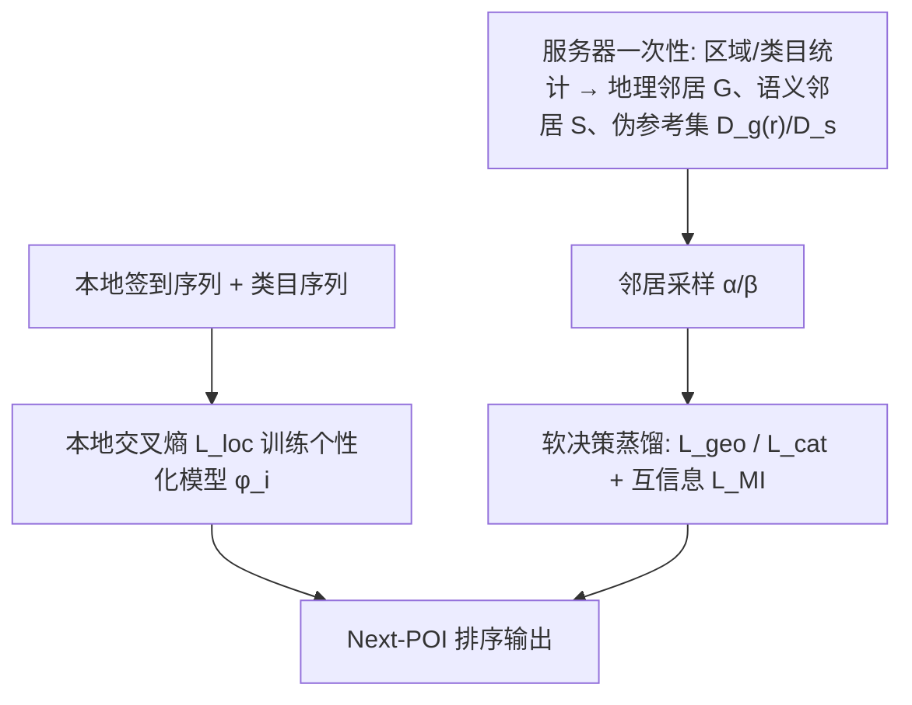
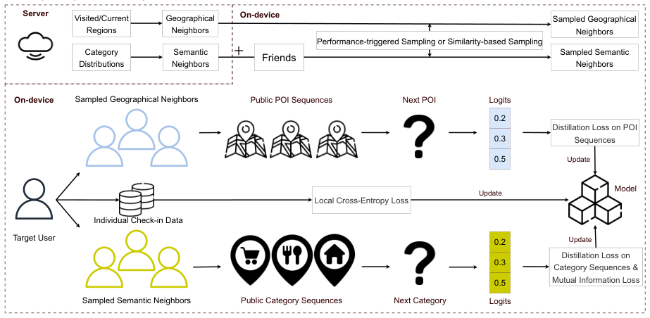

# Model-Agnostic Decentralized Collaborative Learning for On-Device POI Recommendation (面向端侧 POI 推荐的模型无关去中心化协同学习)

- **会议/期刊**: SIGIR 2023
- **作者与机构**: Jing Long, Tong Chen, Hongzhi Yin 等（The University of Queensland / Griffith University / UTS / UESTC）
- **推荐链路定位**: 端侧召回（Next-POI 排序），去中心化训练 + 本地推理
- **研究方向**: 时空轨迹与 POI 本地生活推荐 / 去偏公平、可信隐私与工业架构
- **论文原文**: [https://arxiv.org/abs/2304.03947v1](https://arxiv.org/abs/2304.03947v1)
- **开源代码**: 暂未开源

## TL;DR (1分钟核心速览)

现有端侧 POI 推荐（联邦/半去中心化）均隐含**模型同构假设**，靠参数或梯度聚合协同，但真实手机算力差异导致端侧模型结构、维度必然异构，聚合失效。MAC 将协同从"参数聚合"改为"**参考数据上的软决策蒸馏**"：按地理位置、类目偏好与社交关系预选邻居，用区域级/语义级伪参考集上的软预测做 L2 对齐 + POI-类目互信息最大化；再用性能触发/相似度两种采样剔除低质邻居。在 Foursquare/Weeplace 上（Leave-One-Out、200 候选采样排序），HR@10 分别达 0.4319/0.4843，较最强基线 DCLR 提升 0.5%/3.8%，而模型体积仅为其约 1/6。

## Background & Motivation (背景与核心矛盾)

- **主流范式**: 云端集中式 POI 推荐（STAN 等注意力/RNN 序列模型）需上传全部签到轨迹；端侧路线分两支——模型压缩（LLRec 教师-学生蒸馏）与协同学习（PREFER 联邦聚合、DCLR 半去中心化组内参数交换）。
- **前人局限**: ① 压缩路线下**所有用户共享同一学生模型**且无在线更新机制，无法适配空间活动动态与兴趣多样性；② 联邦/半去中心化路线强制**模型同构**（等维参数聚合），异构设备只能被"最小算力设备"拖累，且 DCLR 仍交换原始参数，隐私与通信开销双输；联邦还需服务器全程参与分组聚类。
- **核心洞察 (Key Insight)**: POI 嵌入是端侧模型内存占用的主要来源，而用户只在自己到访过的区域内活动——因此**只存本地相关区域的 POI 嵌入 + 只交换脱敏参考数据上的软决策**，就能在突破等维约束的同时把通信量压到极低。
- **本文切入点**: 以"共享参考集 + 软决策蒸馏"替代"共享参数/梯度"，把协同学习推广到任意结构、任意维度的端侧推荐器。

## Method (核心方法设计)

### 1. 整体框架 (Overall Architecture)

服务器只做一次性冷启动：收集各用户的到访区域集合 $R(u_i)$与类目分布$CP(u_i)$（均为低敏信息），划分地理/语义邻居，生成区域级与语义级伪参考集并下发；随后**服务器彻底退出**。端侧模型$\phi_i(\cdot)$以 STAN 为骨干但维度可自选（$d\in\{8,\dots,128\}$），仅保存当前及历史到访区域的 POI 嵌入；每轮本地接收采样邻居在参考集上的软决策，用$L_{loc}+\gamma(\mu L_{geo}+(1-\mu)L_{sem})$ 更新，并按性能或相似度动态重采邻居，直至收敛。

<figure class="paper-figure" markdown="span">
  <figcaption>图1：提出的 MAC 概览。</figcaption>
</figure>

### 2. 关键设计拆解 (Key Designs)

1. **模型无关的软决策蒸馏（双通道参考集）**：痛点是不共享参数就无法对齐异构模型的表示空间。MAC 把"对齐"下沉到输出层：对当前区域参考集 $D_g(r_{i0})$ 做逐样本 L2 输出对齐
$\mathcal{L}_{geo}=\frac{1}{|G(u_i)|}\sum_{u_j\in G(u_i)}\sum_{X\in D_g(r_{i0})}\lVert\phi_i(X)-\phi_j(X)\rVert_2^2$，
对跨地域的语义邻居则只对齐类目预测 $\mathcal{L}_{cat}$，再用互信息把类目知识"回流"到 POI 嵌入。直觉：同一参考输入上的输出分布是模型的紧凑指纹，异构结构也可比。
2. **互信息桥接 POI-类目双视图**：语义邻居参考集只含类目序列，无法直接更新 POI 嵌入。作者把 POI $p$与其类目$c_p$ 视为同一实体的两个视图，用 InfoNCE 式对比把类目侧学到的知识注入 POI 侧：
$\mathcal{L}_{MI}=-\sum_{p}\log\frac{\exp(f(p,c_p))}{\sum_{c'\neq c_p}\exp(f(p,c'))},\quad f(p,c)=\sigma(\mathbf{e}_p^{\top}\mathbf{W}\mathbf{e}_c)$。
这解决了"语义协同无梯度可回传"的死结，等价于在嵌入空间做跨视图对齐。
3. **伪参考数据生成与邻居采样**：直接切分真实签到作参考集既泄露隐私又在冷启动区域失效。**变换式生成**在互为好友且共享至少一个 POI 的两用户间，以公共 POI 为切点做"分解-重组"，并裁剪到同一区域；**概率式生成**仅用类目转移条件概率 $P(c_n|c_m)=\mu(c_n|c_m)/\sum_{m'}\mu(c_n|c_{m'})$采样类目链，再在区域内按 5km 内约束实例化 POI。邻居过滤上，性能触发采样在$\Delta L_{loc}=|L^o_{loc}-L^{o-1}_{loc}|/L^{o-1}_{loc}\times100\%<\tau=1\%$时重抽；相似度采样按软决策 KL 距离$d_{soft}=\sum_{X\in D_{ref}}KL(\phi_i(X)\Vert\phi_j(X))$取 top-$\beta$。
- **训练目标与开销**：$\mathcal{L}=L_{loc}+\gamma(\mu L_{geo}+(1-\mu)(L_{cat}+L_{MI}))$，$\gamma=0.5,\mu=0.7$；无负采样设计，候选打分时仅在同区域 200 个未访问最近 POI 内排序；通信内容仅软决策向量，节点内存因只存区域 POI 嵌入而下降约 6 倍。

## Experimental Setup & Evaluation Protocol (实验设置与评估协议)

| 数据集 | #Users | #Items | #Interactions | 稀疏度/密度 | 特征/场景说明 |
| :--- | :---: | :---: | :---: | :---: | :--- |
| Foursquare | 7,507 | 80,962 | 1,214,631 | 密度 ≈ 0.0020 | 436 类目；NY/LA/Chicago 三城签到 |
| Weeplace | 4,560 | 44,194 | 923,600 | 密度 ≈ 0.0046 | 625 类目；同三城，人均签到更长 (202.5) |

- **过滤与划分**: 用户与 POI 均保留 $\geq 10$ 条交互；`Leave-One-Out`（最后一条测试、倒数第二条验证、其余训练），最大序列长 200；每城用 k-means 划 5 个区域。
- **排名评测协议**: `Sampled Ranking`——每个 ground-truth 仅与**同区域内 200 个未访问且最近**的 POI 组成候选（非全库 Full-Ranking），指标 HR@5/10、NDCG@5/10。
- **基线与超参**: 集中式 MF/LSTM/STAN，端侧 LLRec/PREFER/DCLR/D-Dist/SQMD；异构设置下 $d\in\{8,16,32,64,128\}$各占 20%，同构基线各维度分别评测后取均值；$\alpha=5,\beta=10,h=50$，lr 0.002，dropout 0.2，batch 16，50 epoch。

## Key Experimental Results (实验关键数据)

### 1. 主实验对比 (Main Results)

| 方法 | FSQ HR@5 | FSQ NDCG@5 | FSQ HR@10 | FSQ NDCG@10 | WEE HR@5 | WEE NDCG@5 | WEE HR@10 | WEE NDCG@10 |
| :--- | :---: | :---: | :---: | :---: | :---: | :---: | :---: | :---: |
| MF | 0.0835 | 0.0598 | 0.0962 | 0.0669 | 0.1045 | 0.0612 | 0.1293 | 0.0872 |
| LSTM | 0.1920 | 0.1227 | 0.2812 | 0.1648 | 0.2215 | 0.1356 | 0.3301 | 0.1578 |
| STAN (集中式 SOTA) | 0.2914 | 0.1756 | 0.4157 | 0.2524 | 0.3205 | 0.1846 | 0.4503 | 0.2783 |
| LLRec | 0.2771 | 0.1488 | 0.3406 | 0.1908 | 0.2912 | 0.1781 | 0.3613 | 0.2255 |
| PREFER (联邦) | 0.2895 | 0.1696 | 0.3607 | 0.2183 | 0.3055 | 0.1874 | 0.3707 | 0.2359 |
| DCLR (同构去中心化) | 0.3078 | 0.1797 | 0.4297 | 0.2653 | 0.3304 | 0.1912 | 0.4664 | 0.2838 |
| D-Dist (异构蒸馏) | 0.2257 | 0.1193 | 0.2915 | 0.1621 | 0.2474 | 0.1343 | 0.3581 | 0.1933 |
| SQMD (异构蒸馏) | 0.2818 | 0.1471 | 0.4054 | 0.2357 | 0.2953 | 0.1531 | 0.4342 | 0.2360 |
| **MAC-P** | **0.3138** | **0.1865** | **0.4319** | **0.2712** | **0.3414** | **0.2032** | **0.4843** | **0.2937** |
| MAC-S | 0.3055 | 0.1843 | 0.4257 | 0.2637 | 0.3365 | 0.1988 | 0.4734 | 0.2845 |
| **Improv. (vs. DCLR, MAC-P)** | +1.9% | +3.8% | +0.5% | +2.2% | +3.3% | +6.3% | +3.8% | +3.5% |

### 2. 消融与效率分析 (Ablation & Efficiency)

| 变体 / 配置 | FSQ HR@10 | WEE HR@10 | 模型体积(d=32, kb) | 训练时长(FSQ/WEE, h) |
| :--- | :---: | :---: | :---: | :---: |
| MAC-P（变换式参考集，默认） | **0.4319** | **0.4843** | **694** | 40 / 32 |
| MAC-S（变换式参考集，默认） | 0.4257 | 0.4734 | 742 | **29 / 21** |
| MAC-P w/o 伪数据（原始参考集） | 0.4357 | 0.4901 | – | – |
| MAC-P 概率式参考集 | 0.4173 | 0.4715 | – | – |
| MAC-S 概率式参考集 | 0.4129 | 0.4581 | – | – |
| DCLR（同构聚合，d=32） | 0.5417(其自评) | 0.5417 | 4,502 | 76 / 57 |
| SQMD（异构蒸馏，d=32） | – | 0.4845 | 3,648 | 51 / 39 |
| D-Dist（异构蒸馏） | – | 0.3514 | 3,852 | 24 / 19 |

### 3. 关键实验发现 (Key Findings)

1. **异构协同的收益来自"共享参考集"而非模型容量**：在 $d=8$时 MAC-P 仅 232 kb 即取得 WEE HR@10=0.4057，已超过 1130 kb 的 DCLR（0.3674）；$d=32$ 时体积 694 kb vs 4,502 kb（约 1/6.5），精度 0.5404 与 DCLR 的 0.5417 基本持平——说明同构聚合的精度红利可被软决策蒸馏以极小内存代价复现。
2. **邻居不是越多越好，采样是必需组件**：$\alpha$从 1 增至 40 时 MAC-P 精度单调下降，与全部预选邻居通信（虚线）反而最低；$\beta$ 在 10 处取峰值，超过 10 后低质语义邻居引入噪声使精度回落。这验证了"预筛选只保证召回候选，质量过滤必须动态进行"。
3. **协同强度与地理/语义配比高度敏感但方向稳定**：$\gamma=0$（不协同）精度最低，$\gamma>0.5$后开始下滑；$\mu=0.7$（偏地理）在多数设置最优，符合 POI 决策空间局部性的先验。同时概率式参考集仅损失约 1.5 个点 HR@10（0.4843→0.4715 WEE），为冷启动/严隐私区域提供了可用退路。

## Highlights & Limitations (亮点、对比与审稿批判)

- **与代表作对比**: 相比 PREFER / DCLR 的"等维参数聚合"，MAC 把协同接口前移到输出软决策，天然支持异构结构与差异化存储；相比 D-Dist / SQMD 的"随机/全库参考集异构蒸馏"，MAC 引入地理-语义双通道参考集 + 邻居预选与动态采样，使参考集既区域受限（保证软决策可靠）又具备跨域语义桥（互信息回流 POI 嵌入）。
- **可迁移亮点**: ① "POI-类目双视图 InfoNCE"可作为通用技巧，把低容量但跨域可得的辅助信号（类目、品牌、区域标签）的协同知识注入主嵌入；② "性能触发 + 相似度"双采样策略可移植到任意多方蒸馏/联邦场景做通信预算控制。
- **审稿级局限批判**: ① 评测采用**同区域 200 个最近 POI 的采样排序**而非全库 Full-Ranking，且负样本按地理邻近构造，指标绝对值与跨论文可比性存疑；② 主实验对 DCLR 的提升幅度偏薄（FSQ HR@10 仅 +0.5%），而表 3 中 DCLR 自评 HR@10 反而为 0.5417，两处口径不一致削弱了"超越同构方法"的论断；③ 文中对 MAC-P / MAC-S 谁更优的叙述与表格数值相互矛盾，且未给出 $\gamma=0$、去$L_{MI}$ 的定量消融，缺少对互信息模块贡献的直接证据。

## Rating (四维评分)

- **方法创新性 (Novelty)**: ⭐⭐⭐⭐ （把"模型无关"从压缩范式迁移到去中心化协同，用软决策接口 + POI/类目互信息桥接解决异构不可聚合问题，思路干净且有实用抽象）
- **评估协议与实验扎实度 (Protocol & Experiments)**: ⭐⭐⭐ （两真实数据集 + 8 基线 + 体积/时延/超参分析较全，但采样排序协议偏弱、关键模块缺定量消融、部分数值前后不一致）
- **写作与数学规范度 (Clarity & Rigor)**: ⭐⭐⭐⭐ （损失项与算法流程定义清晰、双参考集动机讲得透，但 MAC-P/MAC-S 结论表述自相矛盾，部分结论缺复杂度分析）
- **工业落地与复现价值 (Industrial & Practical Value)**: ⭐⭐⭐⭐ （服务器一次性介入 + 软决策通信 + 区域级嵌入存储，非常贴合端侧部署约束，体积与时延收益明确；遗憾未开源，参考集生成与分组细节复现成本偏高）

