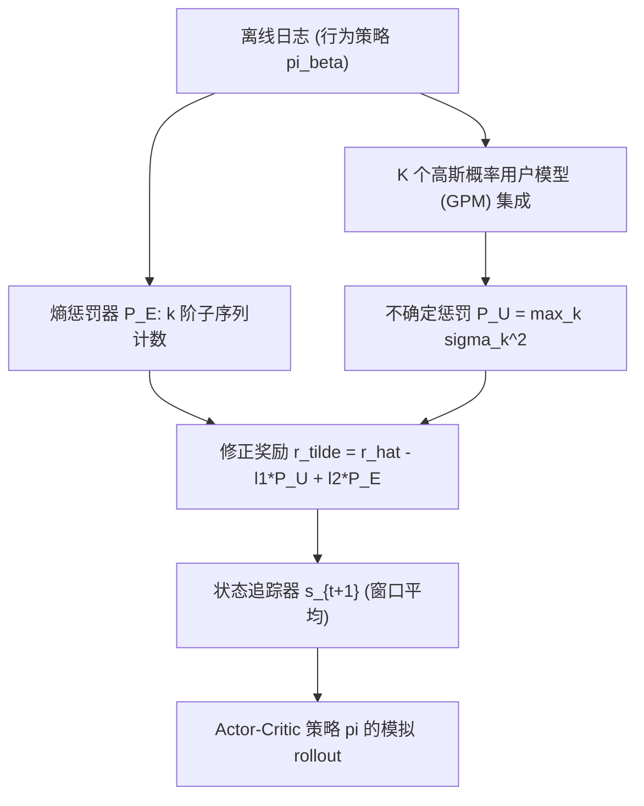

# Alleviating Matthew Effect of Offline Reinforcement Learning in Interactive Recommendation (缓解交互式推荐中离线强化学习的马太效应)

- **会议/期刊**: SIGIR 2023 (Full Paper)
- **作者与机构**: Chongming Gao, Kexin Huang, Jiawei Chen, Xiangnan He 等（中国科学技术大学、浙江大学、快手科技、重庆大学、电子科技大学）
- **推荐链路定位**: 端到端交互式推荐策略（离线 RL 训练 + 模拟环境评估）
- **研究方向**: 强化学习与动态探索推荐 / 去偏与可信推荐
- **论文原文**: [https://arxiv.org/abs/2307.04571v1](https://arxiv.org/abs/2307.04571v1)
- **开源代码**: [https://github.com/chongminggao/DORL-codes](https://github.com/chongminggao/DORL-codes)

## TL;DR (1分钟核心速览)

离线 RL 依靠"保守性"（惩罚 OOD/高不确定样本）解决价值高估，但在推荐中会把曝光少的物品一律判为"不确定"而压制，导致热门品类越推越多的**马太效应**并损害长期留存。本文从理论上把模型失配分解为奖励偏差与价值偏差两项，指出惩罚不确定性的副作用是放大价值偏差 $d_V$；据此提出 **DORL**，在 MOPO 的奖励惩罚上再加一项**行为策略熵惩罚**$P_E=-\mathrm{KL}(\pi_\beta\|\pi_u)$，用离线数据做"反事实探索"。在 KuaiRec / KuaiRand 交互式模拟环境中，累计收益相比 MOPO 分别提升 **79.3% / 8.4%**，主导品类占比 MCD 由 0.479 降至 0.379。

## Background & Motivation (背景与核心矛盾)

- **主流范式**: 交互式推荐被建模为 MDP，用离线 RL 从历史日志学策略；为对抗价值高估，model-free 方法约束策略贴近行为策略（BCQ/CQL/CRR），model-based 方法（MOPO）学习悲观动力学/奖励模型并惩罚高不确定区域。
- **前人局限 (1)**: 推荐数据高度稀疏，不确定性惩罚无法区分"真噪声"与"长尾稀有但高价值"的物品，稀有一个例被系统性判为不可信并被剪枝，推荐结果向头部品类坍缩（图 3/图 4）。
- **前人局限 (2)**: 这种坍缩直接伤害长期满意度。作者在 KuaiRand-27K（3.2 亿交互）与 LFM-1b（10.9 亿收听事件）上控制用户活跃度混杂后发现：**在所有活跃度分组中，Day-1 留存率随 item 级 / 品类级的重复率单调下降**（图 2）。
- **核心洞察**: 论文把失配函数拆解为 $|G^{\pi}_{\widehat{M}}(s,a)|\le\gamma d_V(\widehat{R},R)+d_1(\widehat{R},R)$；惩罚不确定性虽压低$d_1$，却因抑制长尾而放大长期价值偏差$d_V$，与"追求长期满足"的目标背道而驰。
- **本文切入点**: 不再"压制不确定"，而是**奖励"高熵状态"上的乐观**——若某状态下行为策略只推过极少数物品，说明真实偏好未被揭示，应主动放宽悲观、鼓励走向多样性状态。

## Method (核心方法设计)

### 1. 整体框架 (Overall Architecture)

DORL 沿用 MOPO 的 model-based 离线范式：用 DeepFM 作**用户模型**（奖励模型）$\widehat{R}(s,a)$，用简单平均层作**状态追踪器**$s_{t+1}=\frac{1}{N}\sum_{n=t-N+1}^{t}[e_{a_n}\oplus\tilde{r}_n]$（作者引用 Huang et al. 的复现结论：朴素平均层优于复杂序列编码器）；用户模型输出被两个惩罚器修正为$\tilde{r}$ 后，作为"模拟用户"的奖励喂给 actor-critic 策略做多轮 rollout，从而绕开稀疏日志中难以捕捉的退出机制。整体闭环如图 6 所示。

### 2. 关键设计拆解 (Key Designs)

1. **熵惩罚项 $P_E$（本文核心增量）**：目标是把行为策略拉向均匀分布$\pi_u$，即
$P_E := -\mathrm{KL}(\pi_\beta(\cdot|s)\|\pi_u(\cdot|s)) = H(\pi_\beta(\cdot|s)) - \log|\mathcal{A}|$。
由于 $-\log|\mathcal{A}|$为常数，$P_E$实际就是行为策略在该状态的条件熵。实现上把$P_E$定义为$k$阶熵之和：给定当前候选物品 8 与历史$\{3,7,8\}$，在全库日志中检索所有形如$[\{3,7,8\},\cdot]$的连续子序列（集合无序、枚举全排列）统计下一物品频率分布并归一化到$(0,1]$（图 5）。直觉：**惩罚只依赖状态而非动作**，通过长期优化间接惩罚"通往低熵状态"的动作，从而在纯离线数据中实现反事实探索。
2. **不确定惩罚 $P_U$ 的双重分解**：把用户模型写成高斯概率模型，单模型损失
$\mathcal{L}(\theta_k)=\frac{1}{N}\sum_i\frac{1}{2\sigma^2_{\theta_k}(x_i)}\|y_i-f_{\theta_k}(x_i)\|^2+\frac{1}{2}\log\sigma^2_{\theta_k}(x_i)$，
同一样本即可给出**偶然不确定性**（预测方差 $\sigma^2$）与 **认知不确定性**（$K$个模型的集成分歧），取$P_U=\max_{k}\sigma^2_{\theta_k}$，$\hat{r}=\frac{1}{K}\sum_k f_{\theta_k}$。
3. **训练目标、负采样与推理开销**：最终修正奖励为 $\tilde{r}(s,a)=\hat{r}(s,a)-\lambda_1 P_U+\lambda_2 P_E$；训练用 actor-critic 在模拟用户上 rollout，**无需任何负采样**（策略在全物品空间做 softmax）。推理时只需一次策略前向 + 一次熵表查询，开销与 MOPO 同阶；离线侧主要成本是$k$ 阶子序列计数的一次性建表。

## Experimental Setup & Evaluation Protocol (实验设置与评估协议)

- **数据集与预处理**: 两个支持反事实评估的视频数据集（表 1）：

| 数据集 | #Users | #Items | #Interactions | 稀疏度/密度 | 特征/场景说明 |
| :--- | :---: | :---: | :---: | :---: | :--- |
| KuaiRec (Train) | 7,176 | 10,728 | 12,530,806 | 16.3% | 短视频，31 个品类，稠密训练日志 |
| KuaiRec (Test) | 1,411 | 3,327 | 4,676,570 | 99.6% | **全观测矩阵**，归一化观看时长作奖励 |
| KuaiRand (Train) | 27,285 | 7,551 | 1,436,609 | 0.70% | 短视频，46 个品类，稀疏日志 |
| KuaiRand (Test) | 27,285 | 7,583 | 1,186,059 | — | 1,186,059 条**随机曝光**日志补全真实偏好，`is_click` 作奖励 |

- **数据划分与防穿越 (Splitting Strategy)**: 训练日志与评估环境**物理隔离**；评估环境用全观测矩阵（KuaiRec）或随机曝光补全矩阵（KuaiRand）充当"在线用户"，训练阶段不可见，杜绝穿越。
- **排名评测协议 (Ranking Protocol)**: 非静态 Full-Ranking，而是**交互式累积奖励协议**——推荐后由环境返回奖励，最多 30 轮；引入**退出机制**（最近 $N$轮内同类目物品出现超过$M$个即终止），默认$M=0,N=4$。指标为累计收益$R_{tra}$、到达率 Reach、轨迹长度 Length、主导品类占比 MCD（训练集中覆盖 80% 物品的热门品类占推荐结果比例）。所有结果为 100 条交互轨迹均值 ± 标准差。
- **对比基线与超参设置**: 2 个 bandit（$\epsilon$-greedy、UCB）+ 4 个 model-free（SQN、BCQ、CQL、CRR）+ 4 个 model-based（MBPO、IPS、MOPO、DORL），统一 DeepFM 骨干；$\lambda_1,\lambda_2$网格搜索于$\{0.001,\dots,100\}$，KuaiRand 取$(0.01,0.05)$，KuaiRec 取$(0.05,5)$。

## Key Experimental Results (实验关键数据)

### 1. 主实验对比 (Main Results)

| 方法 | KuaiRec $R_{tra}$| Reach | Length | MCD | KuaiRand$R_{tra}$ | Reach | Length | MCD |
| :--- | :---: | :---: | :---: | :---: | :---: | :---: | :---: | :---: |
| UCB | 3.606 | 0.853 | 4.219 | 0.811 | 1.651 | 0.372 | 4.431 | 0.789 |
| $\epsilon$-greedy | 3.515 | 0.828 | 4.219 | 0.823 | 1.711 | 0.351 | 4.880 | 0.773 |
| SQN | 4.673 | 0.913 | 5.111 | 0.686 | 0.912 | 0.182 | 4.601 | 0.621 |
| CRR | 4.163 | 0.895 | 4.654 | 0.865 | 1.481 | 0.226 | 6.561 | 0.733 |
| CQL | 2.506 | 0.684 | 3.224 | **0.386** | 2.032 | 0.226 | 9.000 | 0.778 |
| BCQ | 2.123 | 0.708 | 3.000 | 0.667 | 0.852 | 0.425 | 2.005 | 0.998 |
| MBPO | 12.043 | 0.770 | 15.646 | 0.362 | 10.933 | 0.431 | 25.345 | 0.306 |
| IPS | 12.833 | 0.767 | 16.727 | **0.215** | 3.629 | 0.216 | 16.821 | **0.201** |
| MOPO | 11.427 | 0.892 | 12.809 | 0.479 | 10.934 | **0.437** | 25.002 | 0.343 |
| **DORL (Ours)** | **20.494** | 0.767 | **26.712** | 0.379 | **11.850** | 0.428 | **27.609** | 0.296 |
| **Improv. vs MOPO** | **+79.3%** | — | **+108.5%** | −20.9% | **+8.4%** | — | **+10.4%** | −13.7% |

### 2. 消融实验 (Ablation Study)

原文未设独立组件消融表，其消融以"惩罚项设计"的横向对照 + 系数扫描（图 3、图 8）实现，可等价整理为：

| 配置 | 惩罚项构成 | KuaiRec Length | KuaiRec MCD | KuaiRand Length | KuaiRand MCD |
| :--- | :--- | :---: | :---: | :---: | :---: |
| MBPO（w/o 两种惩罚） | 无 | 15.646 | 0.362 | 25.345 | 0.306 |
| IPS（w/ 硬去偏重加权） | 重要性权重 | 16.727 | 0.215 | 16.821 | 0.201 |
| MOPO（w/o $P_E$，仅$P_U$） |$-\lambda_1 P_U$ | 12.809 | 0.479 | 25.002 | 0.343 |
| **DORL（w/ $P_U + P_E$）** |$-\lambda_1 P_U+\lambda_2 P_E$ | **26.712** | 0.379 | **27.609** | 0.296 |
| DORL，$\lambda_2$ 增大（图 8） | 强熵惩罚 | 单调↑ | 单调↓ | 单调↑ | 单调↓ |

### 3. 关键实验发现 (Key Findings)

1. **增益几乎全部来自"活得久"而非"猜得准"**：KuaiRec 上 DORL 累计收益 20.494 vs MOPO 11.427（+79.3%），但单轮奖励（Reach 0.767 vs 0.892）反而更低，轨迹长度却从 12.809 暴涨至 26.712（+108.5%）。定量印证了"牺牲短期点击精度换取长期留存"的设计哲学。
2. **熵惩罚是马太效应的直接解药，且优于硬去偏**：随 $\lambda_2$ 增大，Length 单调升、MCD 单调降；DORL 把 MCD 从 MOPO 的 0.479/0.343 压到 0.379/0.296。IPS 虽在 KuaiRec 拿到最低 MCD 0.215，但在 KuaiRand 上累计收益仅 3.629（vs DORL 11.850），暴露重要性加权的**高方差**缺陷——软去偏更适合 model-based RL。
3. **model-free 与 bandit 在稀疏日志下全面失效**：CQL 在 KuaiRand 长度 9.000 但 MCD 0.778（几乎只推热门），BCQ 因只在高置信样本上更新导致 MCD 达 0.998；二者说明"保守 = 头部坍缩"的因果链在稀疏数据上被极端放大。

## Highlights & Limitations (亮点、对比与审稿批判)

- **与代表作对比 (vs. Prior Work)**: 相对 MOPO，DORL 不改框架只改**惩罚项语义**（把"不确定"换成"低熵状态乐观"），是低成本高收益的补丁；相对 BCQ/CQL 这类 model-free 保守派，本文论证了在稀疏推荐日志中模型无关方法连退出机制都学不出来；相对 IPS 的硬重加权，DORL 的软惩罚方差显著更低。
- **可迁移亮点**: ①"惩罚只依赖状态、经长期优化间接约束动作"的反事实探索范式，可迁移到任何离线 RL/序列决策推荐；②用 $k$ 阶子序列计数从日志中**免训练地估计行为策略熵**，可作为通用的"日志覆盖率/探索度"特征，用于数据筛选或课程式采样。
- **审稿级局限批判**: ①奖励与状态转移完全依赖 DeepFM 模拟用户与固定退出规则，**模拟器偏差**可能放大或掩盖真实线上效应，缺少线上 A/B 或半离线 OPE 佐证；②$k$阶熵在高$k$时子序列极度稀疏，实际估计退化为低阶经验频率，且$\lambda_1,\lambda_2$两个敏感超参需分数据集网格搜索（KuaiRec 的$\lambda_2=5$与 KuaiRand 的$0.05$ 相差两个数量级），泛化与调参成本存疑。

## Rating (四维评分)

- **方法创新性 (Novelty)**: ⭐⭐⭐⭐ （把"离线 RL 保守性→马太效应"从现象上升为失配函数 $d_V$ 的理论解释，并给出熵惩罚这一极简算子，推导链条完整但技术本身非全新范式的首创）
- **评估协议与实验扎实度 (Protocol & Experiments)**: ⭐⭐⭐⭐ （采用交互式累积奖励 + 退出机制 + 全观测/随机曝光环境，10 个基线覆盖全面并报标准差；扣分在于无真实线上验证、消融以系数扫描替代严格组件表）
- **写作与数学规范度 (Clarity & Rigor)**: ⭐⭐⭐⭐ （Lemma 5.1、Eq.(6)(7) 与 MOPO 定理衔接清晰，符号一致；$k$ 阶熵的定义与实现细节略显口头化，缺少复杂度分析）
- **工业落地与复现价值 (Industrial & Practical Value)**: ⭐⭐⭐⭐ （代码开源、框架复用 MOPO/DeepFM 易工程化、推理开销与 MOPO 同阶；但离线建熵表需大规模日志扫描，超参跨域迁移需重调）

