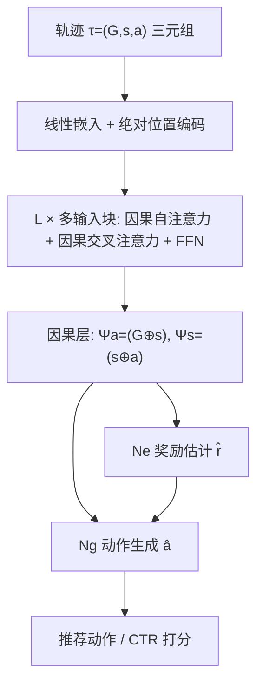
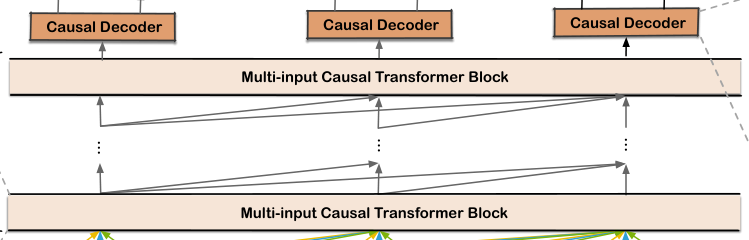

# Causal Decision Transformer for Recommender Systems via Offline Reinforcement Learning (基于离线强化学习的因果决策 Transformer 推荐系统)

- **会议/期刊**: SIGIR 2023
- **作者与机构**: Siyu Wang, Xiaocong Chen, Lina Yao (UNSW / Data61, CSIRO)；Dietmar Jannach (University of Klagenfurt)
- **推荐链路定位**: 端到端策略学习（离线训练 + 在线/模拟器微调打分）
- **研究方向**: 强化学习与动态探索推荐 / 序列与会话推荐
- **论文原文**: [https://arxiv.org/abs/2304.07920v2](https://arxiv.org/abs/2304.07920v2)
- **开源代码**: 暂未开源（原文仅给出数据划分说明的外链）

## TL;DR (1分钟核心速览)

RL 推荐的两大死结是「奖励函数无法手工刻画」与「必须在线交互、难以用大规模离线日志训练」。本文提出 CDT4Rec：把离线 RL 直接写成序列建模问题，用 return-to-go + 状态 + 动作三元组喂入带因果掩码的自/交叉注意力 Transformer，并在输出端增设**因果层**分别聚合 $(G,s)$估动作、$(s,a)$估状态，再由$N_e$/$N_g$ 两网分别回归奖励与生成动作，从而以「因果效应估计」替代奖励函数设计。在 6 个真实数据集（Recall/Precision/nDCG）与 VirtualTB 模拟器（CTR）上，相对 S3Rec 等 SOTA 多数指标领先（ML-20M Recall 19.27 vs 17.42，+10.6%）。

## Background & Motivation (背景与核心矛盾)

- **主流范式**: RLRS 把推荐建成 MDP，用 DDPG/SAC/TD3 等在线策略梯度最大化长期奖励；另一支用 Transformer 做序列推荐（SASRec/BERT4Rec/S3Rec）。
- **前人局限**: ①奖励函数（点击与否的权重、满意度标量）无法手工刻画，弱监督奖励直接决定策略上限；②在线 RL 每次仅能采集少量交互，且大规模离线日志与 RL 范式不兼容，仿真器本身又受数据效率限制。
- **核心洞察**: 用户点击行为背后存在**因果逻辑**——最近的行为与系统动作共同决定了反馈；若能用 Transformer 从历史轨迹中估计 $\mathbb{E}(r(a_t,s_t)\mid\tau)$，就不必再"设计"奖励，而是"读出"奖励。
- **本文切入点**: 把 Decision Transformer 从机器人控制迁移到推荐，并补一个因果层（自注意力 + 交叉注意力）显式解耦动作分支与状态分支，让离线数据集直接成为训练语料。

## Method (核心方法设计)

### 1. 整体框架 (Overall Architecture)

输入为按时间排列的三元组轨迹 $\tau=(G_1,s_1,a_1,\dots,G_T,s_T,a_T)$，其中$G_t$为折扣回报。三路 token 经线性层 + LayerNorm + 绝对位置编码后进入$L$个多输入块（因果掩码多头自注意力 → 跨三路子网的因果交叉注意力 → FFN/GELU），第$L$层输出被切回 RTG/状态/动作三组；因果层按"动作由$G,s$决定、状态由$s,a$决定"分别做逐元素相加与 GELU 投影得到$\Psi^a,\Psi^s$，最后$N_e$回归潜在奖励、$N_g$依$\hat{r}$与$\Psi^a$ 生成动作。训练用 DDPG 专家采集的离线轨迹做自回归拟合，测试时按目标回报条件化解码。

<figure class="paper-figure" markdown="span">
  <figcaption>图 1：我们的 CDT4Rec 架构概览。RTGs、状态和动作被输入线性嵌入，并加入绝对位置嵌入。随后这些词元通过 L 个堆叠的多输入块，这些块采用带因果掩码的自注意力和交叉注意力机制。由此在第 L 个块的输出处生成两个平衡表示。然后这些表示被输入两个额外的预测层。在此之上是两个网络 𝑁𝑒 和 𝑁𝑔，分别用于估计奖励和生成预测动作。</figcaption>
</figure>

### 2. 关键设计拆解 (Key Designs)

1. **回报条件化序列建模（用 RTG 代替奖励函数）**：痛点是不知奖励如何定义；本文沿 Decision Transformer 思路把未来折扣回报前置为条件 token
   $G_t=\sum_{k=t}^{T}\gamma^{k-t}r_k$，
   使策略 $\pi(a_t\mid s_{t-K+1:t},G_{t-K+1:t})$ 以"期望回报"为输入而非以标量奖励为损失权重；直觉上把"最大化奖励"的优化难题转成"给定回报做条件生成"的监督难题，规避了奖励尺度与稀疏性问题。
2. **因果层与双分支表征（本文真正的增量）**：DT 原版只用一个动作头，无法区分"动作影响反馈"与"状态自然漂移"。本文显式构造两条因果路径：
   $\Psi^a_t=\mathrm{GELU}\big((G_{t-K+1:t}\oplus s_{t-K+1:t})W_{r1}+b_{r1}\big),\quad \Psi^s_t=\mathrm{GELU}\big((s_{t-K+1:t}\oplus a_{t-K+1:t})W_{r2}+b_{r2}\big)$再让$N_e$由$(\Psi^s,\Psi^a)$估奖励、$N_g$由$(\hat r,\Psi^a)$生成动作。因果掩码保证$t$步只看到$\le t$ 的 token，交叉注意力则在三条子网间交换信息——这正是"用近期行为推断反馈"的算子化表达。
3. **训练目标与推理开销**：奖励分支用事实损失 $\mathcal{L}_{N_e}=\mathbb{E}_{\tau}\big[\tfrac{1}{K}\sum_k (r_k-N_e(\cdot))^2\big]$，动作分支用逐位交叉熵$\mathcal{L}_{N_g}=\tfrac{1}{K}\mathbb{E}_{\tau}\big[-\sum_k \log N_g(\hat r_{k-K+1:k},a_{k-K+1:k})\big]$，总目标为二者之和，联合反传至$\theta_e,\theta_s,\theta_a,\theta_g$。**免负采样**（动作空间即候选项隐空间），推理为自回归$B$步解码，单步复杂度约$O(L\cdot K^2 d_h)$，随上下文长度$K$线性/平方增长，但实验中$K=2$ 即最优，线上开销可控。

## Experimental Setup & Evaluation Protocol (实验设置与评估协议)

- **数据集与预处理**（原文未声明 `5-core` 过滤，仅按稀疏度差异选样；评分 $>0.75\times$ 最高分记为正向激励，其余为负）：

| 数据集 | #Users | #Items | #Interactions | 密度 | 特征/场景说明 |
| :--- | :---: | :---: | :---: | :---: | :--- |
| Amazon CD | 75,258 | 64,443 | 3,749,004 | 0.08% | 电商评论，CD 类目 |
| LibraryThing | 73,882 | 337,561 | 979,053 | 0.004% | 图书 + 社交关系 |
| MovieLens-1M | 6,040 | 3,900 | 1,000,209 | 4.24% | 稠密电影评分 |
| GoodReads | 808,749 | 1,561,465 | 225,394,930 | 0.02% | 大规模书评，多交互类型 |
| MovieLens-20M | 138,493 | 27,278 | 20,000,263 | 0.53% | 中等密度电影 |
| Netflix | 480,189 | 17,770 | 100,498,277 | 1.18% | 纯评分数据 |

- **数据划分与防穿越**: 沿用文献 [34] 的轨迹式评估；离线数据经 LSTM 状态编码器转为可交互仿真环境，按轨迹切分训练/测试（**原文未明确 Leave-One-Out 或全局时间戳切分**，属可复现性弱点）。
- **排名评测协议**: 离线侧报告 Recall / Precision / nDCG @ 全候选项（**未报告是否 Full-Ranking、亦未给出采样正负比**）；在线侧用 VirtualTB 内置 CTR 作为唯一指标。所有离线结果给 5 次运行均值 ± 标准差。
- **对比基线与超参**: 在线基线 DDPG / SAC / TD3 / DT；离线基线 SASRec / BERT4Rec / S3Rec（Transformer 系）与 KGRL / TPGR / PGPR（RL 系）。上下文长度 $K$与轨迹数做敏感性分析，最优$K=2$、约 20k 轨迹饱和。

## Key Experimental Results (实验关键数据)

### 1. 主实验对比 (Main Results)

| 数据集 / 指标(%) | SASRec | BERT4Rec | S3Rec | KGRL | TPGR | PGPR | **CDT4Rec** | Improv. |
| :--- | :---: | :---: | :---: | :---: | :---: | :---: | :---: | :---: |
| Amazon CD · Recall | 5.210 | 9.123 | 10.212* | 8.208 | 7.294 | 6.619 | **10.424** | +2.1% |
| Amazon CD · nDCG | 4.601 | 7.123 | 8.028* | 6.876 | 6.128 | 5.970 | **8.111** | +1.0% |
| LibraryThing · Recall | 8.312 | 11.982 | 13.425 | 12.128 | 14.713* | 11.531 | **15.229** | +3.5% |
| LibraryThing · Precision | 6.526 | 9.928 | 11.725 | 12.451* | 12.410 | 10.333 | **14.020** | +12.6% |
| ML-20M · Recall | 14.512 | 17.212 | 17.423* | 16.021 | 16.431 | 14.234 | **19.273** | +10.6% |
| ML-20M · Precision | 12.412 | 14.234 | 15.002* | 14.989 | 13.421 | 9.531 | **17.371** | +15.8% |
| Netflix · Recall | 11.321 | 13.847 | 14.090* | 13.909 | 12.512 | 10.982 | **15.271** | +8.4% |
| Netflix · nDCG | 14.225 | **13.274*** | 13.002 | 13.082 | 10.425 | 10.104 | 12.479 | −6.0% |

在线 VirtualTB（图 2）：CDT4Rec 与 DT 在回合早期即显著高于 DDPG / SAC / TD3（离线预训练红利），且全程优于 DT，方差更小。

### 2. 消融实验 (Ablation Study)

原文**未提供逐组件 `w/o` 消融表**，仅有 DT↔CDT4Rec 替换与超参曲线，下表为原文可得证据的整理（未报告项如实标注）：

| 变体 / 因素 | 观察结果 | 归因 |
| :--- | :--- | :--- |
| DT（无因果层、无交叉注意力） | VirtualTB 全程低于 CDT4Rec，方差更大 | 因果层与交叉注意力带来表征增益 |
| CDT4Rec 完整模型 | 6 数据集 Recall/Precision 多数第一 | 双分支解耦提升动作拟合精度 |
| 上下文长度 $K$|$K=2$最优，增大$K$ 反而下降 | 用户决策强马尔可夫性，最近一次交互主导 |
| 轨迹数 | <20k 上升，>20k 趋于饱和 | 样本效率高，小数据即可收敛 |
| w/o 交叉注意力 / w/o $N_e$（纯 BC） | **未报告** | 无法量化各模块独立贡献 |

### 3. 关键实验发现 (Key Findings)

1. **离线预训练红利随数据稀疏度放大**：GoodReads（0.02% 密度）Recall 13.274 vs 次优 PGPR 11.421（+16.2%）、ML-20M Precision 相对 S3Rec +15.8%，说明轨迹级因果建模在稀疏场景比纯序列自注意力更能抑制噪声交互。
2. **Recall 领先但位置敏感指标不总领先**：Netflix 上 nDCG 12.479 反被 BERT4Rec 的 13.274 超越（−6.0%），表明 $N_g$ 的交叉熵目标优化的是"动作似然"而非"排序位次"，因果层并未直接对齐 top-N 排序质量。
3. **强马尔可夫性被实验证实**：$K=2$即最优、$K$增大性能下降，且 20k 轨迹后曲线饱和，说明该框架的有效信息集中在最近一次$(s,a)$ 对，长上下文反而引入回报条件漂移。

## Highlights & Limitations (亮点、对比与审稿批判)

- **与代表作对比 (vs. Prior Work)**: 相较 DT（原版仅单动作头、面向机器人控制），本文加入因果层与双分支奖励/动作双网，把"状态转移"与"动作因果效应"分开建模；相较 KGRL/TPGR/PGPR 等在线 RL 推荐，本文完全离线训练、不需要可交互仿真器；相较 S3Rec/BERT4Rec 等序列模型，本文以 RTG 条件化引入长期回报信号。
- **可迁移亮点**: ①"$(\cdot\oplus\cdot)$ 双输入拼接构造因果子表征"的轻量做法可直接移植到多任务精排的塔间信息交换；②用 RTG 作为条件输入替代奖励加权，可迁移到长周期留存/LTV 建模。
- **审稿级局限批判**: ①**评测协议不透明**——未说明 Full-Ranking 还是采样排序、未给负采样比例、未声明划分方式，且把评分按 75% 分位二值化后转为仿真环境评估，与真实排序场景存在分布差；②**缺少组件级消融与效率报告**，因果层的独立增益无法量化，推理需自回归解码 $B$ 步，线上延迟未测；③离线数据全部由 DDPG 专家采集，存在专家策略覆盖偏差（distribution shift），文中未讨论保守性正则。

## Rating (四维评分)

- **方法创新性 (Novelty)**: ⭐⭐⭐⭐ （把 Decision Transformer 迁移到推荐并首创因果层双分支 + RTG 条件化，思路清晰但组件多为已有积木的组合）
- **评估协议与实验扎实度 (Protocol & Experiments)**: ⭐⭐⭐ （6 个真实数据集 + 1 个模拟器覆盖面好，但划分/打分协议未交代、缺组件消融、显著性检验缺失）
- **写作与数学规范度 (Clarity & Rigor)**: ⭐⭐⭐ （公式与符号基本完整，但 Eq.13 存在 $\Psi^a$笔误、basline 表格排版与指标口径描述不统一，$K$与$B$ 关系未澄清）
- **工业落地与复现价值 (Industrial & Practical Value)**: ⭐⭐⭐ （免负采样 + $K=2$ 使线上开销可控，但无开源代码、依赖专家轨迹采集流水线，复现门槛偏高）

