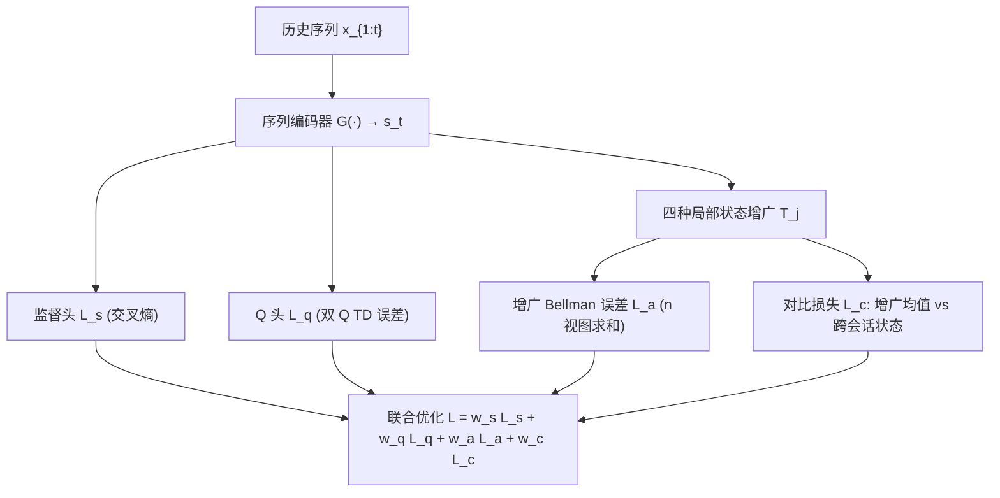
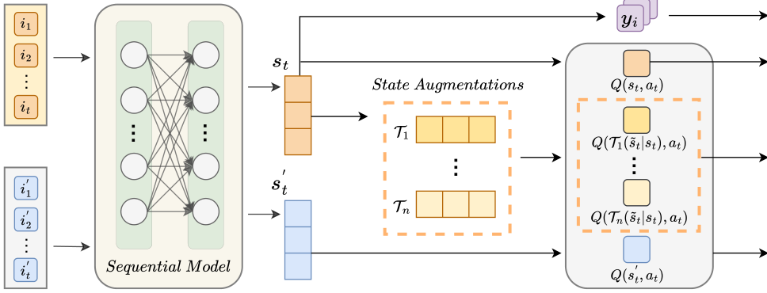

# Contrastive State Augmentations for Reinforcement Learning-Based Recommender Systems (基于对比状态增广的强化学习推荐)

- **会议/期刊**: SIGIR 2023 (ACM SIGIR, 46th)
- **作者与机构**: Zhaochun Ren, Na Huang, Yidan Wang, Pengjie Ren, Jun Ma, Xin Xin 等（山东大学、美团、University of Glasgow）
- **推荐链路定位**: 召回 / 序列 next-item 全库排序（端到端序列模型 + RL 输出头）
- **研究方向**: 强化学习与动态探索推荐 / 自监督对比学习
- **论文原文**: [https://arxiv.org/abs/2305.11081v1](https://arxiv.org/abs/2305.11081v1)
- **开源代码**: [https://github.com/HN-RS/CSA](https://github.com/HN-RS/CSA)

## TL;DR (1分钟核心速览)

离线 RL 推荐受限于两个痛点：训练数据只覆盖极小的状态集（OOD 状态值函数估不准），以及隐式反馈缺乏负信号导致状态表征不可靠。本文提出 CSA：在基础序列编码器（GRU4Rec/SASRec/FMLPRec）之上并联监督头与 Q 头，用高斯噪声、均匀噪声、item mask、维度 dropout 四种**局部**状态增广扩展状态空间，对增广状态求和 Bellman 误差，并用"同状态不同增广 vs 跨会话状态"构造对比损失。在 **Full-Ranking** 协议下，RC15 上 NDCG@5 相对 SQN 提升 7.4%，RetailRocket 上最高提升 8.8%。

## Background & Motivation (背景与核心矛盾)

- **主流范式**: 序列推荐以监督式 next-item 交叉熵训练 GRU4Rec/SASRec/FMLPRec；为优化长期累计收益，进一步引入离线 RL（Q-learning、双 Q 网络），如 SQN 将监督损失与 DQN 损失共享底座联合训练。
- **前人局限 1（分布偏移）**: 离线 RL 只能在 logged 数据出现过的 $(s_t,a_t)$上做策略评估，推理时用户状态与状态转移均可能偏离$D$，Q 网络对未见状态估计失真。
- **前人局限 2（缺负信号）**: 隐式反馈只有点击/购买正例，agent 不知道"哪个状态坏、哪个动作该避开"；增广若过于激进（如随机重排整条序列），奖励语义会被破坏。
- **核心洞察 (Key Insight)**: 视觉里旋转/裁剪保持语义，但在推荐中只有**局部扰动**才能保证 $\tilde{s}_t$与$s_t$ 的即时奖励近似一致；因此"小幅扰动不应导致值函数剧变"可作为平滑 Q 值面的先验。
- **本文切入点**: 把状态增广嵌入 Bellman 备份（$n$ 个增广视图的 TD 误差求和），再把增广视图当作对比学习的正样本对，二者与监督损失联合优化。

## Method (核心方法设计)

### 1. 整体框架 (Overall Architecture)

输入为长度 $t$的历史序列$x_{1:t}$，序列编码器$G(\cdot)$输出隐状态$s_t=G(x_{1:t})$，其上并联两层：监督层输出$|I|$维排序分布（交叉熵$\mathcal{L}_s$）与 RL 层输出$Q(s_t,a_t)$（双 Q-learning 的$\mathcal{L}_q$）。训练阶段对$s_t$采样$n$个局部变换$\mathcal{T}_j$得到增广状态$\tilde{s}_t$，分别送入同一 Q 层计算"增广 Bellman 损失"$\mathcal{L}_a$，并把$n$个增广 Q 值均值与原始状态 Q 值构成正对、与随机采样的另一会话状态$s'_t$构成负对，得到$\mathcal{L}_c$。四路损失加权求和在离线日志上联合训练；推理阶段仅保留编码器 + 监督头（或 Q 头），**无任何额外在线探索开销**。

<figure class="paper-figure" markdown="span">
  <figcaption>图 1：CSA 概述。{𝑖1,𝑖2, ...,𝑖𝑡} 表示原始输入序列。{T1, ..., T𝑛} 表示状态增强。基础序列模型通过监督损失、原始状态与增强状态上的 RL 损失（即 Q-learning 损失与增强损失），以及基于 {𝑖′ 之间比较的对比损失联合训练。</figcaption>
</figure>

### 2. 关键设计拆解 (Key Designs)

1. **四类局部状态增广（扩大离线状态支撑集）**：痛点是不做在线探索就只能访问 $D$内状态；本文对隐状态施加零均值高斯噪声$\tilde{s}_t=s_t+\epsilon_n,\ \epsilon_n\in\mathcal{N}(0,\sigma^2 I)$、均匀噪声$\epsilon_u\in\mathcal{U}(\alpha,\beta)$、序列 item mask（长度$>T$时随机置为 `[mask]`）以及维度 dropout（$\tilde{s}_t=s_t\cdot \mathbf{1}$，$\mathbf{1}$中随机一位为 0）。关键不是"多造数据"，而是扰动幅度受控——$\sigma=0.003$、$\beta=0.005$、$T=3$、$p=0.1$，保证奖励语义不变，从而让 agent 在状态邻域内被显式"访问"一遍。
2. **增广 Bellman 误差（平滑 Q 值面）**：把标准 TD 误差扩展为对 $n$ 个增广视图求和，
$\mathcal{L}_a=-\sum_{j=1}^{n}\big(r(s_t,a_t)+\gamma\max_{a'}Q(\mathcal{T}_j(\tilde{s}_{t+1}),a')-Q(\mathcal{T}_j(\tilde{s}_t),a_t)\big)^2$。
直觉：同一状态的多个扰动视图共享同一 TD 目标，等价于在 $s_t$ 的局部球内强制 Q 值一致，直接缓解离线 RL 的分布偏移。
3. **RL 状态的对比损失与训练目标**：隐式反馈无负例，故以"同状态增广均值 $\bar{Q}_t=\frac{1}{n}\sum_j Q(\mathcal{T}_j(\tilde{s}_t),a_t)$"为正对、以另一会话随机状态为负对：
$\mathcal{L}_c=-\log\delta\big((Q(s'_t,a_t)-\bar{Q}_t)^2-(Q(s_t,a_t)-\bar{Q}_t)^2\big)$。
总损失 $\mathcal{L}=w_s\mathcal{L}_s+w_q\mathcal{L}_q+w_a\mathcal{L}_a+w_c\mathcal{L}_c$，为免调参全部权重取 1；负样本"免费"来自 batch 内其他会话状态，无需显式负采样；推理开销与 SQN 相同（仅多一个训练期 Q 头）。

## Experimental Setup & Evaluation Protocol (实验设置与评估协议)

- **数据集与预处理**:

| 数据集 | #Sequences | #Items | #Clicks | #Purchases | 过滤/场景说明 |
| :--- | :---: | :---: | :---: | :---: | :--- |
| RC15 (RecSys Challenge 2015) | 200,000 | 26,702 | 1,110,965 | 43,946 | 会话长度 $\geq 3$，按时序排列 |
| RetailRocket | 195,523 | 70,852 | 1,176,680 | 57,269 | view→click，add-to-cart→purchase |
| meituan（美团真实电商） | 108,650 | 87,987 | 1,966,922 | 427,701 | 2022-04-01~07 一周日志，item 5-core、序列长度 $\geq 3$ |
| KuaiRec（模拟在线） | 1,411 用户 | 3,327 视频 | 密度 99.6% | — | 10 轮推荐，reward = 观看比例 |

- **数据划分与防穿越**: RC15/RetailRocket 沿用 SQN 的序列切分；meituan 按 8:1:1 划分训练/验证/测试。
- **排名评测协议**: **Full-Ranking**（在全体物品集上排序）；指标为 HR@{5,10,20}、NDCG@{5,10,20}；训练用点击+购买，**仅在购买预测上汇报**（对齐高奖励目标）。模拟在线以 10 轮累计折扣奖励评估，跑 3 次取均值。
- **对比基线与超参**: 三种底座（GRU4Rec / SASRec / FMLPRec）× 训练方式（Normal 监督、SQN、CSA-N/U/M/D）；序列长度 10，embedding $d=64$，batch 256，Adam，学习率按数据集调（0.01 / 0.005 / 0.001），增广次数$n$ 正文取 2、实现细节处写 24（存在表述不一致）。

## Key Experimental Results (实验关键数据)

### 1. 主实验对比 (Main Results)

| 模型 | RC15 HR@5 | RC15 NG@5 | RC15 HR@10 | RC15 NG@10 | RR HR@5 | RR NG@5 | RR HR@10 | RR NG@10 |
| :--- | :---: | :---: | :---: | :---: | :---: | :---: | :---: | :---: |
| GRU4Rec (Normal) | 0.4057 | 0.2802 | 0.5191 | 0.3170 | 0.4559 | 0.3775 | 0.5092 | 0.3948 |
| GRU4Rec + SQN | 0.4313 | 0.3043 | 0.5433 | 0.3405 | 0.5009 | 0.4135 | 0.5538 | 0.4308 |
| GRU4Rec + CSA-M | **0.4525** | **0.3268** | 0.5629 | **0.3627** | 0.5126 | 0.4358 | 0.5638 | 0.4524 |
| SASRec (Normal) | 0.4308 | 0.3006 | 0.5512 | 0.3396 | 0.5335 | 0.4322 | 0.5878 | 0.4497 |
| SASRec + SQN | 0.4433 | 0.3098 | 0.5509 | 0.3448 | 0.5649 | 0.4748 | 0.6203 | 0.4929 |
| SASRec + CSA-N | **0.4537** | 0.3208 | **0.5705** | 0.3587 | 0.5874 | 0.4934 | **0.6316** | 0.5078 |
| FMLPRec (Normal) | 0.4087 | 0.2929 | 0.5145 | 0.3272 | 0.5218 | 0.4307 | 0.5712 | 0.4468 |
| FMLPRec + SQN | 0.4205 | 0.2994 | 0.5304 | 0.3353 | 0.5534 | 0.4631 | 0.5991 | 0.4781 |
| FMLPRec + CSA-N | 0.4394 | 0.3209 | 0.5422 | 0.3543 | **0.5876** | **0.5041** | 0.6313 | **0.5183** |
| **Improv. (best CSA vs SQN)** | +4.9% | +7.4% | +3.6% | +6.5% | +6.2% | +8.8% | +1.8% | +5.4% |

meituan 上增益更温和但一致：SASRec+CSA-N 相对 SQN 的 HR@5 0.5352→0.5455（+1.9%）、NDCG@5 0.4416→0.4595（+4.1%）；SASRec+CSA-U 的 HR@10 达 **0.6040**（+1.5%）。

### 2. 消融实验 (Ablation Study)

| 配置 (RC15) | HR@5 | NG@5 | HR@10 | NG@10 |
| :--- | :---: | :---: | :---: | :---: |
| GRU4Rec + SQN（无增广） | 0.4313 | 0.3043 | 0.5433 | 0.3405 |
| GRU4Rec + CSA-M（完整） | **0.4525** | **0.3268** | **0.5629** | **0.3627** |
| w/o $\mathcal{L}_c$ | 0.4477 | 0.3216 | 0.5546 | 0.3563 |
| 对比作用在 action 而非 state | 0.4419 | 0.3162 | 0.5565 | 0.3535 |
| SASRec + CSA-U（完整） | **0.4364** | **0.3122** | **0.5470** | **0.3482** |
| w/o $\mathcal{L}_c$ | 0.4085 | 0.2887 | 0.5053 | 0.3200 |

### 3. 关键实验发现 (Key Findings)

1. **RL 本身有效，增广才是主要增量**：GRU4Rec 上 SQN 相对 Normal 的 NDCG@5 为 +8.6%（0.2802→0.3043），叠加 CSA-M 后进一步提升至 0.3268（再 +7.4%）；说明离线 RL 的瓶颈确实在状态覆盖而非损失形式。
2. **对比项是"稳定器"而非锦上添花**：去掉 $\mathcal{L}_c$ 后 SASRec+CSA-U 的 HR@5 从 0.4364 跌至 0.4085（−6.4%），而对比作用在 **state** 上普遍优于作用在 **action** 上（GRU-M：0.4525 vs 0.4419），因为不同底座编码出的状态空间更稳定、更值得约束。
3. **增广必须"局部"，且存在强度上界**：$\sigma$超过 0.003、$\beta$超过 0.005、$T$偏离 3、$p$偏离 0.1 时性能均回落；增广次数$n>2$ 后也下降（过多视图让 Q 值同质化、逼近模型塌缩）。策略并非普适：meituan 上 GRU4Rec+CSA-M 反而退化（HR@5 0.5095 < SQN 0.5238），说明 item mask 对短/密集购买序列过于激进。

## Highlights & Limitations (亮点、对比与审稿批判)

- **与代表作对比 (vs. Prior Work)**: 相比 SQN（监督+DQN 共享底座，无状态增广、无对比信号），CSA 只增加训练期算子即插即用；相比基于 dropout/crop 的对比序列推荐（CL4SRec、CoSeRec 等）把对比用在监督式表征上，本文把对比目标直接架在 **Q 值**上以服务策略评估；相比倾向性得分校正的 off-policy 方法，避免了 IPS 的高方差。
- **可迁移亮点**: (a) "增广视图求和 TD 误差"可平移到任何 offline RL 排序/出价场景做 Q 平滑；(b) 用跨会话随机状态充当免费负例，可低成本移植到缺乏负反馈的序列预训练中。
- **审稿级局限批判**: (a) 增广次数 $n$ 在正文（2）与实现细节（24）自相矛盾，且四类策略与 4 个超参需人工选择/网格搜索，缺少自适应或可学习增广；(b) 评测仍限于 HR/NDCG 与近乎 100% 密度的 KuaiRec 模拟环境，无显著性检验、无真实线上 A/B，奖励函数也仍是"交互即 1"，未验证作者声称的 novelty/dwell-time 等异构奖励。

## Rating (四维评分)

- **方法创新性 (Novelty)**: ⭐⭐⭐⭐ （把状态增广从"数据增强技巧"提升为 Bellman 备份内的 Q 值平滑先验，并给出奖励一致性假设，思路简洁但理论仅停留直觉层面）
- **评估协议与实验扎实度 (Protocol & Experiments)**: ⭐⭐⭐⭐ （三个数据集 + 模拟在线环境、三种底座交叉验证、消融覆盖对比项与增广位置，扣分在缺显著性检验与采样/全库排序细节描述）
- **写作与数学规范度 (Clarity & Rigor)**: ⭐⭐⭐ （框架图与公式链清晰，但式 (13) 的对比损失写成平方差之差的 sigmoid，符号与优化方向说明不够严谨，且 $n$ 取值前后矛盾）
- **工业落地与复现价值 (Industrial & Practical Value)**: ⭐⭐⭐⭐ （代码开源、插件式接入现有序列模型，训练期增广不改推理路径，且有美团真实数据验证，工程迁移成本低）

