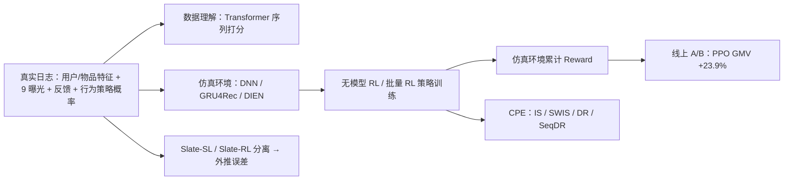
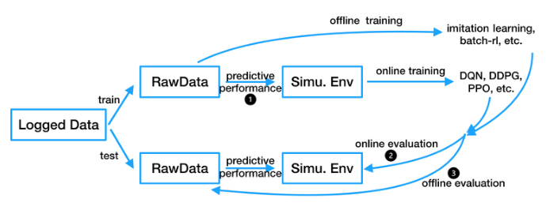

# RL4RS: A Real-World Dataset for Reinforcement Learning based Recommender System（真实工业级强化学习推荐数据集与评估框架）

- **会议/期刊**: SIGIR 2023（Resource Track；arXiv v5, 2023）
- **作者与机构**: Kai Wang, Zhene Zou, Minghao Zhao 等，网易伏羲 AI Lab
- **推荐链路定位**: 端到端策略学习（Slate/SeqSlate 排序与多步决策）
- **研究方向**: 强化学习与动态探索推荐 / 工业数据集与评测基准
- **论文原文**: [https://arxiv.org/abs/2110.11073v5](https://arxiv.org/abs/2110.11073v5)
- **开源代码**: [https://github.com/fuxiAIlab/RL4RS](https://github.com/fuxiAIlab/RL4RS)

## TL;DR (1分钟核心速览)

RL 推荐长期受困于人工/半模拟数据与有偏评估，策略无法在部署前被可靠验证。RL4RS 开源网易游戏真实日志，构造 Slate（单页 9 物品）与 SeqSlate（最多 36 步、含“解锁”规则）两套 MDP 数据，并配套数据理解工具、仿真环境、反事实策略评估及 RL 部署前后分离数据。在 283 物品、14.9 万用户上，PPO 在仿真环境取得 SeqSlate 最高奖励 319.7，线上 A/B 的 GMV 较 DIEN 提升 23.9%。

## Background & Motivation (背景与核心矛盾)

- **主流范式**: 工业推荐仍以监督学习（SL）逐物品贪心排序为主；RL 推荐将一次会话建模为多步 MDP，直接优化长期累计效用。
- **前人局限一（数据假）**: RecoGym/Recsim 为人工环境，半模拟数据（如 MovieLens 转 RL 格式）需大量强制假设，用户反馈并非真实多步决策。
- **前人局限二（评估偏）**: 现有工作或在训练所用仿真器上测试，或只看 Recall/Accuracy 等短期指标；后者与长期收益错位，前者受“外推误差”污染。
- **核心洞察 (Key Insight)**: 若贪心策略已接近 beam search 最优，则该数据根本不需要 RL；真实推荐中物品转化受同页其他物品影响（诱饵效应），且“解锁”规则使长期规划成为必需。
- **本文切入点**: 用真实工业日志 + 系统化四层评估，把“RL 是否必要、策略是否可信”变成可复现实验。

## Method (核心方法设计)

### 1. 整体框架 (Overall Architecture)

RL4RS 将推荐建模为离散时间 MDP：状态由 42 维用户画像、64 维点击历史及 360 维物品上下文构成；动作为选物品（离散 ID 或连续 embedding）；环境由 SL 用户模型近似；奖励为页级折扣效用。数据采集自网易游戏推荐引擎的在线规划环与学习环，日志保留曝光物品、9 维用户反馈、特征及**行为策略概率**，后者是 CPE 的关键。评估分四层：仿真环境保真度、仿真环境上的策略评估、反事实策略评估（CPE）、基于测试集构建环境的评估；并用 RL 部署前/后的 Slate-SL 与 Slate-RL 数据度量外推误差。

<figure class="paper-figure" markdown="span">
  <figcaption>图 5：基于 RL 的 RS 任务评估框架。</figcaption>
</figure>

### 2. 关键设计拆解 (Key Designs)

1. **双场景真实 MDP 与“解锁”规则**：每页固定 3 个列表×3 物品，当前列表未售罄则下一列表不可见，用户每日最多刷新 3 次。页奖励定义为 $r_{\text{page}}=\sum_{i=0}^{page-1}\gamma^i p_i r_i$，其中$p_i$为整页上下文下第$i$个物品的购买概率，$r_i$ 为其效用。该设计把“同页组合效应”和“跨页延迟收益”同时写进奖励，迫使策略放弃单步贪心。
2. **数据理解工具（判断该数据是否值得 RL）**：将 RL 退化为 Transformer 序列建模，比较 greedy 解码分数与 beam search 前 5% 序列分数；并用优势 $A(s_t,a_t)=V^*(s_{t+1})-V^*(s_t,\cdot)$ 刻画单步推荐的长期影响。若 greedy 已接近最优，则 RL 建模无意义。RL4RS 上 greedy 仅为最优序列的 0.62，纯热物品序列仅 0.01；而 RecSys15、MovieLens、Last.fm、CIKMCup2016 的 greedy 分别为 1.26、0.99、1.09、4.50，反证传统数据集的“RL 收益”多为伪需求。
3. **SL-RL 分离评估与 CPE**：用部署前数据训练仿真器、部署后数据测试策略，直接暴露分布偏移；CPE 以行为策略概率构造步级重要性权重 $w_t=\pi(a_t|s_t)/\pi_b(a_t|s_t)$，并用 DR/SeqDR 引入价值基线降方差。其直觉是：只有把“日志策略当时为何选该物品”纳入分母，才能校正离线评估的选择偏差。

**训练目标、负采样与推理效率**：无模型 RL 目标为最大化折扣累计奖励，采用 RLlib 实现，$\gamma=1$、batch 256、学习率$1\times10^{-4}$、embedding 128、约 640 万步；批量 RL 用 d3rlpy（BC/BCQ/CQL/MOPO/COMBO）直接离线学习，无需负采样。推理仅需策略网络前向；主要开销在预训练用户仿真器（千万级样本、数十毫秒级延迟），作者用 file-based 与 HTTP 向量化环境加速采样。

## Experimental Setup & Evaluation Protocol (实验设置与评估协议)

- **数据集与预处理**（全量周日志，**无 5-core 过滤**）：

| 数据集 | #Users | #Items | #Sessions | Items/session | 购买/session | 平均奖励 | 特征/场景说明 |
| :--- | :---: | :---: | :---: | :---: | :---: | :---: | :--- |
| RL4RS-Slate | 149,414 | 283 | 1,719,316 | 9.0 | 5.46 | 91.7 | 单页 9 物品，9 步决策 |
| RL4RS-SeqSlate | 149,414 | 283 | 958,566 | 16.1 | 9.75 | 164.5 | 最多 4 页/36 步，含解锁 |

- **数据划分与防穿越**: 数据理解实验随机取 10,000 用户为测试集；主实验沿用用户划分，并按 RL 部署时间切分为 Slate-SL（112,221 用户，训练仿真器）与 Slate-RL（77,834 用户，测外推误差），不是 Leave-One-Out。
- **排名评测协议**: 非传统 Full-Ranking；主指标为**仿真环境累计 Reward**，辅以线上 A/B 的 IPV/CVR/GMV 与 CPE 分数；无负采样，使用真实曝光日志。
- **对比基线**: 环境仿真用 DNN、Wide&Deep、GRU4Rec、DIEN、Adversarial User Model；无模型 RL 用 PG、DQN、Rainbow、PA-DQN、A2C、PPO、Exact-k 及 DDPG/TD3/PPO-conti；批量 RL 用 BC、BCQ、CQL、MOPO、COMBO。所有结果跑 5 次取标准差。

## Key Experimental Results (实验关键数据)

### 1. 主实验对比 (Main Results)

仿真环境累计奖励（越高越好）：

| 方法 | 动作类型 | Slate Reward | SeqSlate Reward |
| :--- | :---: | :---: | :---: |
| 行为策略 DIEN（SL） | 离散 | 91.7 | 164.5 |
| DQN | 离散 | 133.0 | 226.1 |
| Rainbow | 离散 | 151.5 | 259.1 |
| PA-DQN | 离散 | 150.1 | 276.3 |
| A2C | 离散 | 159.8 | 282.1 |
| PPO | 离散 | 160.4 | **319.7** |
| TD3 | 连续 | **178.1** | 272.9 |
| BCQ（批量） | 离散 | 127.4 | 262.4 |
| CQL（批量） | 离散 | 103.5 | 247.5 |

**Improv.**：TD3 在 Slate 较行为策略 +94.2%；PPO 在 SeqSlate +94.4%。线上 A/B（相对 DIEN，越高越好）：

| 方法 | IPV | CVR | GMV |
| :--- | :---: | :---: | :---: |
| DIEN | 1.000 | 1.000 | 1.000 |
| A2C | **1.206** | 0.801 | 1.190 |
| DQN | 0.966 | **0.874** | 1.143 |
| PPO | 1.133 | 0.853 | **1.239** |

### 2. 消融实验 (Ablation Study)

以“仿真器选择”为消融轴，考察分类指标与奖励预测误差的错位：

| 环境模型 | Slate-wise Acc | Slate item AUC | SeqSlate item AUC | Slate reward Abs.Err | SeqSlate reward Abs.Err |
| :--- | :---: | :---: | :---: | :---: | :---: |
| DNN | 0.386 | 0.876 | 0.935 | 41.6 | 89.0 |
| Wide&Deep | 0.398 | 0.894 | 0.939 | 41.1 | 78.7 |
| GRU4Rec | **0.429** | **0.907** | **0.961** | 36.5 | 68.9 |
| DIEN | 0.430 | **0.907** | 0.960 | **36.2** | **66.2** |

### 3. 关键实验发现 (Key Findings)

1. **RL 必要性被首次量化**：RL4RS 的 greedy 序列仅为 beam search 最优的 0.62，热物品序列低至 0.01；传统数据集 greedy 高达 0.99–4.50。说明多数公开数据上的“RL 提升”来自数据转换而非长期决策，RL4RS 才构成真实多步任务。
2. **分类精度高 ≠ 仿真器可信**：DIEN 的 item-wise AUC 达 0.907，但 Slate 奖励绝对误差仍有 36.2、SeqSlate 66.2；GRU4Rec 与 DIEN 的 AUC 几乎持平，奖励误差却相差 2–10 分，证明用 CTR/AUC 选仿真器会系统性高估策略质量。
3. **仿真排名可外推、CPE 尚不可靠**：线上 PPO>A2C>DQN>DIEN 与仿真排名一致，PPO GMV +23.9%；但 CPE 给出相反信号（CQL 的 DR 2.20 vs PPO 1.24），且 IS 分值在 9.12–130.61 间剧烈波动，说明仅靠 CPE 选策略仍高风险。

## Highlights & Limitations (亮点、对比与审稿批判)

- **与代表作对比**: RecoGym/Recsim 是人工环境，无法反映真实反馈；Virtual-Taobao 虽真实但不开源原始日志，难以复现离线学习；半模拟工作（Adversarial User Model、List-wise）对 MovieLens 做强制 MDP 转换。RL4RS 是首个同时开源原始日志、仿真环境、RL/批量 RL 基线、CPE 与部署前后分离数据的资源。
- **可迁移亮点**: ① 用“greedy vs beam-search 分数比”快速判断新场景是否值得上 RL；② 用部署前/后数据分离度量外推误差，可迁移到 any 离线策略评估；③ 用零填充会话替代显式“用户退出”建模，简化 SeqSlate 状态转移。
- **审稿级局限批判**: ① 仅 283 个物品、单一游戏场景，动作空间远小于真实电商/短视频候选集，结论泛化性有限；② 仿真器仍是 SL 拟合，奖励误差 36–66，且 MOPO/COMBO 的动态模型训练失败，说明基于模型的批量 RL 在此数据上尚不可用；③ CPE 方差极大、未给出置信区间选择规则，实际部署前的策略筛选仍缺可靠统计保证。

## Rating (四维评分)

- **方法创新性 (Novelty)**: ⭐⭐⭐⭐ （首个真实工业 RL 推荐数据集与四层评估框架，资源价值突出；但算法层面增量有限，主要是基准与工具。）
- **评估协议与实验扎实度 (Protocol & Experiments)**: ⭐⭐⭐⭐ （仿真+批量 RL+CPE+线上 A/B 四路互证，5 次运行给方差；但用户划分与时间切分未完全统一，部分结论依赖单一场景。）
- **写作与数学规范度 (Clarity & Rigor)**: ⭐⭐⭐⭐ （MDP、奖励、数据理解与 CPE 符号清晰，数据卡与复现脚本完备；部分实现细节散落附录，CPE 理论推导较浅。）
- **工业落地与复现价值 (Industrial & Practical Value)**: ⭐⭐⭐⭐⭐ （网易真实部署、代码与数据全开源、线上 GMV +23.9%，为 RL 推荐提供了可直接复现的工业级沙盒。）

