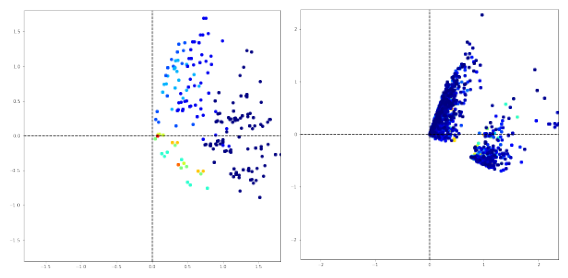
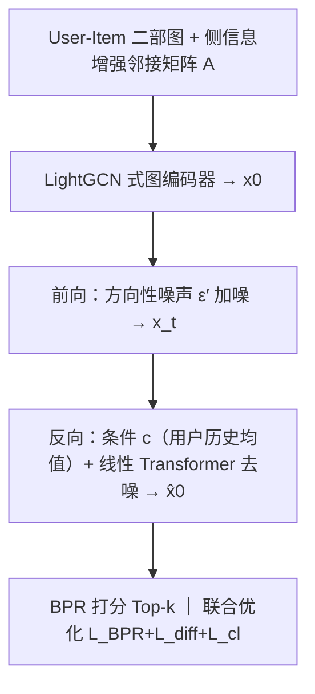
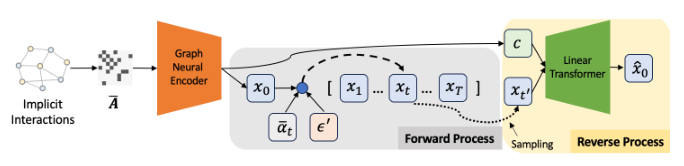

# A Directional Diffusion Graph Transformer for Recommendation (面向推荐的方向性扩散图 Transformer)

- **会议/期刊**: SIGIR 2024
- **作者与机构**: Zixuan Yi, Iadh Ounis (University of Glasgow); Xi Wang (University of Sheffield)
- **推荐链路定位**: 召回（Top-k 全库排序）
- **研究方向**: 自监督对比学习与交互去噪 / 图神经网络推荐
- **论文原文**: [https://arxiv.org/abs/2404.03326v1](https://arxiv.org/abs/2404.03326v1)
- **开源代码**: 暂未开源（原文称接收后释出）

## TL;DR (1分钟核心速览)

隐式反馈中大量假阳性/假阴性边会污染 GNN 的邻居聚合，而已有扩散式推荐（DiffRec）统一注入等方向（isotropic）高斯噪声，与推荐数据本身呈强各向异性（少数方向集中）的结构相冲突。本文提出 DiffGT：前向在嵌入层注入「方向性各向异性噪声」$\epsilon'=\mathrm{sgn}(x_0)\odot|\bar{\epsilon}|$，反向用线性注意力 Transformer 以用户历史均向量为条件做去噪。在 ML-1M / Foursquare / Yelp2018 三数据集、全库排序 Recall@20 上相对最强基线 GFormer、DiffRec、SimGCL 提升 2.0%–4.0%，NDCG@20 提升 2.4%–6.4%。

## Background & Motivation (背景与核心矛盾)

- **主流范式**：以 LightGCN / SGL / SimGCL / GFormer 为代表，靠边丢弃、节点丢弃、嵌入扰动或对比学习来"隐式降噪"，本质是在聚合时随机丢边，并未显式建模噪声的分布形式。
- **前人局限 1（噪声假设错配）**：CDAE、MultiVAE、DiffRec 一律使用等方向高斯噪声，隐含假设隐空间是各向同性的；而 SVD 可视化显示 Foursquare 标签、ML-1M 类型都挤在少数方向上，等方向噪声会快速淹没本已稀疏的方向性信号。
- **前人局限 2（无条件生成）**：DiffRec 等价于无条件生成范式，反向过程不知道"这是哪个用户"，无法把去噪轨迹拉向该用户真实偏好；同时其在邻接矩阵上做离散扩散，每步需转移矩阵乘法，复杂度含 $M^2$ 因子。
- **核心洞察 (Key Insight)**：若让注入噪声与原始嵌入同号（同象限），信噪比（SNR）就不会像等方向噪声那样急剧坍塌，扩散过程能保留可分性。
- **本文切入点**：把"噪声的形状"和"去噪的条件"同时改掉——方向性噪声 + 个性化条件 + 图适配的线性 Transformer。

<figure class="paper-figure" markdown="span">
  <figcaption>图1：使用SVD分解对数据进行二维可视化。(a) MovieLens-1M数据集中物品表示的可视化，不同颜色表示电影类型。(b) Foursquare数据集中所有场馆标签的可视化。</figcaption>
</figure>

## Method (核心方法设计)

### 1. 整体框架 (Overall Architecture)

先用 LightGCN 式图编码器在「侧信息增强」的二部图上做邻居聚合，得到干净嵌入 $x_0$；前向过程按调度系数$\bar{\alpha}_t$逐步注入方向性噪声得到$x_t$；反向过程不再逐步重参数化到$x_0$，而是直接在采样步$t'$上用线性注意力 Transformer 一次性预测$\hat{x}_0$，并把用户交互项的均值向量作为条件$c$参与注意力；最终用$\hat{x}_0$ 做 BPR 打分与 Top-k 排序，训练侧由 BPR、扩散、对比三项损失联合优化。

<figure class="paper-figure" markdown="span">
  <figcaption>图2：我们的DiffGT架构示意图。</figcaption>
</figure>

### 2. 关键设计拆解 (Key Designs)

1. **方向性各向异性噪声（Forward）**：痛点是等方向噪声破坏方向结构 $\to$先把各向同性噪声按数据逐坐标的均值/方差重标定，再强制与$x_0$同号：$\bar{\epsilon}=\mu+\sigma\odot\epsilon$，$\epsilon'=\mathrm{sgn}(x_0)\odot|\bar{\epsilon}|$，前向即$x_t=\sqrt{\bar{\alpha}_t}x_0+\sqrt{1-\bar{\alpha}_t}\epsilon'$。直觉：噪声不再翻转特征方向，SNR 缓降，稀疏但关键的"类型/标签方向"得以保留。
2. **条件化线性 Transformer 去噪（Reverse）**：痛点是无条件反向无法个性化 $\to$把用户交互均值$X_C$作为条件与含噪嵌入共同送入线性注意力：$X_T^{\ell_2+1}=\mathrm{LinearAttn}_{\ell_2}(X_G^{\ell_2},X_C)$，直接回归$p(x_0\mid x_t,c)$。注意力复杂度由$O(N^2)$降为$O(N)$，且只在采样步$t'$去噪（$K\ll T$），反向开销再降$T-K$ 倍，TOST 检验表明性能与全步版本等价。
3. **训练目标与推理效率**：$\mathcal{L}=\mathcal{L}_{BPR}+\lambda_1\mathcal{L}_{diff}+\lambda_2\mathcal{L}_{cl}$，其中$\mathcal{L}_{diff}=\|\epsilon-\epsilon_\theta(\sqrt{\bar\alpha_t}x_0+\sqrt{1-\bar\alpha_t}\epsilon',t)\|^2$约束去噪保真，$\mathcal{L}_{cl}$拉近图编码嵌入$e$与其去噪嵌入$e'$、推远其他节点嵌入；采用 BPR 均匀负采样（每正例 1 负例），推理时仅需一次图编码 + 一次反向 Transformer 前传。

## Experimental Setup & Evaluation Protocol (实验设置与评估协议)

- **数据集与预处理**：未做 `5-core` 过滤，直接用原始划分；用侧信息（电影类型 / 场馆标签）余弦相似度取 top-$n$ 相似用户-用户、物品-物品对补边，得到增强邻接矩阵。

| 数据集 | #Users | #Items | #Interactions | 稀疏度/密度 | 特征/场景说明 |
| :--- | :---: | :---: | :---: | :---: | :--- |
| MovieLens-1M | 6,040 | 3,704 | 1,000,209 | 4.47% | 电影类型侧信息，稠密 |
| Foursquare | 2,060 | 2,876 | 27,149 | 0.46% | 场馆标签侧信息，含地理签到 |
| Yelp2018 | 31,668 | 38,048 | 1,561,406 | 0.13% | 商户属性，极稀疏 |

- **数据划分与防穿越 (Splitting Strategy)**：沿用 LightGCN 的 `7:1:2 随机比例划分`（train/val/test），非时间切分；每个数据集用 **10 个不同随机种子构造 10 个测试集**，报告均值为最终指标，以降低单一测试集偏置。
- **排名评测协议 (Ranking Protocol)**：指标 Recall@20 / NDCG@20；论文未明示负例采样比例，按基线（LightGCN/SGL/SimGCL/GFormer）惯例为无偏 **Full-Ranking 全库未交互排序**（这一点原文表述略含糊，复现需注意）。
- **对比基线与超参设置**：10 个基线覆盖 MF、CDAE、MultiVAE、DiffRec；侧信息类 HIRE、cVAE；图模型 LightGCN、SGL、SimGCL、GFormer。$\lambda_1,\lambda_2\in\{0,0.1,\dots,1.0\}$，$\tau\in\{0,\dots,10\}$，噪声系数$\epsilon\in\{0,\dots,10\}$，扩散步$t\in\{10,\dots,100\}$，top-$n\in\{0,5,\dots,20\}$，Transformer 层数$\{1,\dots,5\}$；显著性用 Holm-Bonferroni 校正的配对 t 检验（$p<0.05$），效率对比另用 TOST 等价性检验。

## Key Experimental Results (实验关键数据)

### 1. 主实验对比 (Main Results)

| Dataset | \multicolumn{2}{c|}{MovieLens-1M} | \multicolumn{2}{c|}{Foursquare} | \multicolumn{2}{c|}{Yelp2018} |
| :--- | :---: | :---: | :---: | :---: | :---: | :---: |
| 方法 | R@20 | N@20 | R@20 | N@20 | R@20 | N@20 |
| MF | 0.1638 | 0.2074 | 0.2430 | 0.3424 | 0.0409 | 0.0341 |
| MultiVAE | 0.2740 | 0.3085 | 0.4151 | 0.5580 | 0.0557 | 0.0481 |
| DiffRec | 0.2756 | 0.3108 | 0.4414 | 0.6087 | 0.0663 | 0.0551 |
| HIRE | 0.2709 | 0.3050 | 0.3634 | 0.4891 | 0.0613 | 0.0520 |
| LightGCN | 0.2697 | 0.3021 | 0.4161 | 0.5707 | 0.0589 | 0.0504 |
| SGL | 0.2723 | 0.3078 | 0.4333 | 0.5978 | 0.0646 | 0.0537 |
| SimGCL | 0.2788 | 0.3112 | 0.4353 | 0.6214 | 0.0701 | 0.0573 |
| GFormer | 0.2812 | 0.3142 | 0.4242 | 0.6051 | 0.0696 | 0.0559 |
| **DiffGT** | **0.2903** | **0.3264** | **0.4589** | **0.6612** | **0.0715** | **0.0587** |
| Improv.% (vs. 最强基线) | +3.2% | +3.9% | +4.0% | +6.4% | +2.0% | +2.4% |

### 2. 消融实验 (Ablation Study)

| 变体 | ML-1M R@20 | ML-1M N@20 | Foursquare R@20 | Foursquare N@20 | Yelp2018 R@20 | Yelp2018 N@20 |
| :--- | :---: | :---: | :---: | :---: | :---: | :---: |
| -Direction（换等方向噪声） | 0.2533 | 0.2843 | 0.4016 | 0.5029 | 0.0541 | 0.0474 |
| -Transformer（换权重矩阵去噪） | 0.2535 | 0.2967 | 0.3631 | 0.5029 | 0.0616 | 0.0507 |
| -CL | 0.2701 | 0.3007 | 0.4144 | 0.5609 | 0.0603 | 0.0508 |
| -DiffL | 0.2736 | 0.3084 | 0.4263 | 0.5803 | 0.0616 | 0.0514 |
| -Condition | 0.2822 | 0.3145 | 0.4322 | 0.5978 | 0.0703 | 0.0578 |
| -Side（去侧信息补边） | 0.2858 | 0.3203 | 0.4352 | 0.6154 | 0.0704 | 0.0556 |
| **DiffGT** | **0.2903** | **0.3264** | **0.4589** | **0.6612** | **0.0715** | **0.0587** |

### 3. 关键实验发现 (Key Findings)

1. **噪声形状是最大增益源**：把方向性噪声换回等方向噪声，ML-1M Recall@20 从 0.2903 掉到 0.2533（-12.7%），Foursquare NDCG@20 从 0.6612 掉到 0.5029（-24%），甚至低于 LightGCN；SNR 曲线显示等方向噪声的 SNR 全程低且陡降，直接解释了后续反向去噪的失效。
2. **架构与条件比"多加数据"更重要**：-Transformer（-12.7%）与 -Direction 降幅相当，说明图适配的去噪器不可替代；条件化仅带来 ~2.8% 提升但在三数据集均显著，属于低成本高性价比项；而侧信息补边只在 4/6 设置上显著（ML-1M 仅 -1.5%），增益最弱。
3. **连续扩散在效率与效果上双赢**：离散扩散 Recall@20 仅 0.2657 且前向复杂度多出 $M^2$因子；连续 + 线性 Transformer + 采样步组合把反向复杂度从$T\cdot N^2 L_2 d$降到$N L_2 d$，性能 0.2903 与全步版 0.2917 在 TOST 下等价。跨模型迁移上，KG 推荐 9/10 例显著提升，序列推荐 4/5 例显著（BERT4Rec 因双向注意力对噪声敏感而无显著增益）。

## Highlights & Limitations (亮点、对比与审稿批判)

- **与代表作对比 (vs. Prior Work)**：相比 DiffRec，本文把"无条件等方向噪声扩散"改成"条件化方向性噪声扩散"，并首次在扩散框架内用 Transformer 而非 MLP 去噪；相比 GFormer，本文是图编码器—Transformer 的**级联**结构（Transformer 服务于扩散去噪），而非并行构造对比视图；相比 SGL/SimGCL 的随机丢边或嵌入扰动，本文是对噪声分布形状做显式建模。
- **可迁移亮点**：$\mathrm{sgn}(x_0)\odot|\bar{\epsilon}|$这一"符号对齐 + 坐标重标定"的加噪算子可即插即用于任何嵌入级扩散/增广模块；采样步去噪（$K\ll T$）+ 线性注意力是扩散推荐降延迟的标准组合。
- **审稿级局限批判**：(1) 排序协议与负采样规模在文中未明确交代，"全库排序"仅能从基线惯例推断，会影响与采样排序方法的可比性；(2) 主实验仅 3 个数据集且代码未释出，$\lambda_1,\lambda_2,\epsilon,t$等超参敏感性分析被"因篇幅省略"，复现成本偏高；(3) 侧信息补边依赖 top-$n$ 人工阈值，在无侧信息场景（纯隐式反馈工业场景）增益可能进一步衰减。

## Rating (四维评分)

- **方法创新性 (Novelty)**: ⭐⭐⭐⭐ （"方向性噪声 + 符号对齐"的物理直觉清晰且有 SNR 曲线佐证，条件化扩散与级联图 Transformer 组合在推荐域属首次）
- **评估协议与实验扎实度 (Protocol & Experiments)**: ⭐⭐⭐⭐ （10 随机种子测试集 + Holm-Bonferroni 校正 t 检验 + TOST 等价性检验较严谨，但仅 3 个主数据集、排序协议表述含糊扣分）
- **写作与数学规范度 (Clarity & Rigor)**: ⭐⭐⭐⭐ （前向/反向公式与四个 Limitation 一一对应，复杂度和效率对比表格清晰，反向过程与实际采样步的推导略跳步）
- **工业落地与复现价值 (Industrial & Practical Value)**: ⭐⭐⭐⭐ （线性注意力 + 采样步把反向压到线性开销、可与 LightGCN 类召回栈直接拼装，但依赖侧信息构图且代码未开源）

