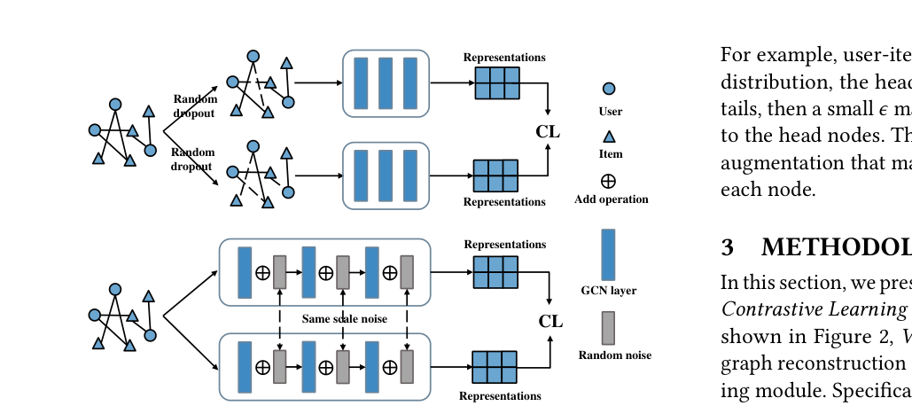
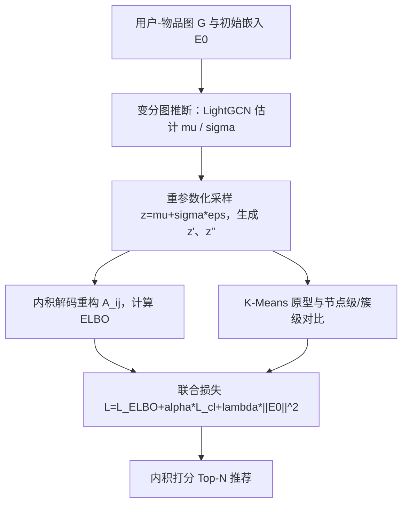
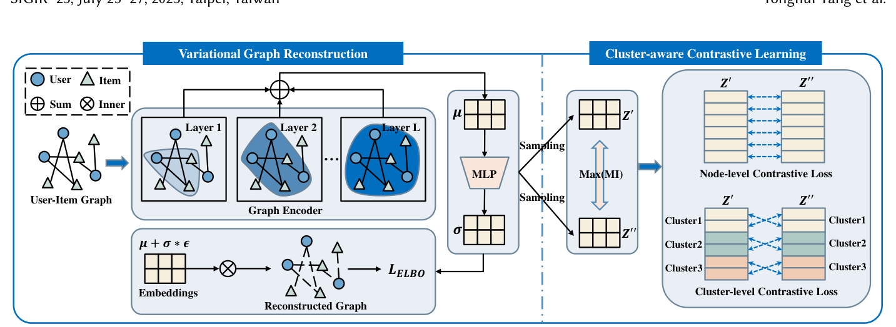

# Generative-Contrastive Graph Learning for Recommendation (生成式对比图学习推荐)

- **会议/期刊**: SIGIR 2023
- **作者与机构**: Yonghui Yang, Zhengwei Wu, Le Wu, Kun Zhang, Richang Hong, Zhiqiang Zhang, Jun Zhou, Meng Wang；合肥工业大学大数据知识工程实验室、蚂蚁集团
- **推荐链路定位**: 召回 / 全库排序（图协同过滤）
- **研究方向**: 自监督对比学习与交互去噪 / 图神经网络与知识图谱推荐
- **论文原文**: [论文原文链接](https://arxiv.org/abs/2307.05100v1)
- **开源代码**: [开源代码仓库链接](https://github.com/yimutianyang/SIGIR23-VGCL)

## TL;DR (1分钟核心速览)

针对图对比推荐中结构增广易破坏图结构、特征增广对全节点同尺度加噪的痛点，VGCL 用变分图重构估计节点高斯分布并多次采样生成对比视图，联合节点级与簇级对比信号。三个公开数据集随机 80/20 划分、Full-Ranking 下，NDCG@20 较 LightGCN 提升 8.61%–28.17%，较 SimGCL 最高提升 6.36%。

## Background & Motivation (背景与核心矛盾)

- **主流范式**: 图协同过滤用 LightGCN 类模型传播高阶协同信号；GCL 方法（SGL/SimGCL）再通过结构或特征增广构造对比视图，以 InfoNCE 补充稀疏监督。
- **前人局限**: 结构增广随机丢点/丢边，易破坏用户-物品图的内在连通结构；特征增广对所有节点施加同尺度噪声，忽略节点度数、长尾分布与个性化不确定性。
- **核心洞察 (Key Insight)**: 若能为每个节点估计一个后验高斯分布，则多次采样天然生成“可重构原图”的对比视图，且方差可自适应控制该节点的对比损失强度。
- **本文切入点**: 用变分图生成替代数据增广，把生成式重构与对比学习桥接起来，并进一步做簇级对比。

<figure class="paper-figure" markdown="span">
  <figcaption>图 1：基于结构数据与特征数据增强的图对比学习范式。</figcaption>
</figure>
*图1：结构增广与特征增广的图对比学习范式。*

## Method (核心方法设计)

### 1. 整体框架 (Overall Architecture)

VGCL 以用户-物品二部图与初始化嵌入 $E_0$为输入：先用 LightGCN 做变分图推断，得到每个节点的均值$\mu$与方差$\sigma$；再以重参数化采样$z=\mu+\sigma\cdot\varepsilon$ 生成多个潜在表示，并通过内积解码器重构原图，形成 ELBO 监督。与此同时，对采样视图执行节点级 InfoNCE 与基于 K-Means 原型的簇级对比，最终以多任务损失联合优化，推理时仅用内积打分做 Top-N 全库排序。

<figure class="paper-figure" markdown="span">
  <figcaption>图 2：我们提出的变分图生成-对比学习（VGCL）框架示意图，由变分图重构模块和聚类感知对比学习模块组成。变分图重构模块通过从估计分布中进行多次采样生成对比视图。聚类感知对比学习模块提供自监督信号，包括节点级和簇级对比目标。</figcaption>
</figure>
*图2：VGCL 框架，由变分图重构模块与聚类感知对比学习模块组成。*

### 2. 关键设计拆解 (Key Designs)

1. **变分图重构替代数据增广**：痛点在于随机增广会失真；VGCL 设节点后验 $q_\phi(z_i|A,E_0)=\mathcal{N}(\mu_i,\mathrm{diag}(\sigma_i^2))$，均值由 LightGCN 层平均得到，方差由单层 MLP 估计$\sigma=\exp(\mu \mathbf{W}+b)$，再用$z_i=\mu_i+\sigma_i\cdot\varepsilon$采样。解码器为$p(A_{ij}=1|z_i,z_j)=\sigma(z_i^T z_j)$，故采样视图仍能重构原图，且方差按节点自适应调节对比尺度。

2. **聚类感知双层对比**：仅节点级对比无法区分“相似但非同一节点”的硬负例；VGCL 对估计分布做 K-Means 得到用户/物品原型，令同簇概率为 $p(a,b)=\sum_k p(c_{uk}|z_a)p(c_{uk}|z_b)$，并以$p(a,b)$ 加权簇级对比损失。节点级保证单节点多视图一致，簇级保证同簇节点语义一致，等价于用伪标签挖掘更难负例。

3. **训练目标、负采样与推理效率**：总损失为 $\mathcal{L}=\mathcal{L}_{\text{ELBO}}+\alpha\mathcal{L}_{cl}+\lambda\|E_0\|^2$，其中$\mathcal{L}_{cl}=\mathcal{L}_N+\gamma\mathcal{L}_C$；图重构采用 pairwise 训练，每用户随机选一个未交互物品作负例，对比学习使用 in-batch 负例。推理仅需内积；图卷积开销为$O(2|E|dS)$，低于 SGL/SimGCL 需重复三次卷积的$O(6|E|dS)$。

## Experimental Setup & Evaluation Protocol (实验设置与评估协议)

- **数据集与预处理**: 过滤交互数少于 10 的用户；Movielens-25M 将评分 5 视为正反馈。

| 数据集 | #Users | #Items | #Interactions | 稀疏度/密度 | 特征/场景说明 |
| :--- | :---: | :---: | :---: | :---: | :--- |
| Douban-Book | 13,024 | 22,347 | 792,062 | 0.272% | 图书评分/评论 |
| Dianping | 59,426 | 10,224 | 934,334 | 0.154% | 本地生活商户 |
| Movielens-25M | 92,901 | 8,826 | 2,605,952 | 0.318% | 电影评分，5 分为正 |

- **数据划分与防穿越 (Splitting Strategy)**: 随机划分 80% 训练、20% 测试；未采用 Leave-One-Out 或全局时间戳切分，存在一定时间穿越风险。
- **排名评测协议 (Ranking Protocol)**: 无偏 `Full-Ranking`，所有未交互物品参与排序；报告 Recall@10/20 与 NDCG@10/20，5 次重复取平均。
- **对比基线与超参设置**: 基线含 BPR-MF、LightGCN、Multi-VAE、CVGA、SGL-ED、NCL、SimGCL；嵌入维度 $d=64$，Adam 学习率 0.001，batch 为 2048/4096；$\tau_1=0.2$，最优$\tau_2$为 0.13/0.15，$K_u/K_i$ 为 900/300、500/100；未明确报告显著性检验。

## Key Experimental Results (实验关键数据)

### 1. 主实验对比 (Main Results)

| 模型 | Douban R@20 | Douban N@20 | Dianping R@20 | Dianping N@20 | ML-25M R@20 | ML-25M N@20 |
| :--- | :---: | :---: | :---: | :---: | :---: | :---: |
| BPR-MF | 0.1296 | 0.1045 | 0.0934 | 0.0557 | 0.3163 | 0.2343 |
| LightGCN | 0.1516 | 0.1278 | 0.1076 | 0.0660 | 0.3263 | 0.2509 |
| Multi-VAE | 0.1376 | 0.1155 | 0.1046 | 0.0632 | 0.3185 | 0.2418 |
| CVGA | 0.1492 | 0.1359 | 0.1128 | 0.0690 | 0.3454 | 0.2641 |
| SGL-ED | 0.1551 | 0.1419 | 0.1111 | 0.0686 | 0.3274 | 0.2541 |
| NCL | 0.1576 | 0.1439 | 0.1124 | 0.0701 | 0.3274 | 0.2531 |
| SimGCL | 0.1731 | 0.1540 | 0.1208 | 0.0743 | 0.3491 | 0.2690 |
| **VGCL** | **0.1829** | **0.1638** | **0.1234** | **0.0757** | **0.3507** | **0.2725** |

Improv. (N@20 vs 最强基线 SimGCL)：Douban +6.36%，Dianping +1.88%，ML-25M +1.30%。

### 2. 消融实验 (Ablation Study)

| 模型 | Douban R@20 | Douban N@20 | Dianping R@20 | Dianping N@20 | ML-25M R@20 | ML-25M N@20 |
| :--- | :---: | :---: | :---: | :---: | :---: | :---: |
| LightGCN | 0.1512 | 0.1271 | 0.1076 | 0.0660 | 0.3263 | 0.2509 |
| SimGCL | 0.1731 | 0.1540 | 0.1208 | 0.0743 | 0.3491 | 0.2690 |
| VGCL-w/o C | 0.1776 | 0.1575 | 0.1222 | 0.0750 | 0.3477 | 0.2705 |
| VGCL-w/o V | 0.1722 | 0.1547 | 0.1218 | 0.0746 | 0.3493 | 0.2702 |
| **VGCL** | **0.1829** | **0.1638** | **0.1233** | **0.0756** | **0.3507** | **0.2725** |

### 3. 关键实验发现 (Key Findings)

- VGCL 在三个数据集全面领先：相对 LightGCN 的 NDCG@20 提升 28.17%/14.70%/8.61%，相对最强 GCL 基线 SimGCL 仍提升 6.36%/1.88%/1.30%，说明“生成式视图”优于随机增广。
- 消融显示两模块均有贡献：去掉簇级对比后 Douban N@20 由 0.1638 降至 0.1575；去掉变分重构后降至 0.1547，后者降幅更大，表明可重构的分布采样是主要增益来源。
- 自适应方差确实按用户活跃度调节：Douban 上 U4 密集用户相对 SimGCL 提升 8.4%，U1 稀疏用户仅 4.2%，且估计标准差随用户组递增，验证了“按节点个性化对比尺度”的设计直觉。

## Highlights & Limitations (亮点、对比与审稿批判)

- **与代表作对比 (vs. Prior Work)**: SGL 依赖随机结构增广，SimGCL 依赖全节点同尺度特征噪声，NCL 用邻域/语义邻居构造对比；VGCL 不再增广原图，而以变分分布采样生成视图，并用簇级伪标签区分硬负例。相较 CVGA 只用 VAE 重构，本文把生成式推断真正用于对比视图构造。
- **可迁移亮点**: “分布采样代替数据增广”可迁移到序列/多模态推荐的自监督视图生成；“簇级概率加权对比”可用于缓解 in-batch 假阴性。
- **审稿级局限批判**: ① 仅随机 80/20 划分，未做时间切分/冷启动划分，Full-Ranking 虽无偏但离线结论外推有限；② K-Means 原型数 $K_u/K_i$、$\alpha/\gamma$、温度均较敏感，且每轮聚类与多次采样带来额外训练开销，论文未报告大规模线上延迟。

## Rating (四维评分)

- **方法创新性 (Novelty)**: ⭐⭐⭐⭐ （用变分图重构采样替代数据增广，生成-对比桥接思路清晰，簇级对比有增量）
- **评估协议与实验扎实度 (Protocol & Experiments)**: ⭐⭐⭐⭐ （三数据集 Full-Ranking、5 次重复与消融完整，但缺少时间切分与显著性检验）
- **写作与数学规范度 (Clarity & Rigor)**: ⭐⭐⭐⭐ （ELBO、重参数化、双层对比公式完整，复杂度分析简洁；部分符号与实验数值舍入略有不一致）
- **工业落地与复现价值 (Industrial & Practical Value)**: ⭐⭐⭐ （开源可复现、推理仅内积且卷积开销低；但 K-Means 与超参敏感度限制大规模直接部署）

